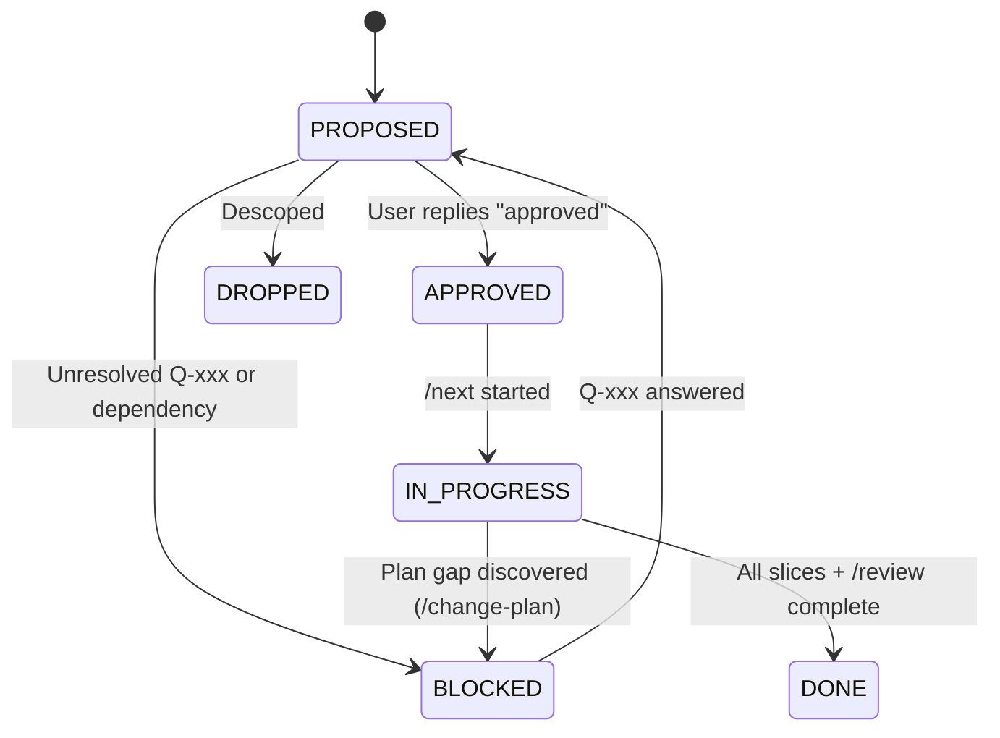

# Roadmap Conventions, Plan Template & Change Protocol

This document defines the binding conventions for planning, tracking, modifying, and executing roadmap items in the School/University ERP repository.

---

## 1. Identifier Scheme

- **Foundation Items (`F-01` .. `F-10`)**: Cross-cutting platform and tenant infrastructure stored in `docs/roadmap/foundation/F-<nn>-<slug>.md`.
- **Phase 1 Domain Modules (`M-01` .. `M-06`)**: Core school business modules stored in `docs/roadmap/phase-1/M-<nn>-<slug>.md`.
- **Open Questions (`Q-001` .. `Q-999`)**: Ambiguous business or product decisions tracked in `docs/roadmap/OPEN-QUESTIONS.md`.
- **Architecture Decision Records (`ADR 0001` ..)**: Stored in `docs/adr/<nnnn>-<slug>.md`.

---

## 2. Status Values & Lifecycle

Every roadmap item has exactly one status in both its plan file header and `docs/roadmap/README.md`:

| Status | Meaning |
|---|---|
| `PROPOSED` | Plan is drafted and complete, awaiting product owner review and open-question resolution. |
| `BLOCKED` | Plan cannot be approved or started because an upstream dependency or critical open question (`Q-xxx`) is unresolved. |
| `APPROVED` | Product owner has explicitly approved the plan; ready for implementation via `/next` once dependencies are `DONE`. |
| `IN_PROGRESS` | Currently being implemented slice-by-slice. Only one item should be `IN_PROGRESS` at a time unless explicitly parallelized. |
| `DONE` | All slices implemented, all tests (unit, integration, 2-school tenant isolation) passing, `/review` completed, docs updated. |
| `DROPPED` | Explicitly descoped or superseded; preserved in `docs/roadmap/` for historical context. |



---

## 3. Metadata Header Format

Every plan file (`F-xx`, `M-xx`) must start with this exact metadata table:

```markdown
# <ID>: <Title>

| Field | Value |
|---|---|
| **ID** | `<ID>` |
| **Title** | <Title> |
| **Status** | `PROPOSED` |
| **Priority** | `P0` / `P1` / `P2` |
| **Depends On** | `<comma-separated IDs or None>` |
| **Blocks** | `<comma-separated IDs>` |
| **Estimated Effort** | `S` (1-2d) / `M` (3-5d) / `L` (1-2w) / `XL` (2-3w) |
| **Open Questions** | `<Q-xxx, Q-yyy or None>` |
| **Revision** | `1` |
```

---

## 4. Mandatory 17-Section Plan Template

No section may be skipped, merged, or shortened in any plan file:

1. **Summary and Business Value**: 2–3 plain-language sentences explaining what this item delivers and why it matters to schools or operators.
2. **Scope and Explicit Non-Goals**: Bulleted list of what is in scope and what is explicitly excluded.
3. **Business Rules**: Numbered rules (`BR-01`, `BR-02`, ...). Any rule based on an unconfirmed product assumption must be tagged `[ASSUMPTION -> Q-xxx]` with a link to `OPEN-QUESTIONS.md`.
4. **Configurability**: Exact `app_settings` keys (with default values and types), feature flag name in `tenants.features_json`, Strategy interfaces / plug-in points, and customizable templates. Explain how a school or operator changes each one.
5. **Domain Model**: Entities, fields, value objects, relationships, and lifecycle state machines (with Mermaid diagrams).
6. **Database**: Flyway migration version and filename (`db/tenant/V<n>__*.sql` or `db/master/V<n>__*.sql`), complete table/column outline, foreign keys, indexes, soft-delete (`deleted_at`) strategy, and `DECIMAL(12,2)` money columns.
7. **API**: Table of endpoints (HTTP method, `/api/v1/...` path, request DTO, response DTO, required permission code `module.action`, and RBAC scope `ALL`/`DEPARTMENT`/`CLASS`/`SECTION`/`OWN`).
8. **Permissions to Seed and Default Role Grants**: Matrix of new `permissions` rows and which default roles (`SCHOOL_ADMIN`, `REGISTRAR`, `ACCOUNTANT`, `TEACHER`, `STUDENT`, `GUARDIAN`) receive them.
9. **Events and Notifications Emitted or Consumed**: Event class/name, payload schema, outbox routing key, and notification channel (`EMAIL`, `SMS`, `IN_APP`, `PUSH`).
10. **Tenancy and Security Considerations**: Physical isolation guarantees, `audit_log` actions written, Redis/S3/RabbitMQ key prefixes (`<tenantSlug>:...`), rate limits, and PII handling.
11. **Frontend**: Routes, pages, reusable components under `src/features/<module>`, `src/app/modules.ts` registration, feature-flag gating, and required `en` + `bn` i18n keys.
12. **Test Plan**: Unit tests, Testcontainers/MySQL integration tests, two-school (`alpha` vs `beta`) tenant isolation test, permission/scope boundary tests, and edge cases.
13. **Acceptance Criteria**: Non-developer-verifiable checklist of user-visible outcomes.
14. **Implementation Slices**: Ordered checkbox list (`- [ ] Slice 1: ...`) where each slice compiles and passes all tests independently.
15. **Risks and Mitigations**: High-risk areas (especially money, results, auth, tenant isolation) and concrete engineering mitigations.
16. **How to Extend or Customize Later**: Concrete examples showing how a future developer adds a new provider, grading rule, fee rule, or custom workflow without breaking existing tenants.
17. **Revision History**: Table tracking `Revision`, `Date`, `Author`, and `Changes`.

---

## 5. Definition of Done (Per Item)

An item can transition from `IN_PROGRESS` to `DONE` only when:
- [ ] All implementation slices in Section 14 are checked off.
- [ ] Backend compiles and `mvn verify` passes with zero warnings introduced.
- [ ] Frontend compiles (`npm run build`) with strict TypeScript (`no any`) and zero hardcoded UI strings.
- [ ] Flyway migration is added as a new versioned file (never editing an applied migration).
- [ ] Permissions are seeded and enforced on every controller/service method with `@PreAuthorize("@perm.has(...)")` or `@PreAuthorize("@perm.hasScoped(...)")`.
- [ ] Feature flag is enforced on both backend (`@RequiresFeature`) and frontend (`modules.ts`).
- [ ] Sensitive mutations record append-only entries via `AuditService`.
- [ ] OpenAPI annotations (`@Tag`, `@Operation`, `@Schema`) are present on all new endpoints and DTOs.
- [ ] Two-school tenant isolation test (`alpha` vs `beta`) passes.
- [ ] `/review` workflow passes with zero blocker or important findings.
- [ ] `docs/roadmap/README.md`, `docs/roadmap/CHANGELOG.md`, `docs/PROGRESS.md`, `docs/DOMAIN.md`, and `docs/ARCHITECTURE.md` are updated.

---

## 6. Change Protocol (`/change-plan`)

Whenever a requirement changes, an open question is answered differently than the assumed default, or implementation reveals a plan gap:
1. Run `/change-plan "<ID>: <description of change>"`.
2. Update the target plan file (`docs/roadmap/.../<ID>-*.md`) and increment its **Revision** number and Section 17 (`Revision History`).
3. Inspect all items listed in its **Blocks** field and update any affected downstream plans (bumping their revision numbers as well).
4. Update `docs/roadmap/OPEN-QUESTIONS.md` (if a question was resolved or added), `docs/roadmap/README.md`, and append an entry to `docs/roadmap/CHANGELOG.md`.
5. **STOP** and present a concise diff summary to the user for approval before writing or modifying any application code.
