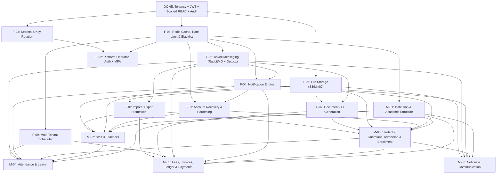

# School/University ERP — Master Product & Engineering Roadmap

This directory is the single source of truth for all planned Foundation (`F-01`..`F-10`) and Phase 1 Domain (`M-01`..`M-06`) work. Every session starts by reading this file alongside [`docs/PROGRESS.md`](../PROGRESS.md).

- **Conventions & 17-Section Template**: [`00-conventions.md`](./00-conventions.md)
- **Open Business Questions (`Q-001`..`Q-025`)**: [`OPEN-QUESTIONS.md`](./OPEN-QUESTIONS.md)
- **Roadmap & Plan Change Log**: [`CHANGELOG.md`](./CHANGELOG.md)
- **Workflows**: `/roadmap` (status check), `/next` (execute next approved item), `/change-plan` (amend a plan and cascade to dependents)

---

## 1. Already Built (`DONE` Prior to Roadmap)

| Capability | Location | Migration |
|---|---|---|
| Database-per-school tenancy (`TenantFilter`, `TenantContext`, `TenantRoutingDataSource`, `TenantRegistry`) | `com.schoolerp.shared.tenancy` | `db/master/V1__create_tenants.sql` |
| Platform provisioning & initial `SCHOOL_ADMIN` seeding | `com.schoolerp.platform` | `db/tenant/V1__core_schema.sql`, `V2__seed_defaults.sql` |
| JWT access tokens (`tenant` claim) + rotating refresh tokens with reuse detection | `com.schoolerp.iam`, `com.schoolerp.shared.security` | `db/tenant/V3__security_and_rbac.sql` |
| Scoped RBAC (`@perm.has` / `@perm.hasScoped` with `ALL`, `DEPARTMENT`, `CLASS`, `SECTION`, `OWN`) | `com.schoolerp.shared.security.PermissionChecker` | `db/tenant/V3__security_and_rbac.sql` |
| Feature flag enforcement (`@RequiresFeature`), login rate limiting, append-only `AuditService`, OpenAPI 3 / Swagger UI | `com.schoolerp.shared.*` | — |

---

## 2. Roadmap Status Table

| ID | Title | Category | Status | Priority | Depends On | Effort | Blocking Questions | Rev | Plan File |
|---|---|---|---|---|---|---|---|---|---|
| **F-08** | Redis Caching, Distributed Rate Limiting & Token Blacklist | Foundation | `DONE` | `P0` | None | `S` | `Q-001` (Resolved) | `1` | [`foundation/F-08-redis-cache-and-rate-limiting.md`](./foundation/F-08-redis-cache-and-rate-limiting.md) |
| **F-05** | Async Messaging (RabbitMQ) & Transactional Outbox | Foundation | `DONE` | `P0` | `F-08` | `M` | None ([ADR 0002](../adr/0002-async-message-broker-rabbitmq.md)) | `1` | [`foundation/F-05-async-messaging-and-outbox.md`](./foundation/F-05-async-messaging-and-outbox.md) |
| **F-06** | Tenant-Isolated File Storage (S3/MinIO) & Malware Scan | Foundation | `DONE` | `P0` | None | `M` | `Q-005`, `Q-014` (Resolved) | `1` | [`foundation/F-06-file-storage.md`](./foundation/F-06-file-storage.md) |
| **F-04** | Multi-Channel Notification Engine (Email, SMS, In-App) | Foundation | `IN_PROGRESS` | `P0` | `F-05`, `F-08` | `L` | `Q-003`, `Q-004` (Resolved) | `1` | [`foundation/F-04-notification-engine.md`](./foundation/F-04-notification-engine.md) |
| **F-01** | Account Recovery & Security Hardening | Foundation | `APPROVED` | `P0` | `F-04`, `F-08` | `M` | `Q-001`, `Q-002`, `Q-011`, `Q-020` (Resolved) | `1` | [`foundation/F-01-account-recovery-and-hardening.md`](./foundation/F-01-account-recovery-and-hardening.md) |
| **M-01** | Institution & Academic Structure | Phase 1 | `APPROVED` | `P0` | `F-08` | `L` | `Q-006`, `Q-018` (Resolved) | `1` | [`phase-1/M-01-institution-and-academic-structure.md`](./phase-1/M-01-institution-and-academic-structure.md) |
| **F-07** | Branded Document & PDF Generation Engine | Foundation | `APPROVED` | `P1` | `F-05`, `F-06` | `M` | `Q-015` (Resolved) | `1` | [`foundation/F-07-document-and-pdf-generation.md`](./foundation/F-07-document-and-pdf-generation.md) |
| **F-09** | Multi-Tenant Distributed Scheduler & Job History | Foundation | `APPROVED` | `P1` | `F-08` | `S` | `Q-016` (Resolved) | `1` | [`foundation/F-09-tenant-scheduler.md`](./foundation/F-09-tenant-scheduler.md) |
| **F-10** | Bulk CSV/Excel Import & Export Framework | Foundation | `APPROVED` | `P1` | `F-05`, `F-06` | `M` | `Q-017` (Resolved) | `1` | [`foundation/F-10-import-export-framework.md`](./foundation/F-10-import-export-framework.md) |
| **M-02** | Staff, Teachers & Subject-Section Assignments | Phase 1 | `IN_PROGRESS` | `P0` | `F-01`, `F-04`, `F-06`, `F-10`, `M-01` | `L` | `Q-019` (Resolved) | `1` | [`phase-1/M-02-staff-and-teachers.md`](./phase-1/M-02-staff-and-teachers.md) |
| **M-03** | Students, Guardians, Admission & Enrollment | Phase 1 | `APPROVED` | `P0` | `F-01`, `F-04`, `F-06`, `F-07`, `F-10`, `M-01` | `XL` | `Q-007`, `Q-018`, `Q-020`, `Q-021` (Resolved) | `1` | [`phase-1/M-03-students-guardians-admission-enrollment.md`](./phase-1/M-03-students-guardians-admission-enrollment.md) |
| **M-04** | Student & Staff Attendance with Leave & Alerts | Phase 1 | `APPROVED` | `P0` | `F-04`, `F-05`, `F-09`, `M-01`, `M-02`, `M-03` | `L` | `Q-008`, `Q-022` (Resolved) | `1` | [`phase-1/M-04-attendance.md`](./phase-1/M-04-attendance.md) |
| **M-06** | Notice Board & Targeted School Communication | Phase 1 | `APPROVED` | `P1` | `F-04`, `F-05`, `F-06`, `M-01`, `M-03` | `M` | `Q-004`, `Q-025` (Resolved) | `1` | [`phase-1/M-06-notices-and-communication.md`](./phase-1/M-06-notices-and-communication.md) |
| **M-05** | Fees, Invoices, Immutable Ledger & Payment Gateways | Phase 1 | `APPROVED` | `P0` | `F-04`, `F-05`, `F-07`, `F-09`, `F-10`, `M-01`, `M-03` | `XL` | `Q-009`, `Q-010`, `Q-015`, `Q-023`, `Q-024` (Resolved) | `1` | [`phase-1/M-05-fees-and-payments.md`](./phase-1/M-05-fees-and-payments.md) |
| **F-03** | Secrets & Key Management with Envelope Rotation | Foundation | `APPROVED` | `P1` | None | `S` | `Q-013` (Resolved) | `1` | [`foundation/F-03-secrets-and-key-management.md`](./foundation/F-03-secrets-and-key-management.md) |
| **F-02** | Platform Operator Authentication & TOTP MFA | Foundation | `APPROVED` | `P1` | `F-03`, `F-08` | `M` | `Q-012` (Resolved) | `1` | [`foundation/F-02-platform-operator-authentication.md`](./foundation/F-02-platform-operator-authentication.md) |

---

## 3. Dependency Graph

---

## 4. Recommended Build Order & Engineering Critique

### Your Suggested Order
`F-08 -> F-05 -> F-06 -> F-04 -> F-01 -> F-07 -> F-09 -> F-10 -> M-01 -> M-02 -> M-03 -> M-04 -> M-06 -> M-05 -> F-02 -> F-03`

### Recommended Order (With 2 Targeted Improvements)

| Step | Item | Why at This Position |
|---|---|---|
| **1** | **F-08** (Redis Cache, Rate Limiting, Token Blacklist) | Unblocks distributed lock (`F-09`), SMS quota counters (`F-04`), account lockout & session revocation (`F-01`), and tenant config caching. |
| **2** | **F-05** (RabbitMQ + Transactional Outbox) | Unblocks async notifications (`F-04`), PDF rendering (`F-07`), and bulk imports (`F-10`). |
| **3** | **F-06** (File Storage S3/MinIO) | Unblocks PDF storage (`F-07`), import files (`F-10`), and student/staff/notice attachments. |
| **4** | **F-04** (Notification Engine) | Unblocks password reset emails/SMS in `F-01` and all domain alerts (`M-02`..`M-06`). |
| **5** | **F-01** (Account Recovery & Security Hardening) | Completes the end-user login/reset/session UI before onboarding school staff and guardians. |
| **6** | **M-01** (Institution & Academic Structure) ⚡ *(Moved earlier)* | **Challenge #1**: `M-01` does **not** depend on `F-07` (PDF), `F-09` (Scheduler), or `F-10` (Import/Export). Building `M-01` right after `F-01` delivers the first visible school domain module early, validates our `DEPARTMENT`/`CLASS`/`SECTION` RBAC scopes against real tables, and lets stakeholders test academic setup while `F-07..F-10` are built. |
| **7** | **F-07** (Document & PDF Generation) | Needed right before `M-03` (Admission forms & Student ID cards) and `M-05` (Fee receipts). |
| **8** | **F-09** (Multi-Tenant Scheduler) | Needed before `M-04` (scheduled absence alerts) and `M-05` (overdue fee reminders & gateway reconciliation). |
| **9** | **F-10** (Import/Export Framework) | Needed right before `M-02` (bulk staff import) and `M-03` (bulk student import). |
| **10** | **M-02** (Staff & Teachers) | Assigns teachers to sections/subjects from `M-01` and populates scoped `user_roles` required by `M-04`. |
| **11** | **M-03** (Students, Guardians, Admission & Enrollment) | Establishes `Student`, `Guardian`, and per-session `Enrollment` required by `M-04`, `M-05`, and `M-06`. |
| **12** | **M-04** (Attendance) | Uses `M-01` sections/subjects, `M-02` teacher scopes, `M-03` enrollments/guardians, and `F-04`/`F-09` alerts. |
| **13** | **M-06** (Notices & Communication) | Lower risk than `M-05`; exercises targeted guardian/student messaging before high-risk financial workflows. |
| **14** | **M-05** (Fees, Invoices, Ledger & Payments) | Highest risk module; benefits from stable `M-01` sessions, `M-03` enrollments, `F-07` PDF receipts, `F-09` scheduler, and `F-04` notifications. |
| **15** | **F-03** (Secrets & Key Rotation) ⚡ *(Swapped before `F-02`)* | **Challenge #2**: `F-03` introduces versioned encryption envelopes (`v1:<ciphertext>`) for `school_master.tenants.db_password_enc` and TOTP secrets. Building `F-03` **before** `F-02` ensures operator TOTP secrets (`platform_operators.mfa_secret_enc`) are encrypted with the versioned keyring from day one, avoiding a redundant migration. |
| **16** | **F-02** (Platform Operator Auth & TOTP MFA) | Replaces static `X-Platform-Key` before production launch. |

---

## 5. Phase 1 Modules — Foundation Dependencies, Feature Flags & Settings Matrix

| Module | Depends On (`F` & `M`) | Feature Flag (`features_json`) | Default Plans | Key `app_settings` Introduced |
|---|---|---|---|---|
| **M-01** Institution & Academic Structure | `F-08` | `academic` (core, always enabled) | `BASIC`, `PRO`, `ENTERPRISE` | `academic.session_type` (`YEARLY`), `academic.multi_campus` (`false`), `academic.use_departments` (`false`), `academic.shift_enabled` (`true`) |
| **M-02** Staff & Teachers | `F-01`, `F-04`, `F-06`, `F-10`, `M-01` | `staff` (core) / `hr` (advanced) | `BASIC`, `PRO`, `ENTERPRISE` | `staff.code_template` (`EMP-{YEAR}-{SEQ:4}`), `staff.auto_create_user` (`true`) |
| **M-03** Students, Guardians, Admission & Enrollment | `F-01`, `F-04`, `F-06`, `F-07`, `F-10`, `M-01` | `students` | `BASIC`, `PRO`, `ENTERPRISE` | `student.id_template` (`{YEAR}{CLASS_CODE}{SEQ:4}`), `admission.require_approval` (`true`), `admission.auto_enroll_on_approve` (`false`) |
| **M-04** Attendance | `F-04`, `F-05`, `F-09`, `M-01`, `M-02`, `M-03` | `attendance` | `BASIC`, `PRO`, `ENTERPRISE` | `attendance.mode` (`DAILY_SECTION`), `attendance.edit_window_hours` (`48`), `attendance.notify_absent_sms` (`true`), `attendance.notify_delay_minutes` (`30`) |
| **M-05** Fees & Payments | `F-04`, `F-05`, `F-07`, `F-09`, `F-10`, `M-01`, `M-03` | `fees` | `BASIC`, `PRO`, `ENTERPRISE` | `fees.currency` (`BDT`), `fees.allow_partial_payment` (`true`), `fees.allocation_order` (`FINE,ARREARS,TUITION,OTHER`), `fees.waiver_auto_approve_limit` (`0.00`), `fees.active_gateways` (`OFFLINE,SSLCOMMERZ,BKASH`) |
| **M-06** Notices & Communication | `F-04`, `F-05`, `F-06`, `M-01`, `M-03` | `notices` | `BASIC`, `PRO`, `ENTERPRISE` | `notices.teacher_require_approval` (`false`), `notices.allow_sms_broadcast` (`true`) |
