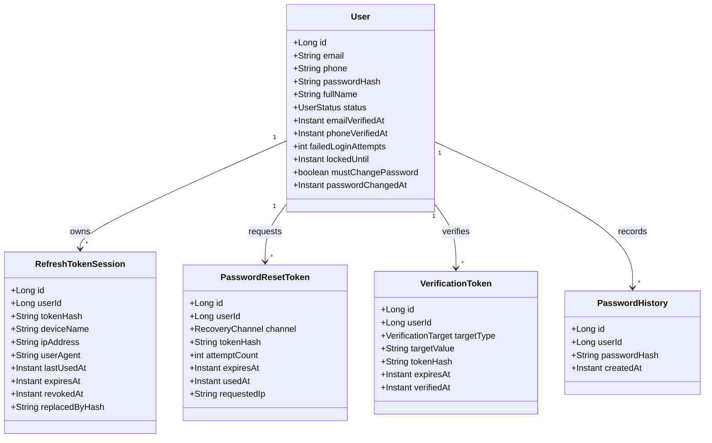
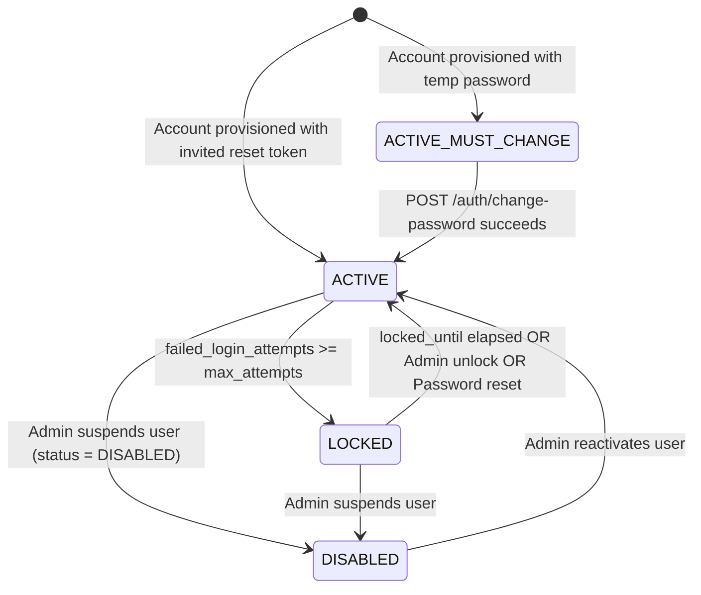

# F-01: Account Recovery and Security Hardening

| Field | Value |
|---|---|
| **ID** | `F-01` |
| **Title** | Account Recovery and Security Hardening |
| **Status** | `PROPOSED` |
| **Priority** | `P0` |
| **Depends On** | `F-04, F-08` |
| **Blocks** | `M-02, M-03` |
| **Estimated Effort** | `M` |
| **Open Questions** | `Q-001, Q-002, Q-011, Q-020` |
| **Revision** | `1` |

---

## 1. Summary and Business Value

`F-01` completes the tenant-level Identity & Access Management (`com.schoolerp.iam`) lifecycle by introducing self-service password reset, email and mobile number verification, brute-force account lockout, configurable password complexity/history policies, active device session management, and the corresponding React authentication and security pages. This eliminates administrator bottlenecks from forgotten passwords when onboarding thousands of staff (`M-02`), students, and guardians (`M-03`), while protecting school accounts against credential stuffing and session hijacking.

---

## 2. Scope and Explicit Non-Goals

### In Scope
- Adding optional mobile phone login identity (`users.phone`), verification timestamps (`email_verified_at`, `phone_verified_at`), lockout tracking (`failed_login_attempts`, `locked_until`), and forced password change flag (`must_change_password`, `password_changed_at`) to `users`.
- Self-service password reset request and token redemption (`password_reset_tokens`) via Email (token link) or SMS (6-digit OTP) dispatched through `F-04`.
- Email and phone verification token generation and confirmation (`verification_tokens`).
- Account-level brute-force lockout after $N$ consecutive failed login attempts within a sliding window, backed by `F-08` Redis counters with MySQL fallback (`users.failed_login_attempts`, `users.locked_until`), plus admin manual unlock.
- Configurable per-school password complexity policy and password history (`password_history` table) preventing reuse of recent passwords.
- Device/session metadata on `refresh_tokens` (`ip_address`, `user_agent`, `device_name`, `last_used_at`), maximum concurrent active session cap with oldest-session eviction, and user/admin endpoints to list and revoke individual or all active sessions.
- Complete React authentication UI (`/login`, `/forgot-password`, `/reset-password`, `/verify-contact`) and self-service security settings (`/profile/security`).

### Explicit Non-Goals
- Platform operator accounts and TOTP MFA for platform console (`F-02`).
- Social/OAuth2/OIDC SSO login (Google Workspace / Microsoft Entra ID) — deferred to Phase 2.
- Biometric/WebAuthn passkeys for tenant users — deferred to Phase 2.

---

## 3. Business Rules

- **BR-01 (`[ASSUMPTION -> Q-020]` — Dual Login Identity)**: A tenant user may authenticate using either their normalized email address (`users.email`) or their E.164 mobile phone number (`users.phone`, e.g., `+8801712345678`) via a single `identifier` field on `POST /api/v1/auth/login`. See [`OPEN-QUESTIONS.md`](../OPEN-QUESTIONS.md#q-011--q-025-summary-defaults).
- **BR-02 (`[ASSUMPTION -> Q-001]` — Account Lockout Threshold & Cooldown)**: After `security.lockout.max_attempts` (default `5`) consecutive failed login attempts within `security.lockout.window_minutes` (default `15`), the user account is locked for `security.lockout.duration_minutes` (default `15`). Login attempts while locked return HTTP `423 Locked` (`ProblemDetail` with `retryAfterSeconds`) without verifying the password hash. A successful login or an explicit `SCHOOL_ADMIN` unlock (`POST /api/v1/users/{id}/unlock`) resets the counter to `0` and clears `locked_until`. See [`OPEN-QUESTIONS.md`](../OPEN-QUESTIONS.md#q-001-account-lockout-threshold--duration-f-01-f-08).
- **BR-03 (`[ASSUMPTION -> Q-002]` — Password Complexity & History Policy)**: New passwords must satisfy the school's configured minimum length (`security.password.min_length`, default `8`), character class rules (`require_uppercase=true`, `require_lowercase=true`, `require_digit=true`, `require_special=false`), and must not match any of the user's last `security.password.history_count` (default `3`) BCrypt password hashes stored in `password_history`. Passwords do not expire periodically by default (`security.password.max_age_days = 0`). See [`OPEN-QUESTIONS.md`](../OPEN-QUESTIONS.md#q-002-password-policy--expiry-rules-f-01).
- **BR-04 (Zero-Enumeration Password Reset)**: `POST /api/v1/auth/forgot-password` always returns HTTP `202 Accepted` with an identical generic response regardless of whether the email/phone exists or is active in the tenant database.
- **BR-05 (Reset Token Hashing & Single Use)**: Raw password reset tokens (32-byte URL-safe random token for email; 6-digit CSPRNG numeric code for SMS) are never stored in plaintext; only their SHA-256 hex digest (`token_hash`) is persisted in `password_reset_tokens`. Reset tokens expire after `security.reset_token.ttl_minutes` (default `15` minutes), allow at most 3 verification attempts for SMS OTPs, and are marked `used_at = NOW()` upon redemption. All other active reset tokens and all existing `refresh_tokens` for that user are atomically revoked upon password reset.
- **BR-06 (`[ASSUMPTION -> Q-011]` — Concurrent Session Limit & Eviction)**: Each user may hold at most `security.session.max_concurrent` (default `5`) active (non-revoked, non-expired) `refresh_tokens`. Creating a 6th session automatically revokes (`revoked_at = NOW()`) the session with the oldest `last_used_at` timestamp. See [`OPEN-QUESTIONS.md`](../OPEN-QUESTIONS.md#q-011--q-025-summary-defaults).
- **BR-07 (Password Change Revokes Other Sessions)**: When an authenticated user changes their password via `POST /api/v1/auth/change-password`, all `refresh_tokens` belonging to that user (except the current session's refresh token, if supplied) are revoked immediately, and `must_change_password` is set to `FALSE`.
- **BR-08 (Forced Password Change on First Login)**: Accounts provisioned by `SCHOOL_ADMIN` or bulk import (`M-02`, `M-03`, `F-10`) with a temporary password have `must_change_password = TRUE`. While `must_change_password = TRUE`, the login response sets `mustChangePassword: true` and the user can only invoke `/api/v1/auth/change-password` and `/api/v1/auth/logout`; other tenant API calls return `403 Forbidden` with error code `PASSWORD_CHANGE_REQUIRED`.

---

## 4. Configurability

### Per-School Settings (`app_settings`)

| Setting Key | Type | Default | Description | How Changed |
|---|---|---|---|---|
| `security.lockout.max_attempts` | `INTEGER` | `5` | Consecutive failed login attempts before temporary lockout | `PUT /api/v1/settings` (`settings.write`) |
| `security.lockout.window_minutes` | `INTEGER` | `15` | Sliding window in minutes for counting failed login attempts | `PUT /api/v1/settings` (`settings.write`) |
| `security.lockout.duration_minutes` | `INTEGER` | `15` | Lockout duration in minutes once threshold is reached | `PUT /api/v1/settings` (`settings.write`) |
| `security.password.min_length` | `INTEGER` | `8` | Minimum password character length (min allowed: 8, max: 64) | `PUT /api/v1/settings` (`settings.write`) |
| `security.password.require_uppercase` | `BOOLEAN` | `true` | Require at least one uppercase letter (`A-Z`) | `PUT /api/v1/settings` (`settings.write`) |
| `security.password.require_lowercase` | `BOOLEAN` | `true` | Require at least one lowercase letter (`a-z`) | `PUT /api/v1/settings` (`settings.write`) |
| `security.password.require_digit` | `BOOLEAN` | `true` | Require at least one numeric digit (`0-9`) | `PUT /api/v1/settings` (`settings.write`) |
| `security.password.require_special` | `BOOLEAN` | `false` | Require at least one symbol (`!@#$%^&*...`) | `PUT /api/v1/settings` (`settings.write`) |
| `security.password.history_count` | `INTEGER` | `3` | Number of previous passwords disallowed on change/reset (`0`–`10`) | `PUT /api/v1/settings` (`settings.write`) |
| `security.password.max_age_days` | `INTEGER` | `0` | Days before password expires (`0` = never expires) | `PUT /api/v1/settings` (`settings.write`) |
| `security.reset_token.ttl_minutes` | `INTEGER` | `15` | Validity window for password reset link / OTP | `PUT /api/v1/settings` (`settings.write`) |
| `security.session.max_concurrent` | `INTEGER` | `5` | Max concurrent active refresh token sessions per user | `PUT /api/v1/settings` (`settings.write`) |
| `security.login.allow_phone` | `BOOLEAN` | `true` | Allow login and password reset via `users.phone` in addition to email | `PUT /api/v1/settings` (`settings.write`) |

### Feature Flags (`tenants.features_json`)
- Core authentication and account recovery are baseline capabilities enabled for every active school (no module feature flag required to log in or reset passwords).
- SMS-based OTP recovery automatically checks whether the `sms` / notification channel is configured in `F-04`; if SMS is disabled for the school, recovery falls back to `EMAIL` only.

### Strategy Interfaces & Templates
- `PasswordPolicyValidator` reads school settings via `SettingsService` and evaluates candidate passwords against length, character classes, and `PasswordHistoryRepository`.
- Notification templates in `F-04` (`AUTH_PASSWORD_RESET_EMAIL`, `AUTH_PASSWORD_RESET_SMS`, `AUTH_VERIFY_EMAIL`, `AUTH_VERIFY_PHONE`, `AUTH_ACCOUNT_LOCKED_EMAIL`) are customizable per school in English (`en`) and Bangla (`bn`).

---

## 5. Domain Model



### Account Security & Lockout State Machine



---

## 6. Database

- **Flyway Migration**: `backend/src/main/resources/db/tenant/V8__account_recovery_and_hardening.sql`
- **Soft-Delete Strategy**: `users` already has `deleted_at TIMESTAMP(6) NULL`. Child security tables (`password_reset_tokens`, `verification_tokens`, `password_history`) are append/ephemeral security logs tied to `users(id)` and do not use soft-delete.
- **Money Columns**: None.

```sql
-- V8__account_recovery_and_hardening.sql
-- Enhances users & refresh_tokens and adds password reset, verification, and history tables.

ALTER TABLE users
    ADD COLUMN phone                  VARCHAR(30)  NULL AFTER email,
    ADD COLUMN email_verified_at      TIMESTAMP(6) NULL AFTER status,
    ADD COLUMN phone_verified_at      TIMESTAMP(6) NULL AFTER email_verified_at,
    ADD COLUMN failed_login_attempts  INT          NOT NULL DEFAULT 0 AFTER phone_verified_at,
    ADD COLUMN locked_until           TIMESTAMP(6) NULL AFTER failed_login_attempts,
    ADD COLUMN must_change_password   BOOLEAN      NOT NULL DEFAULT FALSE AFTER locked_until,
    ADD COLUMN password_changed_at    TIMESTAMP(6) NULL AFTER must_change_password,
    ADD UNIQUE KEY uk_users_phone (phone),
    ADD KEY idx_users_status_locked (status, locked_until);

ALTER TABLE refresh_tokens
    ADD COLUMN device_name   VARCHAR(120) NULL AFTER token_hash,
    ADD COLUMN ip_address    VARCHAR(45)  NULL AFTER device_name,
    ADD COLUMN user_agent    VARCHAR(500) NULL AFTER ip_address,
    ADD COLUMN last_used_at  TIMESTAMP(6) NOT NULL DEFAULT CURRENT_TIMESTAMP(6) AFTER user_agent,
    ADD KEY idx_rt_user_active (user_id, revoked_at, expires_at);

CREATE TABLE password_reset_tokens (
    id             BIGINT       NOT NULL AUTO_INCREMENT,
    user_id        BIGINT       NOT NULL,
    channel        VARCHAR(16)  NOT NULL,
    token_hash     VARCHAR(64)  NOT NULL,
    attempt_count  INT          NOT NULL DEFAULT 0,
    requested_ip   VARCHAR(45)  NULL,
    expires_at     TIMESTAMP(6) NOT NULL,
    used_at        TIMESTAMP(6) NULL,
    created_at     TIMESTAMP(6) NOT NULL DEFAULT CURRENT_TIMESTAMP(6),
    PRIMARY KEY (id),
    UNIQUE KEY uk_prt_token_hash (token_hash),
    KEY idx_prt_user_expires (user_id, expires_at),
    CONSTRAINT fk_prt_user FOREIGN KEY (user_id) REFERENCES users (id)
) ENGINE=InnoDB DEFAULT CHARSET=utf8mb4;

CREATE TABLE verification_tokens (
    id            BIGINT       NOT NULL AUTO_INCREMENT,
    user_id       BIGINT       NOT NULL,
    target_type   VARCHAR(16)  NOT NULL,
    target_value  VARCHAR(190) NOT NULL,
    token_hash    VARCHAR(64)  NOT NULL,
    expires_at    TIMESTAMP(6) NOT NULL,
    verified_at   TIMESTAMP(6) NULL,
    created_at    TIMESTAMP(6) NOT NULL DEFAULT CURRENT_TIMESTAMP(6),
    PRIMARY KEY (id),
    UNIQUE KEY uk_vt_token_hash (token_hash),
    KEY idx_vt_user_target (user_id, target_type, expires_at),
    CONSTRAINT fk_vt_user FOREIGN KEY (user_id) REFERENCES users (id)
) ENGINE=InnoDB DEFAULT CHARSET=utf8mb4;

CREATE TABLE password_history (
    id             BIGINT       NOT NULL AUTO_INCREMENT,
    user_id        BIGINT       NOT NULL,
    password_hash  VARCHAR(255) NOT NULL,
    created_at     TIMESTAMP(6) NOT NULL DEFAULT CURRENT_TIMESTAMP(6),
    PRIMARY KEY (id),
    KEY idx_ph_user_created (user_id, created_at),
    CONSTRAINT fk_ph_user FOREIGN KEY (user_id) REFERENCES users (id)
) ENGINE=InnoDB DEFAULT CHARSET=utf8mb4;

-- Seed initial password history from existing users
INSERT INTO password_history (user_id, password_hash, created_at)
SELECT id, password_hash, created_at FROM users;

-- Seed default security settings into app_settings
INSERT INTO app_settings (setting_key, setting_value) VALUES
    ('security.lockout.max_attempts',       '5'),
    ('security.lockout.window_minutes',     '15'),
    ('security.lockout.duration_minutes',   '15'),
    ('security.password.min_length',        '8'),
    ('security.password.require_uppercase', 'true'),
    ('security.password.require_lowercase', 'true'),
    ('security.password.require_digit',     'true'),
    ('security.password.require_special',   'false'),
    ('security.password.history_count',     '3'),
    ('security.password.max_age_days',      '0'),
    ('security.reset_token.ttl_minutes',    '15'),
    ('security.session.max_concurrent',     '5'),
    ('security.login.allow_phone',          'true')
ON DUPLICATE KEY UPDATE setting_value = VALUES(setting_value);

-- Seed new permissions
INSERT INTO permissions (code, description) VALUES
    ('user.unlock',         'Unlock locked user accounts and trigger password resets'),
    ('session.read',        'View active login sessions for users'),
    ('session.revoke',      'Revoke active login sessions for users');

INSERT INTO role_permissions (role_id, permission_id)
SELECT r.id, p.id
FROM roles r
JOIN permissions p ON p.code IN ('user.unlock', 'session.read', 'session.revoke')
WHERE r.code = 'SCHOOL_ADMIN';
```

---

## 7. API

All endpoints are prefixed with `/api/v1` and resolve the school via `TenantFilter` (`X-Tenant-ID` or subdomain).

| HTTP Method | Path | Request DTO | Response DTO | Permission | RBAC Scope |
|---|---|---|---|---|---|
| `POST` | `/api/v1/auth/login` | `LoginRequest(identifier, password, deviceName)` | `AuthTokensResponse(accessToken, refreshToken, expiresIn, mustChangePassword, user)` | Public (Rate-limited) | N/A |
| `POST` | `/api/v1/auth/forgot-password` | `ForgotPasswordRequest(identifier, channel)` | `AcceptedMessageResponse(message)` | Public (Rate-limited) | N/A |
| `POST` | `/api/v1/auth/reset-password` | `ResetPasswordRequest(identifier, token, newPassword)` | `AcceptedMessageResponse(message)` | Public (Rate-limited) | N/A |
| `POST` | `/api/v1/auth/change-password` | `ChangePasswordRequest(currentPassword, newPassword, keepCurrentSession)` | `AcceptedMessageResponse(message)` | Authenticated (Any user) | `OWN` |
| `POST` | `/api/v1/auth/verify/send` | `SendVerificationRequest(targetType)` | `AcceptedMessageResponse(message)` | Authenticated (Any user) | `OWN` |
| `POST` | `/api/v1/auth/verify/confirm` | `ConfirmVerificationRequest(targetType, token)` | `VerificationStatusResponse(emailVerified, phoneVerified)` | Public / Authenticated | `OWN` |
| `GET` | `/api/v1/auth/password-policy` | — | `PasswordPolicyResponse(minLength, requireUppercase, requireLowercase, requireDigit, requireSpecial)` | Public | N/A |
| `GET` | `/api/v1/auth/sessions` | `PageRequest(page, size)` | `PageResponse<UserSessionDto>` | Authenticated (Any user) | `OWN` |
| `DELETE` | `/api/v1/auth/sessions/{sessionId}` | — | `204 No Content` | Authenticated (Any user) | `OWN` |
| `DELETE` | `/api/v1/auth/sessions` | `RevokeAllSessionsRequest(keepCurrentRefreshToken)` | `204 No Content` | Authenticated (Any user) | `OWN` |
| `POST` | `/api/v1/users/{userId}/unlock` | `UnlockUserRequest(reason)` | `UserSummaryDto` | `user.unlock` | `ALL` |
| `POST` | `/api/v1/users/{userId}/force-password-reset` | `AdminForceResetRequest(channel)` | `AcceptedMessageResponse(message)` | `user.unlock` | `ALL` |
| `GET` | `/api/v1/users/{userId}/sessions` | `PageRequest(page, size)` | `PageResponse<UserSessionDto>` | `session.read` | `ALL` |
| `DELETE` | `/api/v1/users/{userId}/sessions/{sessionId}` | — | `204 No Content` | `session.revoke` | `ALL` |

---

## 8. Permissions to Seed and Default Role Grants

| Permission Code | Description | `SCHOOL_ADMIN` | `REGISTRAR` | `ACCOUNTANT` | `TEACHER` | `STUDENT` | `GUARDIAN` |
|---|---|:---:|:---:|:---:|:---:|:---:|:---:|
| `user.unlock` | Unlock locked user accounts and trigger admin password resets | Yes (`ALL`) | No | No | No | No | No |
| `session.read` | View active device sessions of any user in the school | Yes (`ALL`) | No | No | No | No | No |
| `session.revoke` | Revoke active device sessions of any user in the school | Yes (`ALL`) | No | No | No | No | No |

*(Note: Self-service endpoints under `/api/v1/auth/change-password` and `/api/v1/auth/sessions` operate strictly on `SecurityContextHolder`'s authenticated `userId` (`OWN` scope) and are accessible to all authenticated roles.)*

---

## 9. Events and Notifications Emitted or Consumed

All events are persisted in the tenant outbox (`F-05`) within the same database transaction and dispatched by `F-04`.

| Event Class | Outbox Routing Key | Channel | Template Code | Trigger |
|---|---|---|---|---|
| `PasswordResetRequestedEvent` | `iam.password_reset.requested` | `EMAIL` or `SMS` | `AUTH_PASSWORD_RESET_EMAIL` / `AUTH_PASSWORD_RESET_SMS` | User requests forgot-password or admin triggers force-reset |
| `PasswordChangedEvent` | `iam.password.changed` | `EMAIL`, `IN_APP` | `AUTH_PASSWORD_CHANGED` | Password changed or reset completed |
| `AccountLockedEvent` | `iam.account.locked` | `EMAIL` | `AUTH_ACCOUNT_LOCKED_EMAIL` | Consecutive failed logins reach `security.lockout.max_attempts` |
| `ContactVerificationRequestedEvent` | `iam.verification.requested` | `EMAIL` or `SMS` | `AUTH_VERIFY_EMAIL` / `AUTH_VERIFY_PHONE` | User requests email or phone verification |

---

## 10. Tenancy and Security Considerations

- **Physical Tenant Isolation**: `password_reset_tokens`, `verification_tokens`, `password_history`, and `refresh_tokens` reside inside each school's dedicated database (`school_<slug>`). A reset token generated in `school_alpha` does not exist in `school_beta`.
- **Redis Key Namespacing (`F-08`)**: Failed login counters and forgot-password rate limit buckets in Redis are strictly prefixed with `<tenantSlug>:auth:lockout:<userId>` and `<tenantSlug>:ratelimit:forgot-pwd:<ip>`.
- **Audit Logging (`audit_log`)**: Append-only entries are recorded for:
  - `AUTH_LOGIN_LOCKED` (actor: target `userId`, entity: `User`, metadata: IP)
  - `AUTH_USER_UNLOCKED` (actor: admin `userId`, entity: `User`, reason)
  - `AUTH_PASSWORD_RESET_REQUESTED` (actor: `userId` or admin `userId`, channel)
  - `AUTH_PASSWORD_RESET_COMPLETED` (actor: `userId`)
  - `AUTH_PASSWORD_CHANGED` (actor: `userId`)
  - `AUTH_SESSION_REVOKED` (actor: `userId` or admin `userId`, entity: `RefreshToken`, `sessionId`)
  - `AUTH_CONTACT_VERIFIED` (actor: `userId`, target: `EMAIL`/`PHONE`)
- **Rate Limits (`F-08`)**:
  - `POST /api/v1/auth/login`: 10 requests / minute / IP + tenant.
  - `POST /api/v1/auth/forgot-password`: 3 requests / 15 minutes / IP + tenant and 3 requests / hour / target user.
  - `POST /api/v1/auth/reset-password`: 5 requests / 15 minutes / IP + tenant.
- **PII & Secret Handling**: Never log raw passwords, raw reset tokens, OTPs, or refresh tokens. Mask email (`t***@school.edu`) and phone (`+88017****5678`) in logs.

---

## 11. Frontend

### Routes and Pages (`src/features/auth`)
- `/login` (`LoginPage.tsx`): Email or mobile phone login form, tenant branding header (`school.display_name`, `brand.primary_color`), lockout countdown alert, redirect to `/change-password` if `mustChangePassword === true`.
- `/forgot-password` (`ForgotPasswordPage.tsx`): Channel selector (`EMAIL` / `SMS` if phone login enabled), identifier input, generic confirmation state.
- `/reset-password` (`ResetPasswordPage.tsx`): Reads `?token=` query param or accepts 6-digit SMS OTP, renders live password policy checklist (`PasswordPolicyChecklist.tsx`), submits new password.
- `/verify-contact` (`VerifyContactPage.tsx`): Email link auto-confirmation or 6-digit phone OTP input.
- `/profile/security` (`ProfileSecurityPage.tsx`): Change password form, verification status badges for email/phone, active device sessions table (`ActiveSessionsTable.tsx`) with current-session badge, "Revoke" per row, and "Sign out all other devices" button.
- Admin extension in `src/features/users`: "Locked" badge on user list, "Unlock Account" and "Send Password Reset" actions, and "Active Sessions" drawer for `SCHOOL_ADMIN`.

### Module Registration (`src/app/modules.ts`)
- Registers `/profile/security` under user profile navigation (always enabled for authenticated users).

### Required i18n Keys (`en` and `bn`)

| i18n Key | English (`en`) | Bangla (`bn`) |
|---|---|---|
| `auth.login.title` | Sign in to your school account | আপনার স্কুল অ্যাকাউন্টে সাইন ইন করুন |
| `auth.login.identifierLabel` | Email address or mobile number | ইমেইল ঠিকানা বা মোবাইল নম্বর |
| `auth.login.passwordLabel` | Password | পাসওয়ার্ড |
| `auth.login.forgotPasswordLink` | Forgot password? | পাসওয়ার্ড ভুলে গেছেন? |
| `auth.login.lockedError` | Account is temporarily locked due to multiple failed attempts. Try again in {{minutes}} minutes. | একাধিক ভুল চেষ্টার কারণে অ্যাকাউন্টটি সাময়িকভাবে লক করা হয়েছে। {{minutes}} মিনিট পরে আবার চেষ্টা করুন। |
| `auth.forgot.title` | Reset your password | আপনার পাসওয়ার্ড রিসেট করুন |
| `auth.forgot.submittedNotice` | If an account matches that identifier, we have sent recovery instructions. | যদি এই তথ্যের সাথে কোনো অ্যাকাউন্ট মিলে যায়, তবে আমরা পুনরুদ্ধারের নির্দেশনা পাঠিয়েছি। |
| `auth.reset.title` | Choose a new password | একটি নতুন পাসওয়ার্ড নির্বাচন করুন |
| `auth.passwordPolicy.minLength` | At least {{count}} characters | কমপক্ষে {{count}}টি অক্ষর |
| `auth.passwordPolicy.reuseError` | You cannot reuse any of your last {{count}} passwords. | আপনি আপনার সর্বশেষ {{count}}টি পাসওয়ার্ডের কোনোটি পুনরায় ব্যবহার করতে পারবেন না। |
| `auth.security.title` | Security & Active Sessions | নিরাপত্তা ও সক্রিয় সেশনসমূহ |
| `auth.security.revokeSession` | Revoke session | সেশন বাতিল করুন |
| `auth.security.revokeAllOthers` | Sign out of all other devices | অন্য সকল ডিভাইস থেকে সাইন আউট করুন |
| `auth.security.currentDevice` | Current device | বর্তমান ডিভাইস |

---

## 12. Test Plan

### Unit Tests
- `PasswordPolicyValidatorTest`: Verifies min length, uppercase/lowercase/digit/special toggles from `app_settings`, and rejection when password matches any of the last $N$ `PasswordHistory` BCrypt hashes.
- `AccountLockoutServiceTest`: Verifies increment on failure, lock activation on reaching `max_attempts`, rejection during cooldown window, automatic unlock after `locked_until` passes, and reset on successful login.
- `SessionLimitServiceTest`: Verifies that creating a 6th session when `max_concurrent = 5` revokes only the oldest session by `last_used_at`.

### Integration Tests (Testcontainers MySQL)
- `PasswordResetFlowIT`: End-to-end flow: request reset -> capture outbox event (`PasswordResetRequestedEvent`) -> submit valid token + new password -> verify old password fails, new password succeeds, token cannot be reused (`400`), and all prior refresh tokens are revoked.
- `PhoneLoginAndVerificationIT`: Verify user can log in with E.164 phone number (`+8801711000001`), request phone OTP verification, and confirm `phone_verified_at`.
- `ForcedPasswordChangeIT`: Verify user with `must_change_password = true` receives `403 PASSWORD_CHANGE_REQUIRED` on `/api/v1/settings` until `/api/v1/auth/change-password` is completed.

### Two-School Tenant Isolation Test (`alpha` vs `beta`)
- `AccountRecoveryTenantIsolationIT`:
  1. Provision school `alpha` and school `beta` with the same user email `teacher@example.com`.
  2. Trigger `POST /api/v1/auth/forgot-password` in `alpha` and capture the reset token.
  3. Attempt `POST /api/v1/auth/reset-password` with that token against `beta` (`X-Tenant-ID: beta`) -> must fail with `400 Invalid or expired reset token` and leave `beta` user's password and sessions untouched.
  4. Lock `teacher@example.com` in `alpha` via 5 failed logins -> verify `teacher@example.com` in `beta` can still log in immediately.
  5. Verify listing/revoking sessions in `alpha` never exposes or revokes `refresh_tokens` rows in `beta`.

### Permission & Scope Boundary Tests
- Verify a `TEACHER` or `STUDENT` can list/revoke their `OWN` sessions via `/api/v1/auth/sessions` but receives `403 Forbidden` when calling `/api/v1/users/{otherUserId}/sessions` or `/api/v1/users/{id}/unlock`.

---

## 13. Acceptance Criteria

- [ ] A user can log in with either their email address or mobile phone number.
- [ ] Entering an incorrect password 5 times in a row locks the account for 15 minutes and displays a clear lockout message; a `SCHOOL_ADMIN` can unlock the account immediately from the Users page.
- [ ] Clicking "Forgot password?" sends a reset link (Email) or 6-digit OTP (SMS) and never reveals whether an email/phone is registered.
- [ ] Completing password reset or changing password enforces the school's password policy, prevents reusing the last 3 passwords, and signs out all other active devices.
- [ ] A user provisioned with a temporary password is required to set a new password upon first login before accessing any school module.
- [ ] Users can view all devices currently signed in to their account (device name, IP, last active time) and revoke any individual device or all other devices.

---

## 14. Implementation Slices

- [ ] **Slice 1: Schema Migration & Domain Entities** — Add `V8__account_recovery_and_hardening.sql`, update `User` and `RefreshToken` entities, create `PasswordResetToken`, `VerificationToken`, and `PasswordHistory` entities and repositories.
- [ ] **Slice 2: Lockout, Dual-Identity Login & Password Policy** — Implement phone/email login lookup, `AccountLockoutService`, `PasswordPolicyValidator`, `must_change_password` enforcement filter, and admin unlock endpoint with unit & integration tests.
- [ ] **Slice 3: Password Reset & Contact Verification Flows** — Implement `PasswordResetService` and `ContactVerificationService` emitting `F-04`/`F-05` outbox events, plus `/forgot-password`, `/reset-password`, and `/verify/*` controllers and 2-school isolation tests.
- [ ] **Slice 4: Device Session Management** — Populate IP/User-Agent/device metadata on login/refresh, enforce `security.session.max_concurrent` eviction, and expose `/api/v1/auth/sessions` and `/api/v1/users/{id}/sessions` endpoints.
- [ ] **Slice 5: Frontend Auth & Security UI** — Build `/login`, `/forgot-password`, `/reset-password`, `/verify-contact`, and `/profile/security` pages with `en`/`bn` i18n keys and Vitest component tests.

---

## 15. Risks and Mitigations

| Risk | Impact | Mitigation |
|---|---|---|
| Attackers abuse `/forgot-password` to drain school SMS quota (`F-04`) | High (financial cost to school) | Enforce strict per-IP and per-user rate limits (`F-08`), cap SMS OTP requests to 3 per hour per user, and require verified phone numbers before allowing SMS recovery. |
| Weaponized lockout (attacker intentionally locks `SCHOOL_ADMIN` account) | Medium (admin locked out for 15m) | Cooldown is time-bounded (15m default), self-service email password reset immediately clears lockout, and platform support (`F-02`) can unlock tenant admins if needed. |
| Timing attacks on `/forgot-password` or `/login` to enumerate valid emails/phones | Medium (privacy leak) | Perform dummy BCrypt hash comparison on unknown identifiers in `/login`, and dispatch password reset outbox creation asynchronously so `/forgot-password` response time is constant. |

---

## 16. How to Extend or Customize Later

- **Adding Passkeys / WebAuthn or Tenant TOTP 2FA**: Add a `user_mfa_credentials` table in a future tenant migration (`V<n>__tenant_mfa.sql`) and plug an `AuthenticationStepStrategy` into `AuthService.login()` after password verification without changing the `refresh_tokens` or session management pipeline.
- **Adding Custom Password Rules (e.g., HaveIBeenPwned breach check)**: Implement a new `PasswordRule` bean registered with `PasswordPolicyValidator`; all password change and reset flows automatically enforce it.

---

## 17. Revision History

| Revision | Date | Author | Changes |
|---|---|---|---|
| `1` | 2026-11-04 | Antigravity | Initial comprehensive plan for `F-01` Account Recovery and Security Hardening. |
