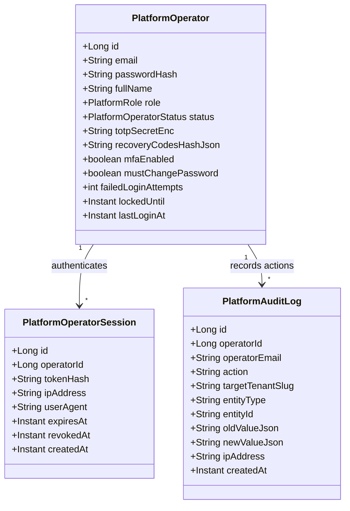
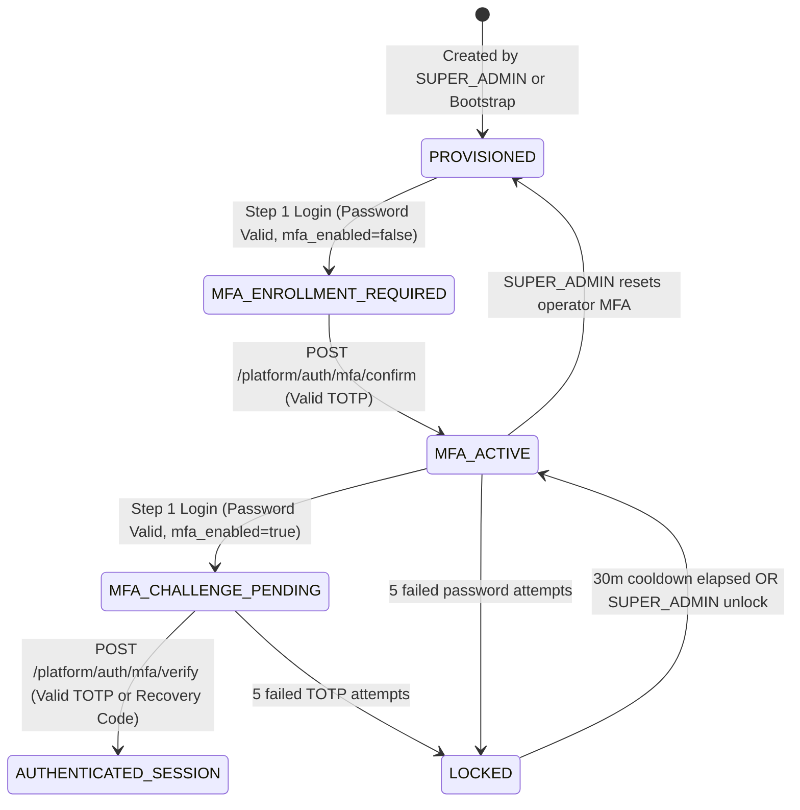

# F-02: Platform Operator Authentication and MFA

| Field | Value |
|---|---|
| **ID** | `F-02` |
| **Title** | Platform Operator Authentication and MFA |
| **Status** | `PROPOSED` |
| **Priority** | `P1` |
| **Depends On** | `F-08` |
| **Blocks** | `None (Required before production release)` |
| **Estimated Effort** | `M` |
| **Open Questions** | `Q-012` |
| **Revision** | `1` |

---

## 1. Summary and Business Value

`F-02` replaces the starter's single static `X-Platform-Key` header with individual platform operator accounts stored in `school_master`, role-based access control (`SUPER_ADMIN`, `SUPPORT_OPERATOR`, `BILLING_OPERATOR`), mandatory RFC 6238 TOTP Multi-Factor Authentication (MFA), dedicated `aud=platform` JWT tokens, and an immutable `platform_audit_log`. Because platform endpoints can provision schools, suspend entire databases, and toggle paid features across all tenants, individual accountability and hardware/authenticator MFA are mandatory before production deployment.

---

## 2. Scope and Explicit Non-Goals

### In Scope
- Master-schema tables (`platform_operators`, `platform_operator_sessions`, `platform_audit_log`) in `school_master`.
- Three built-in operator roles (`SUPER_ADMIN`, `SUPPORT_OPERATOR`, `BILLING_OPERATOR`) with fine-grained endpoint authorization on `/api/v1/platform/**`.
- Two-step operator login flow: Step 1 verifies email + BCrypt password and returns a short-lived `mfa_challenge_token`; Step 2 verifies the 6-digit RFC 6238 TOTP code (or one-time recovery code) and issues an operator JWT (`aud=platform`) plus rotating session refresh token.
- First-login TOTP enrollment flow (encrypted TOTP secret using `F-03` AES-GCM keyring, otpauth QR URI, and 8 hashed backup recovery codes).
- Strict cryptographic domain separation between platform JWTs (`aud=platform`, no `tenant` claim) and tenant JWTs (`aud=tenant`, mandatory `tenant` claim).
- Deprecation and removal of `X-Platform-Key` in `prod` profile (optional fallback flag in `local`/`test` only).
- Frontend `/platform/login`, `/platform/mfa-setup`, and `/platform/operators` management screen.

### Explicit Non-Goals
- Tenant-level staff/student/guardian authentication (handled by `F-01` in each school database).
- Automated SaaS subscription invoicing and credit card billing for schools (handled by manual/external billing in Phase 1).
- Read/write impersonation ("Log in as tenant user") — operators manage tenant lifecycle and metadata only; any future support impersonation will require a separate ADR and explicit tenant consent.

---

## 3. Business Rules

- **BR-01 (`[ASSUMPTION -> Q-012]` — Operator Roles & Least Privilege)**: Every platform operator has exactly one role (`SUPER_ADMIN`, `SUPPORT_OPERATOR`, or `BILLING_OPERATOR`):
  - `SUPER_ADMIN`: Full access to provision/suspend/activate schools, manage operator accounts, rotate encryption keys (`F-03`), and view platform audit logs.
  - `SUPPORT_OPERATOR`: Read-only access to school catalog/health, trigger tenant admin account unlock or password reset, and view platform audit logs; cannot provision schools or manage operators.
  - `BILLING_OPERATOR`: Update school `plan`, `features_json`, and SMS quota top-ups (`F-04`), and view school catalog; cannot provision/suspend schools or manage operators.
  See [`OPEN-QUESTIONS.md`](../OPEN-QUESTIONS.md#q-011--q-025-summary-defaults).
- **BR-02 (`[ASSUMPTION -> Q-012]` — Mandatory TOTP MFA)**: No operator can obtain an `aud=platform` access token without completing TOTP MFA verification. If an operator has `mfa_enabled = FALSE` (newly created), Step 1 login only allows access to `/api/v1/platform/auth/mfa/setup` and `/api/v1/platform/auth/mfa/confirm` using the temporary challenge token.
- **BR-03 (JWT Audience Isolation)**: `PlatformAuthenticationFilter` only accepts JWTs with `aud = "platform"` and rejects any tenant JWT (`403 Forbidden`). Conversely, `JwtAuthenticationFilter` (for `/api/v1/**` tenant endpoints) rejects any JWT with `aud = "platform"`.
- **BR-04 (Static Key Disabled in Production)**: When `app.platform.static-key-enabled=false` (the mandatory default in `application-prod.yml`), the legacy `X-Platform-Key` header is ignored and rejected with `401 Unauthorized`.
- **BR-05 (Bootstrap Super Admin)**: On startup, if `platform_operators` has 0 rows and `APP_PLATFORM_BOOTSTRAP_EMAIL` + `APP_PLATFORM_BOOTSTRAP_PASSWORD` environment variables are set, `PlatformBootstrapRunner` seeds the initial `SUPER_ADMIN` operator with `must_change_password = TRUE` and `mfa_enabled = FALSE`.
- **BR-06 (Self-Lockout Prevention)**: A `SUPER_ADMIN` cannot disable, demote, or delete their own operator account, nor can the last active `SUPER_ADMIN` in `platform_operators` be disabled or demoted.
- **BR-07 (Append-Only Platform Audit Trail)**: Every state-changing request under `/api/v1/platform/**` (school provisioning, status change, plan/feature change, SMS quota top-up, operator creation/role change/MFA reset) writes an immutable row to `school_master.platform_audit_log` capturing `operator_id`, `action`, `target_tenant_slug`, `old_value`, `new_value`, and `ip_address`.

---

## 4. Configurability

### Application Configuration (`application.yml` / Environment Variables)

| Property / Env Var | Type | Default | Description |
|---|---|---|---|
| `app.platform.jwt.access-ttl-minutes` | `INTEGER` | `15` | Lifetime of `aud=platform` operator access JWT |
| `app.platform.jwt.refresh-ttl-hours` | `INTEGER` | `12` | Lifetime of platform operator session (shorter than tenant sessions) |
| `app.platform.mfa.issuer` | `STRING` | `SchoolERP-Platform` | Issuer label displayed in Google Authenticator / Authy / 1Password |
| `app.platform.lockout.max-attempts` | `INTEGER` | `5` | Consecutive failed password or TOTP attempts before 30-minute operator lockout |
| `app.platform.static-key-enabled` | `BOOLEAN` | `false` (`prod`), `true` (`local`/`test`) | Whether legacy `X-Platform-Key` header is accepted alongside operator JWT |
| `APP_PLATFORM_BOOTSTRAP_EMAIL` | `STRING` | — | Initial `SUPER_ADMIN` email seeded if `platform_operators` is empty |
| `APP_PLATFORM_BOOTSTRAP_PASSWORD` | `STRING` | — | Initial `SUPER_ADMIN` password seeded on first boot |

### Feature Flags & Strategy Points
- `TotpVerifier` strategy interface (`Rfc6238TotpVerifier` allowing $\pm 1$ 30-second time-step drift window to handle minor clock skew, plus replay cache in `F-08` Redis so a 6-digit code cannot be used twice within its 30s window).

---

## 5. Domain Model



### Operator Authentication & MFA Enrollment State Machine



---

## 6. Database

- **Flyway Migration**: `backend/src/main/resources/db/master/V2__platform_operators_and_mfa.sql`
- **Database Target**: `school_master` (platform catalog database only; never executed on tenant databases).
- **Soft-Delete Strategy**: `platform_operators` uses `status` (`ACTIVE`, `LOCKED`, `DISABLED`) and `deleted_at TIMESTAMP(6) NULL`. `platform_audit_log` is strictly append-only.
- **Money Columns**: None.

```sql
-- db/master/V2__platform_operators_and_mfa.sql
-- Platform operator accounts, sessions, and immutable platform audit log in school_master.

CREATE TABLE platform_operators (
    id                        BIGINT       NOT NULL AUTO_INCREMENT,
    email                     VARCHAR(190) NOT NULL,
    password_hash             VARCHAR(255) NOT NULL,
    full_name                 VARCHAR(200) NOT NULL,
    role                      VARCHAR(40)  NOT NULL,
    status                    VARCHAR(20)  NOT NULL DEFAULT 'ACTIVE',
    totp_secret_enc           VARCHAR(500) NULL,
    recovery_codes_hash_json  JSON         NULL,
    mfa_enabled               BOOLEAN      NOT NULL DEFAULT FALSE,
    must_change_password      BOOLEAN      NOT NULL DEFAULT TRUE,
    failed_login_attempts     INT          NOT NULL DEFAULT 0,
    locked_until              TIMESTAMP(6) NULL,
    last_login_at             TIMESTAMP(6) NULL,
    created_at                TIMESTAMP(6) NOT NULL DEFAULT CURRENT_TIMESTAMP(6),
    updated_at                TIMESTAMP(6) NOT NULL DEFAULT CURRENT_TIMESTAMP(6) ON UPDATE CURRENT_TIMESTAMP(6),
    deleted_at                TIMESTAMP(6) NULL,
    PRIMARY KEY (id),
    UNIQUE KEY uk_platform_operators_email (email),
    KEY idx_po_status_role (status, role)
) ENGINE=InnoDB DEFAULT CHARSET=utf8mb4;

CREATE TABLE platform_operator_sessions (
    id                BIGINT       NOT NULL AUTO_INCREMENT,
    operator_id       BIGINT       NOT NULL,
    token_hash        VARCHAR(64)  NOT NULL,
    ip_address        VARCHAR(45)  NULL,
    user_agent        VARCHAR(500) NULL,
    expires_at        TIMESTAMP(6) NOT NULL,
    revoked_at        TIMESTAMP(6) NULL,
    replaced_by_hash  VARCHAR(64)  NULL,
    created_at        TIMESTAMP(6) NOT NULL DEFAULT CURRENT_TIMESTAMP(6),
    PRIMARY KEY (id),
    UNIQUE KEY uk_pos_token_hash (token_hash),
    KEY idx_pos_operator_active (operator_id, revoked_at, expires_at),
    CONSTRAINT fk_pos_operator FOREIGN KEY (operator_id) REFERENCES platform_operators (id)
) ENGINE=InnoDB DEFAULT CHARSET=utf8mb4;

CREATE TABLE platform_audit_log (
    id                  BIGINT       NOT NULL AUTO_INCREMENT,
    operator_id         BIGINT       NULL,
    operator_email      VARCHAR(190) NULL,
    action              VARCHAR(80)  NOT NULL,
    target_tenant_slug  VARCHAR(24)  NULL,
    entity_type         VARCHAR(100) NOT NULL,
    entity_id           VARCHAR(100) NULL,
    old_value           JSON         NULL,
    new_value           JSON         NULL,
    ip_address          VARCHAR(45)  NULL,
    created_at          TIMESTAMP(6) NOT NULL DEFAULT CURRENT_TIMESTAMP(6),
    PRIMARY KEY (id),
    KEY idx_pal_operator (operator_id, created_at),
    KEY idx_pal_tenant (target_tenant_slug, created_at),
    KEY idx_pal_action_created (action, created_at)
) ENGINE=InnoDB DEFAULT CHARSET=utf8mb4;
```

---

## 7. API

All platform endpoints live under `/api/v1/platform` and operate against `school_master` without binding a tenant database.

| HTTP Method | Path | Request DTO | Response DTO | Required Operator Role |
|---|---|---|---|---|
| `POST` | `/api/v1/platform/auth/login` | `OperatorLoginRequest(email, password)` | `OperatorChallengeResponse(challengeToken, mfaEnrolled, mustChangePassword)` | Public (Rate-limited) |
| `POST` | `/api/v1/platform/auth/mfa/setup` | `MfaSetupRequest(challengeToken)` | `MfaSetupResponse(secretBase32, otpauthUri)` | Challenge Token |
| `POST` | `/api/v1/platform/auth/mfa/confirm` | `MfaConfirmRequest(challengeToken, totpCode, newPassword)` | `MfaConfirmResponse(accessToken, refreshToken, recoveryCodes, operator)` | Challenge Token |
| `POST` | `/api/v1/platform/auth/mfa/verify` | `MfaVerifyRequest(challengeToken, code)` | `OperatorAuthResponse(accessToken, refreshToken, expiresIn, operator)` | Challenge Token |
| `POST` | `/api/v1/platform/auth/refresh` | `OperatorRefreshRequest(refreshToken)` | `OperatorAuthResponse(accessToken, refreshToken, expiresIn, operator)` | Public (Refresh Token) |
| `POST` | `/api/v1/platform/auth/logout` | `OperatorLogoutRequest(refreshToken)` | `204 No Content` | Any Authenticated Operator |
| `GET` | `/api/v1/platform/operators` | `PageRequest(page, size)` | `PageResponse<PlatformOperatorDto>` | `SUPER_ADMIN` |
| `POST` | `/api/v1/platform/operators` | `CreateOperatorRequest(email, fullName, role, tempPassword)` | `PlatformOperatorDto` | `SUPER_ADMIN` |
| `PATCH` | `/api/v1/platform/operators/{id}` | `UpdateOperatorRequest(role, status)` | `PlatformOperatorDto` | `SUPER_ADMIN` |
| `POST` | `/api/v1/platform/operators/{id}/reset-mfa` | `ResetOperatorMfaRequest(reason)` | `PlatformOperatorDto` | `SUPER_ADMIN` |
| `GET` | `/api/v1/platform/audit-logs` | `PlatformAuditFilter(tenantSlug, operatorId, action, page, size)` | `PageResponse<PlatformAuditLogDto>` | `SUPER_ADMIN`, `SUPPORT_OPERATOR` |
| `POST` | `/api/v1/platform/tenants` | `CreateTenantRequest` (existing) | `TenantDto` | `SUPER_ADMIN` |
| `GET` | `/api/v1/platform/tenants` | `PageRequest(page, size)` | `PageResponse<TenantDto>` | `SUPER_ADMIN`, `SUPPORT_OPERATOR`, `BILLING_OPERATOR` |
| `PATCH` | `/api/v1/platform/tenants/{slug}/status` | `UpdateTenantStatusRequest` (existing) | `TenantDto` | `SUPER_ADMIN` |
| `PUT` | `/api/v1/platform/tenants/{slug}/features` | `UpdateFeaturesRequest` (existing) | `TenantDto` | `SUPER_ADMIN`, `BILLING_OPERATOR` |

---

## 8. Permissions to Seed and Default Role Grants

Platform operators use coarse-grained `PlatformRole` enums stored in `school_master.platform_operators.role` rather than tenant RBAC tables:

| Capability / Endpoint Group | `SUPER_ADMIN` | `SUPPORT_OPERATOR` | `BILLING_OPERATOR` | Tenant Roles (`SCHOOL_ADMIN`, etc.) |
|---|:---:|:---:|:---:|:---:|
| Provision / Suspend / Activate School | Yes | No | No | No (`403`) |
| View School Catalog & Health | Yes | Yes | Yes | No (`403`) |
| Update School Plan, Features & SMS Quota | Yes | No | Yes | No (`403`) |
| Unlock Tenant Admin / Trigger Reset | Yes | Yes | No | No (`403`) |
| Create / Update / Reset MFA for Operators | Yes | No | No | No (`403`) |
| View `platform_audit_log` | Yes | Yes | No | No (`403`) |

---

## 9. Events and Notifications Emitted or Consumed

Platform events are logged directly to `school_master.platform_audit_log`. No tenant outbox is used because platform actions occur outside any tenant context.

| Event / Action Code | Target | Description |
|---|---|---|
| `PLATFORM_OPERATOR_LOGIN_SUCCESS` | `platform_audit_log` | Operator completed password + TOTP MFA verification |
| `PLATFORM_OPERATOR_LOGIN_FAILED` | `platform_audit_log` | Invalid password or invalid TOTP code |
| `PLATFORM_OPERATOR_MFA_ENROLLED` | `platform_audit_log` | Operator completed initial TOTP setup and received recovery codes |
| `PLATFORM_OPERATOR_MFA_RESET` | `platform_audit_log` | `SUPER_ADMIN` cleared an operator's TOTP secret requiring re-enrollment |
| `PLATFORM_TENANT_PROVISIONED` | `platform_audit_log` | New school provisioned (`target_tenant_slug` populated) |
| `PLATFORM_TENANT_STATUS_CHANGED` | `platform_audit_log` | School suspended or activated (`old_value`, `new_value`) |
| `PLATFORM_TENANT_FEATURES_UPDATED` | `platform_audit_log` | School plan or `features_json` modified |

---

## 10. Tenancy and Security Considerations

- **Zero Tenant Data Leakage**: `PlatformOperatorService` and `PlatformAuditService` exclusively use `masterJdbcTemplate` / master repository beans. `TenantContext` is never set during `/api/v1/platform/**` requests.
- **Cryptographic Token Separation**:
  - Platform JWTs carry `iss="school-erp"`, `aud="platform"`, `sub=operatorId`, `role=SUPER_ADMIN|SUPPORT_OPERATOR|BILLING_OPERATOR`, and **no** `tenant` claim.
  - Challenge tokens carry `aud="platform-mfa-challenge"` with a 5-minute TTL and cannot authenticate any `/api/v1/platform/**` endpoint except `/mfa/setup`, `/mfa/confirm`, and `/mfa/verify`.
- **TOTP Secret Protection**: `totp_secret_enc` is encrypted at rest using the `CryptoService` AES-GCM keyring (`F-03`) before persisting to `platform_operators`. Backup recovery codes are hashed with BCrypt.
- **TOTP Replay Prevention (`F-08`)**: Verified TOTP codes are cached under `platform:totp:used:<operatorId>:<timeStep>` in Redis (`F-08`) for 90 seconds so the same 6-digit code cannot be replayed.
- **Rate Limits (`F-08`)**:
  - `/api/v1/platform/auth/**`: 5 requests / minute / IP.

---

## 11. Frontend

### Routes and Pages (`src/features/platform`)
- `/platform/login` (`PlatformLoginPage.tsx`): Two-step operator login (Email + Password -> 6-digit TOTP code or backup recovery code input).
- `/platform/mfa-setup` (`PlatformMfaSetupPage.tsx`): Renders QR code (`otpauthUri`), manual Base32 secret copy, forced initial password change inputs, and one-time downloadable/copyable recovery codes modal.
- `/platform` (`PlatformConsolePage.tsx`): Updates existing platform console to use operator Bearer JWT instead of prompting for raw `X-Platform-Key`, displaying the signed-in operator's name and role badge, and hiding unauthorized actions (e.g., hiding "Provision School" for `BILLING_OPERATOR`).
- `/platform/operators` (`PlatformOperatorsPage.tsx`): Paginated operator directory, "New Operator" modal, role/status editor, and "Reset MFA" confirmation dialog (`SUPER_ADMIN` only).
- `/platform/audit-logs` (`PlatformAuditLogsPage.tsx`): Filterable table of `platform_audit_log` entries by school slug, operator, and action.

### Required i18n Keys (`en` and `bn`)

| i18n Key | English (`en`) | Bangla (`bn`) |
|---|---|---|
| `platform.login.title` | Platform Operator Sign In | প্ল্যাটফর্ম অপারেটর সাইন ইন |
| `platform.login.mfaTitle` | Two-Factor Verification | দুই-স্তরের যাচাইকরণ (MFA) |
| `platform.login.totpPlaceholder` | Enter 6-digit authenticator code | ৬-সংখ্যার অথেনটিকেটর কোড দিন |
| `platform.mfaSetup.title` | Set Up Authenticator App | অথেনটিকেটর অ্যাপ সেট আপ করুন |
| `platform.mfaSetup.recoveryWarning` | Save these recovery codes in a secure location. They will not be shown again. | এই রিকভারি কোডগুলো নিরাপদ স্থানে সংরক্ষণ করুন। এগুলো আর দেখানো হবে না। |
| `platform.operators.title` | Platform Operators | প্ল্যাটফর্ম অপারেটরবৃন্দ |
| `platform.operators.create` | Add Operator | নতুন অপারেটর যোগ করুন |
| `platform.operators.resetMfa` | Reset MFA | এমএফএ (MFA) রিসেট করুন |
| `platform.audit.title` | Platform Audit Trail | প্ল্যাটফর্ম অডিট লগ |

---

## 12. Test Plan

### Unit Tests
- `Rfc6238TotpVerifierTest`: Verifies RFC 6238 test vectors, $\pm 1$ window acceptance, rejection of expired windows, and rejection of replayed codes within the same 30-second window.
- `PlatformJwtTokenServiceTest`: Verifies `aud=platform` claim generation, challenge token scope restriction, and rejection of tenant JWTs.
- `PlatformOperatorServiceTest`: Verifies self-demotion/self-disable guard (`BR-06`) and backup recovery code consumption (each recovery code works once, then is removed).

### Integration Tests (Testcontainers MySQL)
- `PlatformOperatorAuthFlowIT`: Bootstrap initial `SUPER_ADMIN` -> Step 1 login -> enroll TOTP + change initial password -> verify 8 recovery codes returned -> Step 2 login with valid TOTP -> call `GET /api/v1/platform/tenants` -> verify `200 OK`.
- `PlatformRoleAuthorizationIT`:
  - Verify `BILLING_OPERATOR` can call `PUT /api/v1/platform/tenants/{slug}/features` (`200`) but receives `403 Forbidden` on `POST /api/v1/platform/tenants` and `POST /api/v1/platform/operators`.
  - Verify `SUPPORT_OPERATOR` can call `GET /api/v1/platform/tenants` and `GET /api/v1/platform/audit-logs` (`200`) but receives `403 Forbidden` on `PUT /api/v1/platform/tenants/{slug}/features`.
- `StaticPlatformKeyDisabledIT`: With `app.platform.static-key-enabled=false`, verify requests carrying `X-Platform-Key` without a valid `aud=platform` Bearer JWT return `401 Unauthorized`.

### Two-School & Cross-Plane Isolation Test
- `CrossPlaneTokenIsolationIT`:
  1. Provision school `alpha` and school `beta`.
  2. Obtain a `SCHOOL_ADMIN` JWT from `alpha` (`aud=tenant`, `tenant=alpha`) and attempt to call `GET /api/v1/platform/tenants` -> must return `403 Forbidden`.
  3. Obtain a `SUPER_ADMIN` JWT from platform (`aud=platform`) and attempt to call tenant endpoint `GET /api/v1/users` with `X-Tenant-ID: alpha` -> must return `403 Forbidden`.

---

## 13. Acceptance Criteria

- [ ] Platform operators authenticate with individual email, password, and 6-digit TOTP authenticator code at `/platform/login`.
- [ ] First-time operators must change their temporary password, scan a TOTP QR code, confirm a 6-digit code, and receive one-time backup recovery codes before accessing the platform console.
- [ ] Role boundaries (`SUPER_ADMIN`, `SUPPORT_OPERATOR`, `BILLING_OPERATOR`) are strictly enforced on all `/api/v1/platform/**` endpoints.
- [ ] Tenant JWTs cannot access `/api/v1/platform/**` endpoints, and platform JWTs cannot access tenant business endpoints.
- [ ] Every platform mutation (creating a school, changing status/features, managing operators) records an immutable entry in `platform_audit_log` with the acting operator's ID and IP address.
- [ ] Static `X-Platform-Key` authentication is disabled in the `prod` profile.

---

## 14. Implementation Slices

- [ ] **Slice 1: Master Schema Migration & Operator Domain** — Add `db/master/V2__platform_operators_and_mfa.sql`, create `PlatformOperator`, `PlatformOperatorSession`, and `PlatformAuditLog` repositories and `PlatformBootstrapRunner`.
- [ ] **Slice 2: RFC 6238 TOTP & Two-Step Operator Auth API** — Implement `Rfc6238TotpVerifier`, `PlatformAuthService`, challenge token + `aud=platform` JWT issuance, and `/api/v1/platform/auth/**` controllers with unit and integration tests.
- [ ] **Slice 3: Operator RBAC, Audit Logging & Static Key Deprecation** — Update `PlatformKeyFilter` -> `PlatformAuthenticationFilter`, enforce `@PreAuthorize` for `SUPER_ADMIN`/`SUPPORT_OPERATOR`/`BILLING_OPERATOR`, wire `PlatformAuditService` into `PlatformTenantController`, and add `/api/v1/platform/operators` and `/audit-logs` endpoints.
- [ ] **Slice 4: Frontend Platform Auth, MFA Setup & Operator Console** — Build `/platform/login`, `/platform/mfa-setup`, `/platform/operators`, and `/platform/audit-logs` and update `PlatformConsolePage.tsx` with `en`/`bn` translations.

---

## 15. Risks and Mitigations

| Risk | Impact | Mitigation |
|---|---|---|
| Sole `SUPER_ADMIN` loses their authenticator device and backup recovery codes | High (locked out of platform console) | Document break-glass CLI procedure and prevent deleting/demoting the last active `SUPER_ADMIN`; recommend registering at least two `SUPER_ADMIN` accounts in production. |
| Server clock drift causes valid TOTP codes to fail | Medium (operator login friction) | Accept $\pm 1$ 30-second window in `Rfc6238TotpVerifier` and monitor NTP synchronization in infrastructure health checks. |
| Existing integration tests rely on `X-Platform-Key` header | Low (test breakage during transition) | Keep `app.platform.static-key-enabled=true` in `test` profile for non-auth tests while testing `static-key-enabled=false` explicitly in `StaticPlatformKeyDisabledIT`. |

---

## 16. How to Extend or Customize Later

- **Adding WebAuthn / YubiKey Hardware Security Keys for Operators**: Add a `platform_operator_webauthn_credentials` table in `db/master` and implement a second `MfaVerificationStrategy` alongside `Rfc6238TotpVerifier`.
- **Adding Scoped Support Read-Only Diagnostics**: Add new endpoints under `/api/v1/platform/diagnostics/**` guarded by `hasAnyRole('SUPER_ADMIN', 'SUPPORT_OPERATOR')` without altering the authentication pipeline.

---

## 17. Revision History

| Revision | Date | Author | Changes |
|---|---|---|---|
| `1` | 2026-11-04 | Antigravity | Initial comprehensive plan for `F-02` Platform Operator Authentication and MFA. |
