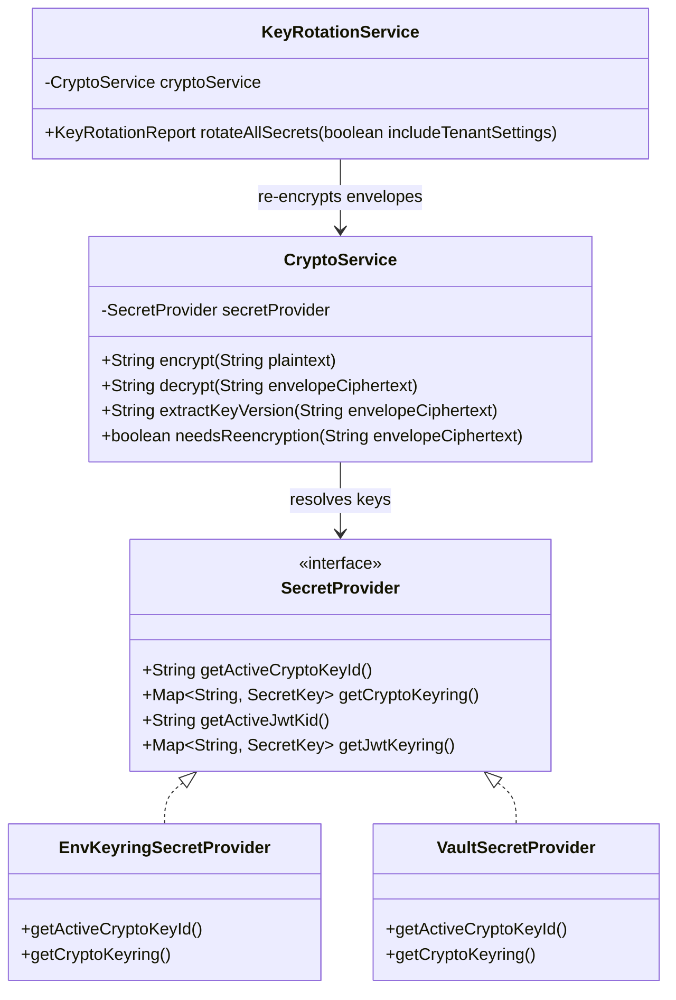
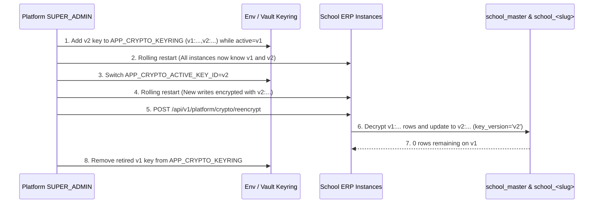

# F-03: Secrets and Key Management with Envelope Rotation

| Field | Value |
|---|---|
| **ID** | `F-03` |
| **Title** | Secrets and Key Management with Envelope Rotation |
| **Status** | `PROPOSED` |
| **Priority** | `P1` |
| **Depends On** | `None` |
| **Blocks** | `F-02` |
| **Estimated Effort** | `S` |
| **Open Questions** | `Q-013` |
| **Revision** | `1` |

---

## 1. Summary and Business Value

`F-03` upgrades the platform's cryptographic foundation (`com.schoolerp.shared.crypto` and `com.schoolerp.iam`) from single static keys to versioned key rings (`v1`, `v2`, ...) for both AES-256-GCM data encryption and HMAC-SHA256 JWT signing. This enables zero-downtime key rotation of tenant MySQL credentials (`tenants.db_password_enc`), operator TOTP secrets (`F-02`), school SMS/payment gateway credentials (`F-04`, `M-05`), and active user JWT sessions without logging out thousands of school users or taking the ERP offline.

---

## 2. Scope and Explicit Non-Goals

### In Scope
- Versioned AES-256-GCM encryption envelope format `<keyId>:<base64(iv + ciphertext + tag)>` (e.g., `v1:AbCdEf...`) in `CryptoService`, maintaining backward compatibility with unprefixed legacy `v1` ciphertexts.
- Adding `key_version` tracking column to `school_master.tenants` (`db/master/V3__tenant_key_versioning.sql`).
- Versioned JWT signing key ring (`kid` JWT header + active signing key ID + map of valid verification keys) for zero-downtime JWT secret rotation.
- `SecretProvider` strategy interface with `EnvKeyringSecretProvider` (default) and `VaultSecretProvider` (HashiCorp Vault KV v2 / AWS KMS adapter interface).
- Dedicated `SensitiveSettingCryptoService` so per-school secret settings in `app_settings` (such as SMS API keys in `F-04` and payment gateway secrets in `M-05`) are stored encrypted with `<keyId>:` prefix and masked in API responses (`********`).
- Platform operator re-encryption endpoint (`POST /api/v1/platform/crypto/reencrypt`) to migrate all `tenants.db_password_enc`, `platform_operators.totp_secret_enc`, and encrypted `app_settings` rows to the active `key_version`.
- Startup fail-fast validation (`ProdSecretsValidator`) in the `prod` profile ensuring no default/dev keys or weak (< 256-bit) secrets are used.
- Documented step-by-step Key Rotation Runbook.

### Explicit Non-Goals
- Full-disk tablespace encryption (TDE) at the MySQL storage engine layer (handled by cloud RDS/infrastructure configuration).
- Client-side end-to-end encryption in the React browser.

---

## 3. Business Rules

- **BR-01 (`[ASSUMPTION -> Q-013]` — Versioned Keyring Envelope Format)**: Every AES-GCM encrypted value produced by `CryptoService.encrypt(plaintext)` is formatted as `<activeKeyId>:<base64Payload>`, where `activeKeyId` matches `app.crypto.active-key-id` (e.g., `v1`, `v2`). On decryption, `CryptoService.decrypt(ciphertext)` inspects the `<keyId>:` prefix and selects the matching key from the configured keyring. If no `<keyId>:` prefix is present (legacy starter rows), it falls back to key `v1`. See [`OPEN-QUESTIONS.md`](../OPEN-QUESTIONS.md#q-011--q-025-summary-defaults).
- **BR-02 (Zero-Downtime JWT Key Rotation)**: Every issued JWT includes the active signing key identifier in its JWS header (`{"alg":"HS256","kid":"k2"}`). During verification, `JwtTokenService` looks up the verification key by `kid` in `app.security.jwt.keys`. Tokens without a `kid` header (issued before rotation) are verified against `k1` until they naturally expire.
- **BR-03 (Idempotent Batch Re-encryption)**: Running the re-encryption job (`POST /api/v1/platform/crypto/reencrypt`) locates all rows where `key_version != activeKeyId` (or where the ciphertext prefix does not match `<activeKeyId>:`), decrypts with the old key ID, re-encrypts with a fresh 96-bit CSPRNG IV under `activeKeyId`, and updates `key_version = activeKeyId`. Re-running the endpoint when all rows are already on `activeKeyId` is a safe no-op returning `reencryptedCount: 0`.
- **BR-04 (Encrypted Tenant Settings Masking)**: Any `app_settings` key matching `*.secret`, `*.api_key`, `*.password`, or `*.private_key` is automatically encrypted via `CryptoService` before being persisted to `app_settings.setting_value` and is always returned as `"********"` by `GET /api/v1/settings` so secrets are never exposed back to the browser.
- **BR-05 (Production Fail-Fast Guard)**: When the `prod` Spring profile is active, application startup immediately aborts with an `IllegalStateException` if:
  1. `app.crypto.active-key-id` is missing from `app.crypto.keys`,
  2. Any configured AES key decodes to fewer than 32 bytes (256 bits) or equals the dev placeholder key, or
  3. Any configured JWT key is shorter than 32 bytes or equals the dev placeholder secret.

---

## 4. Configurability

### Application Configuration (`application.yml` / Environment Variables)

| Property / Env Var | Type | Default (`local`) | Description |
|---|---|---|---|
| `app.secrets.provider` | `STRING` | `ENV` | Secret backend strategy (`ENV` or `VAULT`) |
| `app.crypto.active-key-id` | `STRING` | `v1` | Key ID used for all new AES-GCM encryptions (`APP_CRYPTO_ACTIVE_KEY_ID`) |
| `app.crypto.keyring` | `STRING` | `v1:<dev-base64-32b>` | Comma-separated `<keyId>:<base64Key>` map (`APP_CRYPTO_KEYRING`) |
| `app.security.jwt.active-kid` | `STRING` | `k1` | Key ID (`kid`) used to sign newly minted JWTs (`APP_JWT_ACTIVE_KID`) |
| `app.security.jwt.keyring` | `STRING` | `k1:<dev-secret>` | Comma-separated `<kid>:<secret>` map (`APP_JWT_KEYRING`) |

### Per-School Settings (`app_settings`)
- No new school-configurable settings are needed for key management itself, but `F-03` provides automatic transparent encryption for secret settings in `app_settings` (any setting key ending in `.secret`, `.api_key`, `.password`, or `.token`).

### Strategy Interfaces
- `SecretProvider`:
  - `EnvKeyringSecretProvider` (`@ConditionalOnProperty(name = "app.secrets.provider", havingValue = "ENV", matchIfMissing = true)`)
  - `VaultSecretProvider` (`@ConditionalOnProperty(name = "app.secrets.provider", havingValue = "VAULT")`)

---

## 5. Domain Model



### Zero-Downtime Envelope Key Rotation Lifecycle



---

## 6. Database

- **Flyway Migration**: `backend/src/main/resources/db/master/V3__tenant_key_versioning.sql`
- **Database Target**: `school_master`.
- **Soft-Delete Strategy**: N/A (adds metadata columns to `tenants`).
- **Money Columns**: None.

```sql
-- db/master/V3__tenant_key_versioning.sql
-- Tracks which encryption key version protects each tenant's database credentials.

ALTER TABLE tenants
    ADD COLUMN key_version     VARCHAR(16)  NOT NULL DEFAULT 'v1' AFTER db_password_enc,
    ADD COLUMN key_rotated_at  TIMESTAMP(6) NULL AFTER key_version,
    ADD KEY idx_tenants_key_version (key_version);
```

---

## 7. API

| HTTP Method | Path | Request DTO | Response DTO | Permission / Role | Scope |
|---|---|---|---|---|---|
| `GET` | `/api/v1/platform/crypto/status` | — | `CryptoKeyStatusResponse(activeCryptoKeyId, loadedCryptoKeyIds, activeJwtKid, loadedJwtKids, tenantsByKeyVersion)` | Platform `SUPER_ADMIN` | Platform |
| `POST` | `/api/v1/platform/crypto/reencrypt` | `ReencryptSecretsRequest(includeTenantSettings, dryRun)` | `ReencryptSecretsResponse(targetKeyVersion, tenantsReencrypted, operatorsReencrypted, tenantSettingsReencrypted, dryRun)` | Platform `SUPER_ADMIN` | Platform |

---

## 8. Permissions to Seed and Default Role Grants

- Platform endpoints `/api/v1/platform/crypto/**` are restricted to `PlatformRole.SUPER_ADMIN` (`F-02`).
- In tenant databases, `GET /api/v1/settings` (`settings.read`) and `PUT /api/v1/settings` (`settings.write`) continue using existing permissions seeded in `V3__security_and_rbac.sql`, with transparent secret masking/encryption applied by `SettingsService`.

---

## 9. Events and Notifications Emitted or Consumed

| Event / Audit Action | Target | Payload Summary |
|---|---|---|
| `PLATFORM_CRYPTO_REENCRYPTED` | `school_master.platform_audit_log` | `oldKeyVersions`, `targetKeyVersion`, `tenantsReencrypted`, `operatorsReencrypted`, `tenantSettingsReencrypted` |
| `TENANT_SECRET_SETTING_UPDATED` | Tenant `audit_log` | Records `setting_key` with `old_value: "********"`, `new_value: "********"` (never logs plaintext or ciphertext in `audit_log`) |

---

## 10. Tenancy and Security Considerations

- **Tenant Routing During Re-encryption**: When `KeyRotationService` re-encrypts secret `app_settings` across schools (`includeTenantSettings = true`), it iterates over active tenant slugs from `school_master.tenants` and binds each tenant explicitly inside a `try { TenantContext.set(slug); ... } finally { TenantContext.clear(); }` block, complying with `.agent/rules/01-tenancy.md` Rule 5.
- **No Plaintext or Ciphertext Leakage in Logs/API**:
  - `GET /api/v1/settings` masks any encrypted setting value as `"********"`.
  - If the frontend submits `"********"` back in `PUT /api/v1/settings`, `SettingsService` preserves the existing encrypted value unchanged rather than overwriting the secret with literal asterisks.
- **Unique IV Per Encryption**: Every call to `CryptoService.encrypt()` generates a fresh 12-byte (96-bit) `SecureRandom` IV so re-encrypting the same password under the same or new key produces an entirely different ciphertext.

---

## 11. Frontend

### Routes and Components (`src/features/platform` & `src/features/settings`)
- **Platform Console Key Status Card (`src/features/platform/components/CryptoKeyStatusCard.tsx`)**: Displays active AES key version (`v1`, `v2`), active JWT `kid`, count of tenant credentials per key version, and a "Re-encrypt Legacy Credentials" button for `SUPER_ADMIN`.
- **Tenant Settings Secret Input (`src/features/settings/components/SecretSettingInput.tsx`)**: Renders masked `"********"` placeholder with a "Replace Secret" toggle so school admins can update SMS/payment gateway keys without viewing existing secrets.

### Required i18n Keys (`en` and `bn`)

| i18n Key | English (`en`) | Bangla (`bn`) |
|---|---|---|
| `platform.crypto.title` | Encryption & Key Management | এনক্রিপশন ও কী ব্যবস্থাপনা |
| `platform.crypto.activeKey` | Active Encryption Key | সক্রিয় এনক্রিপশন কী |
| `platform.crypto.activeJwtKid` | Active JWT Signing Key (kid) | সক্রিয় জেডব্লিউটি (JWT) সাইনিং কী |
| `platform.crypto.reencryptButton` | Re-encrypt All Credentials to Active Key | সকল ক্রেডেনশিয়াল সক্রিয় কী-তে পুনরায় এনক্রিপ্ট করুন |
| `platform.crypto.reencryptSuccess` | Re-encrypted {{count}} records to key {{keyVersion}}. | {{count}}টি রেকর্ড {{keyVersion}} কী-তে পুনরায় এনক্রিপ্ট করা হয়েছে। |
| `settings.secret.maskedHint` | Secret is stored encrypted. Leave unchanged to keep current value. | গোপন কী এনক্রিপ্ট করে সংরক্ষিত আছে। বর্তমান মান রাখতে অপরিবর্তিত রাখুন। |

---

## 12. Test Plan

### Unit Tests
- `CryptoServiceKeyringTest`:
  - Encrypts with `activeKeyId = v2` -> verifies output starts with `v2:`.
  - Decrypts `v1:<ciphertext>`, `v2:<ciphertext>`, and legacy unprefixed `<ciphertext>` (using `v1`) when both `v1` and `v2` are in the keyring.
  - Throws `CryptoException` when attempting to decrypt a `v99:` prefix not present in the keyring.
- `JwtKeyringRotationTest`:
  - Mints token with `kid = k1`, switches active key to `k2` while keeping `k1` in keyring -> verifies both `k1` and `k2` tokens validate, and tampered tokens fail.
- `ProdSecretsValidatorTest`:
  - Verifies startup fails when `prod` profile is active with default dev keys or keys < 256 bits, and succeeds with strong keys.

### Integration Tests (Testcontainers MySQL)
- `KeyRotationReencryptionIT`:
  1. Provision tenants `alpha` and `beta` while `active-key-id = v1` (verify `tenants.key_version = 'v1'` and `db_password_enc` starts with `v1:`).
  2. Store an encrypted setting `sms.gateway.api_key` in both `alpha` and `beta`.
  3. Switch `active-key-id` to `v2` (with `v1` and `v2` in keyring) and call `POST /api/v1/platform/crypto/reencrypt`.
  4. Verify `tenants.key_version = 'v2'`, `db_password_enc` starts with `v2:`, and `TenantRoutingDataSource` still connects to both `school_alpha` and `school_beta` using the re-encrypted credentials.

### Two-School Tenant Isolation Test (`alpha` vs `beta`)
- `EncryptedSettingsTenantIsolationIT`:
  - Store `sms.gateway.api_key = "alpha-secret-123"` in `alpha` and `"beta-secret-456"` in `beta`.
  - Verify `GET /api/v1/settings` in both tenants returns `"********"` for `sms.gateway.api_key`.
  - Verify internal `SettingsService.getDecryptedSecret("sms.gateway.api_key")` under `TenantContext("alpha")` returns `"alpha-secret-123"` and never `"beta-secret-456"`, and persists distinct ciphertexts in each school database.

---

## 13. Acceptance Criteria

- [ ] All newly encrypted database passwords, TOTP secrets, and secret `app_settings` carry an explicit `<keyId>:` version prefix.
- [ ] Legacy unprefixed ciphertexts continue to decrypt seamlessly using key `v1`.
- [ ] All newly issued JWTs include a `kid` header and can be verified across key rotations without invalidating active user sessions.
- [ ] A `SUPER_ADMIN` can view key version status and trigger `POST /api/v1/platform/crypto/reencrypt` to migrate all stored secrets to the latest key version with zero downtime.
- [ ] Secret `app_settings` values (`*.secret`, `*.api_key`, `*.password`) are encrypted at rest and masked as `"********"` in API responses and audit logs.
- [ ] The `prod` profile refuses to start if default development keys are present.

---

## 14. Implementation Slices

- [ ] **Slice 1: `SecretProvider` & Versioned `CryptoService` / `JwtTokenService`** — Implement `SecretProvider`, `<keyId>:` envelope support in `CryptoService`, `kid` header keyring support in `JwtTokenService`, and `ProdSecretsValidator` with unit tests.
- [ ] **Slice 2: Master Schema Migration & Batch Re-encryption Service** — Add `db/master/V3__tenant_key_versioning.sql`, implement `KeyRotationService`, and expose `/api/v1/platform/crypto/status` and `/api/v1/platform/crypto/reencrypt`.
- [ ] **Slice 3: Encrypted & Masked Tenant Settings** — Integrate `SensitiveSettingCryptoService` into `SettingsService` with `"********"` masking and two-school isolation tests.
- [ ] **Slice 4: Frontend Key Status Card & Rotation Runbook** — Add `CryptoKeyStatusCard.tsx`, `SecretSettingInput.tsx`, `en`/`bn` i18n keys, and operational runbook documentation.

---

## 15. Risks and Mitigations

| Risk | Impact | Mitigation |
|---|---|---|
| Operator removes old key (`v1`) from `APP_CRYPTO_KEYRING` before all rows are re-encrypted to `v2` | Critical (cannot decrypt `v1` tenant DB passwords) | `GET /api/v1/platform/crypto/status` explicitly displays `tenantsByKeyVersion` counts; `KeyRotationService` verifies target key exists before updating any row. |
| Cached `HikariDataSource` pool holds stale credentials during password change | Low (envelope rotation re-encrypts the same underlying MySQL password) | Envelope rotation does not change the underlying MySQL user password; if a MySQL password itself is rotated, `TenantRoutingDataSource.evict(slug)` closes the old pool cleanly. |
| Admin UI saves literal `"********"` over an existing secret | High (breaks gateway integration) | `SettingsService` explicitly ignores updates where the incoming value for a secret key equals `"********"`. |

---

## 16. How to Extend or Customize Later

- **Adding AWS KMS / Google Cloud KMS Envelope Encryption**: Implement `SecretProvider` as `AwsKmsSecretProvider` that decrypts data encryption keys (DEKs) at boot using a KMS Customer Master Key (CMK) ARN without changing `CryptoService` or any database columns.
- **Rotating Underlying MySQL Tenant User Passwords**: Extend `KeyRotationService` with an optional `rotateDatabaseUserPassword(slug)` command that executes `ALTER USER` on MySQL, encrypts the new password with the active key, updates `school_master.tenants`, and evicts the tenant's `HikariDataSource`.

---

## 17. Revision History

| Revision | Date | Author | Changes |
|---|---|---|---|
| `1` | 2026-11-04 | Antigravity | Initial comprehensive plan for `F-03` Secrets and Key Management with Envelope Rotation. |
