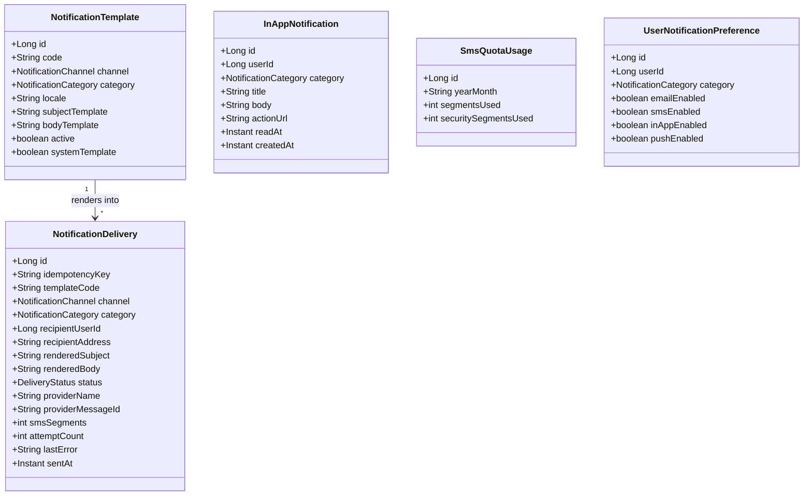
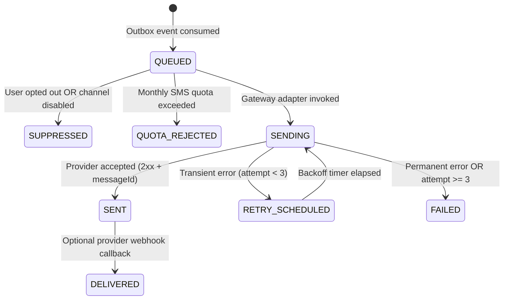

# F-04: Multi-Channel Notification Engine

| Field | Value |
|---|---|
| **ID** | `F-04` |
| **Title** | Multi-Channel Notification Engine |
| **Status** | `IN_PROGRESS` |
| **Priority** | `P0` |
| **Depends On** | `F-05, F-08` |
| **Blocks** | `F-01, M-02, M-03, M-04, M-05, M-06` |
| **Estimated Effort** | `L` |
| **Open Questions** | `Q-003, Q-004` |
| **Revision** | `1` |

---

## 1. Summary and Business Value

`F-04` provides the multi-channel notification infrastructure (`com.schoolerp.notifications`) for dispatching transactional and broadcast messages across `EMAIL`, `SMS`, `IN_APP`, and `PUSH` (stub) channels. Every school in Bangladesh and globally relies on timely SMS and in-app alerts for password OTPs (`F-01`), staff welcome invites (`M-02`), admission updates (`M-03`), guardian absence alerts (`M-04`), fee invoice/payment receipts (`M-05`), and emergency school notices (`M-06`). `F-04` gives each school localized (`en`/`bn`) templates, pluggable SMS/Email gateway strategies, asynchronous outbox-driven delivery with retry/dead-letter handling (`F-05`), and strict monthly SMS quota enforcement.

---

## 2. Scope and Explicit Non-Goals

### In Scope
- Four notification channels: `EMAIL`, `SMS`, `IN_APP`, and `PUSH` (interface + log stub for future mobile app).
- Strategy interfaces `SmsGatewayAdapter` (**SSL Wireless**, **BulkSMSBD**, **Twilio**, and **Console/DB Mock**) and `EmailGatewayAdapter` (**SMTP / JavaMail** and **SendGrid HTTP**).
- Support for both platform-managed SMS credits (shared sender ID with per-school monthly quota) and school-owned SMS gateway credentials stored encrypted in `app_settings` (`F-03`).
- Per-school customizable templates (`notification_templates`) with variable interpolation (`{{studentName}}`, `{{amount}}`, `{{otp}}`) and localized variants (`en` and `bn`).
- Append-only/status-tracked delivery log (`notification_deliveries`) with provider message ID, SMS segment count, error diagnostics, and idempotency key.
- In-app notification inbox (`in_app_notifications`) with unread counter, mark-as-read, and mark-all-read endpoints.
- Per-user channel opt-in/opt-out preferences (`user_notification_preferences`), while enforcing mandatory delivery for critical security alerts (`AUTH_*`).
- Monthly SMS usage tracking per school (`sms_quota_usage` table in tenant DB + platform quota limit in `tenants.features_json` / settings).
- Frontend Notification Bell + Inbox drawer, User Notification Preferences tab, and Admin Notification Templates & Delivery Logs pages.

### Explicit Non-Goals
- Two-way conversational SMS / WhatsApp chatbot replies — outbound notifications only in Phase 1.
- Native iOS/Android APNs/FCM mobile app push token registration (the `PUSH` channel strategy and schema hook are created now so Phase 2 mobile apps require zero refactoring).
- Notice board authoring, audience targeting by class/section, and scheduled broadcasts (covered in `M-06`, which delegates actual delivery to `F-04`).

---

## 3. Business Rules

- **BR-01 (`[ASSUMPTION -> Q-003]` — Dual SMS Credential Modes & Gateway Strategies)**: Each school configures `notification.sms.mode` as either `PLATFORM_CREDITS` (uses platform-level gateway credentials and decrements the school's monthly SMS quota) or `SCHOOL_OWNED` (uses the school's own encrypted gateway credentials configured in `app_settings`, e.g., `notification.sms.provider = SSL_WIRELESS | BULKSMSBD | TWILIO | MOCK`). See [`OPEN-QUESTIONS.md`](../OPEN-QUESTIONS.md#q-003-sms-gateway-providers-at-launch-f-04-m-04-m-05-m-06).
- **BR-02 (`[ASSUMPTION -> Q-004]` — Monthly SMS Quota & Transactional Grace Buffer)**: Under `PLATFORM_CREDITS` mode, each school has a monthly SMS segment limit (`notification.sms.monthly_quota`, seeded by plan: `BASIC = 500`, `PRO = 5000`, `ENTERPRISE = 25000`, plus any `notification.sms.extra_credits`). When usage reaches 100% of quota:
  - Bulk/broadcast SMS (`category = BROADCAST`, e.g. `M-06` notices) are rejected with `422 Unprocessable Entity` (`SMS_QUOTA_EXCEEDED`).
  - Critical transactional SMS (`category = SECURITY`, e.g. `F-01` OTPs) are permitted up to a 10% grace buffer (`1.10 * monthly_quota`). Beyond 110%, all platform-credit SMS are blocked until top-up or next calendar month reset. See [`OPEN-QUESTIONS.md`](../OPEN-QUESTIONS.md#q-004-monthly-sms-quota--overage-handling-f-04-m-06).
- **BR-03 (Idempotent Outbox Dispatch)**: Every outbound notification request carries a deterministic `idempotency_key` (e.g., `fee-payment-receipt:inv-1042:pay-88:SMS`). If `notification_deliveries` already contains a row with that `idempotency_key` in `SENT` or `DELIVERED` status, the dispatcher skips duplicate transmission.
- **BR-04 (Localized Template Resolution)**: When rendering a template (`template_code`), `NotificationTemplateRenderer` selects the recipient's preferred locale if present, falling back to the school's `school.locale` (`en` or `bn`), and finally `en`. Unknown placeholders fail validation on template save rather than sending raw `{{variable}}` text to parents.
- **BR-05 (SMS Segment Calculation)**: GSM-7 ASCII messages count as 1 segment up to 160 characters (153 chars per multipart segment); UCS-2 Unicode messages (including Bangla `bn` script) count as 1 segment up to 70 characters (67 chars per multipart segment). `sms_segments` is calculated and deducted accurately per recipient.
- **BR-06 (Retry & Exponential Backoff via `F-05`)**: Transient gateway errors (HTTP `429`, `502`, `503`, `504`, network timeout) mark the delivery `RETRY_SCHEDULED` and retry up to 3 times with exponential backoff ($10\text{s}, 60\text{s}, 300\text{s}$). Permanent errors (invalid phone format `400`, unsubscribed) mark the delivery `FAILED` immediately without retry.
- **BR-07 (Mandatory Security Notifications)**: Users can mute `BROADCAST` or `ACADEMIC` notifications on `EMAIL`/`SMS` via `user_notification_preferences`, but `SECURITY` category notifications (password reset, account lock) ignore opt-outs and are always delivered.

---

## 4. Configurability

### Per-School Settings (`app_settings`)

| Setting Key | Type | Default | Description | How Changed |
|---|---|---|---|---|
| `notification.email.enabled` | `BOOLEAN` | `true` | Master switch for outbound emails in this school | `PUT /api/v1/settings` (`settings.write`) |
| `notification.email.from_name` | `STRING` | `My School ERP` | Display name in outbound `From:` header | `PUT /api/v1/settings` (`settings.write`) |
| `notification.email.reply_to` | `STRING` | `noreply@school.edu` | Reply-To address for school emails | `PUT /api/v1/settings` (`settings.write`) |
| `notification.sms.enabled` | `BOOLEAN` | `true` | Master switch for outbound SMS in this school | `PUT /api/v1/settings` (`settings.write`) |
| `notification.sms.mode` | `STRING` | `PLATFORM_CREDITS` | `PLATFORM_CREDITS` or `SCHOOL_OWNED` | Platform `BILLING_OPERATOR` / `SUPER_ADMIN` |
| `notification.sms.provider` | `STRING` | `MOCK` | `SSL_WIRELESS`, `BULKSMSBD`, `TWILIO`, or `MOCK` | `PUT /api/v1/settings` (`settings.write`) |
| `notification.sms.sender_id` | `STRING` | `SCHOOLERP` | Approved masking/non-masking Sender ID | `PUT /api/v1/settings` (`settings.write`) |
| `notification.sms.api_key` | `SECRET` | `""` | Encrypted (`F-03`) gateway API key/token for `SCHOOL_OWNED` mode | `PUT /api/v1/settings` (`settings.write`) |
| `notification.sms.api_secret` | `SECRET` | `""` | Encrypted (`F-03`) gateway secret/SID for `SCHOOL_OWNED` mode | `PUT /api/v1/settings` (`settings.write`) |
| `notification.sms.monthly_quota` | `INTEGER` | `500` | Monthly included SMS segments under `PLATFORM_CREDITS` | Platform `/api/v1/platform/tenants/{slug}/sms-quota` |
| `notification.sms.extra_credits` | `INTEGER` | `0` | Rollover top-up SMS segments added by platform operator | Platform `/api/v1/platform/tenants/{slug}/sms-quota` |

### Feature Flags (`tenants.features_json`)
- `notifications`: Always enabled for `IN_APP` and transactional `EMAIL`.
- `sms_notifications`: Feature flag in `tenants.features_json` controlling whether the school can send `SMS` notifications.

### Strategy Interfaces
- `SmsGatewayAdapter`: `supports(SmsProviderType)` + `SmsSendResult send(SmsPayload, SmsGatewayCredentials)`
  - `SslWirelessSmsAdapter` (Bangladesh SSL Wireless REST API)
  - `BulkSmsBdAdapter` (Bangladesh BulkSMSBD API)
  - `TwilioSmsAdapter` (Global Twilio Programmable Messaging API)
  - `MockSmsAdapter` (Logs message and records `SENT` in `local`/`test`)
- `EmailGatewayAdapter`:
  - `SmtpEmailAdapter` (Spring `JavaMailSender`)
  - `SendGridEmailAdapter` (SendGrid v3 Mail Send API)

---

## 5. Domain Model



### Notification Delivery State Machine



---

## 6. Database

- **Flyway Migration**: `backend/src/main/resources/db/tenant/V7__notification_engine.sql`
- **Soft-Delete Strategy**: `notification_templates` has `deleted_at TIMESTAMP(6) NULL` (system templates cannot be deleted). `notification_deliveries` is an immutable operational delivery log (never deleted).
- **Money Columns**: None.

```sql
-- V7__notification_engine.sql
-- Multi-channel notification templates, delivery logs, in-app inbox, user preferences, and SMS quota counters.

CREATE TABLE notification_templates (
    id                BIGINT       NOT NULL AUTO_INCREMENT,
    code              VARCHAR(80)  NOT NULL,
    channel           VARCHAR(16)  NOT NULL,
    category          VARCHAR(30)  NOT NULL,
    locale            VARCHAR(10)  NOT NULL DEFAULT 'en',
    subject_template  VARCHAR(255) NULL,
    body_template     TEXT         NOT NULL,
    allowed_vars_json JSON         NOT NULL,
    active            BOOLEAN      NOT NULL DEFAULT TRUE,
    system_template   BOOLEAN      NOT NULL DEFAULT TRUE,
    created_at        TIMESTAMP(6) NOT NULL DEFAULT CURRENT_TIMESTAMP(6),
    updated_at        TIMESTAMP(6) NOT NULL DEFAULT CURRENT_TIMESTAMP(6) ON UPDATE CURRENT_TIMESTAMP(6),
    deleted_at        TIMESTAMP(6) NULL,
    PRIMARY KEY (id),
    UNIQUE KEY uk_nt_code_channel_locale (code, channel, locale)
) ENGINE=InnoDB DEFAULT CHARSET=utf8mb4;

CREATE TABLE notification_deliveries (
    id                   BIGINT       NOT NULL AUTO_INCREMENT,
    idempotency_key      VARCHAR(140) NOT NULL,
    template_code        VARCHAR(80)  NOT NULL,
    channel              VARCHAR(16)  NOT NULL,
    category             VARCHAR(30)  NOT NULL,
    recipient_user_id    BIGINT       NULL,
    recipient_address    VARCHAR(190) NOT NULL,
    rendered_subject     VARCHAR(255) NULL,
    rendered_body        TEXT         NOT NULL,
    status               VARCHAR(24)  NOT NULL DEFAULT 'QUEUED',
    provider_name        VARCHAR(40)  NULL,
    provider_message_id  VARCHAR(120) NULL,
    sms_segments         INT          NOT NULL DEFAULT 0,
    attempt_count        INT          NOT NULL DEFAULT 0,
    last_error            VARCHAR(500) NULL,
    next_retry_at        TIMESTAMP(6) NULL,
    sent_at              TIMESTAMP(6) NULL,
    created_at           TIMESTAMP(6) NOT NULL DEFAULT CURRENT_TIMESTAMP(6),
    updated_at           TIMESTAMP(6) NOT NULL DEFAULT CURRENT_TIMESTAMP(6) ON UPDATE CURRENT_TIMESTAMP(6),
    PRIMARY KEY (id),
    UNIQUE KEY uk_nd_idempotency (idempotency_key),
    KEY idx_nd_status_retry (status, next_retry_at),
    KEY idx_nd_recipient_created (recipient_user_id, created_at),
    KEY idx_nd_channel_created (channel, created_at)
) ENGINE=InnoDB DEFAULT CHARSET=utf8mb4;

CREATE TABLE in_app_notifications (
    id          BIGINT       NOT NULL AUTO_INCREMENT,
    user_id     BIGINT       NOT NULL,
    category    VARCHAR(30)  NOT NULL,
    title       VARCHAR(200) NOT NULL,
    body        TEXT         NOT NULL,
    action_url  VARCHAR(255) NULL,
    read_at     TIMESTAMP(6) NULL,
    created_at  TIMESTAMP(6) NOT NULL DEFAULT CURRENT_TIMESTAMP(6),
    PRIMARY KEY (id),
    KEY idx_ian_user_unread (user_id, read_at, created_at),
    CONSTRAINT fk_ian_user FOREIGN KEY (user_id) REFERENCES users (id)
) ENGINE=InnoDB DEFAULT CHARSET=utf8mb4;

CREATE TABLE user_notification_preferences (
    id              BIGINT       NOT NULL AUTO_INCREMENT,
    user_id         BIGINT       NOT NULL,
    category        VARCHAR(30)  NOT NULL,
    email_enabled   BOOLEAN      NOT NULL DEFAULT TRUE,
    sms_enabled     BOOLEAN      NOT NULL DEFAULT TRUE,
    in_app_enabled  BOOLEAN      NOT NULL DEFAULT TRUE,
    push_enabled    BOOLEAN      NOT NULL DEFAULT TRUE,
    updated_at      TIMESTAMP(6) NOT NULL DEFAULT CURRENT_TIMESTAMP(6) ON UPDATE CURRENT_TIMESTAMP(6),
    PRIMARY KEY (id),
    UNIQUE KEY uk_unp_user_category (user_id, category),
    CONSTRAINT fk_unp_user FOREIGN KEY (user_id) REFERENCES users (id)
) ENGINE=InnoDB DEFAULT CHARSET=utf8mb4;

CREATE TABLE sms_quota_usage (
    id                      BIGINT      NOT NULL AUTO_INCREMENT,
    year_month              CHAR(7)     NOT NULL,
    segments_used           INT         NOT NULL DEFAULT 0,
    security_segments_used  INT         NOT NULL DEFAULT 0,
    updated_at              TIMESTAMP(6) NOT NULL DEFAULT CURRENT_TIMESTAMP(6) ON UPDATE CURRENT_TIMESTAMP(6),
    PRIMARY KEY (id),
    UNIQUE KEY uk_squ_year_month (year_month)
) ENGINE=InnoDB DEFAULT CHARSET=utf8mb4;

-- Seed default notification settings
INSERT INTO app_settings (setting_key, setting_value) VALUES
    ('notification.email.enabled',       'true'),
    ('notification.email.from_name',     'My School'),
    ('notification.email.reply_to',      'noreply@school.edu'),
    ('notification.sms.enabled',         'true'),
    ('notification.sms.mode',            'PLATFORM_CREDITS'),
    ('notification.sms.provider',        'MOCK'),
    ('notification.sms.sender_id',       'SCHOOLERP'),
    ('notification.sms.monthly_quota',   '500'),
    ('notification.sms.extra_credits',   '0')
ON DUPLICATE KEY UPDATE setting_value = VALUES(setting_value);

-- Seed baseline English (en) and Bangla (bn) templates for Auth, Attendance, Fees, and Notices
INSERT INTO notification_templates (code, channel, category, locale, subject_template, body_template, allowed_vars_json) VALUES
    ('AUTH_PASSWORD_RESET_EMAIL', 'EMAIL', 'SECURITY', 'en', 'Reset your {{schoolName}} password', 'Hello {{fullName}}, use this link within {{ttlMinutes}} minutes to reset your password: {{resetUrl}}', '["schoolName","fullName","ttlMinutes","resetUrl"]'),
    ('AUTH_PASSWORD_RESET_EMAIL', 'EMAIL', 'SECURITY', 'bn', '{{schoolName}} পাসওয়ার্ড রিসেট', 'প্রিয় {{fullName}}, আগামী {{ttlMinutes}} মিনিটের মধ্যে পাসওয়ার্ড রিসেট করতে এই লিংকে ক্লিক করুন: {{resetUrl}}', '["schoolName","fullName","ttlMinutes","resetUrl"]'),
    ('AUTH_PASSWORD_RESET_SMS',   'SMS',   'SECURITY', 'en', NULL, '{{schoolName}}: Your password reset code is {{otp}}. Valid for {{ttlMinutes}} minutes.', '["schoolName","otp","ttlMinutes"]'),
    ('AUTH_PASSWORD_RESET_SMS',   'SMS',   'SECURITY', 'bn', NULL, '{{schoolName}}: আপনার পাসওয়ার্ড রিসেট কোড {{otp}}। মেয়াদ {{ttlMinutes}} মিনিট।', '["schoolName","otp","ttlMinutes"]'),
    ('ATTENDANCE_ABSENT_SMS',     'SMS',   'ACADEMIC', 'en', NULL, '{{schoolName}}: {{studentName}} (Roll {{rollNumber}}) was marked ABSENT on {{date}}.', '["schoolName","studentName","rollNumber","date"]'),
    ('ATTENDANCE_ABSENT_SMS',     'SMS',   'ACADEMIC', 'bn', NULL, '{{schoolName}}: {{studentName}} (রোল {{rollNumber}}) আজ {{date}} তারিখে অনুপস্থিত।', '["schoolName","studentName","rollNumber","date"]'),
    ('FEE_PAYMENT_RECEIPT_SMS',   'SMS',   'FINANCE',  'en', NULL, '{{schoolName}}: Received {{currency}} {{amount}} for {{studentName}} (Receipt {{receiptNo}}). Balance: {{balance}}.', '["schoolName","currency","amount","studentName","receiptNo","balance"]'),
    ('FEE_PAYMENT_RECEIPT_SMS',   'SMS',   'FINANCE',  'bn', NULL, '{{schoolName}}: {{studentName}}-এর ফি বাবদ {{currency}} {{amount}} গৃহীত হয়েছে (রসিদ {{receiptNo}})। বকেয়া: {{balance}}।', '["schoolName","currency","amount","studentName","receiptNo","balance"]');

-- Seed permissions
INSERT INTO permissions (code, description) VALUES
    ('notification.template.read',  'View school notification templates'),
    ('notification.template.write', 'Edit school notification templates'),
    ('notification.delivery.read',  'View outbound email/SMS delivery logs and quota usage'),
    ('notification.test.send',      'Send test email or SMS notifications');

INSERT INTO role_permissions (role_id, permission_id)
SELECT r.id, p.id
FROM roles r
JOIN permissions p ON p.code IN (
    'notification.template.read',
    'notification.template.write',
    'notification.delivery.read',
    'notification.test.send'
)
WHERE r.code = 'SCHOOL_ADMIN';
```

---

## 7. API

| HTTP Method | Path | Request DTO | Response DTO | Permission | RBAC Scope |
|---|---|---|---|---|---|
| `GET` | `/api/v1/notifications/me` | `PageRequest(unreadOnly, page, size)` | `PageResponse<InAppNotificationDto>` | Authenticated (Any user) | `OWN` |
| `GET` | `/api/v1/notifications/me/unread-count` | — | `UnreadCountResponse(unreadCount)` | Authenticated (Any user) | `OWN` |
| `PATCH` | `/api/v1/notifications/me/{id}/read` | — | `InAppNotificationDto` | Authenticated (Any user) | `OWN` |
| `POST` | `/api/v1/notifications/me/read-all` | — | `204 No Content` | Authenticated (Any user) | `OWN` |
| `GET` | `/api/v1/notifications/me/preferences` | — | `List<UserNotificationPreferenceDto>` | Authenticated (Any user) | `OWN` |
| `PUT` | `/api/v1/notifications/me/preferences` | `UpdatePreferencesRequest(preferences)` | `List<UserNotificationPreferenceDto>` | Authenticated (Any user) | `OWN` |
| `GET` | `/api/v1/notifications/templates` | `TemplateFilter(channel, category, locale, page, size)` | `PageResponse<NotificationTemplateDto>` | `notification.template.read` | `ALL` |
| `PUT` | `/api/v1/notifications/templates/{id}` | `UpdateTemplateRequest(subjectTemplate, bodyTemplate, active)` | `NotificationTemplateDto` | `notification.template.write` | `ALL` |
| `GET` | `/api/v1/notifications/deliveries` | `DeliveryFilter(channel, status, category, from, to, page, size)` | `PageResponse<NotificationDeliveryDto>` | `notification.delivery.read` | `ALL` |
| `GET` | `/api/v1/notifications/sms-quota` | — | `SmsQuotaStatusResponse(mode, yearMonth, monthlyQuota, extraCredits, segmentsUsed, remainingSegments)` | `notification.delivery.read` | `ALL` |
| `POST` | `/api/v1/notifications/test-send` | `TestNotificationRequest(channel, recipientAddress, templateCode)` | `NotificationDeliveryDto` | `notification.test.send` | `ALL` |
| `PUT` | `/api/v1/platform/tenants/{slug}/sms-quota` | `UpdateTenantSmsQuotaRequest(mode, monthlyQuota, addExtraCredits)` | `SmsQuotaStatusResponse` | Platform `SUPER_ADMIN`, `BILLING_OPERATOR` | Platform |

---

## 8. Permissions to Seed and Default Role Grants

| Permission Code | Description | `SCHOOL_ADMIN` | `REGISTRAR` | `ACCOUNTANT` | `TEACHER` | `STUDENT` | `GUARDIAN` |
|---|---|:---:|:---:|:---:|:---:|:---:|:---:|
| `notification.template.read` | View school notification templates | Yes (`ALL`) | Yes (`ALL`) | No | No | No | No |
| `notification.template.write` | Customize localized (`en`/`bn`) templates | Yes (`ALL`) | No | No | No | No | No |
| `notification.delivery.read` | View outbound SMS/email delivery log & quota | Yes (`ALL`) | Yes (`ALL`) | Yes (`ALL`) | No | No | No |
| `notification.test.send` | Trigger test email/SMS to verify gateway config | Yes (`ALL`) | No | No | No | No | No |

*(Note: All authenticated users (`SCHOOL_ADMIN`, `REGISTRAR`, `ACCOUNTANT`, `TEACHER`, `STUDENT`, `GUARDIAN`) have implicit `OWN`-scope access to `/api/v1/notifications/me/**` for their personal in-app notification inbox and preferences.)*

---

## 9. Events and Notifications Emitted or Consumed

`F-04` is the primary consumer of domain notification requests published via the `F-05` transactional outbox:

| Outbox Event Consumed | Source Module | Channels Dispatched | Category |
|---|---|---|---|
| `iam.password_reset.requested` | `F-01` | `EMAIL` or `SMS` | `SECURITY` |
| `iam.verification.requested` | `F-01` | `EMAIL` or `SMS` | `SECURITY` |
| `staff.account.invited` | `M-02` | `EMAIL`, `SMS` | `SECURITY` |
| `admission.status.changed` | `M-03` | `EMAIL`, `SMS`, `IN_APP` | `ACADEMIC` |
| `attendance.student.absent` | `M-04` | `SMS`, `IN_APP` | `ACADEMIC` |
| `fees.invoice.published` | `M-05` | `EMAIL`, `SMS`, `IN_APP` | `FINANCE` |
| `fees.payment.received` | `M-05` | `EMAIL`, `SMS`, `IN_APP` | `FINANCE` |
| `notice.published` | `M-06` | `IN_APP`, optional `EMAIL` / `SMS` | `BROADCAST` |

---

## 10. Tenancy and Security Considerations

- **Explicit Tenant Context Binding in Outbox Consumers**: Every message consumed from `F-05` carries `tenantSlug`. `NotificationDispatchWorker` binds `TenantContext.set(tenantSlug)` in a `try / finally` block before loading school templates, decrypting gateway credentials, checking SMS quota, or writing `notification_deliveries`.
- **Template Injection Prevention (No SpEL / No Freemarker Code Execution)**: `NotificationTemplateRenderer` uses a strict regex placeholder replacer (`\{\{([a-zA-Z0-9_]+)\}\}`) verified against `allowed_vars_json` and HTML-escapes values in `EMAIL` HTML bodies. Server-Side Template Injection (SSTI) is structurally impossible.
- **Masking Sensitive OTPs in Delivery Logs**: When `category = SECURITY` (e.g., `AUTH_PASSWORD_RESET_SMS` or `AUTH_PASSWORD_RESET_EMAIL`), `NotificationDispatcher` masks the `{{otp}}` / `{{resetUrl}}` values as `******` before persisting `rendered_body` into `notification_deliveries` so a school admin viewing `/api/v1/notifications/deliveries` cannot hijack another user's active reset token.
- **Audit Logging (`audit_log`)**:
  - `NOTIFICATION_TEMPLATE_UPDATED` (records old and new template strings)
  - `NOTIFICATION_TEST_SENT` (records actor and channel)
  - `PLATFORM_SMS_QUOTA_UPDATED` (recorded in `school_master.platform_audit_log`)

---

## 11. Frontend

### Routes, Pages & Components (`src/features/notifications`)
- **Topbar Notification Bell (`NotificationBellPopover.tsx`)**: Polls `/api/v1/notifications/me/unread-count` via TanStack Query, shows unread badge, renders dropdown of latest 10 in-app notifications with "Mark all as read" and deep links (`actionUrl`).
- `/notifications` (`UserNotificationsPage.tsx`): Full paginated in-app notification inbox and `NotificationPreferencesTab.tsx` (per-category toggles for `ACADEMIC`, `FINANCE`, `BROADCAST`).
- `/settings/notifications` (`NotificationSettingsPage.tsx`, gated by `notification.template.read` / `notification.delivery.read`):
  - **SMS Quota & Gateway Banner (`SmsQuotaBanner.tsx`)**: Progress bar of monthly SMS segments used vs remaining, current mode (`PLATFORM_CREDITS` vs `SCHOOL_OWNED`), and "Send Test SMS/Email" modal.
  - **Templates Editor (`NotificationTemplatesTable.tsx`)**: Edit `en` and `bn` templates with clickable `allowed_vars_json` chips and live character/SMS-segment counter.
  - **Delivery Logs (`NotificationDeliveriesTable.tsx`)**: Filterable log by channel, status (`SENT`, `FAILED`, `QUOTA_REJECTED`), date range, and provider error details.

### Module Registration (`src/app/modules.ts`)
- Registers `/settings/notifications` under School Settings navigation for `SCHOOL_ADMIN` and `REGISTRAR`.

### Required i18n Keys (`en` and `bn`)

| i18n Key | English (`en`) | Bangla (`bn`) |
|---|---|---|
| `notifications.inbox.title` | Notifications | নোটিফিকেশনসমূহ |
| `notifications.inbox.markAllRead` | Mark all as read | সবগুলো পঠিত হিসেবে চিহ্নিত করুন |
| `notifications.inbox.empty` | You have no notifications. | আপনার কোনো নোটিফিকেশন নেই। |
| `notifications.preferences.title` | Notification Preferences | নোটিফিকেশন পছন্দসমূহ |
| `notifications.preferences.securityLocked` | Security alerts cannot be disabled. | নিরাপত্তা সংক্রান্ত সতর্কবার্তা বন্ধ করা যাবে না। |
| `notifications.admin.templatesTitle` | Notification Templates (EN / BN) | নোটিফিকেশন টেমপ্লেট (ইংরেজি / বাংলা) |
| `notifications.admin.deliveriesTitle` | Delivery Logs | ডেলিভারি লগ |
| `notifications.admin.smsQuotaTitle` | Monthly SMS Quota | মাসিক এসএমএস কোটা |
| `notifications.admin.smsSegmentsRemaining` | {{remaining}} of {{total}} SMS segments remaining this month | এই মাসে {{total}}টির মধ্যে {{remaining}}টি এসএমএস অবশিষ্ট আছে |
| `notifications.admin.testSend` | Send Test Message | পরীক্ষামূলক বার্তা পাঠান |

---

## 12. Test Plan

### Unit Tests
- `NotificationTemplateRendererTest`: Verifies placeholder substitution for `en` and `bn`, rejection of undeclared variables not in `allowed_vars_json`, HTML escaping in email bodies, and OTP masking for `SECURITY` templates.
- `SmsSegmentCalculatorTest`: Verifies GSM-7 single (<=160) and multipart (153/part) segment counts vs Bangla UCS-2 Unicode single (<=70) and multipart (67/part) segment counts.
- `SmsQuotaGuardTest`: Verifies `BROADCAST` SMS is blocked at 100% quota (`SMS_QUOTA_EXCEEDED`), `SECURITY` SMS is allowed up to 110% grace buffer and blocked above 110%, and `extra_credits` are consumed after base `monthly_quota`.

### Integration Tests (Testcontainers MySQL)
- `NotificationDispatchPipelineIT`: Publish outbox event -> verify `NotificationDispatchWorker` renders localized template, invokes `MockSmsAdapter`, records `SENT` in `notification_deliveries`, increments `sms_quota_usage.segments_used`, and skips duplicate dispatch when re-invoked with the same `idempotency_key`.
- `NotificationRetryAndBackoffIT`: Configure mock gateway to throw transient 503 twice then succeed -> verify `attempt_count` increments to 3 and final status transitions `QUEUED -> RETRY_SCHEDULED -> SENT`.

### Two-School Tenant Isolation Test (`alpha` vs `beta`)
- `NotificationTenantIsolationIT`:
  1. Customize `ATTENDANCE_ABSENT_SMS` template in `alpha` with custom wording and set `alpha`'s `notification.sms.monthly_quota = 10`.
  2. Exhaust `alpha`'s 10 SMS segments -> verify subsequent `BROADCAST` SMS in `alpha` is marked `QUOTA_REJECTED`.
  3. Dispatch `ATTENDANCE_ABSENT_SMS` in `beta` -> verify `beta` uses its own untouched default template, succeeds (`SENT`), and `beta`'s `in_app_notifications` and `notification_deliveries` are invisible when querying `/api/v1/notifications/**` with `alpha` credentials.

### Permission & Scope Boundary Tests
- Verify `STUDENT` and `GUARDIAN` can read and mark their `OWN` `in_app_notifications` (`200`), cannot mark another user's notification (`404`/`403`), and receive `403 Forbidden` on `/api/v1/notifications/templates` and `/api/v1/notifications/deliveries`.

---

## 13. Acceptance Criteria

- [ ] Every user sees an in-app notification bell with live unread count and can mark individual or all notifications as read.
- [ ] Users can customize their notification preferences (`EMAIL`, `SMS`, `IN_APP`) per category, while `SECURITY` alerts remain mandatory.
- [ ] `SCHOOL_ADMIN` can edit English (`en`) and Bangla (`bn`) notification templates with validated placeholders and live SMS segment calculation.
- [ ] Outbound SMS and Email messages are dispatched asynchronously via the outbox with idempotency protection and automatic exponential backoff retries on transient failures.
- [ ] Security OTPs and password reset links are masked (`******`) in `notification_deliveries` logs.
- [ ] Monthly SMS quota accurately counts GSM-7 and Bangla UCS-2 segments, blocks bulk SMS at 100% usage, allows security OTPs up to 110%, and supports platform operator top-ups.

---

## 14. Implementation Slices

- [x] **Slice 1: Schema Migration, Templates & Segment Calculator** — Add `V7__notification_engine.sql`, entities/repositories, `NotificationTemplateRenderer` (with SSTI guard & OTP masking), and `SmsSegmentCalculator` with unit tests.

- [ ] **Slice 2: Gateway Adapters, Quota Guard & Outbox Dispatcher** — Implement `SmsGatewayAdapter` (`Mock`, `SslWireless`, `BulkSmsBd`, `Twilio`), `EmailGatewayAdapter` (`Smtp`, `SendGrid`), `SmsQuotaService`, and `NotificationDispatchWorker` wired to `F-05` outbox with retry/idempotency and 2-school isolation tests.

- [ ] **Slice 3: In-App Inbox, User Preferences & Admin Management APIs** — Expose `/api/v1/notifications/me/**`, `/templates`, `/deliveries`, `/sms-quota`, `/test-send`, and platform `/api/v1/platform/tenants/{slug}/sms-quota`.

- [ ] **Slice 4: Frontend Notification Bell, Inbox & Admin Console** — Build `NotificationBellPopover.tsx`, `UserNotificationsPage.tsx`, and `NotificationSettingsPage.tsx` (templates editor, quota banner, delivery logs) with `en`/`bn` translations.

---

## 15. Risks and Mitigations

| Risk | Impact | Mitigation |
|---|---|---|
| Bangla (`bn`) Unicode SMS uses 70 chars/segment instead of 160, causing schools to exhaust SMS quotas 2.3x faster than expected | High (unexpected quota exhaustion) | Display a live GSM-7 vs Unicode (`bn`) character & segment counter in the Template Editor and Notice Broadcast UI (`M-06`) before sending. |
| Slow external SMS gateway HTTP calls block database connections or web threads | High (connection pool starvation) | Never call SMS/Email gateways inside an HTTP request transaction; always write to the `F-05` outbox and execute HTTP calls in `NotificationDispatchWorker` outside DB transactions. |
| School admin views `notification_deliveries` to steal a user's password reset OTP | High (account takeover) | Mask all `SECURITY` category variables (`otp`, `resetUrl`, `token`) as `******` prior to storing `rendered_body` in `notification_deliveries`. |

---

## 16. How to Extend or Customize Later

- **Adding a New Regional SMS Gateway (e.g., Greenweb BD, Infobip, MSG91)**: Create a single `@Component` implementing `SmsGatewayAdapter` with `supports(SmsProviderType.INFOBIP)` — no schema or dispatcher changes needed.
- **Adding WhatsApp Business Cloud API or Mobile FCM Push**: Implement `ChannelDispatcher` for `NotificationChannel.PUSH` using Firebase Admin SDK once the mobile app registers device tokens.

---

## 17. Revision History

| Revision | Date | Author | Changes |
|---|---|---|---|
| `1` | 2026-11-04 | Antigravity | Initial comprehensive plan for `F-04` Multi-Channel Notification Engine. |
