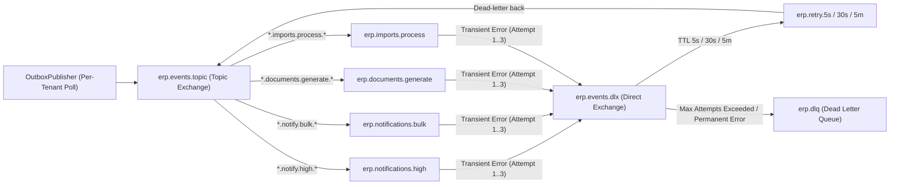
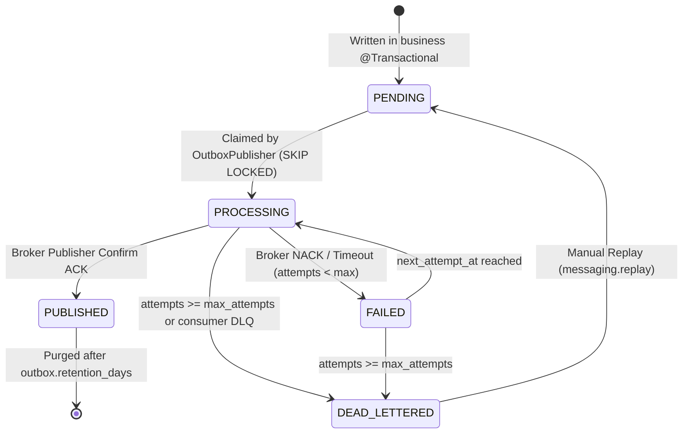

# F-05: Asynchronous Messaging, RabbitMQ Broker, and Transactional Outbox

| Field | Value |
|---|---|
| **ID** | `F-05` |
| **Title** | Asynchronous Messaging, RabbitMQ Broker, and Transactional Outbox |
| **Status** | `DONE` |
| **Priority** | `P0` |
| **Depends On** | `F-08` |
| **Blocks** | `F-04, F-07, F-10, M-04, M-05, M-06` |
| **Estimated Effort** | `M` |
| **Open Questions** | `None (See ADR 0002)` |
| **Revision** | `1` |

---

## 1. Summary and Business Value

This foundation item introduces a reliable, tenant-aware asynchronous event pipeline powered by RabbitMQ 3.13 (`spring-boot-starter-amqp`), paired with a per-school Transactional Outbox (`outbox_events`) and an idempotent consumer inbox (`processed_events`). By recording domain events inside the same database transaction as business mutations (such as fee payments, attendance submissions, or user onboarding) and relaying them asynchronously, schools never lose critical SMS/email notifications, receipt PDFs, or bulk import jobs even if an external broker or third-party gateway experiences temporary downtime. Furthermore, explicit priority queues and tenant-fair routing ensure that one school's 5,000-recipient notice broadcast never delays another school's urgent password-reset OTP.

---

## 2. Scope and Explicit Non-Goals

### In Scope
- RabbitMQ 3.13 broker integration in `docker-compose.yml` (with Management UI on port `15672`) and Spring AMQP configuration (`com.schoolerp.shared.messaging`).
- Per-tenant `outbox_events` table and `processed_events` idempotent consumer inbox table (`V5__outbox_and_inbox_events.sql`).
- `OutboxEventWriter` application helper that serializes domain events into `outbox_events` within the caller's active `@Transactional` boundary.
- `OutboxPublisher` scheduled relay that iterates over active tenants, claims `PENDING` outbox rows using `SELECT ... FOR UPDATE SKIP LOCKED`, publishes them to RabbitMQ with mandatory `X-Tenant-Slug` and `X-Event-ID` headers, and marks them `PUBLISHED`.
- Declarative RabbitMQ topology (`erp.events.topic`, `erp.events.dlx`, high-priority vs bulk queues, exponential backoff retry tiers `5s` -> `30s` -> `5m`, and terminal `erp.dlq`).
- `TenantAwareMessageListener` wrapper / AOP aspect that validates `X-Tenant-Slug` against `TenantRegistry`, binds `TenantContext` inside a `try / finally` block, enforces idempotency via `processed_events`, and routes permanent failures to `erp.dlq`.
- School Admin and Platform Operator Dead-Letter & Outbox inspection and manual replay API (`/api/v1/messaging/outbox`) and Admin UI page.
- Retention cleanup task purging `PUBLISHED` outbox rows and `processed_events` older than `outbox.retention_days`.

### Explicit Non-Goals
- Apache Kafka or long-term event-sourcing log replay (explicitly rejected in [ADR 0002](../../adr/0002-async-message-broker-rabbitmq.md)).
- Concrete SMS or Email gateway delivery implementations (handled in `F-04`).
- Concrete PDF rendering or CSV import parsing logic (handled in `F-07` and `F-10`).
- Cross-tenant event broadcasting within tenant business code (strictly forbidden by `.agent/rules/01-tenancy.md`).

---

## 3. Business Rules

- **BR-01 (Atomicity of State and Event)**: Any business operation that triggers an asynchronous side effect (notification, PDF generation, webhook reconciliation, audit projection) MUST write an `OutboxEvent` row in the same school database transaction as the domain entity mutation. Publishing directly to RabbitMQ inside a `@Transactional` business method is forbidden.
- **BR-02 (Mandatory Tenant Header)**: Every message published to RabbitMQ MUST carry the non-empty header `X-Tenant-Slug` matching the originating school database, plus `X-Event-ID` (UUID v4), `X-Event-Type`, and `X-Correlation-ID`.
- **BR-03 (Strict Consumer Tenant Binding)**: Every RabbitMQ listener MUST resolve `X-Tenant-Slug`, verify the tenant is `ACTIVE` in `TenantRegistry`, and bind `TenantContext.set(tenantSlug)` before opening a database transaction, clearing it in a `finally` block (`TenantContext.clear()`). Messages with missing, unknown, or `SUSPENDED` tenant slugs MUST be rejected directly to `erp.dlq` without retry.
- **BR-04 (Idempotent Consumption)**: Before invoking business consumer logic, the listener wrapper MUST insert `(event_id, consumer_group)` into the school's `processed_events` table. If a duplicate key conflict occurs, the message is acknowledged (`ACK`) immediately as a no-op so at-least-once broker delivery guarantees effectively-once business execution.
- **BR-05 (Tiered Exponential Retry & Dead-Lettering)**: Transient consumer exceptions trigger routing through dead-letter retry queues with fixed TTL tiers: Attempt 1 -> `5s` (`erp.retry.5s`), Attempt 2 -> `30s` (`erp.retry.30s`), Attempt 3 -> `300s` (`erp.retry.5m`). After `max_attempts` (default `3`), the message is routed to `erp.dlq` and the corresponding `outbox_events` row is updated to `DEAD_LETTERED` with `last_error`.
- **BR-06 (High-Priority vs Bulk Queue Isolation)**: Interactive transactional events (`auth.otp_requested`, `auth.password_reset`, `fees.payment_received`) route to `erp.notifications.high`, while batch workloads (`notices.broadcast`, `documents.generate`, `imports.process`) route to dedicated bulk queues with independent concurrency pools so bulk jobs cannot starve interactive traffic.
- **BR-07 (Audited Manual Replay)**: Replaying a `FAILED` or `DEAD_LETTERED` outbox event resets its status to `PENDING`, increments `replay_count`, and records an `OUTBOX_EVENT_REPLAYED` entry in `audit_log`.

---

## 4. Configurability

### Per-School Settings (`app_settings`)

| Setting Key | Type | Default | Description | How Changed |
|---|---|---|---|---|
| `outbox.retention_days` | `INTEGER` | `30` | Days to retain `PUBLISHED` rows in `outbox_events` and rows in `processed_events` before automatic cleanup. | `PUT /api/v1/settings` by `SCHOOL_ADMIN` |
| `outbox.max_attempts` | `INTEGER` | `3` | Maximum delivery/consumption attempts before marking an event `DEAD_LETTERED`. | `PUT /api/v1/settings` by `SCHOOL_ADMIN` |
| `outbox.batch_size` | `INTEGER` | `50` | Maximum `PENDING` outbox events claimed per relay poll cycle for this school. | `PUT /api/v1/settings` by `SCHOOL_ADMIN` |

### Application Properties (`application.yml` / Environment Variables)

| Property | Env Var | Default | Description |
|---|---|---|---|
| `spring.rabbitmq.host` | `RABBITMQ_HOST` | `localhost` | RabbitMQ broker hostname |
| `spring.rabbitmq.port` | `RABBITMQ_PORT` | `5672` | RabbitMQ AMQP port |
| `spring.rabbitmq.username` | `RABBITMQ_USERNAME` | `erp` | Broker username |
| `spring.rabbitmq.password` | `RABBITMQ_PASSWORD` | `erp` (dev only) | Broker password (required in `prod`) |
| `app.messaging.relay-poll-ms` | `APP_MESSAGING_RELAY_POLL_MS` | `1000` | Interval in milliseconds between `OutboxPublisher` poll cycles across active schools |

### Feature Flags (`tenants.features_json`)
- Outbox and core messaging are platform-wide infrastructure enabled for all schools (`core`). The Admin Outbox Inspector UI tab is gated by permission `messaging.read` rather than a commercial module flag.

### Strategy Interfaces / Plug-in Points
- `DomainEventConsumer<T extends DomainEvent>`: Pluggable interface implemented by downstream modules (`F-04`, `F-07`, `F-10`, `M-04`, `M-05`, `M-06`). Annotated with `@ErpQueueListener(queue = "...", eventType = "...")`, automatically wrapped by `TenantAwareMessageListener`.

---

## 5. Domain Model

### Entities & Value Objects (`com.schoolerp.shared.messaging`)
- **`OutboxEvent` (Entity, per-tenant DB)**:
  - `id` (`Long`), `eventId` (`UUID` string), `aggregateType` (`String`, e.g., `INVOICE`, `ATTENDANCE`, `USER`), `aggregateId` (`String`), `eventType` (`String`, e.g., `fees.payment_received`), `routingKey` (`String`, e.g., `tenant.alpha.fees.payment_received`), `priority` (`EventPriority`: `HIGH`, `NORMAL`, `BULK`), `payloadJson` (`String`), `headersJson` (`String`), `status` (`OutboxStatus`), `attempts` (`int`), `replayCount` (`int`), `nextAttemptAt` (`Instant`), `publishedAt` (`Instant`), `lastError` (`String`), `createdAt` (`Instant`).
- **`ProcessedEvent` (Entity, per-tenant DB)**:
  - `id` (`Long`), `eventId` (`String`), `consumerGroup` (`String`), `eventType` (`String`), `processedAt` (`Instant`).
- **`Envelope<T>` (Value Object)**:
  - Standardized JSON wire format sent over RabbitMQ: `{ "eventId": "uuid", "tenantSlug": "alpha", "eventType": "fees.payment_received", "aggregateType": "PAYMENT", "aggregateId": "1042", "occurredAt": "2026-11-04T10:15:30Z", "correlationId": "uuid", "payload": { ... } }`.

### RabbitMQ Exchange & Queue Topology



### Outbox Event State Machine



---

## 6. Database

### Flyway Migration
- **File**: `backend/src/main/resources/db/tenant/V5__outbox_and_inbox_events.sql`
- **Soft-Delete Strategy**: Outbox and inbox tables are operational event journals, not academic/financial records; they are retained for `outbox.retention_days` (default 30 days) and purged in batches once `PUBLISHED`. `DEAD_LETTERED` rows are never auto-purged.
- **Money Columns**: None in this migration (`DECIMAL(12,2)` payloads inside `payload_json` are serialized as exact strings).

```sql
-- Transactional outbox and idempotent consumer inbox per school database.

CREATE TABLE outbox_events (
    id              BIGINT       NOT NULL AUTO_INCREMENT,
    event_id        VARCHAR(36)  NOT NULL,
    aggregate_type  VARCHAR(80)  NOT NULL,
    aggregate_id    VARCHAR(100) NOT NULL,
    event_type      VARCHAR(120) NOT NULL,
    routing_key     VARCHAR(180) NOT NULL,
    priority        VARCHAR(16)  NOT NULL DEFAULT 'NORMAL',
    payload_json    JSON         NOT NULL,
    headers_json    JSON         NULL,
    status          VARCHAR(24)  NOT NULL DEFAULT 'PENDING',
    attempts        INT          NOT NULL DEFAULT 0,
    replay_count    INT          NOT NULL DEFAULT 0,
    next_attempt_at TIMESTAMP(6) NOT NULL DEFAULT CURRENT_TIMESTAMP(6),
    published_at    TIMESTAMP(6) NULL,
    last_error      TEXT         NULL,
    created_at      TIMESTAMP(6) NOT NULL DEFAULT CURRENT_TIMESTAMP(6),
    updated_at      TIMESTAMP(6) NOT NULL DEFAULT CURRENT_TIMESTAMP(6) ON UPDATE CURRENT_TIMESTAMP(6),
    PRIMARY KEY (id),
    UNIQUE KEY uk_outbox_event_id (event_id),
    KEY idx_outbox_poll (status, next_attempt_at, priority, id),
    KEY idx_outbox_aggregate (aggregate_type, aggregate_id),
    KEY idx_outbox_created (created_at)
) ENGINE=InnoDB DEFAULT CHARSET=utf8mb4;

CREATE TABLE processed_events (
    id              BIGINT       NOT NULL AUTO_INCREMENT,
    event_id        VARCHAR(36)  NOT NULL,
    consumer_group  VARCHAR(100) NOT NULL,
    event_type      VARCHAR(120) NOT NULL,
    processed_at    TIMESTAMP(6) NOT NULL DEFAULT CURRENT_TIMESTAMP(6),
    PRIMARY KEY (id),
    UNIQUE KEY uk_processed_event_consumer (event_id, consumer_group),
    KEY idx_processed_at (processed_at)
) ENGINE=InnoDB DEFAULT CHARSET=utf8mb4;

INSERT INTO app_settings (setting_key, setting_value) VALUES
    ('outbox.retention_days', '30'),
    ('outbox.max_attempts',   '3'),
    ('outbox.batch_size',     '50');

INSERT INTO permissions (code, description) VALUES
    ('messaging.read',   'View transactional outbox events and dead-letter queue status'),
    ('messaging.replay', 'Replay failed or dead-lettered outbox events');

INSERT INTO role_permissions (role_id, permission_id)
SELECT r.id, p.id
FROM roles r
JOIN permissions p ON p.code IN ('messaging.read', 'messaging.replay')
WHERE r.code = 'SCHOOL_ADMIN';
```

---

## 7. API

All tenant endpoints require `X-Tenant-ID` (or subdomain resolution) and JWT `BearerAuth`.

| Method | Path | Request DTO | Response DTO | Permission | RBAC Scope | Description |
|---|---|---|---|---|---|---|
| `GET` | `/api/v1/messaging/outbox` | Query: `status`, `eventType`, `aggregateType`, `from`, `to`, `page`, `size` | `Page<OutboxEventSummaryDto>` | `messaging.read` | `ALL` | Paginated list of school's outbox events (filterable by `DEAD_LETTERED`, `FAILED`, `PENDING`, `PUBLISHED`). |
| `GET` | `/api/v1/messaging/outbox/{eventId}` | — | `OutboxEventDetailDto` | `messaging.read` | `ALL` | Inspect full payload, headers, attempt count, and stack/error trace of a specific outbox event. |
| `POST` | `/api/v1/messaging/outbox/{eventId}/replay` | `ReplayOutboxRequest` (`reason`) | `OutboxEventDetailDto` | `messaging.replay` | `ALL` | Reset a `FAILED` or `DEAD_LETTERED` event to `PENDING` for immediate re-publication and write an audit log entry. |
| `POST` | `/api/v1/messaging/outbox/replay-batch` | `BatchReplayOutboxRequest` (`eventIds`, `reason`) | `BatchReplayResultDto` | `messaging.replay` | `ALL` | Bulk replay up to 100 `DEAD_LETTERED` or `FAILED` events for the school. |
| `GET` | `/api/v1/messaging/stats` | — | `OutboxStatsDto` | `messaging.read` | `ALL` | Counts of `PENDING`, `PROCESSING`, `FAILED`, `DEAD_LETTERED`, and oldest pending event lag in seconds. |

---

## 8. Permissions to Seed and Default Role Grants

| Permission Code | Description | `SCHOOL_ADMIN` | `REGISTRAR` | `ACCOUNTANT` | `TEACHER` | `STUDENT` | `GUARDIAN` |
|---|---|---|---|---|---|---|---|
| `messaging.read` | View transactional outbox events and dead-letter queue status | Yes (`ALL`) | No | No | No | No | No |
| `messaging.replay` | Replay failed or dead-lettered outbox events | Yes (`ALL`) | No | No | No | No | No |

---

## 9. Events and Notifications Emitted or Consumed

`F-05` provides the transport infrastructure for all domain events across the ERP. Standard routing key pattern: `tenant.<tenantSlug>.<category>.<priority>.<eventName>`:

| Event Category | Routing Key Pattern | Target Queue | Downstream Consumer Item | Channels |
|---|---|---|---|---|
| Interactive Auth & Alerts | `tenant.<slug>.notify.high.*` | `erp.notifications.high` | `F-04` (SMS/Email Notification Engine) | `SMS`, `EMAIL` |
| Bulk Broadcasts & Reminders | `tenant.<slug>.notify.bulk.*` | `erp.notifications.bulk` | `F-04`, `M-04`, `M-05`, `M-06` | `SMS`, `EMAIL`, `IN_APP`, `PUSH` |
| Document & PDF Rendering | `tenant.<slug>.documents.generate.*` | `erp.documents.generate` | `F-07` (PDF Generation Engine) | Internal / `IN_APP` |
| Bulk Data Import Jobs | `tenant.<slug>.imports.process.*` | `erp.imports.process` | `F-10` (Bulk Import/Export Engine) | Internal / `EMAIL` |

---

## 10. Tenancy and Security Considerations

- **Physical Database Isolation**: Each school has its own `outbox_events` and `processed_events` tables inside `school<slug>`. No `tenant_id` column exists on either table.
- **Strict Tenant Context Binding in Consumers**: `TenantAwareMessageListener` extracts `X-Tenant-Slug` from the AMQP message headers, validates that it matches the `tenantSlug` inside the JSON `Envelope`, verifies the tenant is `ACTIVE` in `TenantRegistry`, and calls `TenantContext.set(slug)` inside a `try` block with `TenantContext.clear()` in `finally`. If `X-Tenant-Slug` is missing or mismatches the payload `tenantSlug`, the listener logs a security warning and rejects the message to `erp.dlq` (`requeue = false`).
- **Per-Tenant Fair Polling**: `OutboxPublisher` iterates through active tenants from `TenantRegistry` using a bounded `outbox.batch_size` (default 50) per school per cycle, preventing a single school that just queued 5,000 notice events from monopolizing the publisher thread.
- **Distributed Lock on Relay Poll (`F-08` Redis)**: Uses a short-lived Redis lock `lock:<tenantSlug>:outbox:poll` (coupled with MySQL `FOR UPDATE SKIP LOCKED`) so multiple application instances do not contend on the same school's outbox batch.
- **Audit Logging**: Manual event replays (`POST /api/v1/messaging/outbox/{eventId}/replay` and `/replay-batch`) record an `OUTBOX_EVENT_REPLAYED` action in `audit_log` with the actor's user ID, `eventId`, previous status, and operator reason.
- **PII Handling**: Sensitive secrets (plaintext passwords, raw OTP codes) MUST NOT be stored in `outbox_events.payload_json` if avoidable, or must be masked before displaying in `/api/v1/messaging/outbox/{eventId}` (`JsonPayloadMasker` masks fields named `password`, `otp`, `token`, `secret`).

---

## 11. Frontend

### Routes & Pages (`frontend/src/features/messaging`)
- Route: `/admin/messaging/outbox` (Protected by `messaging.read` permission).
- `OutboxDashboardPage.tsx`: Displays summary cards (`Pending`, `Published (24h)`, `Failed`, `Dead-Lettered`), filter toolbar (Status, Event Type, Date Range), paginated event table, and "Batch Replay Selected" button.
- `OutboxEventDrawer.tsx`: Slide-over detail drawer showing masked JSON payload, headers, attempt history, `lastError` diagnostic message, and single-event "Replay Event" modal requiring a reason.
- Module Registration: Registered in `src/app/modules.ts` under the `administration` section (`requiredPermission: 'messaging.read'`).

### Required i18n Keys (`en` and `bn`)

| i18n Key | English (`en`) | Bengali (`bn`) |
|---|---|---|
| `messaging.outbox.title` | `Background Jobs & Event Outbox` | `ব্যাকগ্রাউন্ড জব এবং ইভেন্ট আউটবক্স` |
| `messaging.outbox.stats.pending` | `Pending` | `অপেক্ষমাণ` |
| `messaging.outbox.stats.published` | `Published` | `প্রকাশিত` |
| `messaging.outbox.stats.failed` | `Retrying` | `পুনঃচেষ্টারত` |
| `messaging.outbox.stats.dead_lettered` | `Dead-Lettered (Action Needed)` | `ব্যর্থ ইভেন্ট (পদক্ষেপ প্রয়োজন)` |
| `messaging.outbox.action.replay` | `Replay Event` | `পুনরায় পাঠান` |
| `messaging.outbox.action.replay_batch` | `Replay Selected` | `নির্বাচিত ইভেন্টগুলো পুনরায় পাঠান` |
| `messaging.outbox.replay.reason_label` | `Reason for Replay` | `পুনরায় পাঠানোর কারণ` |
| `messaging.outbox.replay.success` | `Event queued for immediate replay.` | `ইভেন্টটি পুনরায় পাঠানোর জন্য তালিকায় যুক্ত হয়েছে।` |

---

## 12. Test Plan

- **Unit Tests**:
  - `OutboxEventWriterTest`: Verifies event serialization, routing key construction (`tenant.<slug>.<type>`), and priority assignment.
  - `TenantAwareMessageListenerTest`: Verifies that missing `X-Tenant-Slug`, payload/header tenant mismatch, or `SUSPENDED` tenant rejects the message without invoking the consumer and ensures `TenantContext.get()` is always `null` after execution (even when the consumer throws an exception).
  - `JsonPayloadMaskerTest`: Verifies sensitive fields (`otp`, `password`, `token`) are masked as `"***"` in API responses.
- **Integration Tests (Testcontainers MySQL + RabbitMQ)**:
  - `TransactionalOutboxAtomicityIT`: Triggers a service method that writes a domain entity and an `OutboxEvent`, then forces a runtime exception before commit; verifies neither the entity nor the `outbox_events` row is persisted.
  - `OutboxRelayAndIdempotentConsumerIT`: Commits an `OutboxEvent`, runs `OutboxPublisher`, verifies RabbitMQ delivery to the target queue, verifies consumer execution, and sends the same `eventId` a second time to verify `processed_events` deduplication (consumer logic invoked exactly once).
  - `DeadLetterAndReplayIT`: Simulates a consumer throwing a transient exception 3 times; verifies routing to `erp.dlq`, status transition to `DEAD_LETTERED`, and recovery via `POST /api/v1/messaging/outbox/{eventId}/replay` (asserting `OUTBOX_EVENT_REPLAYED` in `audit_log`).
- **Two-School Tenant Isolation Test (`alpha` vs `beta`)**:
  - `MessagingTenantIsolationIT`: Publishes an outbox event in school `alpha` and another in school `beta`. Verifies that:
    1. `GET /api/v1/messaging/outbox` as `alpha` admin returns only `alpha` events and never `beta` events.
    2. `alpha` admin attempting `POST /api/v1/messaging/outbox/{betaEventId}/replay` receives `404 Not Found`.
    3. When the RabbitMQ consumer processes `alpha`'s message, `TenantContext.get()` is strictly `alpha` and any database write lands in `school_alpha`, never `school_beta`.
    4. A crafted AMQP message with header `X-Tenant-Slug: alpha` and payload `tenantSlug: beta` is rejected to `erp.dlq` with zero database writes.
- **Permission & Scope Boundary Tests**:
  - Verifies `TEACHER`, `ACCOUNTANT`, `STUDENT`, and `GUARDIAN` receive `403 Forbidden` on `/api/v1/messaging/**`.

---

## 13. Acceptance Criteria

- [x] `docker-compose.yml` starts RabbitMQ 3.13 with healthcheck and management console on `http://localhost:15672`.
- [x] Every active school database receives `outbox_events` and `processed_events` tables via `V5__outbox_and_inbox_events.sql`.
- [x] Domain events saved via `OutboxEventWriter` roll back automatically if the enclosing business database transaction rolls back.
- [x] Committed `PENDING` outbox events are relayed to RabbitMQ within 2 seconds, carrying `X-Tenant-Slug` and `X-Event-ID`.
- [x] Consumers automatically bind `TenantContext` for the target school, ignore duplicate deliveries of the same `eventId`, and clear `TenantContext` upon completion.
- [x] Events that fail 3 times transition to `DEAD_LETTERED` and can be inspected and replayed by a `SCHOOL_ADMIN` from `/admin/messaging/outbox` with an audit trail.
- [x] Two-school isolation test (`alpha` vs `beta`) passes with zero cross-tenant leakage.

---

## 14. Implementation Slices

- [x] **Slice 1 (Infrastructure & Migration)**: Add RabbitMQ 3.13 to `docker-compose.yml`, add `spring-boot-starter-amqp` to `backend/pom.xml`, create `V5__outbox_and_inbox_events.sql`, and configure declarative exchanges/queues (`RabbitMqTopologyConfig`).
- [x] **Slice 2 (Transactional Outbox & Relay)**: Implement `OutboxEvent`, `OutboxEventWriter`, `OutboxPublisher` (with `SKIP LOCKED` and tenant iteration), and retention cleanup job.
- [x] **Slice 3 (Tenant-Aware Consumer & Inbox Idempotency)**: Implement `ProcessedEvent`, `TenantAwareMessageListener`, header/payload validation, retry tier routing, and `DEAD_LETTERED` status synchronization.
- [x] **Slice 4 (Admin API, Audit & Two-School Isolation Tests)**: Implement `/api/v1/messaging/outbox` endpoints, `JsonPayloadMasker`, RBAC checks, `AuditService` logging on replay, and full Testcontainers integration + tenant isolation suite.
- [x] **Slice 5 (Frontend Outbox Inspector)**: Build `OutboxDashboardPage`, `OutboxEventDrawer`, replay modal, `en`/`bn` translations, and register in `src/app/modules.ts`.

---

## 15. Risks and Mitigations

| Risk | Impact | Mitigation |
|---|---|---|
| **Cross-tenant data corruption in async worker** (ThreadLocal `TenantContext` leaked from previous message on pooled RabbitMQ thread) | Critical — school A's event writes into school B's database | `TenantAwareMessageListener` wraps every invocation in `try { TenantContext.set(slug); ... } finally { TenantContext.clear(); MDC.clear(); }` and asserts header `X-Tenant-Slug` equals payload `tenantSlug`. |
| **Noisy-neighbor starvation** (School A queues 10,000 bulk notice SMS, delaying School B's login OTP) | High — degraded UX and expired OTPs for other schools | Round-robin per-school polling with `outbox.batch_size=50` + separate `erp.notifications.high` and `erp.notifications.bulk` queues with isolated consumer thread pools. |
| **Duplicate message delivery** when broker connection drops right before publisher confirm ACK | Medium — duplicate SMS or duplicate ledger side-effect | Mandatory `processed_events` unique constraint `(event_id, consumer_group)` checked inside the consumer's database transaction before executing side effects. |
| **Unbounded `outbox_events` table growth** | Medium — slow queries on school DB | Composite index `idx_outbox_poll (status, next_attempt_at, priority, id)` + daily batch purge of `PUBLISHED` rows older than `outbox.retention_days` (default 30 days). |

---

## 16. How to Extend or Customize Later

### Adding a New Asynchronous Workflow in a Downstream Module
A developer implementing a new module (for example, `M-05` Fee Payment Receipt generation) does not touch RabbitMQ configuration or `TenantContext` boilerplate:

1. **Publish atomically inside the business transaction**:
   ```java
   @Transactional
   public PaymentDto recordPayment(RecordPaymentCommand cmd) {
       Payment payment = paymentRepository.save( ... );
       outboxEventWriter.Write(
           "PAYMENT",
           payment.getId().toString(),
           "fees.payment_received",
           EventPriority.HIGH,
           new PaymentReceivedEvent(payment.getId(), payment.getInvoiceId(), payment.getAmount())
       );
       return PaymentDto.from(payment);
   }
   ```
2. **Consume idempotently with automatic tenant context**:
   ```java
   @Component
   public class PaymentReceiptConsumer implements DomainEventConsumer<PaymentReceivedEvent> {
       @Override
       public String consumerGroup() { return "receipt-pdf-generator"; }

       @Override
       public String eventType() { return "fees.payment_received"; }

       @Override
       @Transactional
       public void handle(Envelope<PaymentReceivedEvent> envelope) {
           // TenantContext is already bound to the right school database!
           // Idempotency in processed_events is already enforced!
           documentService.generateReceiptPdf(envelope.payload().paymentId());
       }
   }
   ```

---

## 17. Revision History

| Revision | Date | Author | Changes |
|---|---|---|---|
| `1` | 2026-11-04 | Antigravity | Initial comprehensive plan for `F-05` per ADR 0002 and `00-conventions.md`. |
