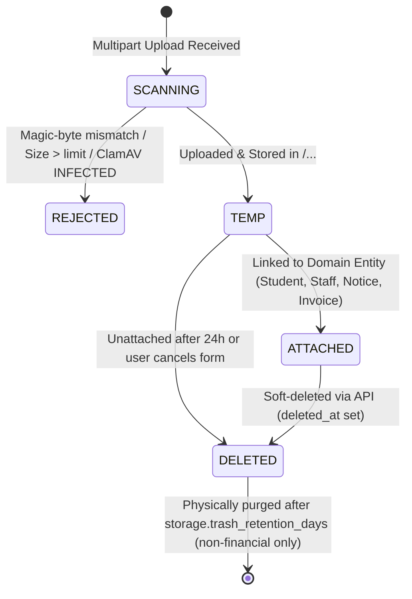

# F-06: Tenant-Isolated File Storage and Malware Scanning

| Field | Value |
|---|---|
| **ID** | `F-06` |
| **Title** | Tenant-Isolated File Storage and Malware Scanning |
| **Status** | `DONE` |
| **Priority** | `P0` |
| **Depends On** | `None` |
| **Blocks** | `F-07, F-10, M-02, M-03, M-06` |
| **Estimated Effort** | `M` |
| **Open Questions** | `Q-005, Q-014` |
| **Revision** | `1` |

---

## 1. Summary and Business Value

Schools manage thousands of sensitive files every year—student profile photos, birth certificates, admission transcripts, staff national IDs, notice attachments, and generated fee receipts. This item delivers a unified, tenant-isolated file storage subsystem supporting S3-compatible object storage (AWS S3, Cloudflare R2, MinIO) in production and an isolated external local-filesystem adapter for development, paired with strict MIME magic-byte inspection, pluggable ClamAV malware scanning, and short-lived pre-signed download URLs. Every school's files are strictly namespaced under `<tenantSlug>/...` and tracked in the school's own `stored_files` table so one school can never enumerate, overwrite, or download another school's documents.

---

## 2. Scope and Explicit Non-Goals

### In Scope
- `StorageProvider` Strategy interface with two built-in implementations:
  - `S3StorageProvider` (AWS SDK v2 for S3 / MinIO / Cloudflare R2).
  - `LocalFsStorageProvider` storing files outside the application working directory (`/var/lib/school-erp/storage` or `/tmp/school-erp-storage` in dev/test, never inside the web root or source tree) with HMAC-signed time-limited download tokens.
- Mandatory tenant-prefixed object key format: `<tenantSlug>/<category>/<yyyy>/<mm>/<uuid>-<sanitizedFilename>`.
- Multi-layer upload validation: file size ceiling per category, filename sanitization (stripping path traversal `..`, null bytes, and control characters), extension whitelist, and Apache Tika / magic-byte header verification.
- Pluggable `MalwareScanner` Strategy interface with `ClamAvMalwareScanner` (`clamd` INSTREAM TCP protocol) and `NoOpMalwareScanner` (for local development).
- Per-tenant `stored_files` metadata table (`V6__file_storage_metadata.sql`) tracking SHA-256 checksum, byte size, category, scan status, visibility, uploader `user_id`, and soft delete (`deleted_at`).
- Short-lived pre-signed download URL generation (`GET /api/v1/files/{fileId}/download-url`) enforcing tenant context and RBAC scope checks before issuing a URL.
- Per-school storage quota tracking and enforcement based on the school's settings (`storage.max_quota_mb`).

### Explicit Non-Goals
- Video streaming, HLS transcoding, or large media hosting (>10 MB per file).
- Public unauthenticated directory browsing of school buckets.
- In-browser document editing (e.g., Collabora/OnlyOffice integration).

---

## 3. Business Rules

- **BR-01 (Mandatory Tenant Key Prefix)**: Every object key read or written by `StorageProvider` MUST start with `<tenantSlug>/` where `<tenantSlug>` is resolved exclusively from `TenantContext.get()`. Any attempt by `StorageProvider` to read, sign, or delete an object key that does not start with `<TenantContext.get()>/` MUST throw a `SecurityException` (`403 Forbidden`).
- **BR-02 (Never Serve From Application Directory)**: Uploaded files MUST NEVER be stored inside the Spring Boot classpath, working directory, or static web root (`.agent/rules/04-security.md`). All downloads are served either via short-lived S3 pre-signed URLs (`Content-Disposition: attachment` or `inline` for safe images/PDFs) or via the signed streaming endpoint backed by the external storage root.
- **BR-03 (Extension + Magic-Byte Verification)** `[ASSUMPTION -> Q-005]` ([OPEN-QUESTIONS.md](../OPEN-QUESTIONS.md)): Uploads MUST validate both the file extension and the first 16KB magic bytes. Allowed MIME types by default are:
  - Profile Photos (`PROFILE_PHOTO`, max `2 MB`): `image/jpeg`, `image/png`, `image/webp`.
  - Student/Staff Documents & Notice Attachments (`STUDENT_DOC`, `STAFF_DOC`, `NOTICE_ATTACHMENT`, `GENERATED_PDF`, max `10 MB`): `image/jpeg`, `image/png`, `image/webp`, `application/pdf`.
  - Bulk Data Imports (`BULK_IMPORT`, max `10 MB`): `text/csv`, `application/vnd.openxmlformats-officedocument.spreadsheetml.sheet`.
  Files whose magic bytes do not match their declared `Content-Type` or extension (e.g., an `.exe` or `.html` renamed to `.jpg`) are rejected with `422 Unprocessable Entity`.
- **BR-04 (Synchronous Malware Scan Before Persistence)** `[ASSUMPTION -> Q-014]` ([OPEN-QUESTIONS.md](../OPEN-QUESTIONS.md)): Every uploaded stream is piped through `MalwareScanner.scan(inputStream)` before being committed to `StorageProvider`. If a virus signature is detected (`INFECTED`), the upload is aborted immediately, an `UPLOAD_MALWARE_DETECTED` security event is written to `audit_log`, and `422 Unprocessable Entity` is returned.
- **BR-05 (Short-Lived Download URLs)**: Pre-signed download URLs expire after `storage.presigned_url_ttl_seconds` (default `300` seconds / 5 minutes). Every request for a download URL verifies that the caller has permission to access the file's category and owning entity scope.
- **BR-06 (Soft Delete & Retention before Physical Purge)**: Deleting a file via API sets `deleted_at = NOW()` and `status = 'DELETED'` on `stored_files` and records a `FILE_DELETED` entry in `audit_log`. Files linked to financial or academic records (`GENERATED_PDF`, `STUDENT_DOC`) cannot be hard-deleted via API; soft-deleted temporary/orphan files are physically purged from object storage after `storage.trash_retention_days` (default `30` days).
- **BR-07 (School Storage Quota Enforcement)**: Before accepting a new upload, the service checks the school's active storage usage (`SUM(size_bytes) WHERE deleted_at IS NULL`) against `storage.max_quota_mb` (default `10240` MB / 10 GB). If exceeded, user uploads return `422 Unprocessable Entity` (`STORAGE_QUOTA_EXCEEDED`), though system-generated financial PDFs (`GENERATED_PDF`) are always permitted.

---

## 4. Configurability

### Per-School Settings (`app_settings`)

| Setting Key | Type | Default | Description | How Changed |
|---|---|---|---|---|
| `storage.max_file_size_mb` | `INTEGER` | `10` | Maximum size in MB for general document uploads (`[ASSUMPTION -> Q-005]`). | `PUT /api/v1/settings` by `SCHOOL_ADMIN` |
| `storage.max_photo_size_mb` | `INTEGER` | `2` | Maximum size in MB for student/staff profile photos (`[ASSUMPTION -> Q-005]`). | `PUT /api/v1/settings` by `SCHOOL_ADMIN` |
| `storage.allowed_mime_types` | `CSV` | `image/jpeg,image/png,image/webp,application/pdf,text/csv,application/vnd.openxmlformats-officedocument.spreadsheetml.sheet` | Allowed MIME types validated via magic bytes (`[ASSUMPTION -> Q-005]`). | `PUT /api/v1/settings` by `SCHOOL_ADMIN` |
| `storage.presigned_url_ttl_seconds` | `INTEGER` | `300` | Validity window in seconds for pre-signed download URLs. | `PUT /api/v1/settings` by `SCHOOL_ADMIN` |
| `storage.max_quota_mb` | `INTEGER` | `10240` | Total storage quota in MB allocated to this school (10 GB default). | Platform operator or `SCHOOL_ADMIN` |
| `storage.trash_retention_days` | `INTEGER` | `30` | Days before soft-deleted `ORPHAN`/`TEMP` files are physically removed from S3/disk. | `PUT /api/v1/settings` by `SCHOOL_ADMIN` |

### Application Properties (`application.yml` / Environment Variables)

| Property | Env Var | Default | Description |
|---|---|---|---|
| `app.storage.provider` | `APP_STORAGE_PROVIDER` | `local` (`s3` in `prod`) | Active `StorageProvider` adapter (`local` or `s3`) |
| `app.storage.local.root-dir` | `APP_STORAGE_LOCAL_ROOT` | `/tmp/school-erp-storage` | External directory for `LocalFsStorageProvider` |
| `app.storage.s3.endpoint` | `APP_STORAGE_S3_ENDPOINT` | `http://localhost:9000` | S3 / MinIO endpoint URL |
| `app.storage.s3.bucket` | `APP_STORAGE_S3_BUCKET` | `school-erp-files` | S3 bucket name |
| `app.storage.s3.region` | `APP_STORAGE_S3_REGION` | `ap-southeast-1` | AWS S3 region |
| `app.storage.malware.scanner` | `APP_MALWARE_SCANNER` | `noop` (`clamav` in `prod`) | Active `MalwareScanner` (`noop` or `clamav`) `[ASSUMPTION -> Q-014]` |
| `app.storage.malware.clamav-host` | `CLAMAV_HOST` | `localhost` | ClamAV daemon host |
| `app.storage.malware.clamav-port` | `CLAMAV_PORT` | `3310` | ClamAV daemon TCP port |

### Feature Flags (`tenants.features_json`)
- Core file storage is enabled for all tenants (`core`).

### Strategy Interfaces / Plug-in Points
- `StorageProvider`: `putObject(...)`, `generatePresignedGetUrl(...)`, `openStream(...)`, `deleteObject(...)`.
- `MalwareScanner`: `ScanResult scan(InputStream stream, String filename)`.

---

## 5. Domain Model

### Entities & Value Objects (`com.schoolerp.shared.storage` / `com.schoolerp.files`)
- **`StoredFile` (Entity, per-tenant DB)**:
  - `id` (`Long`), `fileUuid` (`String` UUID), `category` (`FileCategory`: `SCHOOL_LOGO`, `PROFILE_PHOTO`, `STUDENT_DOC`, `STAFF_DOC`, `NOTICE_ATTACHMENT`, `GENERATED_PDF`, `BULK_IMPORT`), `entityType` (`String`, nullable, e.g., `STUDENT`, `STAFF`, `INVOICE`, `NOTICE`), `entityId` (`String`, nullable), `originalFilename` (`String`), `sanitizedFilename` (`String`), `objectKey` (`String`, `<tenantSlug>/<category>/<yyyy>/<mm>/<uuid>-<sanitizedFilename>`), `mimeType` (`String`), `sizeBytes` (` long`), `sha256Checksum` (`String`), `scanStatus` (`ScanStatus`: `CLEAN`, `SKIPPED_DEV`), `status` (`FileStatus`: `TEMP`, `ATTACHED`, `DELETED`), `uploadedByUserId` (`Long`), `createdAt` (`Instant`), `deletedAt` (`Instant`).
- **`ObjectKey` (Value Object)**:
  - Enforces regex `^[a-z0-9_]+/[A-Z_]+/\d{4}/\d{2}/[0-9a-f-]{36}-[a-zA-Z0-9._-]+$` and verifies prefix matches `TenantContext.get()`.

### File Lifecycle State Machine



---

## 6. Database

### Flyway Migration
- **File**: `backend/src/main/resources/db/tenant/V6__file_storage_metadata.sql`
- **Soft-Delete Strategy**: `deleted_at TIMESTAMP(6) NULL` on `stored_files`. Financial and academic files (`GENERATED_PDF`, `STUDENT_DOC`) retain their metadata and S3 object permanently.
- **Money Columns**: None.

```sql
-- Tenant-isolated file storage metadata per school database.

CREATE TABLE stored_files (
    id                   BIGINT       NOT NULL AUTO_INCREMENT,
    file_uuid            VARCHAR(36)  NOT NULL,
    category             VARCHAR(40)  NOT NULL,
    entity_type          VARCHAR(60)  NULL,
    entity_id            VARCHAR(100) NULL,
    original_filename    VARCHAR(255) NOT NULL,
    sanitized_filename   VARCHAR(200) NOT NULL,
    object_key           VARCHAR(500) NOT NULL,
    storage_provider     VARCHAR(20)  NOT NULL,
    mime_type            VARCHAR(120) NOT NULL,
    size_bytes           BIGINT       NOT NULL,
    sha256_checksum      CHAR(64)     NOT NULL,
    scan_status          VARCHAR(20)  NOT NULL DEFAULT 'CLEAN',
    status               VARCHAR(20)  NOT NULL DEFAULT 'TEMP',
    uploaded_by_user_id  BIGINT       NULL,
    created_at           TIMESTAMP(6) NOT NULL DEFAULT CURRENT_TIMESTAMP(6),
    updated_at           TIMESTAMP(6) NOT NULL DEFAULT CURRENT_TIMESTAMP(6) ON UPDATE CURRENT_TIMESTAMP(6),
    deleted_at           TIMESTAMP(6) NULL,
    PRIMARY KEY (id),
    UNIQUE KEY uk_stored_files_uuid (file_uuid),
    UNIQUE KEY uk_stored_files_object_key (object_key),
    KEY idx_stored_files_entity (entity_type, entity_id, status),
    KEY idx_stored_files_category (category, status),
    KEY idx_stored_files_uploader (uploaded_by_user_id),
    KEY idx_stored_files_cleanup (status, created_at, deleted_at),
    CONSTRAINT fk_sf_uploaded_by FOREIGN KEY (uploaded_by_user_id) REFERENCES users (id)
) ENGINE=InnoDB DEFAULT CHARSET=utf8mb4;

INSERT INTO app_settings (setting_key, setting_value) VALUES
    ('storage.max_file_size_mb',          '10'),
    ('storage.max_photo_size_mb',         '2'),
    ('storage.allowed_mime_types',        'image/jpeg,image/png,image/webp,application/pdf,text/csv,application/vnd.openxmlformats-officedocument.spreadsheetml.sheet'),
    ('storage.presigned_url_ttl_seconds', '300'),
    ('storage.max_quota_mb',              '10240'),
    ('storage.trash_retention_days',      '30');

INSERT INTO permissions (code, description) VALUES
    ('file.upload', 'Upload files and attachments within permitted categories'),
    ('file.read',   'View file metadata and request short-lived download URLs'),
    ('file.delete', 'Soft-delete uploaded files'),
    ('file.admin',  'View school storage quota usage and manage all stored files');

INSERT INTO role_permissions (role_id, permission_id)
SELECT r.id, p.id
FROM roles r
JOIN permissions p ON p.code IN ('file.upload', 'file.read', 'file.delete', 'file.admin')
WHERE r.code = 'SCHOOL_ADMIN';

INSERT INTO role_permissions (role_id, permission_id)
SELECT r.id, p.id
FROM roles r
JOIN permissions p ON p.code IN ('file.upload', 'file.read', 'file.delete')
WHERE r.code IN ('REGISTRAR', 'ACCOUNTANT', 'TEACHER');

INSERT INTO role_permissions (role_id, permission_id)
SELECT r.id, p.id
FROM roles r
JOIN permissions p ON p.code = 'file.read'
WHERE r.code IN ('STUDENT', 'GUARDIAN');
```

---

## 7. API

| Method | Path | Request DTO | Response DTO | Permission | RBAC Scope | Description |
|---|---|---|---|---|---|---|
| `POST` | `/api/v1/files/upload` | `MultipartFile file`, `@RequestParam category`, `entityType`, `entityId` | `StoredFileDto` | `file.upload` | `ALL` / `OWN` | Validate, malware-scan, store under `<tenantSlug>/<category>/...`, and persist metadata row. |
| `GET` | `/api/v1/files/{fileUuid}` | — | `StoredFileDto` | `file.read` | `ALL` / `CLASS` / `OWN` | Retrieve metadata for a stored file (checksum, size, MIME type, category). |
| `GET` | `/api/v1/files/{fileUuid}/download-url` | Query: `disposition` (`inline` \| `attachment`) | `PresignedDownloadUrlDto` (`url`, `expiresAt`) | `file.read` | `ALL` / `CLASS` / `OWN` | Issue a 5-minute pre-signed download URL after verifying tenant prefix and caller scope. |
| `GET` | `/api/v1/files/stream/{token}` | Signed HMAC token in path (dev/local provider only) | Binary stream (`ResponseEntity<Resource>`) | Public (HMAC-signed, 5-min TTL) | Token-scoped | Serves bytes for `LocalFsStorageProvider` with strict `X-Content-Type-Options: nosniff` and `Content-Security-Policy: sandbox`. |
| `DELETE` | `/api/v1/files/{fileUuid}` | — | `204 No Content` | `file.delete` | `ALL` / `OWN` | Soft-delete a file (`deleted_at = NOW()`) and log `FILE_DELETED` in `audit_log`. |
| `GET` | `/api/v1/files/quota` | — | `StorageQuotaDto` (`usedBytes`, `quotaBytes`, `fileCountByCategory`) | `file.admin` | `ALL` | View the school's storage utilization by category. |

---

## 8. Permissions to Seed and Default Role Grants

| Permission Code | Description | `SCHOOL_ADMIN` | `REGISTRAR` | `ACCOUNTANT` | `TEACHER` | `STUDENT` | `GUARDIAN` |
|---|---|---|---|---|---|---|---|
| `file.upload` | Upload files and attachments within permitted categories | Yes (`ALL`) | Yes (`ALL`) | Yes (`ALL`) | Yes (`CLASS`/`SECTION`) | No (until `M-03` admission self-upload if enabled) | No |
| `file.read` | View file metadata and request short-lived download URLs | Yes (`ALL`) | Yes (`ALL`) | Yes (`ALL`) | Yes (`CLASS`/`SECTION`) | Yes (`OWN`) | Yes (`OWN`) |
| `file.delete` | Soft-delete uploaded files | Yes (`ALL`) | Yes (`ALL`) | Yes (`ALL`) | Yes (`OWN`) | No | No |
| `file.admin` | View school storage quota usage and manage all stored files | Yes (`ALL`) | No | No | No | No | No |

---

## 9. Events and Notifications Emitted or Consumed

| Event Type | Direction | Routing Key | Payload / Purpose |
|---|---|---|---|
| `files.malware_detected` | Emitted (`HIGH`) | `tenant.<slug>.notify.high.malware_detected` | Notifies `SCHOOL_ADMIN` (in-app/email via `F-04`) when an authenticated user uploads a file flagged by ClamAV. |
| `files.quota_warning` | Emitted (`NORMAL`) | `tenant.<slug>.notify.bulk.quota_warning` | Emitted when a school crosses 85% and 95% of `storage.max_quota_mb`. |

---

## 10. Tenancy and Security Considerations

- **Strict Object Key Prefix Isolation**: Every S3 and local filesystem path is formatted as `<tenantSlug>/<category>/<yyyy>/<mm>/<uuid>-<sanitizedFilename>`. Both `S3StorageProvider` and `LocalFsStorageProvider` call `ObjectKeyValidator.assertBelongsToCurrentTenant(objectKey)` before any read, write, sign, or delete operation. Even if a bug in caller code passes another school's `objectKey`, the storage provider throws `AccessDeniedException` because the prefix does not match `TenantContext.get()`.
- **Path Traversal & Polyglot File Prevention**:
  - Original filenames are stripped of all directory separators (`/`, `\`, `..`) and non-ASCII/control characters; the stored key always prepends a server-generated UUID v4.
  - Magic-byte inspection inspects the actual binary signature (`FFD8FF` for JPEG, `89504E47` for PNG, `52494646....57454250` for WebP, `25504446` for PDF) and rejects HTML/SVG/JS/executable polyglots (`image/svg+xml` is explicitly disallowed to prevent stored XSS).
  - Download responses set `X-Content-Type-Options: nosniff` and `Content-Security-Policy: default-src 'none'; sandbox`.
- **Audit Logging**:
  - `FILE_UPLOADED` (for sensitive categories: `SCHOOL_LOGO`, `STUDENT_DOC`, `STAFF_DOC`, `BULK_IMPORT`),
  - `FILE_DELETED` (records `fileUuid`, `objectKey`, `category`, actor user ID),
  - `UPLOAD_MALWARE_DETECTED` (records actor user ID, filename, virus signature name, IP address).
- **PII Protection**: Student and staff documents contain sensitive personal data (birth certificates, national IDs, medical notes). Pre-signed URLs are never cached publicly (`Cache-Control: private, no-store`) and expire after 300 seconds.

---

## 11. Frontend

### Reusable Components & Pages (`frontend/src/shared/ui/file-upload` & `frontend/src/features/files`)
- `FileDropzone.tsx`: Reusable drag-and-drop uploader component accepting `category`, `maxSizeMb`, `allowedMimeTypes`, progress bar, client-side size/type pre-check, and returning `StoredFileDto` on upload completion.
- `SecureFileLink.tsx`: Component that takes a `fileUuid` and fetches a fresh pre-signed URL via `GET /api/v1/files/{fileUuid}/download-url` on click (or renders a secure thumbnail preview for `PROFILE_PHOTO` / `SCHOOL_LOGO`).
- `StorageQuotaWidget.tsx`: Displayed in `/admin/settings` for `SCHOOL_ADMIN` showing storage usage bar (`usedBytes` / `quotaBytes`) and breakdown by category.

### Required i18n Keys (`en` and `bn`)

| i18n Key | English (`en`) | Bengali (`bn`) |
|---|---|---|
| `files.upload.dropzone_prompt` | `Drag & drop a file here, or click to browse` | `এখানে ফাইল টেনে আনুন, অথবা ব্রাউজ করতে ক্লিক করুন` |
| `files.upload.max_size_hint` | `Allowed formats: {{formats}} (Max {{maxMb}} MB)` | `অনুমোদিত ফরম্যাট: {{formats}} (সর্বোচ্চ {{maxMb}} মেগাবাইট)` |
| `files.upload.error.too_large` | `File exceeds the maximum allowed size of {{maxMb}} MB.` | `ফাইলটি সর্বোচ্চ অনুমোদিত আকার {{maxMb}} মেগাবাইটের বেশি।` |
| `files.upload.error.invalid_type` | `Unsupported or unsafe file format.` | `অসমর্থিত বা অনিরাপদ ফাইল ফরম্যাট।` |
| `files.upload.error.quota_exceeded` | `School storage quota exceeded. Please contact your administrator.` | `স্কুলের স্টোরেজ কোটা পূর্ণ হয়েছে। অনুগ্রহ করে প্রশাসকের সাথে যোগাযোগ করুন।` |
| `files.action.download` | `Download Document` | `ডকুমেন্ট ডাউনলোড করুন` |
| `files.action.delete` | `Remove File` | `ফাইল মুছে ফেলুন` |
| `files.quota.title` | `Storage Utilization` | `স্টোরেজ ব্যবহার` |

---

## 12. Test Plan

- **Unit Tests**:
  - `ObjectKeyValidatorTest`: Verifies path traversal strings (`../../etc/passwd`, `beta/STUDENT_DOC/...` when `TenantContext` is `alpha`, null bytes) are rejected with `SecurityException`.
  - `FileMagicByteValidatorTest`: Verifies genuine JPEG, PNG, WebP, PDF, CSV, and XLSX byte headers pass, while an executable (`MZ...`), HTML (`<html>`), or SVG (`<svg>`) disguised as `.jpg` or `.pdf` is rejected with `422`.
  - `ClamAvMalwareScannerTest`: Tests the `clamd` INSTREAM chunk protocol parser against a mock TCP socket returning `stream: OK` vs `stream: Eicar-Test-Signature FOUND`.
- **Integration Tests (Testcontainers MySQL + LocalFs / MinIO S3)**:
  - `FileStorageLifecycleIT`: Uploads a valid PDF, verifies `stored_files` row creation with SHA-256 hash, requests a pre-signed download URL, downloads the exact bytes, and verifies soft-delete (`DELETE /api/v1/files/{uuid}`) hides the file from subsequent `GET` requests while writing `FILE_DELETED` to `audit_log`.
  - `StorageQuotaEnforcementIT`: Sets `storage.max_quota_mb` to `1`, uploads a 900 KB file (succeeds), then uploads a 300 KB file and asserts `422 STORAGE_QUOTA_EXCEEDED`.
- **Two-School Tenant Isolation Test (`alpha` vs `beta`)**:
  - `FileStorageTenantIsolationIT`:
    1. Uploads `report.pdf` under tenant `alpha` -> verifies `objectKey` starts with `alpha/STUDENT_DOC/...`.
    2. Requests `GET /api/v1/files/{alphaFileUuid}` and `/download-url` while authenticated as `beta` `SCHOOL_ADMIN` -> asserts `404 Not Found`.
    3. Directly invokes `StorageProvider.generatePresignedGetUrl("alpha/...")` while `TenantContext` is `beta` -> asserts `SecurityException` (`403`).
    4. Verifies `LocalFsStorageProvider` token signed for `alpha` is rejected if replayed with `X-Tenant-ID: beta`.
- **Permission & Scope Boundary Tests**:
  - Verifies a `STUDENT` or `GUARDIAN` can request a download URL for a file attached to their own student record (`OWN` scope) but receives `403 Forbidden` when requesting another student's file UUID.

---

## 13. Acceptance Criteria

- [x] Uploading valid JPEG, PNG, WebP, PDF, CSV, and XLSX files succeeds and stores objects under `<tenantSlug>/<category>/<yyyy>/<mm>/<uuid>-<sanitizedFilename>`.
- [x] Uploading a file whose binary magic bytes do not match its extension (e.g., HTML or EXE renamed to `.pdf`) is rejected with `422 Unprocessable Entity`.
- [x] Uploading an EICAR test file when `ClamAvMalwareScanner` is active rejects the upload with `422` and records `UPLOAD_MALWARE_DETECTED` in `audit_log`.
- [x] No uploaded file is ever written inside the application's working directory or served directly as a static asset.
- [x] Pre-signed download URLs expire after `storage.presigned_url_ttl_seconds` (default 5 minutes).
- [x] School `beta` cannot view, download, or delete any file uploaded by school `alpha`.
- [x] Reusable `FileDropzone` and `SecureFileLink` components are available for downstream modules (`M-02`, `M-03`, `M-06`).

---

## 14. Implementation Slices

- [x] **Slice 1 (Migration & Domain Model)**: Add `V6__file_storage_metadata.sql`, `StoredFile` entity/repository, `FileCategory`, and `ObjectKeyValidator`.
- [x] **Slice 2 (Validation & Malware Scanner)**: Implement `FileMagicByteValidator`, filename sanitizer, `MalwareScanner` interface, `NoOpMalwareScanner`, and `ClamAvMalwareScanner`.
- [x] **Slice 3 (Storage Providers)**: Implement `StorageProvider` interface, `LocalFsStorageProvider` (with HMAC-signed streaming token), and `S3StorageProvider` (AWS SDK v2 S3 + S3Presigner).
- [x] **Slice 4 (Application Service, REST API & Isolation Tests)**: Implement `FileStorageService` (quota check, audit logging, soft delete, orphan cleanup), `FileController`, and two-school isolation tests (`FileStorageTenantIsolationIT`).
- [x] **Slice 5 (Frontend Reusable Upload & Quota UI)**: Implement `FileDropzone`, `SecureFileLink`, `StorageQuotaWidget`, and `en`/`bn` translations.

---

## 15. Risks and Mitigations

| Risk | Impact | Mitigation |
|---|---|---|
| **Cross-tenant path traversal or direct key tampering** | Critical — school A reads school B's private student documents | UUID lookup happens inside each school's physical DB (`stored_files`), AND `StorageProvider` independently asserts `objectKey.startsWith(TenantContext.get() + "/")`. |
| **Stored XSS via uploaded SVG/HTML opened inline** | High — session hijack if an attacker uploads malicious script disguised as an image | Magic-byte inspection blocks `text/html` and `image/svg+xml`; only `image/jpeg`, `image/png`, `image/webp`, and `application/pdf` allow `inline` disposition, always accompanied by `X-Content-Type-Options: nosniff` and `Content-Security-Policy: sandbox`. |
| **Memory exhaustion during multipart upload** | Medium — OOM on large concurrent uploads | Spring multipart max size capped at the servlet container level (`10MB`), streaming SHA-256 and magic-byte inspection via `DigestInputStream` without loading the entire file into heap multiple times. |
| **Orphaned files from abandoned forms** | Low — wasted S3 storage quota | Uploads start in `status = 'TEMP'`; when the parent form (`Student`, `Staff`, `Notice`) saves, it calls `fileStorageService.markAttached(fileUuid, entityType, entityId)`. Unattached `TEMP` files older than 24 hours are soft-deleted and purged. |

---

## 16. How to Extend or Customize Later

### Adding a New Cloud Storage Backend (e.g., Google Cloud Storage or Azure Blob)
1. Implement `StorageProvider`:
   ```java
   @Component
   @ConditionalOnProperty(name = "app.storage.provider", havingValue = "gcs")
   public class GcsStorageProvider implements StorageProvider {
       @Override
       public void putObject(String objectKey, InputStream stream, long size, String contentType) {
           ObjectKeyValidator.assertBelongsToCurrentTenant(objectKey);
           // Upload to GCS bucket using objectKey
       }
       // ...
   }
   ```
2. Switch `APP_STORAGE_PROVIDER=gcs` in environment variables; zero changes to `FileStorageService` or any domain module (`M-02`, `M-03`, `F-07`).

### Attaching a File in a Domain Module (e.g., `M-03` Student Admission)
```java
@Transactional
public StudentDto attachBirthCertificate(Long studentId, String fileUuid) {
    Student student = studentRepository.findById(studentId).orElseThrow();
    StoredFileDto file = fileStorageService.attachFile(
        fileUuid, FileCategory.STUDENT_DOC, "STUDENT", studentId.toString()
    );
    student.setBirthCertificateFileUuid(file.fileUuid());
    return StudentDto.from(student);
}
```

---

## 17. Revision History

| Revision | Date | Author | Changes |
|---|---|---|---|
| `1` | 2026-11-04 | Antigravity | Initial comprehensive plan for `F-06` covering tenant-isolated S3/Local storage, magic-byte validation, and ClamAV scanning. |
