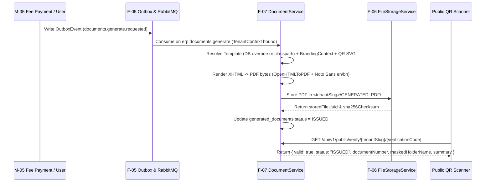
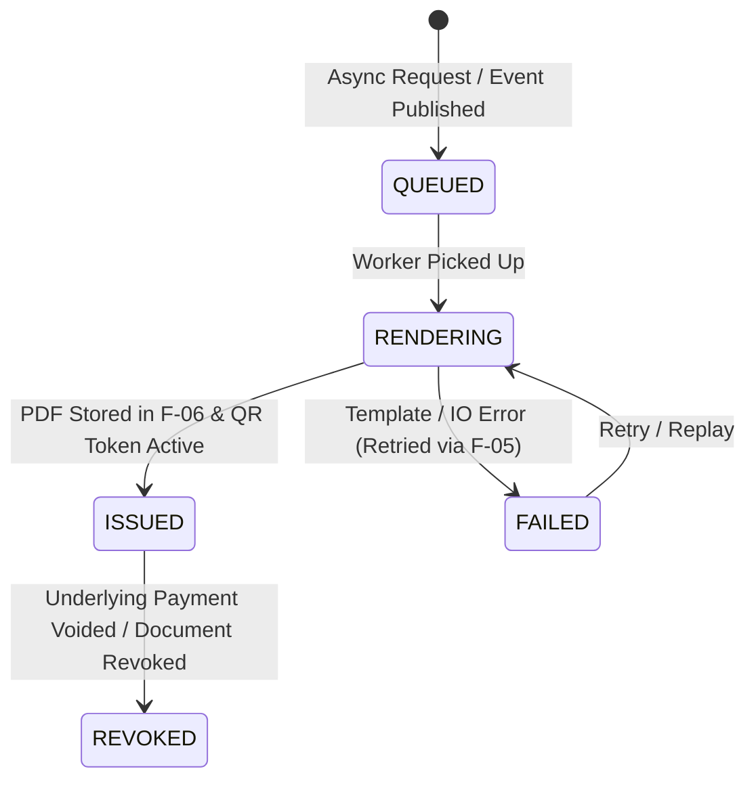

# F-07: Branded Document and PDF Generation Engine

| Field | Value |
|---|---|
| **ID** | `F-07` |
| **Title** | Branded Document and PDF Generation Engine |
| **Status** | `PROPOSED` |
| **Priority** | `P1` |
| **Depends On** | `F-05, F-06` |
| **Blocks** | `M-03, M-05` |
| **Estimated Effort** | `M` |
| **Open Questions** | `Q-015` |
| **Revision** | `1` |

---

## 1. Summary and Business Value

Schools and universities issue official, legally significant documents every day—fee payment receipts, admission application forms, student/staff ID cards, exam admit cards, marksheets, and transfer certificates. This foundation item provides a reusable, bilingual (`en` and `bn`) HTML-to-PDF rendering engine powered by Thymeleaf and OpenHTMLToPDF (with embedded Noto Sans & Noto Sans Bengali fonts), per-school dynamic branding (logo, header, watermark, principal/cashier signature blocks, and custom templates), asynchronous background generation via `F-05`, tenant-isolated storage via `F-06`, and tamper-evident QR code verification so anyone can verify the authenticity of a receipt or certificate online.

---

## 2. Scope and Explicit Non-Goals

### In Scope
- HTML-to-PDF rendering engine (`PdfRendererService`) using Thymeleaf strict XHTML templates + OpenHTMLToPDF (`openhtmltopdf-pdfbox` + `openhtmltopdf-svg-support` + `ZXing` QR code SVG generator).
- Embedded Unicode fonts (`NotoSans-Regular.ttf`, `NotoSans-Bold.ttf`, `NotoSansBengali-Regular.ttf`, `NotoSansBengali-Bold.ttf`) packaged in classpath resources for crisp English and Bengali script rendering across all OS containers.
- Per-school branding injection loaded from `app_settings` (`school.display_name`, `brand.primary_color`, `document.logo_file_uuid`, `document.signature_file_uuid`, `document.header_subtitle`, `document.footer_text`, `document.watermark_enabled`).
- Customizable per-school `document_templates` table (`V9__document_generation.sql`) allowing overrides of default system templates (`FEE_RECEIPT`, `ADMISSION_FORM`, `STUDENT_ID_CARD`, `FEE_INVOICE`, `TRANSFER_CERTIFICATE`) with safe variable interpolation.
- Synchronous on-demand rendering (for single-page fee receipts < 500ms) and asynchronous queued rendering via `F-05` (`erp.documents.generate` queue for batch ID cards, invoices, or heavy reports), persisting the resulting PDF via `F-06` (`FileCategory.GENERATED_PDF`).
- Tamper-evident `generated_documents` ledger storing `verification_code` (16-char base32 HMAC/UUID token), document SHA-256 hash, and public verification snapshot JSON, plus a rate-limited public verification endpoint `GET /api/v1/public/verify/{tenantSlug}/{verificationCode}`.

### Explicit Non-Goals
- Headless Chromium / Puppeteer sidecar processes (avoided due to 500MB+ RAM overhead and SSRF risks; OpenHTMLToPDF renders pure XHTML/CSS2.1 deterministically inside the JVM).
- Drag-and-drop WYSIWYG visual layout designer in Phase 1 (schools configure branding fields, toggles, and safe Thymeleaf HTML/CSS template overrides).
- Exam marksheet domain logic (handled in Phase 2 `M-07` Exams module, which will register its `MARKSHEET` template into this engine).

---

## 3. Business Rules

- **BR-01 (Automatic School Branding Injection)**: Every rendered document automatically receives a `BrandingContext` built from the school's `app_settings` (school name, address, EIIN/registration code, primary color, logo data URI from `F-06`, authorized signatory name/title/signature image, and locale). No template may hardcode a school's name or logo.
- **BR-02 (Template Resolution Order)**: When rendering a `DocumentType` (e.g., `FEE_RECEIPT`) for locale `en` or `bn`, the engine first queries the school's `document_templates` table for an active custom template `(document_type, locale, active = TRUE)`. If none exists, it falls back to the immutable classpath default template (`classpath:/templates/documents/<document_type>_<locale>.html`).
- **BR-03 (SSRF-Free Sandboxed Rendering)**: OpenHTMLToPDF MUST use a restricted `FSStreamFactory` that blocks all external network fetches (`http://`, `https://`, `file://`, `ftp://`). Only classpath fonts/assets (`classpath:/fonts/...`) and pre-fetched `F-06` tenant-verified image bytes (`tenant-asset://<fileUuid>`) are resolved during PDF rendering.
- **BR-04 (Tamper-Evident QR Code & Verification)** `[ASSUMPTION -> Q-015]` ([OPEN-QUESTIONS.md](../OPEN-QUESTIONS.md)): Every official document (`FEE_RECEIPT`, `STUDENT_ID_CARD`, `ADMISSION_FORM`, `TRANSFER_CERTIFICATE`) generates a unique `verification_code` and embeds an inline SVG QR code pointing to `https://<school-domain>/verify/{tenantSlug}/{verificationCode}`. Scanning the QR code hits `GET /api/v1/public/verify/{tenantSlug}/{verificationCode}`, which returns only the non-sensitive verification summary (`valid: true/false`, `status: ISSUED | REVOKED`, `documentType`, `documentNumber`, `issuedAt`, `maskedHolderName`, `summaryFields`) without exposing raw PII or downloadable files.
- **BR-05 (Immutability & Revocation of Official Documents)**: Once a `generated_documents` row is `ISSUED`, its stored PDF in `F-06` is never overwritten. If an underlying transaction is voided (e.g., a fee payment is reversed or an ID card is reported lost), the previous `generated_documents` record transitions to `REVOKED` with `revoked_reason`, and any public QR verification immediately displays `REVOKED`.
- **BR-06 (Async Queue vs Sync Threshold)**: Single-document requests (e.g., cashier clicking "Print Receipt") can render synchronously if not yet generated, or return the already-generated `file_uuid` created asynchronously by the `F-05` `fees.payment_received` consumer. Bulk requests (>1 document, such as generating ID cards for a 60-student section) MUST execute asynchronously through the `erp.documents.generate` RabbitMQ queue (`F-05`).

---

## 4. Configurability

### Per-School Settings (`app_settings`)

| Setting Key | Type | Default | Description | How Changed |
|---|---|---|---|---|
| `document.header_subtitle` | `STRING` | `""` | School address, affiliation, or EIIN code printed below the school name on all PDFs. | `PUT /api/v1/settings` by `SCHOOL_ADMIN` |
| `document.footer_text` | `STRING` | `"System generated official document"` | Footer text printed at the bottom of every page. | `PUT /api/v1/settings` by `SCHOOL_ADMIN` |
| `document.logo_file_uuid` | `STRING` | `""` | `F-06` `file_uuid` of the school crest/logo rendered in the document header. | `PUT /api/v1/settings` by `SCHOOL_ADMIN` |
| `document.signature_file_uuid` | `STRING` | `""` | `F-06` `file_uuid` of the principal/registrar signature image. | `PUT /api/v1/settings` by `SCHOOL_ADMIN` |
| `document.signatory_name` | `STRING` | `"Authorized Signatory"` | Printed name below the signature block. | `PUT /api/v1/settings` by `SCHOOL_ADMIN` |
| `document.signatory_title` | `STRING` | `"Principal / Head of Institution"` | Printed title below the signature block. | `PUT /api/v1/settings` by `SCHOOL_ADMIN` |
| `document.watermark_enabled` | `BOOLEAN` | `true` | Whether to render a subtle diagonal school watermark behind official receipts and certificates. | `PUT /api/v1/settings` by `SCHOOL_ADMIN` |
| `document.paper_size` | `STRING` | `"A4"` | Default paper size (`A4`, `LETTER`, `A5_LANDSCAPE` for receipts, `CR80` for ID cards). | `PUT /api/v1/settings` by `SCHOOL_ADMIN` |

### Feature Flags (`tenants.features_json`)
- Document generation is part of core infrastructure (`core`), while custom HTML template editing is gated by permission `document.template.write`.

### Strategy Interfaces / Plug-in Points
- `DocumentDataProvider<T>`: Implemented by domain modules (`M-03`, `M-05`) for each `DocumentType`. Given an `entityId`, it loads the domain model, checks caller scope, and returns the template context map plus verification summary map.

---

## 5. Domain Model

### Entities & Value Objects (`com.schoolerp.documents`)
- **`DocumentTemplate` (Entity, per-tenant DB)**:
  - `id` (`Long`), `documentType` (`DocumentType`: `FEE_RECEIPT`, `FEE_INVOICE`, `ADMISSION_FORM`, `STUDENT_ID_CARD`, `TRANSFER_CERTIFICATE`), `locale` (`String`: `en`, `bn`), `name` (`String`), `pageSize` (`String`), `htmlContent` (`String`), `cssContent` (`String`), `version` (`int`), `active` (`boolean`), `updatedByUserId` (`Long`), `updatedAt` (`Instant`).
- **`GeneratedDocument` (Entity, per-tenant DB)**:
  - `id` (`Long`), `documentUuid` (`String`), `documentType` (`DocumentType`), `documentNumber` (`String`, e.g., `RCP-2026-000142`), `entityType` (`String`), `entityId` (`String`), `locale` (`String`), `status` (`DocumentStatus`: `QUEUED`, `RENDERING`, `ISSUED`, `REVOKED`, `FAILED`), `storedFileUuid` (`String`, FK to `stored_files.file_uuid` from `F-06`), `sha256Hash` (`String`), `verificationCode` (`String`, unique 20-char token), `verificationSummaryJson` (`String` JSON with non-PII summary for public verification), `issuedAt` (`Instant`), `revokedAt` (`Instant`), `revokedReason` (`String`), `requestedByUserId` (`Long`), `lastError` (`String`).

### Document Generation & Verification Flow



### Generated Document State Machine



---

## 6. Database

### Flyway Migration
- **File**: `backend/src/main/resources/db/tenant/V9__document_generation.sql`
- **Soft-Delete Strategy**: `generated_documents` rows are immutable audit artifacts and are never hard-deleted; invalidation uses `status = 'REVOKED'`, `revoked_at`, and `revoked_reason`. `document_templates` uses `deleted_at TIMESTAMP(6) NULL`.
- **Money Columns**: None on the core document tables (monetary values displayed in `verification_summary_json` are formatted strings produced from `DECIMAL(12,2)` source entities).

```sql
-- Per-school document templates and tamper-evident generated document registry.

CREATE TABLE document_templates (
    id                  BIGINT       NOT NULL AUTO_INCREMENT,
    document_type       VARCHAR(50)  NOT NULL,
    locale              VARCHAR(10)  NOT NULL DEFAULT 'en',
    name                VARCHAR(150) NOT NULL,
    page_size           VARCHAR(30)  NOT NULL DEFAULT 'A4',
    html_content        MEDIUMTEXT   NOT NULL,
    css_content         TEXT         NULL,
    version             INT          NOT NULL DEFAULT 1,
    active              BOOLEAN      NOT NULL DEFAULT TRUE,
    updated_by_user_id  BIGINT       NULL,
    created_at          TIMESTAMP(6) NOT NULL DEFAULT CURRENT_TIMESTAMP(6),
    updated_at          TIMESTAMP(6) NOT NULL DEFAULT CURRENT_TIMESTAMP(6) ON UPDATE CURRENT_TIMESTAMP(6),
    deleted_at          TIMESTAMP(6) NULL,
    PRIMARY KEY (id),
    KEY idx_doc_templates_lookup (document_type, locale, active),
    CONSTRAINT fk_dt_updated_by FOREIGN KEY (updated_by_user_id) REFERENCES users (id)
) ENGINE=InnoDB DEFAULT CHARSET=utf8mb4;

CREATE TABLE generated_documents (
    id                         BIGINT       NOT NULL AUTO_INCREMENT,
    document_uuid              VARCHAR(36)  NOT NULL,
    document_type              VARCHAR(50)  NOT NULL,
    document_number            VARCHAR(80)  NOT NULL,
    entity_type                VARCHAR(60)  NOT NULL,
    entity_id                  VARCHAR(100) NOT NULL,
    locale                     VARCHAR(10)  NOT NULL DEFAULT 'en',
    status                     VARCHAR(20)  NOT NULL DEFAULT 'QUEUED',
    stored_file_uuid           VARCHAR(36)  NULL,
    sha256_hash                CHAR(64)     NULL,
    verification_code          VARCHAR(40)  NOT NULL,
    verification_summary_json  JSON         NOT NULL,
    requested_by_user_id       BIGINT       NULL,
    issued_at                  TIMESTAMP(6) NULL,
    revoked_at                 TIMESTAMP(6) NULL,
    revoked_reason             VARCHAR(255) NULL,
    last_error                 TEXT         NULL,
    created_at                 TIMESTAMP(6) NOT NULL DEFAULT CURRENT_TIMESTAMP(6),
    updated_at                 TIMESTAMP(6) NOT NULL DEFAULT CURRENT_TIMESTAMP(6) ON UPDATE CURRENT_TIMESTAMP(6),
    PRIMARY KEY (id),
    UNIQUE KEY uk_gen_docs_uuid (document_uuid),
    UNIQUE KEY uk_gen_docs_verification_code (verification_code),
    KEY idx_gen_docs_entity (entity_type, entity_id, document_type, status),
    KEY idx_gen_docs_number (document_number),
    KEY idx_gen_docs_file (stored_file_uuid),
    CONSTRAINT fk_gd_requested_by FOREIGN KEY (requested_by_user_id) REFERENCES users (id)
) ENGINE=InnoDB DEFAULT CHARSET=utf8mb4;

INSERT INTO app_settings (setting_key, setting_value) VALUES
    ('document.header_subtitle',     ''),
    ('document.footer_text',         'Official computer-generated document.'),
    ('document.logo_file_uuid',      ''),
    ('document.signature_file_uuid', ''),
    ('document.signatory_name',      'Authorized Signatory'),
    ('document.signatory_title',     'Principal'),
    ('document.watermark_enabled',   'true'),
    ('document.paper_size',          'A4');

INSERT INTO permissions (code, description) VALUES
    ('document.read',           'View and download generated official PDFs'),
    ('document.generate',       'Trigger on-demand or batch PDF generation'),
    ('document.revoke',         'Revoke an issued official document'),
    ('document.template.read',  'View school PDF document templates'),
    ('document.template.write', 'Customize and preview school PDF document templates');

INSERT INTO role_permissions (role_id, permission_id)
SELECT r.id, p.id
FROM roles r
JOIN permissions p ON p.code IN (
    'document.read', 'document.generate', 'document.revoke',
    'document.template.read', 'document.template.write'
)
WHERE r.code = 'SCHOOL_ADMIN';

INSERT INTO role_permissions (role_id, permission_id)
SELECT r.id, p.id
FROM roles r
JOIN permissions p ON p.code IN ('document.read', 'document.generate')
WHERE r.code IN ('REGISTRAR', 'ACCOUNTANT');

INSERT INTO role_permissions (role_id, permission_id)
SELECT r.id, p.id
FROM roles r
JOIN permissions p ON p.code = 'document.read'
WHERE r.code IN ('TEACHER', 'STUDENT', 'GUARDIAN');
```

---

## 7. API

| Method | Path | Request DTO | Response DTO | Permission | RBAC Scope | Description |
|---|---|---|---|---|---|---|
| `POST` | `/api/v1/documents/generate` | `GenerateDocumentRequest` (`documentType`, `entityId`, `locale`, `async`) | `GeneratedDocumentDto` | `document.generate` | `ALL` | Render or queue an official PDF for a target entity (e.g., `FEE_RECEIPT` for payment ID). |
| `GET` | `/api/v1/documents/{documentUuid}` | — | `GeneratedDocumentDto` (includes `downloadUrl` when `ISSUED`) | `document.read` | `ALL` / `OWN` | Fetch status, metadata, and short-lived `F-06` download URL for a generated document. |
| `GET` | `/api/v1/documents` | Query: `entityType`, `entityId`, `documentType`, `status`, `page`, `size` | `Page<GeneratedDocumentDto>` | `document.read` | `ALL` / `OWN` | List generated documents for an entity or school. |
| `POST` | `/api/v1/documents/{documentUuid}/revoke` | `RevokeDocumentRequest` (`reason`) | `GeneratedDocumentDto` | `document.revoke` | `ALL` | Mark an `ISSUED` document as `REVOKED` and record an audit log entry. |
| `GET` | `/api/v1/documents/templates` | — | `List<DocumentTemplateDto>` | `document.template.read` | `ALL` | List all supported `DocumentType` templates (indicating default vs custom override). |
| `PUT` | `/api/v1/documents/templates/{documentType}` | `UpsertDocumentTemplateRequest` (`locale`, `pageSize`, `htmlContent`, `cssContent`, `active`) | `DocumentTemplateDto` | `document.template.write` | `ALL` | Save or update a school's custom XHTML/CSS template override. |
| `POST` | `/api/v1/documents/templates/{documentType}/preview` | `PreviewTemplateRequest` (`locale`, `htmlContent`, `cssContent`) | `ResponseEntity<byte[]>` (`application/pdf`) | `document.template.write` | `ALL` | Render an instant sample PDF using mock data so admins can preview branding & layout. |
| `GET` | `/api/v1/public/verify/{tenantSlug}/{verificationCode}` | — | `PublicDocumentVerificationDto` | Public (Rate-limited via `F-08`) | Public | Verify a document QR code against `{tenantSlug}` without authentication. |

---

## 8. Permissions to Seed and Default Role Grants

| Permission Code | Description | `SCHOOL_ADMIN` | `REGISTRAR` | `ACCOUNTANT` | `TEACHER` | `STUDENT` | `GUARDIAN` |
|---|---|---|---|---|---|---|---|
| `document.read` | View and download generated official PDFs | Yes (`ALL`) | Yes (`ALL`) | Yes (`ALL`) | Yes (`CLASS`/`SECTION`) | Yes (`OWN`) | Yes (`OWN`) |
| `document.generate` | Trigger on-demand or batch PDF generation | Yes (`ALL`) | Yes (`ALL`) | Yes (`ALL`) | No | No | No |
| `document.revoke` | Revoke an issued official document | Yes (`ALL`) | No | No | No | No | No |
| `document.template.read` | View school PDF document templates | Yes (`ALL`) | No | No | No | No | No |
| `document.template.write` | Customize and preview school PDF document templates | Yes (`ALL`) | No | No | No | No | No |

---

## 9. Events and Notifications Emitted or Consumed

| Event Type | Direction | Routing Key | Queue | Description |
|---|---|---|---|---|
| `documents.generate.requested` | Consumed & Emitted | `tenant.<slug>.documents.generate.requested` | `erp.documents.generate` | Consumed by `DocumentGenerationConsumer` to render PDF in background and store in `F-06`. |
| `documents.generated` | Emitted (`NORMAL`) | `tenant.<slug>.documents.generated` | `erp.events.topic` | Emitted once a PDF is `ISSUED` and stored in `F-06` so downstream modules (`M-05` receipt email, `M-03` admission card) can attach or link it. |

---

## 10. Tenancy and Security Considerations

- **SSRF & Arbitrary File Read Prevention**: Custom HTML templates edited by a `SCHOOL_ADMIN` could attempt `` or `<link rel="stylesheet" href="file:///etc/passwd">`. `PdfRendererService` configures OpenHTMLToPDF with a whitelist-only `SafeTenantUriResolver` that rejects all `http://`, `https://`, `file://`, and `jar://` URLs except bundled `classpath:/fonts/` and `tenant-asset://<fileUuid>` (which loads bytes through `F-06` `FileStorageService`, enforcing `<tenantSlug>/` key prefix validation).
- **Thymeleaf Sandboxing (SSTI Prevention)**: Custom `document_templates.html_content` is parsed using a restricted Thymeleaf `SpringStandardDialect` configuration with `StandardExpressionObjectFactory` disabling `@bean`, `T(...)` type references, and `new` instantiation (`enableSpringELCompiler = false` + expression regex validator rejecting `T(`, `Runtime`, `ProcessBuilder`, `Class`).
- **Public Verification Isolation & Rate Limiting**: `GET /api/v1/public/verify/{tenantSlug}/{verificationCode}` validates `{tenantSlug}` against `TenantRegistry` (rejecting unknown or suspended schools with `404`), binds `TenantContext` for `{tenantSlug}` in a read-only transaction, and is rate-limited by `F-08` to `30 requests / minute / IP` to prevent brute-forcing `verification_code`.
- **PII Masking on Public Verification**: `verification_summary_json` masks student/guardian names (e.g., `"T***d R****n"`) and never includes phone numbers, home addresses, or full date of birth.
- **Audit Logging**:
  - `DOCUMENT_TEMPLATE_UPDATED` (records `documentType`, `locale`, `version`, old/new content diff),
  - `DOCUMENT_REVOKED` (records `documentUuid`, `documentNumber`, `revokedReason`, actor user ID).

---

## 11. Frontend

### Routes, Pages & Components (`frontend/src/features/documents`)
- Route `/admin/settings/documents` (`DocumentBrandingAndTemplatesPage.tsx`, protected by `document.template.read`):
  - **Branding Form**: Upload school logo (`F-06` `FileDropzone`), upload authorized signature image, edit header subtitle, signatory name/title, footer text, watermark toggle, and default paper size.
  - **Template Manager**: Select `DocumentType` (`FEE_RECEIPT`, `ADMISSION_FORM`, `STUDENT_ID_CARD`, `TRANSFER_CERTIFICATE`) and locale (`en` / `bn`), inspect available template variables (`{{school.name}}`, `{{document.number}}`, `{{qrCodeSvg}}`), edit custom HTML/CSS, and click **"Live PDF Preview"** (`POST /api/v1/documents/templates/{type}/preview`).
- Route `/verify/:tenantSlug/:verificationCode` (`PublicDocumentVerifyPage.tsx`, unauthenticated public route):
  - Displays a clean verification badge (`Verified Official Document` in green or `Revoked / Invalid Document` in red), school name & logo, document number, issue timestamp, masked holder name, and summary attributes.
- Reusable Component: `PrintOrDownloadPdfButton.tsx`: Used across `M-03` and `M-05` to trigger/fetch a document PDF and open it in the browser's print dialog or download it.

### Required i18n Keys (`en` and `bn`)

| i18n Key | English (`en`) | Bengali (`bn`) |
|---|---|---|
| `documents.settings.title` | `Document Branding & PDF Templates` | `ডকুমেন্ট ব্র্যান্ডিং এবং পিডিএফ টেমপ্লেট` |
| `documents.settings.logo_label` | `Official School Crest / Logo` | `স্কুলের অফিসিয়াল লোগো` |
| `documents.settings.signature_label` | `Authorized Signature Image` | `অনুমোদিত স্বাক্ষরের ছবি` |
| `documents.settings.watermark_toggle` | `Show Official Watermark on PDFs` | `পিডিএফ-এ অফিসিয়াল জলছাপ দেখান` |
| `documents.templates.preview_btn` | `Preview Sample PDF` | `নমুনা পিডিএফ দেখুন` |
| `documents.action.download_pdf` | `Download PDF` | `পিডিএফ ডাউনলোড করুন` |
| `documents.action.revoke` | `Revoke Document` | `ডকুমেন্ট বাতিল করুন` |
| `documents.verify.valid_badge` | `Verified Authentic Document` | `যাচাইকৃত আসল ডকুমেন্ট` |
| `documents.verify.revoked_badge` | `This Document Has Been Revoked` | `এই ডকুমেন্টটি বাতিল করা হয়েছে` |
| `documents.verify.invalid_badge` | `Invalid or Unrecognized Verification Code` | `অবৈধ বা অপরিচিত যাচাইকরণ কোড` |

---

## 12. Test Plan

- **Unit Tests**:
  - `TemplateSstiAndSsrfValidatorTest`: Verifies templates containing SpEL type expressions (`${T(java.lang.Runtime)...}`) or external URLs (``) are rejected with `422 Unprocessable Entity` before rendering.
  - `PdfRendererServiceFontTest`: Renders a bilingual English + Bengali (`আমার সোনার বাংলা`) template to PDF bytes and uses PDFBox `PDFTextStripper` to assert both English and Bengali text are embedded and extractable without tofu/missing glyphs.
  - `QrCodeSvgGeneratorTest`: Verifies deterministic inline `<svg>` generation for verification URLs.
- **Integration Tests (Testcontainers MySQL + RabbitMQ + LocalFs)**:
  - `AsyncDocumentGenerationFlowIT`: Publishes a `documents.generate.requested` event via `F-05`, verifies `DocumentGenerationConsumer` renders the PDF, stores it in `F-06` (`stored_files`), transitions `generated_documents.status` to `ISSUED`, and serves a working download URL.
  - `PublicVerificationAndRevocationIT`: Verifies `GET /api/v1/public/verify/{slug}/{code}` returns `valid: true, status: ISSUED`, then calls `POST /api/v1/documents/{uuid}/revoke`, and verifies the public endpoint immediately returns `valid: false, status: REVOKED` and `audit_log` contains `DOCUMENT_REVOKED`.
- **Two-School Tenant Isolation Test (`alpha` vs `beta`)**:
  - `DocumentTenantIsolationIT`:
    1. Configures custom school logo and header for `alpha` and different branding for `beta`.
    2. Generates a `FEE_RECEIPT` in `alpha` (`codeA`) and another in `beta` (`codeB`).
    3. Asserts `GET /api/v1/public/verify/beta/{codeA}` returns `404 Not Found` (cannot verify `alpha`'s document under `beta`'s tenant slug).
    4. Asserts `alpha` template referencing `tenant-asset://<betaLogoFileUuid>` is blocked by `SafeTenantUriResolver`.
    5. Asserts `GET /api/v1/documents/{alphaDocUuid}` as `beta` admin returns `404 Not Found`.

---

## 13. Acceptance Criteria

- [ ] Default PDF templates render cleanly in both English (`en`) and Bengali (`bn`) with embedded Noto Sans / Noto Sans Bengali fonts.
- [ ] School logo, primary brand color, subtitle, watermark, and signature block configured in Settings automatically appear on all generated PDFs.
- [ ] Every generated official PDF includes a scannable QR code that resolves to `/verify/{tenantSlug}/{verificationCode}` and displays the verification status without requiring login.
- [ ] Revoking an issued document immediately flips its public verification status to `REVOKED` and logs `DOCUMENT_REVOKED` in `audit_log`.
- [ ] Custom templates cannot trigger outbound HTTP requests (SSRF) or arbitrary Java expression execution (SSTI).
- [ ] School `beta` cannot view, download, or verify documents belonging to school `alpha`.

---

## 14. Implementation Slices

- [ ] **Slice 1 (Migration & Domain Model)**: Add `V9__document_generation.sql`, `DocumentTemplate` and `GeneratedDocument` entities, `DocumentType` enum, and `DocumentDataProvider` interface.
- [ ] **Slice 2 (Sandboxed PDF Engine & Bilingual Fonts)**: Bundle Noto Sans + Noto Sans Bengali TTF fonts, implement `PdfRendererService` with OpenHTMLToPDF, `SafeTenantUriResolver`, SSTI expression guard, `QrCodeSvgGenerator`, and default classpath templates (`FEE_RECEIPT`, `ADMISSION_FORM`, `STUDENT_ID_CARD`).
- [ ] **Slice 3 (Async Consumer & F-06 Integration)**: Implement `DocumentGenerationService` and `DocumentGenerationConsumer` (`F-05` listener on `erp.documents.generate`) saving rendered PDFs into `F-06` `FileStorageService`.
- [ ] **Slice 4 (REST APIs, Public Verification & Isolation Tests)**: Implement `DocumentController`, `PublicVerificationController`, RBAC & audit logging, and `DocumentTenantIsolationIT`.
- [ ] **Slice 5 (Frontend Branding, Template Preview & Public Verify Page)**: Implement `DocumentBrandingAndTemplatesPage`, `PublicDocumentVerifyPage`, `PrintOrDownloadPdfButton`, and `en`/`bn` translations.

---

## 15. Risks and Mitigations

| Risk | Impact | Mitigation |
|---|---|---|
| **Server-Side Request Forgery (SSRF) or Local File Inclusion (LFI)** via custom HTML `` | Critical — exposure of server secrets or cloud metadata | Custom `SafeTenantUriResolver` blocks all `http`, `https`, `file`, and `jar` schemes; only `classpath:/fonts/` and `tenant-asset://<fileUuid>` (verified via `F-06`) are permitted. |
| **Server-Side Template Injection (SSTI)** via custom Thymeleaf template | Critical — remote code execution | Disable SpEL type references (`T(...)`), bean access (`@`), and object instantiation (`new`) in the restricted template engine + regex pre-validation. |
| **Broken Bengali conjuncts (যুক্তবর্ণ) in PDF output** | High — unreadable official documents for Bangladeshi schools | Bundle `NotoSansBengali-Regular.ttf` and `NotoSansBengali-Bold.ttf` with OpenHTMLToPDF HarfBuzz/ICU complex-script layout enabled and verify in `PdfRendererServiceFontTest`. |
| **High CPU/Memory spike during bulk PDF generation** | Medium — API latency degradation | Bulk generation (>1 document) is routed to `erp.documents.generate` queue with bounded consumer concurrency (max 2 concurrent PDF renders per JVM). |

---

## 16. How to Extend or Customize Later

### Registering a New Document Type in a Downstream Module (e.g., `M-05` Fee Receipt)
1. Add the enum value (e.g., `FEE_RECEIPT`) and default classpath template `templates/documents/fee_receipt_en.html` / `fee_receipt_bn.html`.
2. Implement `DocumentDataProvider`:
   ```java
   @Component
   public class FeeReceiptDocumentDataProvider implements DocumentDataProvider {
       @Override
       public DocumentType supports() { return DocumentType.FEE_RECEIPT; }

       @Override
       public DocumentRenderPayload load(String paymentId, Locale locale) {
           Payment payment = paymentRepository.findById(Long.valueOf(paymentId)).orElseThrow();
           // Verify caller RBAC scope (ALL or OWN guardian/student)
           return new DocumentRenderPayload(
               "RCP-" + payment.getReceiptNumber(),
               Map.of("payment", payment, "student", payment.getStudent()),
               Map.of("amountPaid", payment.getAmount().toPlainString(), "currency", payment.getCurrency())
           );
       }
   }
   ```
3. Trigger via `documentService.requestGeneration(DocumentType.FEE_RECEIPT, "PAYMENT", payment.getId().toString(), locale, true)`.

---

## 17. Revision History

| Revision | Date | Author | Changes |
|---|---|---|---|
| `1` | 2026-11-04 | Antigravity | Initial comprehensive plan for `F-07` covering bilingual HTML-to-PDF rendering, school branding, F-05/F-06 integration, and QR verification. |
