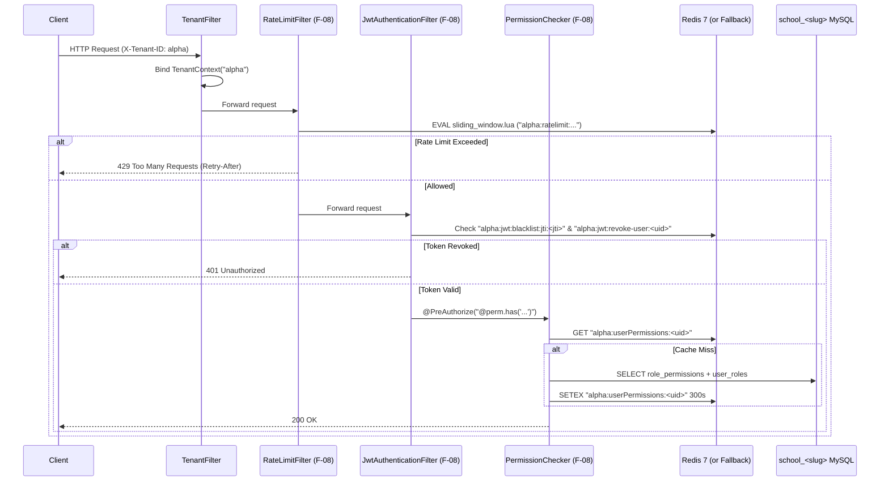

# F-08: Redis Caching, Distributed Rate Limiting, and Token Blacklist

| Field | Value |
|---|---|
| **ID** | `F-08` |
| **Title** | Redis Caching, Distributed Rate Limiting, and Token Blacklist |
| **Status** | `DONE` |
| **Priority** | `P0` |
| **Depends On** | `None` |
| **Blocks** | `F-01, F-02, F-04, F-05, F-09` |
| **Estimated Effort** | `S` |
| **Open Questions** | `Q-001` |
| **Revision** | `1` |

---

## 1. Summary and Business Value

As the ERP scales horizontally across multiple stateless application instances and serves hundreds of schools, three critical requirements emerge: fast read access to frequently queried per-school metadata (branding settings, user permissions, feature flags), distributed rate limiting and account lockout protection that cannot be bypassed by load-balancing across nodes, and immediate JWT access-token revocation when a staff member or student is suspended or logs out. This item introduces Redis 7 (`spring-boot-starter-data-redis`) with a mandatory tenant-prefixed key strategy (`<tenantSlug>:<namespace>:<key>`), atomic Lua-based rate limiting and login lockout counters, a JWT `jti` revocation blacklist, and resilient in-memory fallback so a temporary Redis blip never takes down a school's operations.

---

## 2. Scope and Explicit Non-Goals

### In Scope
- Redis 7 container in `docker-compose.yml` and Spring Data Redis / Lettuce connection pool configuration (`com.schoolerp.shared.cache`).
- `TenantPrefixedCacheKeyGenerator` and `TenantAwareRedisTemplate` enforcing `<tenantSlug>:<cacheName>:<key>` on all tenant-scoped caches (`settings`, `userPermissions`, `tenantConfig`) and `platform:<cacheName>:<key>` for master catalog lookups (`tenantRegistry`).
- Deterministic cache eviction hooks triggered whenever `app_settings`, `roles`/`role_permissions`/`user_roles`, or `tenants.features_json` are updated, plus an admin cache flush endpoint (`POST /api/v1/cache/evict`).
- Upgrading `RateLimitFilter` from single-JVM `ConcurrentHashMap` to an atomic Redis Lua token-bucket / sliding-window rate limiter keyed by `<tenantSlug>:ratelimit:<policy>:<clientKey>`, with automatic Circuit-Breaker fallback to the local bounded Caffeine/in-memory limiter if Redis is unreachable.
- Distributed failed-login counter and account lockout state (`<tenantSlug>:lockout:<emailOrPhone>`) supporting `F-01` (`[ASSUMPTION -> Q-001]`).
- Distributed JWT revocation blacklist (`<tenantSlug>:jwt:blacklist:jti:<jti>` and `<tenantSlug>:jwt:revoke-user:<userId>` timestamp watermark) checked in `JwtAuthenticationFilter` for immediate session termination on logout, password change, or user deactivation.
- Lightweight Redis distributed lock helper (`TenantDistributedLock`) used by `F-05` (`OutboxPublisher`) and `F-09` (Tenant Scheduler).

### Explicit Non-Goals
- Storing primary business data exclusively in Redis without MySQL persistence (Redis is strictly an ephemeral cache, coordination lock, and security state store).
- Cross-datacenter active-active Redis Enterprise clustering in Phase 1.

---

## 3. Business Rules

- **BR-01 (Mandatory Tenant Key Prefix)**: Every Redis key read or written while a tenant is bound MUST start with `<tenantSlug>:` (resolved from `TenantContext.get()`, per `.agent/rules/01-tenancy.md` Rule 6). Platform-level keys (such as `TenantRegistry` metadata or platform operator rate limits) MUST start with `platform:`. Calling `TenantAwareRedisTemplate` when `TenantContext.get()` is `null` (outside platform explicit calls) throws `IllegalStateException`.
- **BR-02 (Tiered Rate Limit Policies)**: Requests are rate-limited using atomic Redis Lua scripts across four standard policies:
  1. `AUTH_LOGIN` (`POST /api/v1/auth/login`, `/api/v1/auth/refresh`): default `10 requests / minute / (tenantSlug + IP)`.
  2. `PUBLIC_VERIFY` (`GET /api/v1/public/verify/**`): default `30 requests / minute / IP`.
  3. `SENSITIVE_MUTATION` (password reset, OTP request, file upload): default `20 requests / minute / (tenantSlug + userIdOrIp)`.
  4. `TENANT_API_GENERAL` (authenticated tenant API calls): default `300 requests / minute / (tenantSlug + userId)`.
  Exceeding any limit returns `429 Too Many Requests` (RFC 7807 `ProblemDetail`) with a `Retry-After` response header.
- **BR-03 (Account Lockout Counter)** `[ASSUMPTION -> Q-001]` ([OPEN-QUESTIONS.md](../OPEN-QUESTIONS.md)): Consecutive failed login attempts for a user identity within a school increment `<tenantSlug>:lockout:attempts:<identity>` with a 15-minute sliding TTL. Upon reaching `security.lockout.max_attempts` (default `5`), a lockout key `<tenantSlug>:lockout:locked:<identity>` is set with TTL `security.lockout.duration_minutes` (default `15` minutes) and `USER_ACCOUNT_LOCKED` is written to `audit_log`. A successful login or manual admin unlock (`DELETE /api/v1/cache/lockouts/{userId}`) deletes both keys immediately.
- **BR-04 (Immediate JWT Revocation via Blacklist & User Watermark)**:
  - Every issued JWT access token includes a unique `jti` (UUID v4) and `iat` (issued-at epoch seconds).
  - Single-session logout writes `<tenantSlug>:jwt:blacklist:jti:<jti>` with a TTL equal to the token's remaining lifetime (max 15 minutes).
  - Password reset, role revocation, or user suspension (`status = 'DISABLED'`) writes `<tenantSlug>:jwt:revoke-user:<userId> = <nowEpochMillis>` (TTL = access token lifetime) and revokes all rows in `refresh_tokens`. Any JWT whose `iat` is older than the user's revocation watermark is rejected with `401 Unauthorized` immediately across all nodes.
- **BR-05 (Write-Through Cache Eviction)**: Any mutation to `app_settings` evicts `<tenantSlug>:settings:*`; any mutation to `user_roles` or `role_permissions` evicts `<tenantSlug>:userPermissions:<userId>` (or `<tenantSlug>:userPermissions:*` for role changes) and increments the user's permission cache version.
- **BR-06 (Resilient Graceful Degradation)**: If Redis throws a `RedisConnectionFailureException` or times out (>200ms), caching falls back to direct MySQL queries and rate limiting falls back to the local JVM sliding-window map while logging a throttled `WARN` metric (`redis.fallback.active`), ensuring schools remain operational during a cache restart.

---

## 4. Configurability

### Per-School Settings (`app_settings`)

| Setting Key | Type | Default | Description | How Changed |
|---|---|---|---|---|
| `security.lockout.max_attempts` | `INTEGER` | `5` | Failed login attempts within 15 minutes before temporary account lockout (`[ASSUMPTION -> Q-001]`). | `PUT /api/v1/settings` by `SCHOOL_ADMIN` |
| `security.lockout.duration_minutes` | `INTEGER` | `15` | Lockout cooldown duration in minutes (`[ASSUMPTION -> Q-001]`). | `PUT /api/v1/settings` by `SCHOOL_ADMIN` |
| `ratelimit.login_per_minute` | `INTEGER` | `10` | Max login requests per minute per IP for this school. | `PUT /api/v1/settings` by `SCHOOL_ADMIN` |
| `ratelimit.api_per_minute` | `INTEGER` | `300` | Max general API requests per minute per authenticated user. | `PUT /api/v1/settings` by `SCHOOL_ADMIN` |

### Application Properties (`application.yml` / Environment Variables)

| Property | Env Var | Default | Description |
|---|---|---|---|
| `spring.data.redis.host` | `REDIS_HOST` | `localhost` | Redis server hostname |
| `spring.data.redis.port` | `REDIS_PORT` | `6379` | Redis server port |
| `spring.data.redis.password` | `REDIS_PASSWORD` | `""` (required in `prod`) | Redis authentication password |
| `spring.data.redis.timeout` | `REDIS_TIMEOUT` | `200ms` | Command timeout before triggering fallback |
| `app.cache.settings-ttl-seconds` | `APP_CACHE_SETTINGS_TTL` | `600` | TTL for cached school settings (10 min) |
| `app.cache.permissions-ttl-seconds` | `APP_CACHE_PERMISSIONS_TTL` | `300` | TTL for cached user permission grants (5 min) |

### Feature Flags (`tenants.features_json`)
- Core infrastructure (`core`), active for all tenants.

### Strategy Interfaces / Plug-in Points
- `RateLimiterStrategy`: `RedisLuaRateLimiter` (primary) and `InMemoryFallbackRateLimiter` (fallback, composite via `ResilientRateLimiter`).

---

## 5. Domain Model

### Key Namespaces & TTL Catalog (`com.schoolerp.shared.cache`)

| Key Pattern | Value Type | TTL | Purpose |
|---|---|---|---|
| `<tenantSlug>:settings:all` | JSON Map | `600s` | Cached `app_settings` key-value map for the school. |
| `<tenantSlug>:userPermissions:<userId>` | JSON Set of `(code, scopeType, scopeId)` | `300s` | Cached RBAC grants loaded by `PermissionChecker`. |
| `<tenantSlug>:ratelimit:<policy>:<subject>` | Lua Token Bucket (`tokens`, `lastRefill`) | `60s` | Distributed rate limit state per IP or user. |
| `<tenantSlug>:lockout:attempts:<identity>` | Integer Counter | `900s` (15m) | Consecutive failed login counter. |
| `<tenantSlug>:lockout:locked:<identity>` | ISO Timestamp (`lockedUntil`) | `900s` (`duration_minutes`) | Active account lockout marker. |
| `<tenantSlug>:jwt:blacklist:jti:<jti>` | `"1"` | Remaining JWT TTL ($\le 900\text{s}$) | Revoked single access token. |
| `<tenantSlug>:jwt:revoke-user:<userId>` | Epoch Millis (`revokedAt`) | `900s` | Revokes all access tokens for `userId` issued before `revokedAt`. |
| `lock:<tenantSlug>:<jobName>` | Instance UUID | `30s`–`300s` | Distributed mutual exclusion lock for `F-05` outbox polling and `F-09` scheduled jobs. |
| `platform:tenant:<tenantSlug>` | JSON `TenantInfo` | `300s` | Cached `school_master.tenants` status and feature flags. |

### Request Pipeline with Redis Rate Limiter, Blacklist & Cache



---

## 6. Database

### Flyway Migration
- **File**: `backend/src/main/resources/db/tenant/V4__redis_cache_admin_permissions.sql`
- **Soft-Delete Strategy**: No new business tables required (state lives in Redis with fallback to MySQL); seeds lockout/rate-limit settings and cache/lockout administration permissions in each tenant database.
- **Money Columns**: None.

```sql
-- Seed per-school account lockout and rate-limit settings plus cache/lockout admin permissions.

INSERT INTO app_settings (setting_key, setting_value) VALUES
    ('security.lockout.max_attempts',     '5'),
    ('security.lockout.duration_minutes', '15'),
    ('ratelimit.login_per_minute',        '10'),
    ('ratelimit.api_per_minute',          '300');

INSERT INTO permissions (code, description) VALUES
    ('security.unlock', 'View and clear temporary account lockouts for school users'),
    ('cache.evict',     'Inspect and flush school application caches');

INSERT INTO role_permissions (role_id, permission_id)
SELECT r.id, p.id
FROM roles r
JOIN permissions p ON p.code IN ('security.unlock', 'cache.evict')
WHERE r.code = 'SCHOOL_ADMIN';
```

---

## 7. API

| Method | Path | Request DTO | Response DTO | Permission | RBAC Scope | Description |
|---|---|---|---|---|---|---|
| `GET` | `/api/v1/security/lockouts/{userId}` | — | `AccountLockoutStatusDto` (`locked`, `failedAttempts`, `lockedUntil`) | `security.unlock` | `ALL` | Check if a user account is currently locked out in Redis. |
| `DELETE` | `/api/v1/security/lockouts/{userId}` | — | `204 No Content` | `security.unlock` | `ALL` | Clear failed login attempts and unlock a locked user account immediately, logging `USER_ACCOUNT_UNLOCKED`. |
| `POST` | `/api/v1/security/users/{userId}/revoke-sessions` | — | `204 No Content` | `user.write` | `ALL` | Revoke all active refresh tokens in MySQL and set `<tenantSlug>:jwt:revoke-user:<userId>` in Redis for immediate access token cutoff. |
| `POST` | `/api/v1/cache/evict` | `EvictCacheRequest` (`cacheNames`: `settings`, `userPermissions`, `all`) | `CacheEvictResultDto` | `cache.evict` | `ALL` | Flush all Redis cache keys under `<tenantSlug>:*` for the specified cache names and record `TENANT_CACHE_EVICTED` in `audit_log`. |

---

## 8. Permissions to Seed and Default Role Grants

| Permission Code | Description | `SCHOOL_ADMIN` | `REGISTRAR` | `ACCOUNTANT` | `TEACHER` | `STUDENT` | `GUARDIAN` |
|---|---|---|---|---|---|---|---|
| `security.unlock` | View and clear temporary account lockouts for school users | Yes (`ALL`) | No | No | No | No | No |
| `cache.evict` | Inspect and flush school application caches | Yes (`ALL`) | No | No | No | No | No |

---

## 9. Events and Notifications Emitted or Consumed

| Event / Hook | Trigger | Action |
|---|---|---|
| `SettingsUpdatedInternalEvent` | `SettingsService.updateSettings(...)` commits | Evicts `<tenantSlug>:settings:all` in Redis after transaction commit (`@TransactionalEventListener(phase = AFTER_COMMIT)`). |
| `UserPermissionsChangedInternalEvent` | Role assignment, role permission update, or user status change commits | Evicts `<tenantSlug>:userPermissions:<userId>` and sets `<tenantSlug>:jwt:revoke-user:<userId>` if status changed to `DISABLED`. |
| `TenantUpdatedInternalEvent` | Platform operator suspends tenant or updates `features_json` | Evicts `platform:tenant:<tenantSlug>` so suspended tenants or disabled features take effect immediately across all nodes. |

---

## 10. Tenancy and Security Considerations

- **Zero Cross-Tenant Cache Pollution**: `TenantPrefixedCacheKeyGenerator` constructs every cache key as `TenantContext.get() + ":" + cacheName + ":" + SimpleKeyGenerator.generateKey(params)`. If `TenantContext.get()` is null or blank on a tenant cache operation, an `IllegalStateException` is thrown immediately rather than falling back to an unprefixed key.
- **Scoped Cache Eviction (`SCAN` + `UNLINK`)**: When a `SCHOOL_ADMIN` flushes their school's cache (`POST /api/v1/cache/evict`), `TenantAwareRedisTemplate` uses `SCAN` with pattern `<tenantSlug>:<cacheName>:*` and non-blocking `UNLINK`—never `FLUSHDB` or `FLUSHALL`, which would wipe other schools' caches and lockouts.
- **Atomic Lua Execution**: Rate limiting and login attempt counters execute inside single-roundtrip Redis Lua scripts so concurrent requests from distributed threads cannot race between `INCR` and `EXPIRE`.
- **Audit Logging**:
  - `USER_ACCOUNT_LOCKED` (recorded when failed attempts reach `security.lockout.max_attempts`),
  - `USER_ACCOUNT_UNLOCKED` (recorded when `SCHOOL_ADMIN` manually unlocks a user),
  - `USER_SESSIONS_REVOKED` (recorded when admin forces immediate session termination),
  - `TENANT_CACHE_EVICTED` (recorded when admin flushes school caches).

---

## 11. Frontend

### Components & Pages (`frontend/src/features/users` & `frontend/src/features/settings`)
- **User Management Integration (`/admin/users`)**:
  - Displays a `Locked` status badge on locked users with a **"Unlock Account"** action button (`DELETE /api/v1/security/lockouts/{userId}`, visible with `security.unlock` permission).
  - Adds a **"Force Logout All Devices"** action button (`POST /api/v1/security/users/{userId}/revoke-sessions`, visible with `user.write` permission).
- **Security & Cache Settings Section (`/admin/settings`)**:
  - Inputs for `security.lockout.max_attempts` and `security.lockout.duration_minutes`.
  - **"Clear School Cache"** button (`POST /api/v1/cache/evict`) for troubleshooting stale settings.

### Required i18n Keys (`en` and `bn`)

| i18n Key | English (`en`) | Bengali (`bn`) |
|---|---|---|
| `security.lockout.badge` | `Temporarily Locked` | `সাময়িকভাবে লক করা` |
| `security.lockout.unlock_btn` | `Unlock Account` | `অ্যাকাউন্ট আনলক করুন` |
| `security.lockout.unlock_success` | `User account unlocked successfully.` | `ব্যবহারকারীর অ্যাকাউন্ট সফলভাবে আনলক করা হয়েছে।` |
| `security.sessions.revoke_all_btn` | `Force Logout All Devices` | `সকল ডিভাইস থেকে লগআউট করুন` |
| `security.sessions.revoke_success` | `All active sessions for this user have been terminated.` | `এই ব্যবহারকারীর সকল সক্রিয় সেশন বাতিল করা হয়েছে।` |
| `settings.security.max_attempts` | `Max Failed Login Attempts Before Lockout` | `লকআউটের আগে সর্বোচ্চ ব্যর্থ লগইন চেষ্টা` |
| `settings.security.lockout_duration` | `Account Lockout Duration (Minutes)` | `অ্যাকাউন্ট লকআউট সময়কাল (মিনিট)` |
| `settings.cache.evict_btn` | `Clear School Cache` | `স্কুল ক্যাশ পরিষ্কার করুন` |

---

## 12. Test Plan

- **Unit Tests**:
  - `TenantPrefixedCacheKeyGeneratorTest`: Verifies key generation produces `alpha:settings:all` when `TenantContext` is `alpha`, `beta:settings:all` when `beta`, and throws `IllegalStateException` when `TenantContext` is empty.
  - `ResilientRateLimiterFallbackTest`: Simulates `RedisConnectionFailureException` on the Redis template and verifies seamless fallback to `InMemoryFallbackRateLimiter` without throwing 500 errors to callers.
- **Integration Tests (Testcontainers MySQL + Redis 7)**:
  - `RedisRateLimiterIT`: Fires 10 login requests within 1 minute (all pass out of rate-limit filter), then fires an 11th request and asserts `429 Too Many Requests` with `Retry-After` header.
  - `AccountLockoutAndAdminUnlockIT`: Fails login 5 times for `teacher@alpha.edu`, verifies 6th attempt with the *correct* password returns `423 Locked` (or `401` with lockout code) and `USER_ACCOUNT_LOCKED` is in `audit_log`; then invokes `DELETE /api/v1/security/lockouts/{userId}` as `SCHOOL_ADMIN` and verifies login immediately succeeds.
  - `JwtBlacklistAndUserRevocationIT`: Logs in, obtains an access token with `jti`, calls `/api/v1/auth/logout` (or `/revoke-sessions`), and immediately replays the still-unexpired access token against `GET /api/v1/users/me` — asserts `401 Unauthorized`.
  - `TenantDistributedLockIT`: Verifies two concurrent threads attempting `tryLock("alpha", "outbox:poll", Duration.ofSeconds(10))` results in exactly one winner while `tryLock("beta", "outbox:poll", ...)` succeeds concurrently.
- **Two-School Tenant Isolation Test (`alpha` vs `beta`)**:
  - `RedisTenantIsolationIT`:
    1. Populates `settings` and `userPermissions` caches for both `alpha` and `beta`.
    2. Calls `POST /api/v1/cache/evict` as `alpha` `SCHOOL_ADMIN` -> verifies all `alpha:*` cache keys are removed while `beta:*` cache keys remain intact in Redis.
    3. Triggers 5 failed logins for `admin@school.edu` under `X-Tenant-ID: alpha` (locking the account in `alpha`) -> verifies `admin@school.edu` under `X-Tenant-ID: beta` is NOT locked and can log in normally.
    4. Blacklists a user ID `1` in `alpha` (`alpha:jwt:revoke-user:1`) -> verifies user ID `1` in `beta` is completely unaffected.

---

## 13. Acceptance Criteria

- [x] `docker-compose.yml` runs Redis 7 with healthcheck and Spring Boot connects cleanly.
- [x] Every tenant cache entry, rate-limit counter, lockout marker, and JWT blacklist entry in Redis is prefixed with `<tenantSlug>:`.
- [x] Updating school settings or user roles immediately evicts the corresponding Redis cache keys after transaction commit.
- [x] Exceeding login or API rate limits returns `429 Too Many Requests` with `Retry-After`.
- [x] Failing login 5 times within 15 minutes locks the user account for 15 minutes, and a `SCHOOL_ADMIN` can unlock it immediately via API/UI.
- [x] Logging out or revoking a user's sessions invalidates their active JWT access token immediately across all requests.
- [x] Stopping the Redis container causes the application to degrade gracefully to in-memory rate limiting and direct DB queries without 500 errors.
- [x] Two-school Redis isolation test (`alpha` vs `beta`) passes.

---

## 14. Implementation Slices

- [x] **Slice 1 (Redis Infrastructure, Migration & Tenant Key Generator)**: Add Redis 7 to `docker-compose.yml`, add `spring-boot-starter-data-redis` to `backend/pom.xml`, create `V4__redis_cache_admin_permissions.sql`, and implement `TenantPrefixedCacheKeyGenerator` + `TenantAwareRedisTemplate`.
- [x] **Slice 2 (Settings & Permissions Caching + Eviction Hooks)**: Cache `SettingsService` and `PermissionChecker` lookups with `AFTER_COMMIT` eviction listeners and `POST /api/v1/cache/evict`.
- [x] **Slice 3 (Distributed Lua Rate Limiter & Resilient Fallback)**: Implement `RedisLuaRateLimiter`, `ResilientRateLimiter`, and upgrade `RateLimitFilter` with per-policy limits and `Retry-After` headers.
- [x] **Slice 4 (Account Lockout, JWT Blacklist & Distributed Lock)**: Implement login lockout tracking, `jti`/user revocation checks in `JwtAuthenticationFilter`, `TenantDistributedLock`, `/api/v1/security/lockouts/**` endpoints, and `RedisTenantIsolationTest`.
- [x] **Slice 5 (Frontend Lockout & Session Revocation Controls)**: Add Unlock Account, Force Logout All Devices, and Clear School Cache UI controls with `en`/`bn` translations.

---

## 15. Risks and Mitigations

| Risk | Impact | Mitigation |
|---|---|---|
| **Cross-tenant cache key collision** (e.g., User ID `1` in `alpha` receives permissions of User ID `1` in `beta`) | Critical — privilege escalation across schools | `TenantPrefixedCacheKeyGenerator` prepends `TenantContext.get()` to every key (`alpha:userPermissions:1` vs `beta:userPermissions:1`) and throws `IllegalStateException` if `TenantContext` is unset. |
| **Redis outage causing complete ERP downtime** | High — all API requests fail if auth filter depends hard on Redis | `ResilientRateLimiter` and `CacheErrorHandler` catch `RedisConnectionFailureException` (with 200ms command timeout) and fall back to local Caffeine/in-memory rate limiting and direct MySQL queries. |
| **Stale permissions after role revocation** | High — revoked user retains access for up to 5 minutes | Role/permission mutations publish `UserPermissionsChangedInternalEvent` which evicts `<tenantSlug>:userPermissions:<userId>` immediately upon transaction commit. |
| **Blocking Redis thread with `KEYS *` during cache eviction** | Medium — latency spikes across all tenants | Strictly forbid `KEYS`, `FLUSHDB`, and `FLUSHALL`; use cursor-based `SCAN` with `MATCH <tenantSlug>:*` and async `UNLINK`. |

---

## 16. How to Extend or Customize Later

### Caching a New Read-Heavy Tenant Resource (e.g., `M-01` Active Academic Session)
Because `TenantPrefixedCacheKeyGenerator` is registered as the default Spring `@EnableCaching` key generator, any module service can use standard Spring annotations and automatically get `<tenantSlug>:<cacheName>:<key>` isolation:

```java
@Cacheable(cacheNames = "academicSessions", key = "'current'")
public AcademicSessionDto getCurrentSession() {
    // Automatically cached under "<tenantSlug>:academicSessions:current"
    return sessionRepository.findByCurrentTrue().map(AcademicSessionDto::from).orElseThrow();
}

@CacheEvict(cacheNames = "academicSessions", key = "'current'")
@Transactional
public AcademicSessionDto markAsCurrent(Long sessionId) {
    // Automatically evicts only "<tenantSlug>:academicSessions:current"
    ...
}
```

### Acquiring a Tenant-Scoped Distributed Lock in Background Workers (`F-05`, `F-09`)
```java
tenantDistributedLock.executeIfLocked("outbox:poll", Duration.ofSeconds(15), () -> {
    outboxPublisher.publishPendingBatchForCurrentTenant();
});
```

---

## 17. Revision History

| Revision | Date | Author | Changes |
|---|---|---|---|
| `1` | 2026-11-04 | Antigravity | Initial comprehensive plan for `F-08` covering tenant-prefixed Redis caching, Lua rate limiting, account lockout, and JWT blacklist. |
