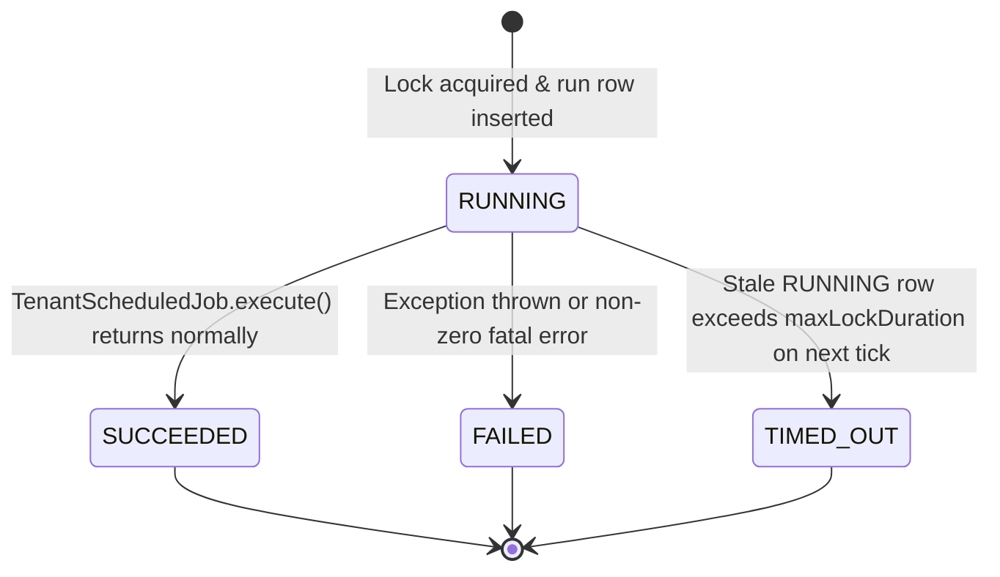
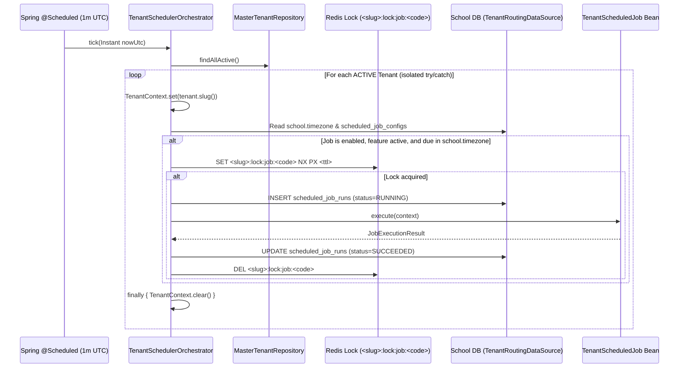

# F-09: Multi-Tenant Distributed Scheduler and Job History

| Field | Value |
|---|---|
| **ID** | `F-09` |
| **Title** | Multi-Tenant Distributed Scheduler and Job History |
| **Status** | `PROPOSED` |
| **Priority** | `P1` |
| **Depends On** | `F-08` |
| **Blocks** | `M-04, M-05` |
| **Estimated Effort** | `S` |
| **Open Questions** | `Q-016` |
| **Revision** | `1` |

---

## 1. Summary and Business Value

Schools rely on time-sensitive background jobs — such as daily absence SMS cutoff triggers (`M-04`), overdue fee fine computation and invoice generation (`M-05`), and expired refresh token cleanup (`F-01`) — that must run reliably at the right local wall-clock time for each school without cross-tenant data leakage or duplicate execution across horizontally scaled backend instances. `F-09` provides a multi-tenant scheduler orchestrator that iterates all `ACTIVE` tenants from `school_master.tenants`, evaluates job schedules in each school's configured `school.timezone`, acquires a Redis distributed lock per `(tenantSlug, jobCode)`, isolates exceptions per tenant, and records full execution history in each school's `scheduled_job_runs` table with an admin UI and manual trigger endpoint.

---

## 2. Scope and Explicit Non-Goals

### In Scope
- `TenantScheduledJob` Strategy interface for pluggable per-school background jobs.
- `TenantSchedulerOrchestrator` ticking every minute in UTC, iterating `ACTIVE` schools via `MasterTenantRepository`, binding `TenantContext` inside `try / finally`, and evaluating whether each job is due in the school's `school.timezone` (`F-08`).
- Distributed locking via Redis (`<tenantSlug>:lock:job:<jobCode>`, `SET NX PX`) with database row-lock fallback when Redis is unavailable in local dev.
- Per-tenant exception isolation so a failing job in school `alpha` never aborts execution for school `beta`.
- `scheduled_job_configs` and `scheduled_job_runs` tables in each school database (`V10__tenant_scheduler_runs.sql`).
- Tenant admin endpoints (`/api/v1/jobs`) to inspect job configurations, view paginated run histories, enable/disable school-configurable jobs, and manually trigger an immediate run (`POST /api/v1/jobs/{jobCode}/trigger`).
- Built-in housekeeping job: `auth.expired_token_cleanup` (purges expired/revoked `refresh_tokens` older than 30 days).

### Explicit Non-Goals
- Arbitrary user-authored scripts or dynamic code execution.
- Sub-minute real-time streaming schedules (minimum schedule granularity is 1 minute; high-frequency async events use the `F-05` transactional outbox and RabbitMQ instead).
- Cross-tenant aggregation jobs (platform billing metrics remain in the platform module).

---

## 3. Business Rules

- **BR-01 (`[ASSUMPTION -> Q-016]`)**: All tenant-scheduled jobs evaluate their cron expressions against the school's `school.timezone` setting in `app_settings` (default `Asia/Dhaka` per [OPEN-QUESTIONS.md](../OPEN-QUESTIONS.md#q-016-F-09)).
- **BR-02**: Only tenants with `status = 'ACTIVE'` in `school_master.tenants` are eligible for scheduled job execution; `SUSPENDED` or `PROVISIONING` tenants are skipped automatically.
- **BR-03**: Every `TenantContext.set(tenantSlug)` in the scheduler orchestrator **must** be paired with `TenantContext.clear()` in a `finally` block before moving to the next tenant or returning the thread to the pool.
- **BR-04**: Before executing `job.execute(context)` for a tenant, the orchestrator must acquire the distributed lock key `<tenantSlug>:lock:job:<jobCode>` with a TTL equal to `job.maxLockDuration()` (default `15 minutes`). If the lock is already held by another application node, the run is skipped silently without recording a failure.
- **BR-05**: Every attempted execution (scheduled or manual trigger) creates a `scheduled_job_runs` row transitioning through `RUNNING -> SUCCEEDED` or `RUNNING -> FAILED`, capturing `items_processed`, `items_failed`, `duration_ms`, and sanitized error details.
- **BR-06**: Manual job triggers (`POST /api/v1/jobs/{jobCode}/trigger`) require `job.trigger` permission (`SCHOOL_ADMIN` only), record an `audit_log` entry (`JOB_MANUAL_TRIGGER`), and use the same Redis distributed lock so a manual run cannot collide with an in-flight scheduled run.
- **BR-07**: Unhandled exceptions thrown by a job for tenant A are caught, logged with `MDC.put("tenant", tenantSlug)`, written to tenant A's `scheduled_job_runs` as `FAILED`, and the orchestrator immediately proceeds to tenant B.

---

## 4. Configurability

### `app_settings` Keys
| Key | Type | Default | Managed By | Description |
|---|---|---|---|---|
| `school.timezone` | `IANA Timezone String` | `Asia/Dhaka` | `SCHOOL_ADMIN` (`F-08`) | Local timezone used to evaluate cron schedules for this school. |
| `scheduler.failure_alert_email` | `Email String` | `""` (disabled) | `SCHOOL_ADMIN` | Optional school admin email notified via `F-04` when a scheduled job fails 3 consecutive times. |

### Feature Flag
- Controlled by `system` core infrastructure (always active for all plans) and optionally surfaced in the Admin UI under the `scheduler` section. Downstream jobs check their own module feature flag (`TenantScheduledJob.requiredFeature()`, e.g., `fees` for `M-05` late fine calculation; if the school's plan does not include `fees`, that job is skipped).

### Strategy Interfaces
```java
package com.schoolerp.shared.scheduler;

public interface TenantScheduledJob {
    String jobCode();                      // e.g. "fees.overdue_fine_calculator"
    String defaultCron();                  // e.g. "0 15 2 * * *" (02:15 AM in school.timezone)
    Optional<String> requiredFeature();    // e.g. Optional.of("fees")
    Duration maxLockDuration();            // e.g. Duration.ofMinutes(15)
    boolean allowSchoolOverrideCron();     // whether SCHOOL_ADMIN can adjust cron in scheduled_job_configs
    JobExecutionResult execute(JobExecutionContext context);
}
```

---

## 5. Domain Model

### Entities & Value Objects (in `com.schoolerp.scheduler.domain`)
- **`ScheduledJobConfig`**: Per-school persistence of registered `TenantScheduledJob` metadata (`id`, `jobCode`, `cronExpression`, `enabled`, `lastRunAt`, `lastStatus`, `nextRunAt`, `consecutiveFailures`).
- **`ScheduledJobRun`**: Immutable execution log entry (`id`, `jobCode`, `triggerType` [`SCHEDULED`, `MANUAL`], `triggeredByUserId`, `status` [`RUNNING`, `SUCCEEDED`, `FAILED`, `TIMED_OUT`], `startedAt`, `finishedAt`, `durationMs`, `itemsProcessed`, `itemsFailed`, `summaryJson`, `errorMessage`).
- **`JobExecutionResult`** (Value Object): `record JobExecutionResult(int itemsProcessed, int itemsFailed, Map<String, Object> summary)`.

### State Machine (`ScheduledJobRun.status`)


### Multi-Tenant Orchestration Flow


---

## 6. Database

### Flyway Migration
- **File**: `backend/src/main/resources/db/tenant/V10__tenant_scheduler_runs.sql`
- **No `tenant_id` column**: Physical isolation per school database.
- **No money columns**: Not applicable for `F-09`.
- **Soft-delete strategy**: `scheduled_job_configs` is permanent configuration (`enabled` flag instead of delete); `scheduled_job_runs` is an append-only execution log retained for 180 days.

```sql
-- V10__tenant_scheduler_runs.sql
-- Per-school scheduled job configuration and execution history.

CREATE TABLE scheduled_job_configs (
    id                    BIGINT       NOT NULL AUTO_INCREMENT,
    job_code              VARCHAR(100) NOT NULL,
    description           VARCHAR(255) NOT NULL,
    cron_expression       VARCHAR(60)  NOT NULL,
    enabled               BOOLEAN      NOT NULL DEFAULT TRUE,
    last_run_at           TIMESTAMP(6) NULL,
    last_status           VARCHAR(20)  NULL,
    consecutive_failures  INT          NOT NULL DEFAULT 0,
    created_at            TIMESTAMP(6) NOT NULL DEFAULT CURRENT_TIMESTAMP(6),
    updated_at            TIMESTAMP(6) NOT NULL DEFAULT CURRENT_TIMESTAMP(6) ON UPDATE CURRENT_TIMESTAMP(6),
    PRIMARY KEY (id),
    UNIQUE KEY uk_sched_job_code (job_code)
) ENGINE=InnoDB DEFAULT CHARSET=utf8mb4;

CREATE TABLE scheduled_job_runs (
    id                    BIGINT       NOT NULL AUTO_INCREMENT,
    job_code              VARCHAR(100) NOT NULL,
    trigger_type          VARCHAR(20)  NOT NULL DEFAULT 'SCHEDULED',
    triggered_by_user_id  BIGINT       NULL,
    status                VARCHAR(20)  NOT NULL DEFAULT 'RUNNING',
    started_at            TIMESTAMP(6) NOT NULL DEFAULT CURRENT_TIMESTAMP(6),
    finished_at           TIMESTAMP(6) NULL,
    duration_ms           BIGINT       NULL,
    items_processed       INT          NOT NULL DEFAULT 0,
    items_failed          INT          NOT NULL DEFAULT 0,
    summary_json          JSON         NULL,
    error_message         VARCHAR(1000) NULL,
    created_at            TIMESTAMP(6) NOT NULL DEFAULT CURRENT_TIMESTAMP(6),
    PRIMARY KEY (id),
    KEY idx_job_runs_code_started (job_code, started_at DESC),
    KEY idx_job_runs_status (status, started_at),
    CONSTRAINT fk_job_runs_user FOREIGN KEY (triggered_by_user_id) REFERENCES users (id)
) ENGINE=InnoDB DEFAULT CHARSET=utf8mb4;

INSERT INTO permissions (code, description) VALUES
    ('job.read',    'View scheduled jobs and execution history'),
    ('job.write',   'Enable, disable, or update schedule of school jobs'),
    ('job.trigger', 'Manually trigger immediate execution of a scheduled job');

INSERT INTO role_permissions (role_id, permission_id)
SELECT r.id, p.id
FROM roles r
CROSS JOIN permissions p
WHERE r.code = 'SCHOOL_ADMIN'
  AND p.code IN ('job.read', 'job.write', 'job.trigger');

INSERT INTO scheduled_job_configs (job_code, description, cron_expression, enabled) VALUES
    ('auth.expired_token_cleanup', 'Purge expired or revoked refresh tokens older than 30 days', '0 30 3 * * *', TRUE);
```

---

## 7. API

All endpoints are tenant-scoped under `/api/v1/jobs` and require a valid JWT whose `tenant` claim matches `TenantContext`.

| Method | Path | Request DTO | Response DTO | Permission | Scope |
|---|---|---|---|---|---|
| `GET` | `/api/v1/jobs` | — | `List<ScheduledJobConfigResponse>` | `job.read` | `ALL` |
| `PATCH` | `/api/v1/jobs/{jobCode}` | `UpdateScheduledJobRequest(Boolean enabled, String cronExpression)` | `ScheduledJobConfigResponse` | `job.write` | `ALL` |
| `POST` | `/api/v1/jobs/{jobCode}/trigger` | `TriggerJobRequest(Map<String, String> parameters)` | `ScheduledJobRunResponse` | `job.trigger` | `ALL` |
| `GET` | `/api/v1/jobs/{jobCode}/runs` | Query: `page, size, status` | `PageResponse<ScheduledJobRunResponse>` | `job.read` | `ALL` |
| `GET` | `/api/v1/jobs/runs/{runId}` | — | `ScheduledJobRunResponse` | `job.read` | `ALL` |

---

## 8. Permissions to Seed and Default Role Grants

| Permission Code | Description | `SCHOOL_ADMIN` | `REGISTRAR` | `ACCOUNTANT` | `TEACHER` | `STUDENT` | `GUARDIAN` |
|---|---|---|---|---|---|---|---|
| `job.read` | View scheduled jobs and execution history | Yes (`ALL`) | No | No | No | No | No |
| `job.write` | Enable/disable or change cron of configurable jobs | Yes (`ALL`) | No | No | No | No | No |
| `job.trigger` | Manually trigger immediate job execution | Yes (`ALL`) | No | No | No | No | No |

---

## 9. Events and Notifications Emitted or Consumed

| Direction | Event / Notification | Payload Schema | Routing Key / Channel |
|---|---|---|---|
| **Emitted** | `TenantJobFailedAlertEvent` (when `consecutive_failures >= 3` and `scheduler.failure_alert_email` is configured) | `{ tenantSlug, jobCode, runId, failedAt, errorMessage, consecutiveFailures }` | Outbox -> `F-04` `EMAIL` & `IN_APP` notification to `SCHOOL_ADMIN` |

---

## 10. Tenancy and Security Considerations

- **Explicit `TenantContext` Lifecycle**: `TenantSchedulerOrchestrator` runs on a background scheduler thread where `TenantFilter` does not execute. It explicitly binds `TenantContext.set(tenant.slug())` in a `try` block and calls `TenantContext.clear()` and `MDC.remove("tenant")` in the `finally` block on every iteration.
- **Redis Key Prefixing**: Lock keys strictly follow `<tenantSlug>:lock:job:<jobCode>`.
- **Audit Logging**:
  - `JOB_CONFIG_UPDATED`: Recorded in `audit_log` with old/new `enabled` and `cron_expression`.
  - `JOB_MANUAL_TRIGGER`: Recorded in `audit_log` with `actor_user_id`, `job_code`, and resulting `run_id`.
- **Rate Limiting**: `POST /api/v1/jobs/{jobCode}/trigger` is rate-limited to 5 manual triggers per minute per tenant (`<tenantSlug>:rl:job-trigger`) and returns `409 Conflict` if the job is already `RUNNING`.
- **PII & Stack Trace Sanitization**: `scheduled_job_runs.error_message` stores only the top-level exception type and message (truncated to 1000 chars), never environment variables, JDBC credentials, or raw SQL parameters.

---

## 11. Frontend

### Routes & Pages (`src/features/scheduler`)
- `/settings/jobs` (`ScheduledJobsPage.tsx`): Lists all registered school jobs, their local schedule in `school.timezone`, last status badge, next scheduled execution time, enable/disable toggle, and a "Run Now" button with confirmation modal.
- `/settings/jobs/:jobCode/runs` (`JobRunHistoryDrawer.tsx`): Paginated slide-over drawer showing historical runs (`SUCCEEDED`, `FAILED`, `RUNNING`), items processed/failed counters, duration in ms, and error message inspector.

### Module Registration (`src/app/modules.ts`)
- Registered under the Settings / Administration navigation group, visible only to users with `job.read` permission.

### Required i18n Keys (`en` and `bn`)
| Key | `en` | `bn` |
|---|---|---|
| `scheduler.title` | `Scheduled Background Jobs` | `নির্ধারিত ব্যাকগ্রাউন্ড জব` |
| `scheduler.timezoneNotice` | `All schedules run in school timezone: {{tz}}` | `সকল সময়সূচী প্রতিষ্ঠানের টাইমজোন অনুযায়ী চলে: {{tz}}` |
| `scheduler.action.runNow` | `Run Now` | `এখনই চালান` |
| `scheduler.action.viewHistory` | `Run History` | `চালনার ইতিহাস` |
| `scheduler.status.RUNNING` | `Running` | `চলমান` |
| `scheduler.status.SUCCEEDED` | `Succeeded` | `সফল` |
| `scheduler.status.FAILED` | `Failed` | `ব্যর্থ` |
| `scheduler.status.TIMED_OUT` | `Timed Out` | `সময় উত্তীর্ণ` |
| `scheduler.toast.triggered` | `Job triggered successfully` | `জব সফলভাবে শুরু হয়েছে` |

---

## 12. Test Plan

- **Unit Tests**:
  - `TimezoneCronEvaluatorTest`: Verifies a job with cron `0 0 9 * * *` triggers at `03:00 UTC` for a school in `Asia/Dhaka` (`UTC+6`) and at `09:00 UTC` for a school in `UTC`, and does not double-fire within the same minute.
  - `TenantSchedulerExceptionIsolationTest`: Simulates a throwing job in tenant 1 and verifies tenant 2 still executes and `TenantContext.get()` is `null` after `tick()` finishes.
- **Integration Tests (Testcontainers MySQL + Redis)**:
  - `DistributedJobLockIntegrationTest`: Two concurrent orchestrator instances invoke `tick()` simultaneously for the same tenant; verifies `job.execute()` runs exactly once and one `scheduled_job_runs` row is written.
  - `ExpiredTokenCleanupJobIntegrationTest`: Seeds expired and active `refresh_tokens`, runs `auth.expired_token_cleanup`, and verifies only tokens expired > 30 days ago are deleted.
- **Two-School Tenant Isolation Test (`TenantSchedulerIsolationTest`)**:
  - Provisions schools `alpha` and `beta`. Disables `auth.expired_token_cleanup` in `beta` via `PATCH /api/v1/jobs/auth.expired_token_cleanup`, triggers a manual run in `alpha`, and asserts that `alpha.scheduled_job_runs` has 1 row while `beta.scheduled_job_runs` has 0 rows and `beta`'s job config remains untouched.
- **Permission Boundary Tests**:
  - `TEACHER`, `ACCOUNTANT`, and `REGISTRAR` receive `403 Forbidden` on `GET /api/v1/jobs` and `POST /api/v1/jobs/{jobCode}/trigger`.

---

## 13. Acceptance Criteria

- [ ] School administrators can view all background jobs registered for their school and see when each job last ran and whether it succeeded or failed.
- [ ] Jobs scheduled for a specific local time (e.g., 10:00 AM) execute at 10:00 AM in each school's configured timezone (`school.timezone`).
- [ ] Clicking "Run Now" executes the job immediately for that school only, records the administrator's user ID in the run history and audit log, and prevents duplicate concurrent runs.
- [ ] A database or runtime error in one school's scheduled job never delays or blocks scheduled jobs for any other school.

---

## 14. Implementation Slices

- [ ] **Slice 1**: Flyway migration `V10__tenant_scheduler_runs.sql`, `ScheduledJobConfig` and `ScheduledJobRun` JPA entities/repositories, and `TenantScheduledJob` Strategy interface.
- [ ] **Slice 2**: Redis distributed lock service (`TenantJobLockService`), timezone-aware cron evaluator, `TenantSchedulerOrchestrator`, and built-in `ExpiredRefreshTokenCleanupJob`.
- [ ] **Slice 3**: `/api/v1/jobs` controller, DTOs, `@PreAuthorize` checks, `AuditService` logging, and two-school Testcontainers isolation test (`TenantSchedulerIsolationTest`).
- [ ] **Slice 4**: React `ScheduledJobsPage`, `JobRunHistoryDrawer`, `en`/`bn` translations, and Vitest component tests.

---

## 15. Risks and Mitigations

| Risk | Impact | Mitigation |
|---|---|---|
| Thread-pool starvation when hundreds of schools have jobs due at the same minute | High (delays jobs for later tenants in the list) | Use a bounded virtual-thread / worker pool (`Executors.newFixedThreadPool(16)`) where each worker binds `TenantContext` for one `(tenantSlug, jobCode)` unit of work with a strict timeout. |
| Forgotten `TenantContext.clear()` on background worker thread | Critical (cross-tenant data leak on next thread reuse) | Encapsulate tenant binding in a single `TenantExecutionTemplate.executeInTenant(slug, runnable)` helper that enforces `try / finally { TenantContext.clear(); }` and verify via unit test. |
| Crash mid-job leaves `scheduled_job_runs.status = 'RUNNING'` forever | Medium (confuses admins) | Orchestrator marks any `RUNNING` row older than `maxLockDuration()` as `TIMED_OUT` when the Redis lock is no longer held. |

---

## 16. How to Extend or Customize Later

To add a new per-school scheduled job in a downstream module (for example, `M-04` Daily Absence SMS Cutoff or `M-05` Overdue Invoice Fine Calculator):
1. Implement `TenantScheduledJob` as a `@Component` inside `com.schoolerp.<module>.application`:
   ```java
   @Component
   public class OverdueFeeFineJob implements TenantScheduledJob {
       @Override public String jobCode() { return "fees.overdue_fine_calculator"; }
       @Override public String defaultCron() { return "0 15 1 * * *"; }
       @Override public Optional<String> requiredFeature() { return Optional.of("fees"); }
       @Override public Duration maxLockDuration() { return Duration.ofMinutes(15); }
       @Override public boolean allowSchoolOverrideCron() { return true; }
       @Override public JobExecutionResult execute(JobExecutionContext ctx) { ... }
   }
   ```
2. Seed the default row into `scheduled_job_configs` in that module's Flyway migration. `TenantSchedulerOrchestrator` discovers all `TenantScheduledJob` Spring beans automatically via constructor injection (`List<TenantScheduledJob>`) — zero changes to `F-09` code are needed.

---

## 17. Revision History

| Revision | Date | Author | Changes |
|---|---|---|---|
| `1` | 2026-11-04 | Antigravity | Initial comprehensive plan for `F-09` Multi-Tenant Distributed Scheduler and Job History. |
