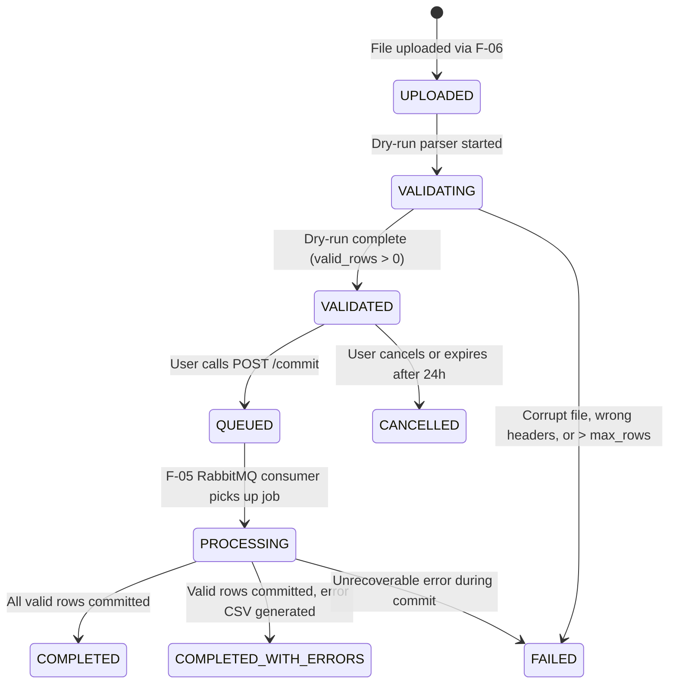

# F-10: Bulk CSV/Excel Import and Export Framework

| Field | Value |
|---|---|
| **ID** | `F-10` |
| **Title** | Bulk CSV/Excel Import and Export Framework |
| **Status** | `PROPOSED` |
| **Priority** | `P1` |
| **Depends On** | `F-05, F-06` |
| **Blocks** | `M-02, M-03, M-05` |
| **Estimated Effort** | `M` |
| **Open Questions** | `Q-017` |
| **Revision** | `1` |

---

## 1. Summary and Business Value

When a new school or university onboards onto the ERP, registrars and accountants must migrate hundreds or thousands of staff (`M-02`), students and guardians (`M-03`), and opening fee balances (`M-05`) from legacy spreadsheets. `F-10` delivers a reusable, tenant-isolated two-phase bulk CSV/XLSX import and export framework with downloadable sample templates, a dry-run validation preview that pinpoints row and column errors before any data is committed, asynchronous background processing via RabbitMQ (`F-05`), downloadable error CSV reports stored in S3/MinIO (`F-06`), and a shared React `ImportWizardModal` component.

---

## 2. Scope and Explicit Non-Goals

### In Scope
- Pluggable `ImportHandler<T>` and `ExportGenerator` Strategy interfaces so domain modules (`M-02`, `M-03`, `M-05`) register bulk import/export support without duplicating parsing, storage, or job tracking logic.
- Dynamic CSV (`.csv`, UTF-8 with BOM support for Bangla text) and Excel (`.xlsx` via streaming Apache POI) parser and sample template generator.
- Two-phase import workflow (`[ASSUMPTION -> Q-017]`):
  1. **Dry-Run (`POST /api/v1/imports/{entityType}/dry-run`)**: Uploads source file via `F-06`, parses and validates every row against schema and database uniqueness rules, stores row-level errors in `import_job_errors`, and returns summary counts (`totalRows`, `validRows`, `invalidRows`) plus a downloadable error CSV.
  2. **Commit (`POST /api/v1/imports/{jobId}/commit`)**: Enqueues valid rows for asynchronous execution via `F-05` RabbitMQ with an `Idempotency-Key`, writing audit log entries and updating progress counters.
- Streaming CSV/XLSX export job (`POST /api/v1/exports/{entityType}`) storing the generated file in `F-06` under `<tenantSlug>/exports/...` with a presigned download URL.
- Reusable frontend `<ImportWizardModal />` and `<ExportButton />` components under `src/features/import-export`.

### Explicit Non-Goals
- Direct SQL dump imports or arbitrary table mapping without a registered `ImportHandler<T>`.
- Legacy binary `.xls` (BIFF8 Excel 97-2003) files — only `.csv` and `.xlsx` are supported.
- Real-time synchronous commit of thousands of rows inside an HTTP request thread.

---

## 3. Business Rules

- **BR-01 (`[ASSUMPTION -> Q-017]`)**: Maximum rows per uploaded import file is `5,000` data rows (configurable per school up to `10,000` via `import.max_rows_per_file`). Files exceeding this limit or `10 MB` (`Q-005`) are rejected immediately with `422 Unprocessable Entity` ([OPEN-QUESTIONS.md](../OPEN-QUESTIONS.md#q-017-F-10)).
- **BR-02 (`[ASSUMPTION -> Q-017]`)**: Imports follow a mandatory two-step workflow: a file must first pass through `DRY_RUN` (`status = 'VALIDATED'`). When the user clicks Commit, all valid rows are committed (`PARTIAL_COMMIT` mode by default, or `ALL_OR_NOTHING` if the school sets `import.require_zero_errors = true` or passes `strictMode = true` in the commit request).
- **BR-03**: Every `ImportHandler<T>` declares the exact required permission code for its entity type (e.g., `staff.write` for `STAFF`, `student.write` for `STUDENT`). A user cannot dry-run or commit an import for an entity type they lack permission to write, nor export an entity type they lack permission to read.
- **BR-04**: Uploaded source files, generated error CSVs, and exported spreadsheets are stored through `F-06` (`FileStorageService`) under tenant-prefixed keys (`<tenantSlug>/imports/<YYYY>/<MM>/<uuid>.xlsx`) and automatically purged after `import.retention_days` (default `30` days).
- **BR-05**: Commit requests require an `Idempotency-Key` header (`F-05`) and transition `import_export_jobs.status` atomically from `VALIDATED` to `PROCESSING` (`WHERE id = :id AND status = 'VALIDATED'`) so double-clicking "Commit" never creates duplicate students, staff, or invoices.
- **BR-06**: CSV and Excel exports sanitize cell values starting with `=`, `+`, `-`, or `@` by prefixing a single quote (`'`) to prevent CSV/Excel formula injection (DDE attacks) when opened in Microsoft Excel or LibreOffice.

---

## 4. Configurability

### `app_settings` Keys
| Key | Type | Default | Managed By | Description |
|---|---|---|---|---|
| `import.max_rows_per_file` | `Integer` | `5000` | `SCHOOL_ADMIN` | Max data rows permitted in a single CSV/XLSX import file (hard ceiling `10000`). |
| `import.require_zero_errors` | `Boolean` | `false` | `SCHOOL_ADMIN` | When `true`, blocks `POST /imports/{jobId}/commit` if `invalid_rows > 0` (`ALL_OR_NOTHING`). |
| `import.retention_days` | `Integer` | `30` | `SCHOOL_ADMIN` | Days to retain import source files, error reports, and export artifacts before cleanup. |

### Feature Flag
- Core foundation capability enabled across all plans; individual entity handlers check their owning module's feature flag (`ImportHandler.requiredFeature()`, e.g., `staff` for `M-02`, `students` for `M-03`, `fees` for `M-05`).

### Strategy Interfaces
```java
package com.schoolerp.shared.importexport;

public interface ImportHandler<T> {
    String entityType();                              // e.g. "STAFF", "STUDENT", "FEE_OPENING_BALANCE"
    Optional<String> requiredFeature();               // e.g. Optional.of("staff")
    String requiredPermission();                      // e.g. "staff.write"
    List<ImportColumnSpec> columns();                 // column key, header, required, sampleValue, description
    RowValidationResult<T> validateRow(int rowNumber, Map<String, String> rawRow, ImportContext ctx);
    void persistBatch(List<T> validItems, ImportContext ctx);
}

public interface ExportGenerator {
    String entityType();                              // e.g. "STAFF", "STUDENT", "INVOICE"
    Optional<String> requiredFeature();
    String requiredPermission();                      // e.g. "staff.read"
    List<ExportColumnSpec> columns();
    void streamRows(Map<String, String> filters, Consumer<Map<String, Object>> rowConsumer);
}
```

---

## 5. Domain Model

### Entities & Value Objects (`com.schoolerp.importexport.domain`)
- **`ImportExportJob`**: Tracks both `IMPORT` and `EXPORT` jobs (`id`, `jobType` [`IMPORT`, `EXPORT`], `entityType`, `fileFormat` [`CSV`, `XLSX`], `status`, `strictMode`, `idempotencyKey`, `sourceFileId`, `resultFileId`, `errorFileId`, `totalRows`, `validRows`, `invalidRows`, `processedRows`, `committedRows`, `filtersJson`, `createdByUserId`, `startedAt`, `finishedAt`).
- **`ImportJobError`**: Row-level validation or commit failure (`id`, `jobId`, `rowNumber`, `columnName`, `rawValue`, `errorCode`, `errorMessage`, `rawRowJson`).

### State Machine (`ImportExportJob.status` for `IMPORT`)


---

## 6. Database

### Flyway Migration
- **File**: `backend/src/main/resources/db/tenant/V11__import_export_jobs.sql`
- **No `tenant_id` column**: Physical isolation per school database.
- **Soft-delete strategy**: Job history rows are retained for auditability; underlying blob files in `stored_files` (`F-06`) expire after `import.retention_days`.

```sql
-- V11__import_export_jobs.sql
-- Bulk CSV/XLSX import and export job tracking and row-level validation errors.

CREATE TABLE import_export_jobs (
    id                  BIGINT       NOT NULL AUTO_INCREMENT,
    job_type            VARCHAR(20)  NOT NULL,
    entity_type         VARCHAR(60)  NOT NULL,
    file_format         VARCHAR(10)  NOT NULL DEFAULT 'CSV',
    status              VARCHAR(30)  NOT NULL DEFAULT 'UPLOADED',
    strict_mode         BOOLEAN      NOT NULL DEFAULT FALSE,
    idempotency_key     VARCHAR(100) NULL,
    source_file_id      BIGINT       NULL,
    result_file_id      BIGINT       NULL,
    error_file_id       BIGINT       NULL,
    total_rows          INT          NOT NULL DEFAULT 0,
    valid_rows          INT          NOT NULL DEFAULT 0,
    invalid_rows        INT          NOT NULL DEFAULT 0,
    committed_rows      INT          NOT NULL DEFAULT 0,
    filters_json        JSON         NULL,
    error_summary       VARCHAR(500) NULL,
    created_by_user_id  BIGINT       NOT NULL,
    started_at          TIMESTAMP(6) NULL,
    finished_at         TIMESTAMP(6) NULL,
    created_at          TIMESTAMP(6) NOT NULL DEFAULT CURRENT_TIMESTAMP(6),
    updated_at          TIMESTAMP(6) NOT NULL DEFAULT CURRENT_TIMESTAMP(6) ON UPDATE CURRENT_TIMESTAMP(6),
    PRIMARY KEY (id),
    UNIQUE KEY uk_ie_idempotency (idempotency_key),
    KEY idx_ie_entity_status (entity_type, status, created_at DESC),
    KEY idx_ie_creator (created_by_user_id, created_at DESC),
    CONSTRAINT fk_ie_source_file FOREIGN KEY (source_file_id) REFERENCES stored_files (id),
    CONSTRAINT fk_ie_result_file FOREIGN KEY (result_file_id) REFERENCES stored_files (id),
    CONSTRAINT fk_ie_error_file  FOREIGN KEY (error_file_id)  REFERENCES stored_files (id),
    CONSTRAINT fk_ie_creator     FOREIGN KEY (created_by_user_id) REFERENCES users (id)
) ENGINE=InnoDB DEFAULT CHARSET=utf8mb4;

CREATE TABLE import_job_errors (
    id             BIGINT       NOT NULL AUTO_INCREMENT,
    job_id         BIGINT       NOT NULL,
    row_number     INT          NOT NULL,
    column_name    VARCHAR(100) NULL,
    raw_value      VARCHAR(500) NULL,
    error_code     VARCHAR(60)  NOT NULL,
    error_message  VARCHAR(500) NOT NULL,
    raw_row_json   JSON         NULL,
    created_at     TIMESTAMP(6) NOT NULL DEFAULT CURRENT_TIMESTAMP(6),
    PRIMARY KEY (id),
    KEY idx_import_err_job_row (job_id, row_number),
    CONSTRAINT fk_import_err_job FOREIGN KEY (job_id) REFERENCES import_export_jobs (id) ON DELETE CASCADE
) ENGINE=InnoDB DEFAULT CHARSET=utf8mb4;

INSERT INTO app_settings (setting_key, setting_value) VALUES
    ('import.max_rows_per_file',   '5000'),
    ('import.require_zero_errors', 'false'),
    ('import.retention_days',      '30');

INSERT INTO permissions (code, description) VALUES
    ('import.execute', 'Run bulk CSV/Excel dry-run and commit imports for permitted modules'),
    ('export.execute', 'Generate and download bulk CSV/Excel exports for permitted modules');

INSERT INTO role_permissions (role_id, permission_id)
SELECT r.id, p.id
FROM roles r
CROSS JOIN permissions p
WHERE r.code IN ('SCHOOL_ADMIN', 'REGISTRAR', 'ACCOUNTANT')
  AND p.code IN ('import.execute', 'export.execute');
```

---

## 7. API

All endpoints require both the framework permission (`import.execute` or `export.execute`) **and** the entity handler's module permission (checked dynamically via `PermissionChecker`).

| Method | Path | Request DTO | Response DTO | Permission | Scope |
|---|---|---|---|---|---|
| `GET` | `/api/v1/imports/templates/{entityType}` | Query: `format=CSV\|XLSX` | `ResponseEntity<byte[]>` (Template attachment) | `import.execute` + handler `requiredPermission()` | `ALL` |
| `POST` | `/api/v1/imports/{entityType}/dry-run` | `multipart/form-data` (`file`) | `ImportJobResponse` | `import.execute` + handler `requiredPermission()` | `ALL` |
| `GET` | `/api/v1/imports/{jobId}` | — | `ImportJobResponse` | `import.execute` | `ALL` |
| `GET` | `/api/v1/imports/{jobId}/errors` | Query: `page, size` | `PageResponse<ImportJobErrorResponse>` | `import.execute` | `ALL` |
| `GET` | `/api/v1/imports/{jobId}/error-report` | — | `PresignedDownloadResponse` (`F-06` URL) | `import.execute` | `ALL` |
| `POST` | `/api/v1/imports/{jobId}/commit` | Header: `Idempotency-Key`, Body: `CommitImportRequest(Boolean strictMode)` | `ImportJobResponse` | `import.execute` + handler `requiredPermission()` | `ALL` |
| `DELETE` | `/api/v1/imports/{jobId}` | — | `204 No Content` (cancels `VALIDATED` job) | `import.execute` | `ALL` |
| `POST` | `/api/v1/exports/{entityType}` | `CreateExportRequest(String format, Map<String,String> filters)` | `ExportJobResponse` | `export.execute` + generator `requiredPermission()` | `ALL` |
| `GET` | `/api/v1/exports/{jobId}` | — | `ExportJobResponse` (includes `downloadUrl` when `COMPLETED`) | `export.execute` | `ALL` |

---

## 8. Permissions to Seed and Default Role Grants

| Permission Code | Description | `SCHOOL_ADMIN` | `REGISTRAR` | `ACCOUNTANT` | `TEACHER` | `STUDENT` | `GUARDIAN` |
|---|---|---|---|---|---|---|---|
| `import.execute` | Execute dry-run and commit imports (subject to entity write permission) | Yes (`ALL`) | Yes (`ALL`) | Yes (`ALL`) | No | No | No |
| `export.execute` | Generate and download data exports (subject to entity read permission) | Yes (`ALL`) | Yes (`ALL`) | Yes (`ALL`) | No | No | No |

---

## 9. Events and Notifications Emitted or Consumed

| Direction | Event / Message | Payload Schema | Routing Key / Channel |
|---|---|---|---|
| **Emitted (Outbox -> RabbitMQ)** | `ImportCommitQueuedEvent` | `{ tenantSlug, jobId, entityType, actorUserId }` | `school.import.commit` (`F-05` consumer binds `TenantContext` and runs `persistBatch` in chunks of 100) |
| **Emitted (Outbox -> RabbitMQ)** | `ExportRequestedEvent` | `{ tenantSlug, jobId, entityType, format, actorUserId }` | `school.export.generate` (`F-05` consumer streams rows to `F-06`) |
| **Emitted (Notification)** | `ImportJobCompletedNotification` | `{ tenantSlug, jobId, entityType, committedRows, invalidRows }` | `F-04` `IN_APP` notification to `createdByUserId` |

---

## 10. Tenancy and Security Considerations

- **Async Tenant Binding**: The RabbitMQ consumers for `school.import.commit` and `school.export.generate` extract `tenantSlug` from the message envelope, verify the tenant is `ACTIVE`, and wrap execution in `try { TenantContext.set(tenantSlug); ... } finally { TenantContext.clear(); }`.
- **S3 / MinIO Path Isolation**: All files uploaded or generated by `F-10` use `F-06` storage paths prefixed with `<tenantSlug>/imports/...` and `<tenantSlug>/exports/...`. A user from school `alpha` can never download a file belonging to school `beta`.
- **Formula Injection Protection**: Every string written to an exported CSV or XLSX cell or an error report CSV is passed through `CsvFormulaSanitizer.sanitize(value)` which prefixes `'=` for any value starting with `=`, `+`, `-`, `@`, `\t`, or `\r`.
- **Zip-Bomb & Memory Protection**: `.xlsx` files are parsed using Apache POI's streaming `XSSFReader` / `ZipSecureFile.setMinInflateRatio(0.01)` so a maliciously compressed XML zip bomb cannot exhaust JVM heap.
- **Audit Logging**:
  - `IMPORT_COMMITTED`: Logs `entityType`, `jobId`, `totalRows`, `committedRows`, `invalidRows`.
  - `EXPORT_GENERATED`: Logs `entityType`, `jobId`, `totalRows`, `filtersJson`.

---

## 11. Frontend

### Reusable Components (`src/features/import-export`)
- `ImportWizardModal.tsx`: 4-step modal reusable by `M-02` (Staff), `M-03` (Students), and `M-05` (Fees):
  1. **Download Template & Upload**: Download `.csv` or `.xlsx` sample template; drag-and-drop file upload.
  2. **Dry-Run Validation Preview**: Summary cards (`Total`, `Valid`, `Invalid`), paginated table of `import_job_errors` showing exact row number, column name, raw value, and error message, plus "Download Error CSV" button.
  3. **Confirm & Commit**: Displays count of valid rows to be imported, warning if partial commit is enabled, and initiates `POST /imports/{jobId}/commit` with a generated UUID `Idempotency-Key`.
  4. **Progress & Completion**: Polls `/api/v1/imports/{jobId}` via TanStack Query until `COMPLETED` or `COMPLETED_WITH_ERRORS`.
- `ExportButton.tsx`: Dropdown button (`Export CSV` / `Export Excel`) that triggers `POST /api/v1/exports/{entityType}` with current table filters and auto-downloads the presigned URL when complete.

### Required i18n Keys (`en` and `bn`)
| Key | `en` | `bn` |
|---|---|---|
| `import.wizard.title` | `Bulk Import {{entity}}` | `একসাথে {{entity}} ইমপোর্ট করুন` |
| `import.wizard.downloadTemplate` | `Download Sample Template ({{format}})` | `নমুনা টেমপ্লেট ডাউনলোড করুন ({{format}})` |
| `import.wizard.step.upload` | `1. Upload File` | `১. ফাইল আপলোড` |
| `import.wizard.step.validate` | `2. Validation Preview` | `২. যাচাইকরণ প্রিভিউ` |
| `import.wizard.step.commit` | `3. Commit Import` | `৩. ইমপোর্ট নিশ্চিত করুন` |
| `import.summary.validRows` | `Valid Rows: {{count}}` | `সঠিক সারি: {{count}}` |
| `import.summary.invalidRows` | `Rows with Errors: {{count}}` | `ত্রুটিপূর্ণ সারি: {{count}}` |
| `import.action.downloadErrors` | `Download Error CSV` | `ত্রুটির তালিকা ডাউনলোড করুন (CSV)` |
| `import.action.commitValid` | `Import {{count}} Valid Rows` | `{{count}}টি সঠিক সারি ইমপোর্ট করুন` |
| `export.action.csv` | `Export as CSV` | `CSV হিসেবে এক্সপোর্ট করুন` |
| `export.action.xlsx` | `Export as Excel (.xlsx)` | `এক্সেল (.xlsx) হিসেবে এক্সপোর্ট করুন` |

---

## 12. Test Plan

- **Unit Tests**:
  - `CsvAndXlsxParserTest`: Tests UTF-8 BOM handling, Bangla Unicode characters, missing required headers, and row limit (> 5,000 rows rejected).
  - `CsvFormulaSanitizerTest`: Verifies values starting with `=cmd|...`, `+SUM(...)`, `-1+1`, and `@SUM(...)` are escaped with a leading `'`.
- **Integration Tests (Testcontainers MySQL + RabbitMQ + MinIO)**:
  - `TwoPhaseImportFlowIntegrationTest`: Registers a test `ImportHandler`, uploads a 10-row CSV (8 valid, 2 invalid), verifies dry-run creates 2 `import_job_errors` rows and 0 target entities, calls `commit` with an `Idempotency-Key`, and verifies exactly 8 entities are persisted and re-sending the same `Idempotency-Key` is a no-op.
  - `StrictModeImportRejectionTest`: Sets `import.require_zero_errors = true` in `app_settings` and verifies `POST /commit` returns `422 Unprocessable Entity` when `invalid_rows > 0`.
- **Two-School Tenant Isolation Test (`ImportExportTenantIsolationTest`)**:
  - Uploads a dry-run job in school `alpha` (`jobId = 1`). Attempts to read `GET /api/v1/imports/1`, `GET /api/v1/imports/1/errors`, and `POST /api/v1/imports/1/commit` using a valid `SCHOOL_ADMIN` token for school `beta`; verifies `404 Not Found` and zero data leakage in `beta`.
- **Permission Boundary Tests**:
  - Verifies an `ACCOUNTANT` with `import.execute` and `fees.write` can dry-run `FEE_OPENING_BALANCE`, but receives `403 Forbidden` when attempting to dry-run `STAFF` (`staff.write` required).

---

## 13. Acceptance Criteria

- [ ] Users can download an up-to-date `.csv` or `.xlsx` sample template with column headers and example row for any supported module.
- [ ] Uploading a spreadsheet runs a dry-run validation without modifying school data and displays exact row numbers, column names, and human-readable reasons for any invalid rows.
- [ ] Users can download an Error CSV containing only the rejected rows and their error descriptions so they can fix and re-upload them.
- [ ] Confirming the import processes valid rows in the background and notifies the user upon completion without timing out the browser.
- [ ] Exported CSV and Excel files preserve Bangla and English text accurately and neutralize spreadsheet formula injection payloads.

---

## 14. Implementation Slices

- [ ] **Slice 1**: Flyway migration `V11__import_export_jobs.sql`, `ImportExportJob` & `ImportJobError` entities/repositories, and `ImportHandler<T>` / `ExportGenerator` Strategy interfaces.
- [ ] **Slice 2**: Streaming CSV/XLSX parser, template generator, `CsvFormulaSanitizer`, and synchronous dry-run service storing files via `F-06`.
- [ ] **Slice 3**: Asynchronous commit and export RabbitMQ consumers (`F-05`), REST controllers (`/api/v1/imports`, `/api/v1/exports`), audit logging, and two-school isolation test (`ImportExportTenantIsolationTest`).
- [ ] **Slice 4**: Frontend `<ImportWizardModal />` and `<ExportButton />` components, `en`/`bn` i18n keys, and Vitest unit tests.

---

## 15. Risks and Mitigations

| Risk | Impact | Mitigation |
|---|---|---|
| Large `.xlsx` upload exhausts JVM heap | High (OutOfMemoryError affects all tenants on instance) | Enforce 10 MB file upload limit (`F-06`), 5,000 row limit, and use streaming SAX/POI reader instead of DOM `WorkbookFactory.create()`. |
| Duplicate records created if user clicks "Commit" twice | High (corrupts student/staff/fee data) | Require `Idempotency-Key` header and atomic SQL state transition `UPDATE import_export_jobs SET status = 'QUEUED' WHERE id = ? AND status = 'VALIDATED'`. |
| CSV formula injection when admin opens exported student list in Excel | Medium (client-side command execution) | Sanitize all string cells via `CsvFormulaSanitizer` before writing CSV/XLSX streams. |

---

## 16. How to Extend or Customize Later

To add bulk import and export to any domain module (such as `M-02` Staff, `M-03` Students, or `M-05` Fee Opening Balances):
1. Create a `@Component` implementing `ImportHandler<MyRowDto>` inside `com.schoolerp.<module>.application`:
   ```java
   @Component
   public class StaffImportHandler implements ImportHandler<StaffImportRow> {
       @Override public String entityType() { return "STAFF"; }
       @Override public Optional<String> requiredFeature() { return Optional.of("staff"); }
       @Override public String requiredPermission() { return "staff.write"; }
       @Override public List<ImportColumnSpec> columns() { ... }
       @Override public RowValidationResult<StaffImportRow> validateRow(int rowNum, Map<String, String> row, ImportContext ctx) { ... }
       @Override public void persistBatch(List<StaffImportRow> batch, ImportContext ctx) { ... }
   }
   ```
2. Drop `<ImportWizardModal entityType="STAFF" />` onto the module's React page. Template generation, dry-run validation UI, error CSV download, and async commit work automatically.

---

## 17. Revision History

| Revision | Date | Author | Changes |
|---|---|---|---|
| `1` | 2026-11-04 | Antigravity | Initial comprehensive plan for `F-10` Bulk CSV/Excel Import and Export Framework. |
