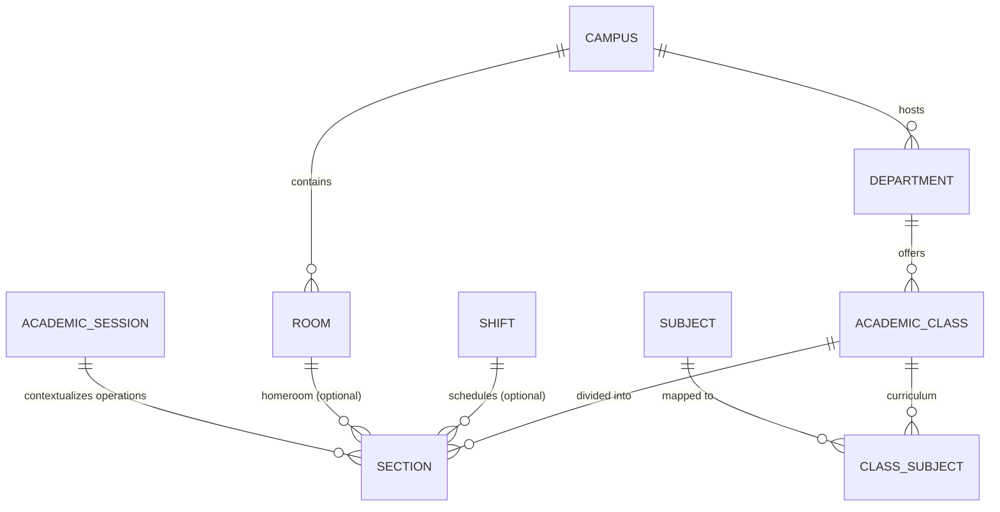
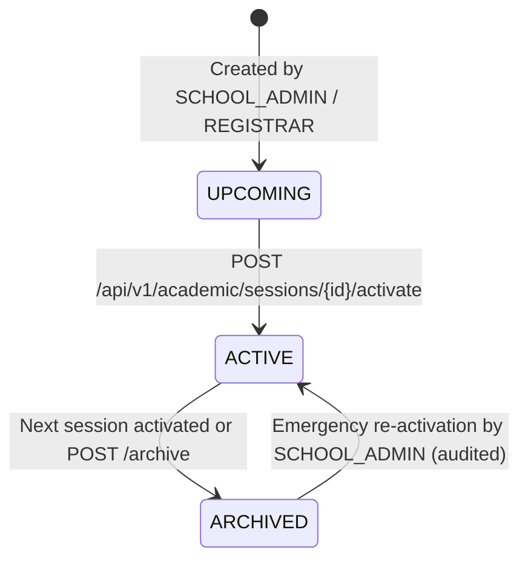

# M-01: Institution and Academic Structure

| Field | Value |
|---|---|
| **ID** | `M-01` |
| **Title** | Institution and Academic Structure |
| **Status** | `PROPOSED` |
| **Priority** | `P0` |
| **Depends On** | `F-08` |
| **Blocks** | `M-02, M-03, M-04, M-05, M-06` |
| **Estimated Effort** | `L` |
| **Open Questions** | `Q-006, Q-018` |
| **Revision** | `1` |

---

## 1. Summary and Business Value

Every downstream school operation — staff teaching assignments (`M-02`), student admission and session enrollment (`M-03`), daily or period attendance (`M-04`), fee structures (`M-05`), and targeted notices (`M-06`) — anchors on the institution's academic hierarchy and active academic session. `M-01` delivers a unified, configurable academic structure (`Campus -> Department/Program -> AcademicClass/Batch -> Section -> Subject/Course`, plus `AcademicSession`, `Shift`, and `Room`) that adapts seamlessly via `F-08` school settings from a single-campus K-12 primary school to a multi-campus college or university running semester-based programs.

---

## 2. Scope and Explicit Non-Goals

### In Scope
- **Foundation Dependencies**: Depends on `F-08` (Settings, Feature Flags, and Branding) for institution-level hierarchy toggles (`academic.session_type`, `academic.multi_campus`, `academic.use_departments`, `academic.shift_enabled`).
- **`AcademicSession`** first-class entity supporting `YEARLY` and `SEMESTER` session types and a strict lifecycle state machine (`UPCOMING -> ACTIVE -> ARCHIVED`), ensuring exactly one `ACTIVE` session (or one active semester per program) at a time.
- **Unified 5-Level Academic Hierarchy (`[ASSUMPTION -> Q-006]`)**:
  - `Campus` (seeded with a `"Main Campus"` default so single-campus K-12 schools never need to manage campuses manually).
  - `Department` / Program (seeded with `"General"` default; used for Science/Humanities/Commerce streams in high schools or faculties/programs in universities).
  - `AcademicClass` / Batch / Grade (ordered by `numeric_level` for deterministic session promotion in `M-03` per `Q-018`).
  - `Section` (linked to `AcademicClass`, optional `Shift` and `Room`, with `capacity`).
  - `Subject` / Course (`THEORY`, `LAB`, `COMBINED`, `ELECTIVE` with credit hours and subject codes) and `ClassSubject` curriculum mapping per `AcademicClass`.
- **Supporting Infrastructure Entities**: `Shift` (Morning / Day / Evening) and `Room` (classrooms/labs with seating capacity).
- Soft-delete (`deleted_at`) across all academic entities — no hard deletion of academic records.

### Explicit Non-Goals
- Student enrollment and batch promotion execution (`M-03` owns `enrollments` and uses `AcademicClass.numeric_level` + `AcademicSession` defined here).
- Teacher-to-section-subject allocation (`M-02` owns `teacher_subject_assignments`).
- Weekly bell-schedule timetable slot allocation (Phase 2 Timetable module).

---

## 3. Business Rules

- **BR-01 (`[ASSUMPTION -> Q-006]`)**: All tenants share the unified 5-level relational schema (`Campus -> Department -> AcademicClass -> Section -> Subject`). When `academic.multi_campus = false`, the API and UI automatically bind new departments and classes to the seeded default `Campus` (`is_default = true`); when `academic.use_departments = false`, classes bind to the seeded `"General"` department ([OPEN-QUESTIONS.md](../OPEN-QUESTIONS.md#q-006-M-01)).
- **BR-02**: `AcademicSession` follows the state machine `UPCOMING -> ACTIVE -> ARCHIVED`. Activating an `UPCOMING` session atomically transitions any previously `ACTIVE` session to `ARCHIVED` (when `academic.session_type = 'YEARLY'`) and writes an `ACADEMIC_SESSION_ACTIVATED` entry to `audit_log`.
- **BR-03**: An `ARCHIVED` `AcademicSession` is read-only for historical reporting; new enrollments (`M-03`), attendance (`M-04`), or fee structures (`M-05`) cannot be created in an `ARCHIVED` session unless explicitly unlocked by `SCHOOL_ADMIN`.
- **BR-04 (`[ASSUMPTION -> Q-018]`)**: Every `AcademicClass` carries an integer `numeric_level` (e.g., Class 1 = `1`, Class 9 = `9`, Class 10 = `10`) and an optional `next_class_id` self-reference so the `M-03` Promotion Wizard knows the default target class when promoting students to the next `AcademicSession` ([OPEN-QUESTIONS.md](../OPEN-QUESTIONS.md#q-018-M-01-M-03)).
- **BR-05**: No academic entity (`AcademicSession`, `Campus`, `Department`, `AcademicClass`, `Section`, `Subject`, `ClassSubject`, `Shift`, `Room`) may ever be hard-deleted. `DELETE` endpoints set `deleted_at = CURRENT_TIMESTAMP(6)` after verifying no active enrollments or active teacher assignments reference the record.
- **BR-06**: Scoped RBAC (`PermissionChecker` from `F-01`) uses `Department.id` for `DEPARTMENT` scope, `AcademicClass.id` for `CLASS` scope, and `Section.id` for `SECTION` scope. Moreover, `AcademicStructureLookupService` resolves parent-child hierarchy so a user granted `DEPARTMENT` scope on Science (`id=2`) automatically satisfies scope checks for any `AcademicClass` or `Section` belonging to Department `2`.

---

## 4. Configurability

### `app_settings` Keys Introduced / Used (`F-08`)
| Key | Type | Default | Managed By | Description |
|---|---|---|---|---|
| `academic.session_type` | `Enum (YEARLY \| SEMESTER)` | `YEARLY` | `SCHOOL_ADMIN` | Controls session terminology (`Academic Year` vs `Semester`) and session activation rules. |
| `academic.multi_campus` | `Boolean` | `false` | `SCHOOL_ADMIN` | Shows/hides multi-campus selectors in forms and filters. |
| `academic.use_departments` | `Boolean` | `false` | `SCHOOL_ADMIN` | Shows/hides Department / Program / Group hierarchy level in UI. |
| `academic.shift_enabled` | `Boolean` | `false` | `SCHOOL_ADMIN` | Enables Shift (Morning/Day/Evening) assignment on Sections. |
| `academic.terminology_preset` | `Enum (K12_SCHOOL \| COLLEGE \| UNIVERSITY)` | `K12_SCHOOL` | `SCHOOL_ADMIN` | Adjusts UI labels (`Class` vs `Batch`, `Subject` vs `Course`, `Department` vs `Program`). |

### Feature Flag (`tenants.features_json`)
- **Flag Key**: `academic` (enabled by default in all subscription plans: `BASIC`, `PRO`, `ENTERPRISE`).
- Enforced on backend controllers via `@RequiresFeature("academic")` and in frontend `src/app/modules.ts`.

### Extension / Strategy Points
- `AcademicHierarchyScopeResolver`: Plugs into `PermissionChecker` (`F-01`) to resolve whether a `SECTION` or `CLASS` belongs to a user's `DEPARTMENT` or `CLASS` role scope.

---

## 5. Domain Model

### Entity Relationship Diagram


### `AcademicSession` Lifecycle State Machine


---

## 6. Database

### Flyway Migration
- **File**: `backend/src/main/resources/db/tenant/V12__academic_structure.sql`
- **No `tenant_id` column**: Physical database isolation per school.
- **Soft-delete strategy**: Every table includes `deleted_at TIMESTAMP(6) NULL` and an active filter index.

```sql
-- V12__academic_structure.sql
-- Institution hierarchy, academic sessions, classes, sections, subjects, shifts, and rooms.

CREATE TABLE academic_sessions (
    id            BIGINT       NOT NULL AUTO_INCREMENT,
    code          VARCHAR(40)  NOT NULL,
    name          VARCHAR(120) NOT NULL,
    session_type  VARCHAR(20)  NOT NULL DEFAULT 'YEARLY',
    start_date    DATE         NOT NULL,
    end_date      DATE         NOT NULL,
    status        VARCHAR(20)  NOT NULL DEFAULT 'UPCOMING',
    is_current    BOOLEAN      NOT NULL DEFAULT FALSE,
    created_at    TIMESTAMP(6) NOT NULL DEFAULT CURRENT_TIMESTAMP(6),
    updated_at    TIMESTAMP(6) NOT NULL DEFAULT CURRENT_TIMESTAMP(6) ON UPDATE CURRENT_TIMESTAMP(6),
    deleted_at    TIMESTAMP(6) NULL,
    PRIMARY KEY (id),
    UNIQUE KEY uk_academic_sessions_code (code),
    KEY idx_academic_sessions_status (status, is_current)
) ENGINE=InnoDB DEFAULT CHARSET=utf8mb4;

CREATE TABLE campuses (
    id          BIGINT       NOT NULL AUTO_INCREMENT,
    code        VARCHAR(40)  NOT NULL,
    name        VARCHAR(150) NOT NULL,
    address     VARCHAR(500) NULL,
    phone       VARCHAR(40)  NULL,
    is_default  BOOLEAN      NOT NULL DEFAULT FALSE,
    created_at  TIMESTAMP(6) NOT NULL DEFAULT CURRENT_TIMESTAMP(6),
    updated_at  TIMESTAMP(6) NOT NULL DEFAULT CURRENT_TIMESTAMP(6) ON UPDATE CURRENT_TIMESTAMP(6),
    deleted_at  TIMESTAMP(6) NULL,
    PRIMARY KEY (id),
    UNIQUE KEY uk_campuses_code (code)
) ENGINE=InnoDB DEFAULT CHARSET=utf8mb4;

CREATE TABLE departments (
    id          BIGINT       NOT NULL AUTO_INCREMENT,
    campus_id   BIGINT       NOT NULL,
    code        VARCHAR(40)  NOT NULL,
    name        VARCHAR(150) NOT NULL,
    is_default  BOOLEAN      NOT NULL DEFAULT FALSE,
    created_at  TIMESTAMP(6) NOT NULL DEFAULT CURRENT_TIMESTAMP(6),
    updated_at  TIMESTAMP(6) NOT NULL DEFAULT CURRENT_TIMESTAMP(6) ON UPDATE CURRENT_TIMESTAMP(6),
    deleted_at  TIMESTAMP(6) NULL,
    PRIMARY KEY (id),
    UNIQUE KEY uk_departments_campus_code (campus_id, code),
    KEY idx_departments_campus (campus_id),
    CONSTRAINT fk_dept_campus FOREIGN KEY (campus_id) REFERENCES campuses (id)
) ENGINE=InnoDB DEFAULT CHARSET=utf8mb4;

CREATE TABLE shifts (
    id          BIGINT       NOT NULL AUTO_INCREMENT,
    code        VARCHAR(40)  NOT NULL,
    name        VARCHAR(100) NOT NULL,
    start_time  TIME         NOT NULL,
    end_time    TIME         NOT NULL,
    created_at  TIMESTAMP(6) NOT NULL DEFAULT CURRENT_TIMESTAMP(6),
    updated_at  TIMESTAMP(6) NOT NULL DEFAULT CURRENT_TIMESTAMP(6) ON UPDATE CURRENT_TIMESTAMP(6),
    deleted_at  TIMESTAMP(6) NULL,
    PRIMARY KEY (id),
    UNIQUE KEY uk_shifts_code (code)
) ENGINE=InnoDB DEFAULT CHARSET=utf8mb4;

CREATE TABLE rooms (
    id          BIGINT       NOT NULL AUTO_INCREMENT,
    campus_id   BIGINT       NOT NULL,
    room_number VARCHAR(40)  NOT NULL,
    name        VARCHAR(120) NULL,
    room_type   VARCHAR(30)  NOT NULL DEFAULT 'CLASSROOM',
    capacity    INT          NOT NULL DEFAULT 40,
    created_at  TIMESTAMP(6) NOT NULL DEFAULT CURRENT_TIMESTAMP(6),
    updated_at  TIMESTAMP(6) NOT NULL DEFAULT CURRENT_TIMESTAMP(6) ON UPDATE CURRENT_TIMESTAMP(6),
    deleted_at  TIMESTAMP(6) NULL,
    PRIMARY KEY (id),
    UNIQUE KEY uk_rooms_campus_number (campus_id, room_number),
    CONSTRAINT fk_rooms_campus FOREIGN KEY (campus_id) REFERENCES campuses (id)
) ENGINE=InnoDB DEFAULT CHARSET=utf8mb4;

CREATE TABLE academic_classes (
    id             BIGINT       NOT NULL AUTO_INCREMENT,
    department_id  BIGINT       NOT NULL,
    code           VARCHAR(40)  NOT NULL,
    name           VARCHAR(120) NOT NULL,
    numeric_level  INT          NOT NULL DEFAULT 1,
    next_class_id  BIGINT       NULL,
    display_order  INT          NOT NULL DEFAULT 1,
    created_at     TIMESTAMP(6) NOT NULL DEFAULT CURRENT_TIMESTAMP(6),
    updated_at     TIMESTAMP(6) NOT NULL DEFAULT CURRENT_TIMESTAMP(6) ON UPDATE CURRENT_TIMESTAMP(6),
    deleted_at     TIMESTAMP(6) NULL,
    PRIMARY KEY (id),
    UNIQUE KEY uk_classes_dept_code (department_id, code),
    KEY idx_classes_level (numeric_level, display_order),
    CONSTRAINT fk_class_dept FOREIGN KEY (department_id) REFERENCES departments (id),
    CONSTRAINT fk_class_next FOREIGN KEY (next_class_id) REFERENCES academic_classes (id)
) ENGINE=InnoDB DEFAULT CHARSET=utf8mb4;

CREATE TABLE sections (
    id            BIGINT       NOT NULL AUTO_INCREMENT,
    class_id      BIGINT       NOT NULL,
    shift_id      BIGINT       NULL,
    room_id       BIGINT       NULL,
    code          VARCHAR(40)  NOT NULL,
    name          VARCHAR(100) NOT NULL,
    capacity      INT          NOT NULL DEFAULT 40,
    created_at    TIMESTAMP(6) NOT NULL DEFAULT CURRENT_TIMESTAMP(6),
    updated_at    TIMESTAMP(6) NOT NULL DEFAULT CURRENT_TIMESTAMP(6) ON UPDATE CURRENT_TIMESTAMP(6),
    deleted_at    TIMESTAMP(6) NULL,
    PRIMARY KEY (id),
    UNIQUE KEY uk_sections_class_code (class_id, code),
    KEY idx_sections_class (class_id),
    KEY idx_sections_shift (shift_id),
    KEY idx_sections_room (room_id),
    CONSTRAINT fk_sec_class FOREIGN KEY (class_id) REFERENCES academic_classes (id),
    CONSTRAINT fk_sec_shift FOREIGN KEY (shift_id) REFERENCES shifts (id),
    CONSTRAINT fk_sec_room  FOREIGN KEY (room_id)  REFERENCES rooms (id)
) ENGINE=InnoDB DEFAULT CHARSET=utf8mb4;

CREATE TABLE subjects (
    id            BIGINT        NOT NULL AUTO_INCREMENT,
    code          VARCHAR(40)   NOT NULL,
    name          VARCHAR(150)  NOT NULL,
    subject_type  VARCHAR(20)   NOT NULL DEFAULT 'THEORY',
    credit_hours  DECIMAL(4,2)  NOT NULL DEFAULT 1.00,
    created_at    TIMESTAMP(6)  NOT NULL DEFAULT CURRENT_TIMESTAMP(6),
    updated_at    TIMESTAMP(6)  NOT NULL DEFAULT CURRENT_TIMESTAMP(6) ON UPDATE CURRENT_TIMESTAMP(6),
    deleted_at    TIMESTAMP(6)  NULL,
    PRIMARY KEY (id),
    UNIQUE KEY uk_subjects_code (code)
) ENGINE=InnoDB DEFAULT CHARSET=utf8mb4;

CREATE TABLE class_subjects (
    id             BIGINT        NOT NULL AUTO_INCREMENT,
    class_id       BIGINT        NOT NULL,
    subject_id     BIGINT        NOT NULL,
    is_mandatory   BOOLEAN       NOT NULL DEFAULT TRUE,
    max_marks      DECIMAL(6,2)  NOT NULL DEFAULT 100.00,
    pass_marks     DECIMAL(6,2)  NOT NULL DEFAULT 33.00,
    display_order  INT           NOT NULL DEFAULT 1,
    created_at     TIMESTAMP(6)  NOT NULL DEFAULT CURRENT_TIMESTAMP(6),
    updated_at     TIMESTAMP(6)  NOT NULL DEFAULT CURRENT_TIMESTAMP(6) ON UPDATE CURRENT_TIMESTAMP(6),
    deleted_at     TIMESTAMP(6)  NULL,
    PRIMARY KEY (id),
    UNIQUE KEY uk_class_subjects (class_id, subject_id),
    KEY idx_cs_subject (subject_id),
    CONSTRAINT fk_cs_class   FOREIGN KEY (class_id)   REFERENCES academic_classes (id),
    CONSTRAINT fk_cs_subject FOREIGN KEY (subject_id) REFERENCES subjects (id)
) ENGINE=InnoDB DEFAULT CHARSET=utf8mb4;

-- Seed default Campus and Department for single-campus K-12 simplicity
INSERT INTO campuses (code, name, is_default) VALUES ('MAIN', 'Main Campus', TRUE);
INSERT INTO departments (campus_id, code, name, is_default)
SELECT id, 'GEN', 'General', TRUE FROM campuses WHERE code = 'MAIN';

INSERT INTO app_settings (setting_key, setting_value) VALUES
    ('academic.multi_campus',       'false'),
    ('academic.use_departments',    'false'),
    ('academic.shift_enabled',      'false'),
    ('academic.terminology_preset', 'K12_SCHOOL');

INSERT INTO permissions (code, description) VALUES
    ('academic.read',           'View academic sessions, classes, sections, and subjects'),
    ('academic.write',          'Create and update campuses, departments, classes, sections, and subjects'),
    ('academic.session.manage', 'Create, activate, and archive academic sessions');

INSERT INTO role_permissions (role_id, permission_id)
SELECT r.id, p.id
FROM roles r
CROSS JOIN permissions p
WHERE r.code = 'SCHOOL_ADMIN'
  AND p.code IN ('academic.read', 'academic.write', 'academic.session.manage');

INSERT INTO role_permissions (role_id, permission_id)
SELECT r.id, p.id
FROM roles r
CROSS JOIN permissions p
WHERE r.code = 'REGISTRAR'
  AND p.code IN ('academic.read', 'academic.write');

INSERT INTO role_permissions (role_id, permission_id)
SELECT r.id, p.id
FROM roles r
CROSS JOIN permissions p
WHERE r.code IN ('ACCOUNTANT', 'TEACHER', 'STUDENT', 'GUARDIAN')
  AND p.code = 'academic.read';
```

---

## 7. API

All endpoints are prefixed with `/api/v1/academic` and annotated with `@RequiresFeature("academic")`.

| Method | Path | Request DTO | Response DTO | Permission | Scope |
|---|---|---|---|---|---|
| `GET` | `/api/v1/academic/sessions` | Query: `page, size, status` | `PageResponse<AcademicSessionResponse>` | `academic.read` | `ALL` |
| `POST` | `/api/v1/academic/sessions` | `CreateAcademicSessionRequest` | `AcademicSessionResponse` | `academic.session.manage` | `ALL` |
| `PUT` | `/api/v1/academic/sessions/{id}` | `UpdateAcademicSessionRequest` | `AcademicSessionResponse` | `academic.session.manage` | `ALL` |
| `POST` | `/api/v1/academic/sessions/{id}/activate` | — | `AcademicSessionResponse` | `academic.session.manage` | `ALL` |
| `POST` | `/api/v1/academic/sessions/{id}/archive` | — | `AcademicSessionResponse` | `academic.session.manage` | `ALL` |
| `GET` | `/api/v1/academic/campuses` | Query: `page, size` | `PageResponse<CampusResponse>` | `academic.read` | `ALL` |
| `POST` | `/api/v1/academic/campuses` | `SaveCampusRequest` | `CampusResponse` | `academic.write` | `ALL` |
| `PUT` | `/api/v1/academic/campuses/{id}` | `SaveCampusRequest` | `CampusResponse` | `academic.write` | `ALL` |
| `GET` | `/api/v1/academic/departments` | Query: `campusId, page, size` | `PageResponse<DepartmentResponse>` | `academic.read` | `ALL` / `DEPARTMENT` |
| `POST` | `/api/v1/academic/departments` | `SaveDepartmentRequest` | `DepartmentResponse` | `academic.write` | `ALL` |
| `PUT` | `/api/v1/academic/departments/{id}` | `SaveDepartmentRequest` | `DepartmentResponse` | `academic.write` | `ALL` |
| `GET` | `/api/v1/academic/classes` | Query: `departmentId, page, size` | `PageResponse<AcademicClassResponse>` | `academic.read` | `ALL` / `DEPARTMENT` / `CLASS` |
| `POST` | `/api/v1/academic/classes` | `SaveAcademicClassRequest` | `AcademicClassResponse` | `academic.write` | `ALL` |
| `PUT` | `/api/v1/academic/classes/{id}` | `SaveAcademicClassRequest` | `AcademicClassResponse` | `academic.write` | `ALL` |
| `DELETE` | `/api/v1/academic/classes/{id}` | — | `204 No Content` (soft delete) | `academic.write` | `ALL` |
| `GET` | `/api/v1/academic/sections` | Query: `classId, shiftId, page, size` | `PageResponse<SectionResponse>` | `academic.read` | `ALL` / `CLASS` / `SECTION` |
| `POST` | `/api/v1/academic/sections` | `SaveSectionRequest` | `SectionResponse` | `academic.write` | `ALL` |
| `PUT` | `/api/v1/academic/sections/{id}` | `SaveSectionRequest` | `SectionResponse` | `academic.write` | `ALL` |
| `DELETE` | `/api/v1/academic/sections/{id}` | — | `204 No Content` (soft delete) | `academic.write` | `ALL` |
| `GET` | `/api/v1/academic/subjects` | Query: `search, subjectType, page, size` | `PageResponse<SubjectResponse>` | `academic.read` | `ALL` |
| `POST` | `/api/v1/academic/subjects` | `SaveSubjectRequest` | `SubjectResponse` | `academic.write` | `ALL` |
| `PUT` | `/api/v1/academic/subjects/{id}` | `SaveSubjectRequest` | `SubjectResponse` | `academic.write` | `ALL` |
| `GET` | `/api/v1/academic/classes/{classId}/subjects` | — | `List<ClassSubjectResponse>` | `academic.read` | `ALL` / `CLASS` |
| `PUT` | `/api/v1/academic/classes/{classId}/subjects` | `AssignClassSubjectsRequest` | `List<ClassSubjectResponse>` | `academic.write` | `ALL` |
| `GET` | `/api/v1/academic/shifts` | — | `List<ShiftResponse>` | `academic.read` | `ALL` |
| `POST` | `/api/v1/academic/shifts` | `SaveShiftRequest` | `ShiftResponse` | `academic.write` | `ALL` |
| `GET` | `/api/v1/academic/rooms` | Query: `campusId, page, size` | `PageResponse<RoomResponse>` | `academic.read` | `ALL` |
| `POST` | `/api/v1/academic/rooms` | `SaveRoomRequest` | `RoomResponse` | `academic.write` | `ALL` |

---

## 8. Permissions to Seed and Default Role Grants

| Permission Code | Description | `SCHOOL_ADMIN` | `REGISTRAR` | `ACCOUNTANT` | `TEACHER` | `STUDENT` | `GUARDIAN` |
|---|---|---|---|---|---|---|---|
| `academic.read` | View sessions, campuses, departments, classes, sections, subjects | Yes (`ALL`) | Yes (`ALL`) | Yes (`ALL`) | Yes (`ALL`) | Yes (`OWN`) | Yes (`OWN`) |
| `academic.write` | Create/edit classes, sections, subjects, shifts, rooms | Yes (`ALL`) | Yes (`ALL`) | No | No | No | No |
| `academic.session.manage` | Create, activate, and archive academic sessions | Yes (`ALL`) | No | No | No | No | No |

---

## 9. Events and Notifications Emitted or Consumed

| Direction | Event Class | Payload Schema | Routing Key / Consumers |
|---|---|---|---|
| **Emitted** | `AcademicSessionActivatedEvent` | `{ tenantSlug, sessionId, code, name, previousActiveSessionId, actorUserId }` | In-process Spring Modulith event + `F-05` Outbox (`school.academic.session_activated`); invalidates `<tenantSlug>:cache:academic:*` in Redis |
| **Emitted** | `AcademicStructureChangedEvent` | `{ tenantSlug, entityType, entityId, action }` | Evicts `<tenantSlug>:cache:academic:hierarchy` Redis cache used by `PermissionChecker` |

---

## 10. Tenancy and Security Considerations

- **Physical Database Isolation**: All 9 tables live inside each tenant's dedicated MySQL schema (`db/tenant/V12__academic_structure.sql`) without any `tenant_id` column.
- **Redis Cache Prefixing**: The hierarchy lookup map (`sectionId -> classId -> departmentId`) and current active session are cached in Redis under `<tenantSlug>:cache:academic:hierarchy` and `<tenantSlug>:cache:academic:current-session`.
- **Audit Logging**:
  - `ACADEMIC_SESSION_ACTIVATED` and `ACADEMIC_SESSION_ARCHIVED` write before/after state into `audit_log`.
  - Soft-deleting a class, section, or subject records `ACADEMIC_ENTITY_DELETED` in `audit_log`.
- **Feature Flag Enforcement**: If a school's `features_json` disables `academic`, all `/api/v1/academic/**` requests are rejected with `403 Forbidden` by `FeatureFlagInterceptor`.

---

## 11. Frontend

### Routes & Pages (`src/features/academic`)
- `/academic/sessions` (`AcademicSessionsPage.tsx`): Manage academic years/semesters, status badges (`UPCOMING`, `ACTIVE`, `ARCHIVED`), and "Set Active Session" confirmation modal.
- `/academic/structure` (`AcademicStructurePage.tsx`): Tabbed workspace adapting dynamically to `F-08` settings:
  - **Classes & Sections Tab**: Tree/table view of Classes (`numeric_level`, `next_class`) and their Sections (`capacity`, `shift`, `room`).
  - **Subjects & Curriculum Tab**: Master Subject catalog (`THEORY`, `LAB`) and interactive Class-Subject matrix.
  - **Campuses & Departments Tab**: Rendered only when `academic.multi_campus` or `academic.use_departments` is enabled.
  - **Shifts & Rooms Tab**: Manage shifts and physical classrooms.
- Global Header Component: `ActiveSessionBadge.tsx` in the top navigation bar showing the school's currently `ACTIVE` `AcademicSession`.

### Module Registration (`src/app/modules.ts`)
- Registered with `featureFlag: 'academic'` and `requiredPermission: 'academic.read'`.

### Required i18n Keys (`en` and `bn`)
| Key | `en` | `bn` |
|---|---|---|
| `academic.nav.title` | `Academic Structure` | `একাডেমিক কাঠামো` |
| `academic.sessions.title` | `Academic Sessions` | `শিক্ষাবর্ষ ও সেশন` |
| `academic.sessions.activate` | `Set as Active Session` | `সক্রিয় সেশন হিসেবে নির্ধারণ করুন` |
| `academic.sessions.status.UPCOMING` | `Upcoming` | `আসন্ন` |
| `academic.sessions.status.ACTIVE` | `Active` | `সক্রিয়` |
| `academic.sessions.status.ARCHIVED` | `Archived` | `আর্কাইভকৃত` |
| `academic.classes.title` | `Classes & Sections` | `শ্রেণি ও শাখা` |
| `academic.classes.numericLevel` | `Grade / Numeric Level` | `শ্রেণি স্তর (ক্রম)` |
| `academic.sections.capacity` | `Seat Capacity` | `আসন সংখ্যা` |
| `academic.subjects.title` | `Subjects & Curriculum` | `বিষয় ও পাঠ্যক্রম` |
| `academic.subjects.type.THEORY` | `Theory` | `তত্ত্বীয়` |
| `academic.subjects.type.LAB` | `Practical / Lab` | `ব্যবহারিক / ল্যাব` |

---

## 12. Test Plan

- **Unit Tests**:
  - `AcademicSessionDomainTest`: Verifies state transitions (`UPCOMING -> ACTIVE -> ARCHIVED`), rejects invalid date ranges (`end_date <= start_date`), and verifies activating a session archives the previous active session.
  - `AcademicHierarchyScopeResolverTest`: Verifies `PermissionChecker` grants access when a user has `DEPARTMENT` scope on Department `D1` and requests a `Section` belonging to Class `C1` under `D1`, and denies access for a `Section` under `D2`.
- **Integration Tests (Testcontainers MySQL)**:
  - `AcademicStructureCrudIntegrationTest`: Tests creating sessions, classes, sections, subjects, and `class_subjects` curriculum mappings, plus soft-delete behavior (`deleted_at IS NOT NULL` excluded from list queries).
  - `DefaultCampusAndDepartmentFallbackTest`: Verifies that creating an `AcademicClass` without specifying `departmentId` when `academic.use_departments = false` automatically links to the seeded `"General"` department.
- **Two-School Tenant Isolation Test (`AcademicStructureTenantIsolationTest`)**:
  - Creates Academic Session `"2026"` and Class `"Grade 10"` in school `alpha`, and Session `"Fall 2026"` and Class `"CSE Batch 1"` in school `beta`. Verifies `GET /api/v1/academic/sessions` and `GET /api/v1/academic/classes` under `alpha` never return `beta`'s records and vice-versa, and cross-tenant IDs return `404 Not Found`.
- **Permission Boundary Tests**:
  - `TEACHER` and `STUDENT` can call `GET /api/v1/academic/classes` (`200 OK`) but receive `403 Forbidden` on `POST /api/v1/academic/classes` and `POST /api/v1/academic/sessions/{id}/activate`.

---

## 13. Acceptance Criteria

- [ ] A K-12 school can immediately create Classes, Sections, and Subjects without having to configure Campuses or Departments first.
- [ ] A college or university can enable `academic.multi_campus`, `academic.use_departments`, and `SEMESTER` sessions in Settings (`F-08`) and organize programs across multiple campuses and departments.
- [ ] Only one Academic Session is marked `is_current = true` (`ACTIVE`) at a time for a yearly school, and activating a new session archives the previous active session with an audit log entry.
- [ ] Subjects can be mapped to Classes with mandatory/elective flags and maximum/pass marks.
- [ ] Deleting a Class, Section, or Subject performs a soft delete (`deleted_at`) and is blocked if active students or teacher assignments depend on it.

---

## 14. Implementation Slices

- [ ] **Slice 1**: Flyway migration `V12__academic_structure.sql`, JPA entities (`AcademicSession`, `Campus`, `Department`, `AcademicClass`, `Section`, `Subject`, `ClassSubject`, `Shift`, `Room`), and repositories.
- [ ] **Slice 2**: `AcademicSessionService` (state machine + audit logging) and `AcademicStructureService` (default campus/department resolution + hierarchy scope resolver for `PermissionChecker`).
- [ ] **Slice 3**: REST controllers (`/api/v1/academic/**`), DTOs with Jakarta Validation & OpenAPI annotations, and two-school Testcontainers isolation test (`AcademicStructureTenantIsolationTest`).
- [ ] **Slice 4**: Frontend `AcademicSessionsPage`, `AcademicStructurePage` (Classes, Sections, Subjects, Curriculum matrix), `ActiveSessionBadge`, `en`/`bn` i18n keys, and Vitest tests.

---

## 15. Risks and Mitigations

| Risk | Impact | Mitigation |
|---|---|---|
| Multiple sessions accidentally marked `ACTIVE` via concurrent requests | High (enrollments and fee generation bind to ambiguous session) | Acquire a pessimistic lock (`SELECT ... FOR UPDATE`) on currently active sessions inside `AcademicSessionService.activateSession()` transaction. |
| Single-campus schools overwhelmed by 5-level university hierarchy | Medium (poor UX for K-12 registrars) | Seed default `"Main Campus"` and `"General"` department in `V12` migration and auto-bind them in backend service when `academic.multi_campus` / `academic.use_departments` are `false`. |
| Soft-deleted section still referenced in new teacher or student assignments | Medium (referential inconsistency) | Repositories expose `findActiveById(id)` (`WHERE id = :id AND deleted_at IS NULL`) and reject assignments to soft-deleted entities with `404 Not Found`. |

---

## 16. How to Extend or Customize Later

- **Adding University Degree / Credit Requirements**: Future university modules can attach `ProgramRequirement` (total credits required to graduate) to `departments` and prerequisite chains (`subject_prerequisites`) to `subjects` in a new Flyway migration without altering `V12` tables.
- **Adding Timetable Bell Schedules**: A future Timetable module can combine `AcademicSession`, `Section`, `Subject`, `Shift`, and `Room` from `M-01` with `Staff` from `M-02` in a `timetable_slots` table without changing any `M-01` entity.

---

## 17. Revision History

| Revision | Date | Author | Changes |
|---|---|---|---|
| `1` | 2026-11-04 | Antigravity | Initial comprehensive plan for `M-01` Institution and Academic Structure. |
