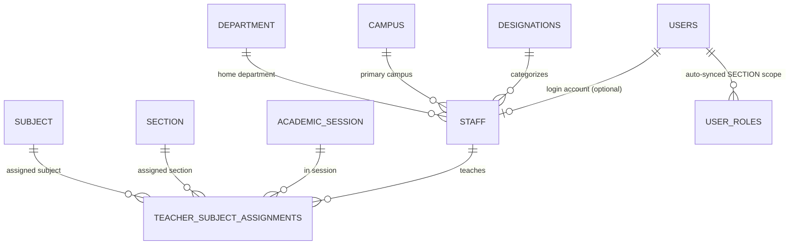
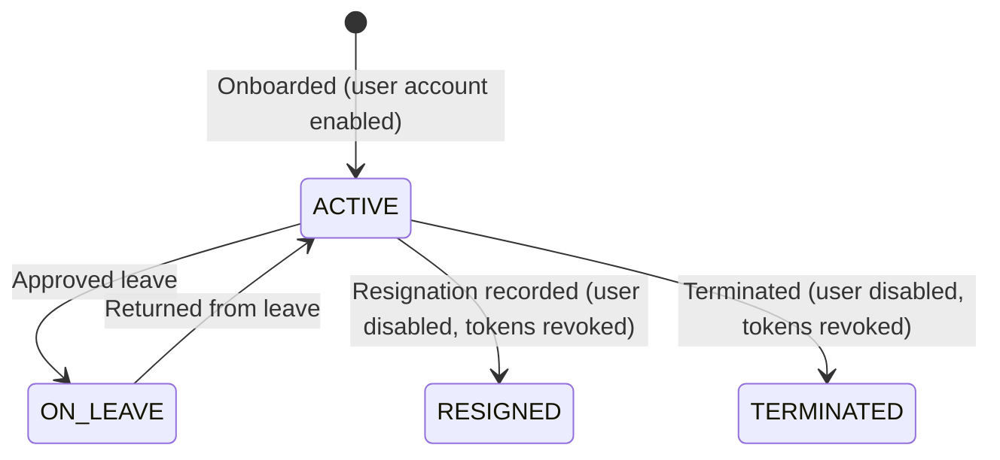

# M-02: Staff, Teachers, and Subject-Section Assignments

| Field | Value |
|---|---|
| **ID** | `M-02` |
| **Title** | Staff, Teachers, and Subject-Section Assignments |
| **Status** | `PROPOSED` |
| **Priority** | `P0` |
| **Depends On** | `F-01, F-04, F-06, F-10, M-01` |
| **Blocks** | `M-04` |
| **Estimated Effort** | `L` |
| **Open Questions** | `Q-019` |
| **Revision** | `1` |

---

## 1. Summary and Business Value

Schools need a central directory of academic and administrative staff, their qualifications, designations, and — critically — which teachers are assigned as class teachers or subject teachers for each section in a given `AcademicSession`. `M-02` delivers full staff lifecycle management, automatic user account creation and welcome notifications (`F-01`, `F-04`), bulk CSV/Excel onboarding (`F-10`), and automatic synchronization of teacher section/subject assignments into scoped RBAC `user_roles` (`SECTION`, `CLASS`, `DEPARTMENT`) so downstream modules like Attendance (`M-04`) and Notices (`M-06`) enforce teacher access boundaries out-of-the-box.

---

## 2. Scope and Explicit Non-Goals

### In Scope
- **Foundation & Module Dependencies**:
  - `F-01` (IAM & Scoped RBAC): Links `staff.user_id` to `users.id` and automatically grants/revokes scoped `user_roles` (`SECTION`, `CLASS`, `DEPARTMENT`).
  - `F-04` (Notification Service): Sends welcome password-setup email/SMS when a staff user account is provisioned.
  - `F-06` (File Storage): Stores staff profile photos and qualification/contract documents under `<tenantSlug>/staff/...`.
  - `F-10` (Bulk Import/Export): Registers `StaffImportHandler` and `StaffExportGenerator` for spreadsheet onboarding.
  - `M-01` (Academic Structure): Links staff to `Campus` and `Department`, and links `TeacherSubjectAssignment` to `AcademicSession`, `Section`, and `Subject`.
- **`Designation`** catalog (e.g., Principal, Senior Teacher, Assistant Teacher, Accountant, Lab Assistant).
- **`Staff`** entity (employee code auto-generation or manual override, staff type `TEACHING` vs `NON_TEACHING`, join date, employment status `ACTIVE`, `ON_LEAVE`, `RESIGNED`, `TERMINATED`, qualification, photo file reference, soft delete).
- **`TeacherSubjectAssignment`** entity mapping a teacher (`Staff`) to an `AcademicSession`, `Section`, and `Subject` (or `is_class_teacher = true` for homeroom/class teacher duty).
- Automatic synchronization between `TeacherSubjectAssignment` and `user_roles` (`role = TEACHER`, `scope_type = SECTION`, `scope_id = section.id`) so `@PreAuthorize("@perm.hasScoped('attendance.write', 'SECTION', #sectionId)")` works automatically.

### Explicit Non-Goals
- Monthly payroll calculation, salary slips, tax deduction, and provident fund accounting (Phase 2 HR & Payroll module).
- Biometric hardware attendance integration for staff (Phase 2).

---

## 3. Business Rules

- **BR-01**: Every staff member has a tenant-unique `employee_code`. If omitted on creation, `EmployeeCodeGenerator` generates it atomically using the school's `hr.employee_code_template` setting (default `EMP-{YEAR}-{SEQ:4}`, e.g., `EMP-2026-0014`).
- **BR-02 (`[ASSUMPTION -> Q-019]`)**: When creating a `Staff` record (via UI or `F-10` bulk import) with `createAccount = true` (default controlled by `hr.auto_create_user`), the service creates a linked `users` row (`status = 'ACTIVE'`) with the requested role (`TEACHER`, `REGISTRAR`, or `ACCOUNTANT`), generates a one-time password-setup token, and dispatches a welcome notification via `F-04` ([OPEN-QUESTIONS.md](../OPEN-QUESTIONS.md#q-019-M-02)).
- **BR-03**: Only staff members with `staff_type = 'TEACHING'` and `employment_status = 'ACTIVE'` can be assigned to a `TeacherSubjectAssignment`.
- **BR-04**: Within a single `(academic_session_id, section_id)`, at most **one** active assignment may have `is_class_teacher = true` (homeroom/class teacher), and at most one primary teacher may be assigned per `(academic_session_id, section_id, subject_id)` unless `role_type = 'CO_TEACHER'`.
- **BR-05 (RBAC Scope Synchronization)**:
  - Assigning a teacher (who has a linked `user_id`) to a `Section` in the current `ACTIVE` `AcademicSession` automatically ensures a `user_roles` row exists for `(user_id, TEACHER_ROLE_ID, 'SECTION', section_id)`.
  - Removing or soft-deleting a `TeacherSubjectAssignment` checks if the teacher has any remaining active assignments in that `Section`; if none remain, the corresponding `('SECTION', section_id)` `user_roles` row is revoked and audited.
- **BR-06**: Transitioning a staff member's `employment_status` to `RESIGNED` or `TERMINATED` atomically sets their linked `users.status = 'DISABLED'`, revokes all active `refresh_tokens` (`F-01`), and writes a `STAFF_DEACTIVATED` entry to `audit_log`.
- **BR-07**: No `Staff` or `TeacherSubjectAssignment` row is ever hard-deleted (`deleted_at` soft delete only).

---

## 4. Configurability

### `app_settings` Keys Introduced
| Key | Type | Default | Managed By | Description |
|---|---|---|---|---|
| `hr.employee_code_template` | `String` | `EMP-{YEAR}-{SEQ:4}` | `SCHOOL_ADMIN` | Pattern used to auto-generate `staff.employee_code`. Supports `{YEAR}`, `{YY}`, `{DEPT}`, `{SEQ:n}`. |
| `hr.auto_create_user` | `Boolean` | `true` | `SCHOOL_ADMIN` | Default state of "Create portal login account & send welcome invite" when adding staff. |

### Feature Flag (`tenants.features_json`)
- **Flag Key**: `staff` (enabled in `BASIC`, `PRO`, and `ENTERPRISE` plans).
- Enforced on backend controllers via `@RequiresFeature("staff")` and in frontend `src/app/modules.ts`.

### Strategy / Plug-in Points
- `StaffImportHandler` and `StaffExportGenerator` registered with `F-10` (`entityType = "STAFF"`).
- `EmployeeCodeGenerator` Strategy supporting custom school patterns.

---

## 5. Domain Model

### Entity Relationship & RBAC Sync Diagram


### `Staff.employmentStatus` State Machine


---

## 6. Database

### Flyway Migration
- **File**: `backend/src/main/resources/db/tenant/V13__staff_and_teachers.sql`
- **No `tenant_id` column**: Physical isolation per school database.
- **Soft-delete strategy**: `deleted_at TIMESTAMP(6) NULL` on `designations`, `staff`, and `teacher_subject_assignments`.

```sql
-- V13__staff_and_teachers.sql
-- Staff directory, designations, and teacher section-subject assignments per academic session.

CREATE TABLE designations (
    id             BIGINT       NOT NULL AUTO_INCREMENT,
    code           VARCHAR(40)  NOT NULL,
    title          VARCHAR(120) NOT NULL,
    category       VARCHAR(20)  NOT NULL DEFAULT 'TEACHING',
    display_order  INT          NOT NULL DEFAULT 1,
    created_at     TIMESTAMP(6) NOT NULL DEFAULT CURRENT_TIMESTAMP(6),
    updated_at     TIMESTAMP(6) NOT NULL DEFAULT CURRENT_TIMESTAMP(6) ON UPDATE CURRENT_TIMESTAMP(6),
    deleted_at     TIMESTAMP(6) NULL,
    PRIMARY KEY (id),
    UNIQUE KEY uk_designations_code (code)
) ENGINE=InnoDB DEFAULT CHARSET=utf8mb4;

CREATE TABLE staff (
    id                 BIGINT       NOT NULL AUTO_INCREMENT,
    user_id            BIGINT       NULL,
    campus_id          BIGINT       NOT NULL,
    department_id      BIGINT       NULL,
    designation_id     BIGINT       NOT NULL,
    employee_code      VARCHAR(50)  NOT NULL,
    first_name         VARCHAR(100) NOT NULL,
    last_name          VARCHAR(100) NOT NULL,
    full_name          VARCHAR(200) NOT NULL,
    email              VARCHAR(190) NULL,
    phone              VARCHAR(40)  NOT NULL,
    gender             VARCHAR(20)  NULL,
    date_of_birth      DATE         NULL,
    blood_group        VARCHAR(10)  NULL,
    national_id        VARCHAR(60)  NULL,
    qualification      VARCHAR(255) NULL,
    specialization     VARCHAR(150) NULL,
    staff_type         VARCHAR(20)  NOT NULL DEFAULT 'TEACHING',
    employment_status  VARCHAR(20)  NOT NULL DEFAULT 'ACTIVE',
    join_date          DATE         NOT NULL,
    leave_date         DATE         NULL,
    photo_file_id      BIGINT       NULL,
    address            VARCHAR(500) NULL,
    created_at         TIMESTAMP(6) NOT NULL DEFAULT CURRENT_TIMESTAMP(6),
    updated_at         TIMESTAMP(6) NOT NULL DEFAULT CURRENT_TIMESTAMP(6) ON UPDATE CURRENT_TIMESTAMP(6),
    deleted_at         TIMESTAMP(6) NULL,
    PRIMARY KEY (id),
    UNIQUE KEY uk_staff_employee_code (employee_code),
    UNIQUE KEY uk_staff_user_id (user_id),
    KEY idx_staff_dept_status (department_id, employment_status),
    KEY idx_staff_type_status (staff_type, employment_status),
    KEY idx_staff_phone (phone),
    CONSTRAINT fk_staff_user        FOREIGN KEY (user_id)        REFERENCES users (id),
    CONSTRAINT fk_staff_campus      FOREIGN KEY (campus_id)      REFERENCES campuses (id),
    CONSTRAINT fk_staff_department  FOREIGN KEY (department_id)  REFERENCES departments (id),
    CONSTRAINT fk_staff_designation FOREIGN KEY (designation_id) REFERENCES designations (id),
    CONSTRAINT fk_staff_photo       FOREIGN KEY (photo_file_id)  REFERENCES stored_files (id)
) ENGINE=InnoDB DEFAULT CHARSET=utf8mb4;

CREATE TABLE teacher_subject_assignments (
    id                   BIGINT       NOT NULL AUTO_INCREMENT,
    academic_session_id  BIGINT       NOT NULL,
    staff_id             BIGINT       NOT NULL,
    section_id           BIGINT       NOT NULL,
    subject_id           BIGINT       NULL,
    is_class_teacher     BOOLEAN      NOT NULL DEFAULT FALSE,
    role_type            VARCHAR(20)  NOT NULL DEFAULT 'PRIMARY',
    created_at           TIMESTAMP(6) NOT NULL DEFAULT CURRENT_TIMESTAMP(6),
    updated_at           TIMESTAMP(6) NOT NULL DEFAULT CURRENT_TIMESTAMP(6) ON UPDATE CURRENT_TIMESTAMP(6),
    deleted_at           TIMESTAMP(6) NULL,
    PRIMARY KEY (id),
    KEY idx_tsa_session_section (academic_session_id, section_id),
    KEY idx_tsa_session_staff (academic_session_id, staff_id),
    KEY idx_tsa_subject (subject_id),
    CONSTRAINT fk_tsa_session FOREIGN KEY (academic_session_id) REFERENCES academic_sessions (id),
    CONSTRAINT fk_tsa_staff   FOREIGN KEY (staff_id)            REFERENCES staff (id),
    CONSTRAINT fk_tsa_section FOREIGN KEY (section_id)          REFERENCES sections (id),
    CONSTRAINT fk_tsa_subject FOREIGN KEY (subject_id)          REFERENCES subjects (id)
) ENGINE=InnoDB DEFAULT CHARSET=utf8mb4;

INSERT INTO designations (code, title, category, display_order) VALUES
    ('PRINCIPAL',    'Principal / Headmaster', 'TEACHING',     1),
    ('SR_TEACHER',   'Senior Teacher',         'TEACHING',     2),
    ('ASST_TEACHER', 'Assistant Teacher',      'TEACHING',     3),
    ('LECTURER',     'Lecturer',               'TEACHING',     4),
    ('REGISTRAR',    'Academic Registrar',     'NON_TEACHING', 5),
    ('ACCOUNTANT',   'Accounts Officer',       'NON_TEACHING', 6);

INSERT INTO app_settings (setting_key, setting_value) VALUES
    ('hr.employee_code_template', 'EMP-{YEAR}-{SEQ:4}'),
    ('hr.auto_create_user',       'true');

INSERT INTO permissions (code, description) VALUES
    ('staff.read',              'View staff directory, profiles, and teacher assignments'),
    ('staff.write',             'Create and update staff records and designations'),
    ('staff.assign',            'Assign teachers to sections and subjects for an academic session'),
    ('staff.status.manage',     'Change staff employment status (leave, resignation, termination)');

INSERT INTO role_permissions (role_id, permission_id)
SELECT r.id, p.id
FROM roles r
CROSS JOIN permissions p
WHERE r.code = 'SCHOOL_ADMIN'
  AND p.code IN ('staff.read', 'staff.write', 'staff.assign', 'staff.status.manage');

INSERT INTO role_permissions (role_id, permission_id)
SELECT r.id, p.id
FROM roles r
CROSS JOIN permissions p
WHERE r.code = 'REGISTRAR'
  AND p.code IN ('staff.read', 'staff.write', 'staff.assign');

INSERT INTO role_permissions (role_id, permission_id)
SELECT r.id, p.id
FROM roles r
CROSS JOIN permissions p
WHERE r.code IN ('ACCOUNTANT', 'TEACHER')
  AND p.code = 'staff.read';
```

---

## 7. API

All endpoints are prefixed with `/api/v1/staff` and protected by `@RequiresFeature("staff")`.

| Method | Path | Request DTO | Response DTO | Permission | Scope |
|---|---|---|---|---|---|
| `GET` | `/api/v1/staff/designations` | — | `List<DesignationResponse>` | `staff.read` | `ALL` |
| `POST` | `/api/v1/staff/designations` | `SaveDesignationRequest` | `DesignationResponse` | `staff.write` | `ALL` |
| `PUT` | `/api/v1/staff/designations/{id}` | `SaveDesignationRequest` | `DesignationResponse` | `staff.write` | `ALL` |
| `GET` | `/api/v1/staff` | Query: `search, departmentId, designationId, staffType, status, page, size` | `PageResponse<StaffSummaryResponse>` | `staff.read` | `ALL` / `DEPARTMENT` |
| `POST` | `/api/v1/staff` | `CreateStaffRequest` (includes `Boolean createUserAccount`, `String roleCode`) | `StaffDetailResponse` | `staff.write` | `ALL` |
| `GET` | `/api/v1/staff/me` | — | `StaffDetailResponse` (includes current session assignments) | `staff.read` | `OWN` |
| `GET` | `/api/v1/staff/{id}` | — | `StaffDetailResponse` | `staff.read` | `ALL` / `DEPARTMENT` / `OWN` |
| `PUT` | `/api/v1/staff/{id}` | `UpdateStaffRequest` | `StaffDetailResponse` | `staff.write` | `ALL` |
| `PATCH` | `/api/v1/staff/{id}/status` | `ChangeStaffStatusRequest(String status, LocalDate effectiveDate, String reason)` | `StaffDetailResponse` | `staff.status.manage` | `ALL` |
| `POST` | `/api/v1/staff/{id}/link-user` | `LinkStaffUserRequest(String email, String roleCode)` | `StaffDetailResponse` | `staff.write` | `ALL` |
| `GET` | `/api/v1/staff/assignments` | Query: `sessionId, sectionId, classId, staffId` | `List<TeacherSubjectAssignmentResponse>` | `staff.read` | `ALL` / `CLASS` / `SECTION` / `OWN` |
| `POST` | `/api/v1/staff/assignments` | `CreateTeacherAssignmentRequest` | `TeacherSubjectAssignmentResponse` | `staff.assign` | `ALL` / `DEPARTMENT` |
| `DELETE` | `/api/v1/staff/assignments/{assignmentId}` | — | `204 No Content` (soft delete + revokes `SECTION` scope if last assignment) | `staff.assign` | `ALL` / `DEPARTMENT` |

Bulk import and export use the `F-10` endpoints (`/api/v1/imports/STAFF/dry-run`, `/api/v1/imports/{jobId}/commit`, `/api/v1/exports/STAFF`).

---

## 8. Permissions to Seed and Default Role Grants

| Permission Code | Description | `SCHOOL_ADMIN` | `REGISTRAR` | `ACCOUNTANT` | `TEACHER` | `STUDENT` | `GUARDIAN` |
|---|---|---|---|---|---|---|---|
| `staff.read` | View staff profiles, designations, and teaching assignments | Yes (`ALL`) | Yes (`ALL`) | Yes (`ALL`) | Yes (`OWN`/`SECTION`) | No | No |
| `staff.write` | Create and update staff profiles and designations | Yes (`ALL`) | Yes (`ALL`) | No | No | No | No |
| `staff.assign` | Assign or unassign teachers to sections and subjects | Yes (`ALL`) | Yes (`ALL`) | No | No | No | No |
| `staff.status.manage` | Transition staff to `ON_LEAVE`, `RESIGNED`, or `TERMINATED` | Yes (`ALL`) | No | No | No | No | No |

---

## 9. Events and Notifications Emitted or Consumed

| Direction | Event / Notification | Payload Schema | Routing Key / Channel |
|---|---|---|---|
| **Emitted** | `StaffAccountProvisionedEvent` | `{ tenantSlug, staffId, userId, email, phone, fullName, passwordSetupToken }` | Outbox (`F-05`) -> `F-04` sends welcome `EMAIL` & `SMS` using template `STAFF_WELCOME_INVITE` |
| **Emitted** | `TeacherAssignmentChangedEvent` | `{ tenantSlug, sessionId, staffId, userId, sectionId, subjectId, action }` | Synchronizes `user_roles` (`SECTION` scope) and evicts `<tenantSlug>:cache:perm:user:<userId>` |
| **Consumed** | `AcademicSessionActivatedEvent` (`M-01`) | `{ tenantSlug, sessionId, previousActiveSessionId }` | Re-computes active `SECTION` scope `user_roles` for teachers assigned in the newly activated `AcademicSession` |

---

## 10. Tenancy and Security Considerations

- **Automatic Scoped RBAC Enforcement**: When Teacher `T` is assigned to Section `S1` via `POST /api/v1/staff/assignments`, `TeacherAssignmentScopeSyncService` grants `user_roles(user_id=T.userId, role='TEACHER', scope_type='SECTION', scope_id=S1.id)`. Consequently, when `T` calls `M-04` Attendance endpoints for `S1`, `@PreAuthorize("@perm.hasScoped('attendance.write', 'SECTION', #sectionId)")` succeeds for `S1` and returns `403 Forbidden` for `S2`.
- **Immediate Session Revocation on Offboarding**: Changing a staff member's status to `RESIGNED` or `TERMINATED` disables their `users` row and revokes all active `refresh_tokens` in the same database transaction so a former employee immediately loses access.
- **PII Protection**: `national_id`, `date_of_birth`, and home `address` are omitted from `StaffSummaryResponse` (list view) and returned only in `StaffDetailResponse` to callers with `ALL` scope (`SCHOOL_ADMIN`, `REGISTRAR`) or `OWN` scope (`GET /api/v1/staff/me`).
- **Audit Logging**:
  - `STAFF_CREATED`, `STAFF_UPDATED`, `STAFF_STATUS_CHANGED`, `TEACHER_ASSIGNED`, and `TEACHER_UNASSIGNED` are logged via `AuditService`.

---

## 11. Frontend

### Routes & Pages (`src/features/staff`)
- `/staff` (`StaffDirectoryPage.tsx`): Paginated, filterable table of teaching and non-teaching staff with department/designation/status filters, `<ExportButton entityType="STAFF" />`, `<ImportWizardModal entityType="STAFF" />` trigger, and "Add Staff" button.
- `/staff/new` & `/staff/:id` (`StaffProfilePage.tsx`): Staff profile form, photo uploader (`F-06`), portal user account status badge, employment status action modal, and a tab showing all current-session `TeacherSubjectAssignment` rows for that teacher.
- `/academic/teacher-assignments` (`TeacherAssignmentMatrixPage.tsx`): Interactive matrix by `AcademicSession -> Class -> Section` allowing Registrars and School Admins to assign the homeroom Class Teacher (`is_class_teacher`) and subject teachers for every subject in the class curriculum.

### Module Registration (`src/app/modules.ts`)
- Registered with `featureFlag: 'staff'` and `requiredPermission: 'staff.read'`.

### Required i18n Keys (`en` and `bn`)
| Key | `en` | `bn` |
|---|---|---|
| `staff.nav.title` | `Staff & Teachers` | `শিক্ষক ও কর্মচারী` |
| `staff.directory.title` | `Staff Directory` | `শিক্ষক ও কর্মচারী তালিকা` |
| `staff.action.add` | `Add Staff Member` | `নতুন শিক্ষক/কর্মচারী যোগ করুন` |
| `staff.action.import` | `Bulk Import Staff` | `একসাথে স্টাফ ইমপোর্ট করুন` |
| `staff.field.employeeCode` | `Employee ID` | `কর্মচারী আইডি` |
| `staff.field.designation` | `Designation` | `পদবী` |
| `staff.field.createUserAccount` | `Create portal login account & send welcome invite` | `পোর্টাল লগইন অ্যাকাউন্ট তৈরি করুন এবং আমন্ত্রণ পাঠান` |
| `staff.status.ACTIVE` | `Active` | `সক্রিয়` |
| `staff.status.ON_LEAVE` | `On Leave` | `ছুটিতে` |
| `staff.status.RESIGNED` | `Resigned` | `পদত্যাগকৃত` |
| `staff.status.TERMINATED` | `Terminated` | `চাকরিচ্যুত` |
| `staff.assignments.title` | `Teacher Section & Subject Assignments` | `শিক্ষকের শাখা ও বিষয় বণ্টন` |
| `staff.assignments.classTeacher` | `Class Teacher (Homeroom)` | `শ্রেণি শিক্ষক` |

---

## 12. Test Plan

- **Unit Tests**:
  - `EmployeeCodeGeneratorTest`: Verifies pattern interpolation (`EMP-{YEAR}-{SEQ:4}`) and custom school templates.
  - `TeacherAssignmentDomainRuleTest`: Rejects assigning a `NON_TEACHING` or `RESIGNED` staff member to a subject, and rejects assigning two `is_class_teacher = true` teachers to the same `(session, section)`.
- **Integration Tests (Testcontainers MySQL)**:
  - `StaffOnboardingAndUserCreationTest`: Creates a staff member with `createUserAccount = true`, verifies `users` row, `user_roles` row, `staff.user_id` foreign key, and outbox welcome notification event are created atomically.
  - `TeacherAssignmentRbacSyncIntegrationTest`: Assigns Teacher `T` to Section `10` in the active session; verifies `PermissionChecker.hasScoped("attendance.write", "SECTION", 10L)` returns `true` for `T` and `false` for Section `11`; deletes the assignment and verifies access to Section `10` immediately returns `false`.
  - `StaffTerminationRevokesAccessTest`: Marks `T` as `RESIGNED` via `PATCH /api/v1/staff/{id}/status` and verifies `users.status = 'DISABLED'` and `T`'s refresh tokens are revoked.
  - `StaffBulkImportIntegrationTest`: Runs `F-10` dry-run and commit with a 5-row staff CSV and verifies 5 `staff` records and 5 linked `users` accounts are created.
- **Two-School Tenant Isolation Test (`StaffTenantIsolationTest`)**:
  - Creates Teacher `"Rahim"` and Section assignment in school `alpha`, and Teacher `"Karim"` in school `beta`. Verifies `GET /api/v1/staff`, `GET /api/v1/staff/assignments`, and employee code sequence generation in `alpha` are completely isolated from `beta`.

---

## 13. Acceptance Criteria

- [ ] Registrars and School Admins can create teaching and non-teaching staff profiles with auto-generated or custom Employee IDs and profile photos.
- [ ] Onboarding a staff member with "Create portal login account" checked automatically creates their login account and sends a welcome password-setup email/SMS.
- [ ] Admins can bulk-import staff from CSV or Excel using the two-step dry-run and commit wizard (`F-10`).
- [ ] Assigning a teacher to a Section and Subject in the active Academic Session automatically grants that teacher section-scoped access (`SECTION` scope) without manual role configuration.
- [ ] Marking a staff member as Resigned or Terminated immediately disables their login account and active sessions.

---

## 14. Implementation Slices

- [ ] **Slice 1**: Flyway migration `V13__staff_and_teachers.sql`, JPA entities (`Designation`, `Staff`, `TeacherSubjectAssignment`), repositories, and `EmployeeCodeGenerator`.
- [ ] **Slice 2**: `StaffApplicationService` (CRUD, user account provisioning via `F-01`, welcome notification via `F-04`, offboarding status transitions, and `AuditService` logging).
- [ ] **Slice 3**: `TeacherAssignmentService` with automatic `user_roles` (`SECTION` scope) synchronization, `AcademicSessionActivatedEvent` listener, and REST controllers (`/api/v1/staff/**`).
- [ ] **Slice 4**: `StaffImportHandler` and `StaffExportGenerator` (`F-10` integration) plus two-school Testcontainers isolation and RBAC sync tests (`StaffTenantIsolationTest`, `TeacherAssignmentRbacSyncIntegrationTest`).
- [ ] **Slice 5**: Frontend `StaffDirectoryPage`, `StaffProfilePage`, `TeacherAssignmentMatrixPage`, `en`/`bn` translations, and Vitest tests.

---

## 15. Risks and Mitigations

| Risk | Impact | Mitigation |
|---|---|---|
| Drift between `teacher_subject_assignments` and `user_roles` (`SECTION` scope) | High (teacher either blocked from taking attendance or retains access after unassignment) | Execute `TeacherAssignmentScopeSyncService.syncTeacherSectionScopes(staffId, activeSessionId)` inside the same `@Transactional` boundary as every assignment mutation and on `AcademicSessionActivatedEvent`. |
| Duplicate employee codes generated under concurrent requests or bulk imports | Medium (unique constraint violation) | Query max sequence with a tenant-level Redis lock or pessimistic DB lock and retry once on `DataIntegrityViolationException`. |
| Resigned teacher still holds a valid 15-minute JWT access token | High (unauthorized access during token TTL) | `JwtAuthenticationFilter` checks a lightweight Redis revocation key `<tenantSlug>:revoked-user:<userId>` written when a user is disabled or terminated. |

---

## 16. How to Extend or Customize Later

- **Adding Payroll & Leave Management (Phase 2)**: Future HR modules can attach `staff_contracts`, `leave_requests`, and `payslips` referencing `staff.id` and `designations.id` in a new migration without altering `V13` tables.
- **Adding Custom Staff Profile Fields**: School-specific HR fields (e.g., bank account number, emergency contact, TIN) can be added via an `attributes_json` column or dedicated `staff_bank_accounts` table in the Payroll module while keeping core `M-02` identity lean.

---

## 17. Revision History

| Revision | Date | Author | Changes |
|---|---|---|---|
| `1` | 2026-11-04 | Antigravity | Initial comprehensive plan for `M-02` Staff, Teachers, and Subject-Section Assignments. |
