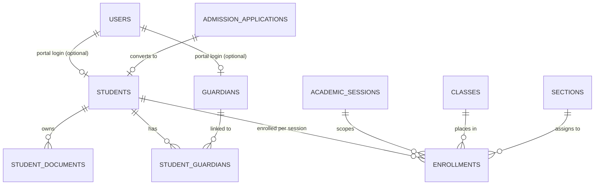
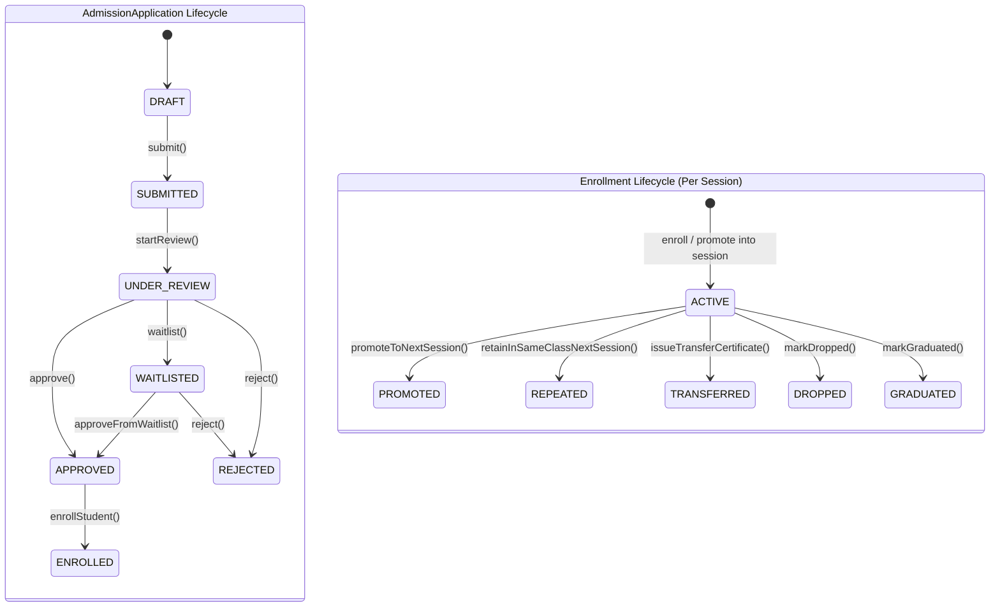

# M-03: Students, Guardians, Admission Workflow, and Session Enrollment

| Field | Value |
|---|---|
| **ID** | `M-03` |
| **Title** | Students, Guardians, Admission Workflow, and Session Enrollment |
| **Status** | `PROPOSED` |
| **Priority** | `P0` |
| **Depends On** | `F-01, F-04, F-06, F-07, F-10, M-01` |
| **Blocks** | `M-04, M-05, M-06` |
| **Estimated Effort** | `XL` |
| **Open Questions** | `Q-007, Q-018, Q-020, Q-021` |
| **Revision** | `1` |

---

## 1. Summary and Business Value

`M-03` establishes the core student and guardian directory, online/offline admission application pipeline, and academic session enrollment lifecycle for every school tenant. It strictly separates a student's permanent identity (`students`, created once upon admission with an immutable `student_code`) from their session-bound academic placement (`enrollments`, recorded per `AcademicSession`, `Class`, `Section`, and `roll_number`), enabling clean multi-year progression, repeaters, section transfers, and historical reporting without duplicating student profiles.

---

## 2. Scope and Explicit Non-Goals

### In Scope
- **Permanent Student Profile (`Student`)**: Single record per student across their entire school tenure, with auto-generated permanent `student_code` via `StudentCodeGeneratorStrategy` (`student.id_template`), demographics, blood group, medical notes, address, photo (`F-06`), optional portal `users` link (`F-01`), and soft delete (`deleted_at`).
- **Session Enrollment (`Enrollment`)**: Separate `enrollments` table linking `student_id`, `academic_session_id`, `class_id`, `section_id`, `roll_number`, and enrollment lifecycle status (`ACTIVE`, `PROMOTED`, `REPEATED`, `TRANSFERRED`, `DROPPED`, `GRADUATED`). Never merged into `students`.
- **Guardians (`Guardian` & `StudentGuardian`)**: Reusable guardian profiles (so siblings share a single guardian record and portal login), relationship type (`FATHER`, `MOTHER`, `LEGAL_GUARDIAN`, `OTHER`), primary contact designation, emergency contact flag, and optional portal `users` link (`F-01`).
- **Admission Application Workflow (`AdmissionApplication`)**: State machine (`DRAFT -> SUBMITTED -> UNDER_REVIEW -> APPROVED / WAITLISTED / REJECTED -> ENROLLED`) supporting online/registrar entry, merit/interview notes, and atomic conversion of an `APPROVED` application into `Student` + `Guardian` + initial `Enrollment`.
- **Student Documents (`StudentDocument`)**: Birth certificate, previous transfer certificate (TC), passport photo, and medical records stored via `F-06` tenant-prefixed object storage.
- **Official Printable PDFs (`F-07`)**: Printable Admission Form PDF, Admission Offer Letter PDF, and Student ID Card PDF with QR verification code.
- **Session Promotion Wizard**: Batch progression tool moving `ACTIVE` students from a source `AcademicSession` + `Class` into a target `AcademicSession` + next `Class` (or repeating same class) by closing old enrollments as `PROMOTED`/`REPEATED` and creating new `ACTIVE` enrollments.
- **Bulk Student & Guardian Import (`F-10`)**: Dry-run + commit CSV/XLSX import creating `Student`, `Guardian`, and initial `Enrollment` rows.

### Explicit Non-Goals
- **Admission Application Fee Processing**: Actual payment collection and ledger posting live in `M-05` (`M-03` only stores optional `application_fee_invoice_id` reference once `M-05` is enabled).
- **Exam Marks & Transcripts**: Handled in Phase 2 Exams module.
- **Biometric Hardware Integration**: RFID/fingerprint sync is deferred to Phase 2 (`M-03` stores optional `rfid_card_uid` field on `students` for readiness).

---

## 3. Business Rules

- **BR-01 (Strict Separation of Student and Enrollment)**: A `Student` row represents the person and is created once. An `Enrollment` row represents that student's placement in a specific `AcademicSession`, `Class`, and `Section`. Business code must never store `current_class_id`, `current_section_id`, or `roll_number` on the `students` table.
- **BR-02 (Permanent Student Code Generation)**: Upon student creation or admission enrollment conversion, `student_code` is generated once via `StudentCodeGeneratorStrategy` using `app_settings` key `student.id_template` (default `{YEAR}{CLASS_CODE}{SEQ:4}`, e.g. `2026090042`) and is immutable thereafter `[ASSUMPTION -> Q-007]](../OPEN-QUESTIONS.md#q-007-student-id-format--lifecycle-m-03)`.
- **BR-03 (One Active Enrollment per Session)**: A student can have at most one `ACTIVE` enrollment per `AcademicSession`. Enforced both in application logic and via a functional unique constraint / check before insertion.
- **BR-04 (Roll Number Uniqueness Within Section)**: Within a given `(academic_session_id, section_id)`, `roll_number` must be unique across all `ACTIVE` enrollments.
- **BR-05 (Sibling Guardian Reuse)**: Guardians are matched or linked by mobile phone (`phone`) or email so siblings share a single `guardians` record and a single `GUARDIAN` user login (`F-01`). Every enrolled student must have at least one linked guardian marked `is_primary_contact = TRUE`.
- **BR-06 (Guardian & Student Portal Login Identity)**: When `student.auto_create_portal_user` or `guardian.auto_create_portal_user` is enabled (or triggered manually by `REGISTRAR`/`SCHOOL_ADMIN`), a `users` account is provisioned in `F-01` supporting login via either email or mobile phone number `[ASSUMPTION -> Q-020]](../OPEN-QUESTIONS.md#q-011--q-025-summary-defaults)`.
- **BR-07 (Admission State Machine Integrity)**: An `AdmissionApplication` must follow valid transitions (`DRAFT -> SUBMITTED -> UNDER_REVIEW -> APPROVED | WAITLISTED | REJECTED`, `WAITLISTED -> APPROVED | REJECTED`, `APPROVED -> ENROLLED`). Transitioning `APPROVED -> ENROLLED` executes inside a single database transaction that creates (or links) `Guardian`, creates `Student` with a generated `student_code`, creates the initial `Enrollment` in the target `AcademicSession`/`Class`/`Section`, and records `enrolled_student_id` on the application `[ASSUMPTION -> Q-021]](../OPEN-QUESTIONS.md#q-011--q-025-summary-defaults)`.
- **BR-08 (Batch Session Promotion Rules)**: Promoting students from source session $S_1$ to target session $S_2$ marks the $S_1$ enrollment as `PROMOTED` (or `REPEATED` if retained in the same class, or `GRADUATED` if completing the final class) and inserts a new `ACTIVE` enrollment in $S_2$. Historical enrollments in $S_1$ are never mutated or deleted `[ASSUMPTION -> Q-018]](../OPEN-QUESTIONS.md#q-011--q-025-summary-defaults)`.
- **BR-09 (No Hard Deletes)**: Neither `students`, `enrollments`, `guardians`, nor `admission_applications` may ever be hard-deleted. Archiving sets `deleted_at` and revokes any linked portal user sessions.

---

## 4. Configurability

| Setting Key (`app_settings`) | Type | Default | Description & How Changed |
|---|---|---|---|
| `student.id_template` | `STRING` | `{YEAR}{CLASS_CODE}{SEQ:4}` | Pattern for permanent `student_code` tokens (`{YEAR}`, `{SHORT_YEAR}`, `{CAMPUS_CODE}`, `{CLASS_CODE}`, `{SEQ:n}`). Changed by `SCHOOL_ADMIN` in Settings UI. |
| `student.allow_manual_code` | `BOOLEAN` | `false` | When `true`, allows `REGISTRAR` to supply a custom `student_code` instead of auto-generation. |
| `student.auto_create_portal_user` | `BOOLEAN` | `false` | Automatically creates a `STUDENT` login account upon enrollment and sends welcome credentials via `F-04`. |
| `guardian.auto_create_portal_user` | `BOOLEAN` | `true` | Automatically creates or links a `GUARDIAN` login account upon student enrollment and sends welcome SMS/Email via `F-04`. |
| `admission.online_enabled` | `BOOLEAN` | `true` | Enables public/self-service admission application submission endpoint for the active admission session. |
| `admission.application_prefix` | `STRING` | `ADM-{YEAR}-{SEQ:5}` | Reference number format for `admission_applications.application_no`. |

- **Feature Flag (`tenants.features_json`)**: `"students": true` (enables `/api/v1/students/**`, `/api/v1/guardians/**`, `/api/v1/enrollments/**`, `/api/v1/admissions/**` via `@RequiresFeature("students")` and frontend `modules.ts`).
- **Strategy Interfaces**:
  - `StudentCodeGeneratorStrategy`: Resolves `{YEAR}`, `{CLASS_CODE}`, `{CAMPUS_CODE}`, and atomic per-school sequence counters (`student_code_sequences` table with `SELECT ... FOR UPDATE`) to guarantee gap-free or collision-free IDs under concurrent admissions and bulk imports.
  - `PromotionRuleStrategy`: Determines default target class and next roll number assignment order (`PREVIOUS_ROLL_ORDER`, `ALPHABETICAL`, `MANUAL`) during the session promotion wizard.
- **Customizable Templates (`F-07` & `F-04`)**:
  - PDF templates: `student-id-card.html`, `admission-form.html`, `transfer-certificate.html` (customizable per school with school logo, colors, signature blocks).
  - Notification templates: `ADMISSION_SUBMITTED`, `ADMISSION_APPROVED`, `STUDENT_ENROLLED_WELCOME`.

---

## 5. Domain Model

### Entities & Value Objects
- **`Student`**: `id`, `studentCode` (unique, immutable), `userId` (nullable FK to `users`), `firstName`, `lastName`, `fullNameBn` (optional Bangla name), `dateOfBirth`, `gender`, `bloodGroup`, `religion`, `nationality`, `nationalIdOrBirthRegNo`, `email`, `phone`, `presentAddressJson`, `permanentAddressJson`, `photoFileId` (FK to `F-06` `stored_files`), `medicalNotes`, `rfidCardUid`, `admissionDate`, `status` (`ACTIVE`, `INACTIVE`, `TRANSFERRED`, `ALUMNI`, `DECEASED`), `createdAt`, `updatedAt`, `deletedAt`.
- **`Guardian`**: `id`, `userId` (nullable FK to `users`), `fullName`, `phone`, `email`, `occupation`, `organization`, `nationalIdNo`, `addressJson`, `photoFileId`, `createdAt`, `updatedAt`, `deletedAt`.
- **`StudentGuardian`**: `id`, `studentId`, `guardianId`, `relationship` (`FATHER`, `MOTHER`, `BROTHER`, `SISTER`, `LEGAL_GUARDIAN`, `OTHER`), `isPrimaryContact`, `isEmergencyContact`, `canPickup`, `isFeePayer`.
- **`Enrollment`**: `id`, `studentId`, `academicSessionId` (FK to `M-01`), `campusId`, `departmentId` (nullable), `classId` (FK to `M-01`), `sectionId` (FK to `M-01`), `rollNumber`, `enrollmentDate`, `status` (`ACTIVE`, `PROMOTED`, `REPEATED`, `TRANSFERRED`, `DROPPED`, `GRADUATED`), `promotedFromEnrollmentId` (nullable self-FK), `remarks`, `createdByUserId`, `createdAt`, `updatedAt`, `deletedAt`.
- **`AdmissionApplication`**: `id`, `applicationNo`, `academicSessionId`, `targetCampusId`, `targetClassId`, `targetSectionId` (nullable), `applicantFirstName`, `applicantLastName`, `dateOfBirth`, `gender`, `previousSchoolName`, `previousClassResult`, `guardianName`, `guardianPhone`, `guardianEmail`, `guardianRelationship`, `payloadJson` (full form answers & document references), `status` (`DRAFT`, `SUBMITTED`, `UNDER_REVIEW`, `APPROVED`, `WAITLISTED`, `REJECTED`, `ENROLLED`), `reviewerUserId`, `reviewNotes`, `reviewedAt`, `enrolledStudentId` (nullable FK to `students`), `createdAt`, `updatedAt`, `deletedAt`.
- **`StudentDocument`**: `id`, `studentId`, `documentType` (`BIRTH_CERTIFICATE`, `PREVIOUS_TC`, `REPORT_CARD`, `MEDICAL_RECORD`, `NATIONAL_ID`, `OTHER`), `title`, `storedFileId` (FK to `F-06`), `verifiedByUserId`, `verifiedAt`, `createdAt`, `deletedAt`.

### Entity-Relationship Diagram



### Lifecycle State Machines



---

## 6. Database

- **Flyway Migration**: `backend/src/main/resources/db/tenant/V14__students_guardians_admission_enrollment.sql`
- **Soft-Delete Strategy**: All core tables (`students`, `guardians`, `enrollments`, `admission_applications`, `student_documents`) carry `deleted_at TIMESTAMP(6) NULL`. Queries filter `WHERE deleted_at IS NULL`.
- **Money Columns**: `admission_applications.application_fee_amount DECIMAL(12,2) NOT NULL DEFAULT 0.00` and `application_fee_currency CHAR(3) NOT NULL DEFAULT 'BDT'` (for display/reference prior to `M-05`).

```sql
-- V14__students_guardians_admission_enrollment.sql
-- Tenant schema migration for M-03: Students, Guardians, Admission Workflow, and Session Enrollment

CREATE TABLE student_code_sequences (
    sequence_key   VARCHAR(60)  NOT NULL,
    last_value     BIGINT       NOT NULL DEFAULT 0,
    updated_at     TIMESTAMP(6) NOT NULL DEFAULT CURRENT_TIMESTAMP(6) ON UPDATE CURRENT_TIMESTAMP(6),
    PRIMARY KEY (sequence_key)
) ENGINE=InnoDB DEFAULT CHARSET=utf8mb4;

CREATE TABLE students (
    id                        BIGINT        NOT NULL AUTO_INCREMENT,
    student_code              VARCHAR(40)   NOT NULL,
    user_id                   BIGINT        NULL,
    first_name                VARCHAR(100)  NOT NULL,
    last_name                 VARCHAR(100)  NOT NULL,
    full_name_bn              VARCHAR(200)  NULL,
    date_of_birth             DATE          NOT NULL,
    gender                    VARCHAR(20)   NOT NULL,
    blood_group               VARCHAR(10)   NULL,
    religion                  VARCHAR(40)   NULL,
    nationality               VARCHAR(60)   NOT NULL DEFAULT 'Bangladeshi',
    birth_reg_or_nid          VARCHAR(60)   NULL,
    email                     VARCHAR(190)  NULL,
    phone                     VARCHAR(30)   NULL,
    present_address_json      JSON          NULL,
    permanent_address_json    JSON          NULL,
    photo_file_id             BIGINT        NULL,
    medical_notes             TEXT          NULL,
    rfid_card_uid             VARCHAR(64)   NULL,
    admission_date            DATE          NOT NULL,
    status                    VARCHAR(20)   NOT NULL DEFAULT 'ACTIVE',
    created_at                TIMESTAMP(6)  NOT NULL DEFAULT CURRENT_TIMESTAMP(6),
    updated_at                TIMESTAMP(6)  NOT NULL DEFAULT CURRENT_TIMESTAMP(6) ON UPDATE CURRENT_TIMESTAMP(6),
    deleted_at                TIMESTAMP(6)  NULL,
    PRIMARY KEY (id),
    UNIQUE KEY uk_students_code (student_code),
    UNIQUE KEY uk_students_user (user_id),
    UNIQUE KEY uk_students_rfid (rfid_card_uid),
    KEY idx_students_status (status, deleted_at),
    KEY idx_students_name (last_name, first_name),
    KEY idx_students_dob (date_of_birth),
    CONSTRAINT fk_students_user FOREIGN KEY (user_id) REFERENCES users (id)
) ENGINE=InnoDB DEFAULT CHARSET=utf8mb4;

CREATE TABLE guardians (
    id               BIGINT        NOT NULL AUTO_INCREMENT,
    user_id          BIGINT        NULL,
    full_name        VARCHAR(200)  NOT NULL,
    phone            VARCHAR(30)   NOT NULL,
    email            VARCHAR(190)  NULL,
    occupation       VARCHAR(100)  NULL,
    organization     VARCHAR(150)  NULL,
    national_id_no   VARCHAR(60)   NULL,
    address_json     JSON          NULL,
    photo_file_id    BIGINT        NULL,
    created_at       TIMESTAMP(6)  NOT NULL DEFAULT CURRENT_TIMESTAMP(6),
    updated_at       TIMESTAMP(6)  NOT NULL DEFAULT CURRENT_TIMESTAMP(6) ON UPDATE CURRENT_TIMESTAMP(6),
    deleted_at       TIMESTAMP(6)  NULL,
    PRIMARY KEY (id),
    UNIQUE KEY uk_guardians_user (user_id),
    KEY idx_guardians_phone (phone),
    KEY idx_guardians_email (email),
    CONSTRAINT fk_guardians_user FOREIGN KEY (user_id) REFERENCES users (id)
) ENGINE=InnoDB DEFAULT CHARSET=utf8mb4;

CREATE TABLE student_guardians (
    id                    BIGINT       NOT NULL AUTO_INCREMENT,
    student_id            BIGINT       NOT NULL,
    guardian_id           BIGINT       NOT NULL,
    relationship          VARCHAR(30)  NOT NULL,
    is_primary_contact    BOOLEAN      NOT NULL DEFAULT FALSE,
    is_emergency_contact  BOOLEAN      NOT NULL DEFAULT TRUE,
    can_pickup            BOOLEAN      NOT NULL DEFAULT TRUE,
    is_fee_payer          BOOLEAN      NOT NULL DEFAULT FALSE,
    created_at            TIMESTAMP(6) NOT NULL DEFAULT CURRENT_TIMESTAMP(6),
    PRIMARY KEY (id),
    UNIQUE KEY uk_student_guardian (student_id, guardian_id),
    KEY idx_sg_guardian (guardian_id),
    CONSTRAINT fk_sg_student  FOREIGN KEY (student_id)  REFERENCES students (id),
    CONSTRAINT fk_sg_guardian FOREIGN KEY (guardian_id) REFERENCES guardians (id)
) ENGINE=InnoDB DEFAULT CHARSET=utf8mb4;

CREATE TABLE enrollments (
    id                           BIGINT        NOT NULL AUTO_INCREMENT,
    student_id                   BIGINT        NOT NULL,
    academic_session_id          BIGINT        NOT NULL,
    campus_id                    BIGINT        NOT NULL,
    department_id                BIGINT        NULL,
    class_id                     BIGINT        NOT NULL,
    section_id                   BIGINT        NOT NULL,
    roll_number                  INT           NOT NULL,
    enrollment_date              DATE          NOT NULL,
    status                       VARCHAR(20)   NOT NULL DEFAULT 'ACTIVE',
    promoted_from_enrollment_id  BIGINT        NULL,
    remarks                      VARCHAR(500)  NULL,
    created_by_user_id           BIGINT        NULL,
    created_at                   TIMESTAMP(6)  NOT NULL DEFAULT CURRENT_TIMESTAMP(6),
    updated_at                   TIMESTAMP(6)  NOT NULL DEFAULT CURRENT_TIMESTAMP(6) ON UPDATE CURRENT_TIMESTAMP(6),
    deleted_at                   TIMESTAMP(6)  NULL,
    PRIMARY KEY (id),
    KEY idx_enrollments_student_session (student_id, academic_session_id, status),
    KEY idx_enrollments_session_class_section (academic_session_id, class_id, section_id, status),
    KEY idx_enrollments_section_roll (academic_session_id, section_id, roll_number),
    KEY idx_enrollments_campus_dept (campus_id, department_id),
    KEY idx_enrollments_promoted_from (promoted_from_enrollment_id),
    CONSTRAINT fk_enrollments_student       FOREIGN KEY (student_id)                  REFERENCES students (id),
    CONSTRAINT fk_enrollments_session       FOREIGN KEY (academic_session_id)         REFERENCES academic_sessions (id),
    CONSTRAINT fk_enrollments_campus        FOREIGN KEY (campus_id)                   REFERENCES campuses (id),
    CONSTRAINT fk_enrollments_department    FOREIGN KEY (department_id)               REFERENCES departments (id),
    CONSTRAINT fk_enrollments_class         FOREIGN KEY (class_id)                    REFERENCES academic_classes (id),
    CONSTRAINT fk_enrollments_section       FOREIGN KEY (section_id)                  REFERENCES sections (id),
    CONSTRAINT fk_enrollments_promoted_from FOREIGN KEY (promoted_from_enrollment_id) REFERENCES enrollments (id),
    CONSTRAINT fk_enrollments_created_by    FOREIGN KEY (created_by_user_id)          REFERENCES users (id)
) ENGINE=InnoDB DEFAULT CHARSET=utf8mb4;

CREATE TABLE admission_applications (
    id                        BIGINT         NOT NULL AUTO_INCREMENT,
    application_no            VARCHAR(40)    NOT NULL,
    academic_session_id       BIGINT         NOT NULL,
    target_campus_id          BIGINT         NOT NULL,
    target_class_id           BIGINT         NOT NULL,
    target_section_id         BIGINT         NULL,
    applicant_first_name      VARCHAR(100)   NOT NULL,
    applicant_last_name       VARCHAR(100)   NOT NULL,
    full_name_bn              VARCHAR(200)   NULL,
    date_of_birth             DATE           NOT NULL,
    gender                    VARCHAR(20)    NOT NULL,
    blood_group               VARCHAR(10)    NULL,
    previous_school_name      VARCHAR(200)   NULL,
    previous_class_result     VARCHAR(100)   NULL,
    guardian_name             VARCHAR(200)   NOT NULL,
    guardian_phone            VARCHAR(30)    NOT NULL,
    guardian_email            VARCHAR(190)   NULL,
    guardian_relationship     VARCHAR(30)    NOT NULL DEFAULT 'FATHER',
    application_fee_amount    DECIMAL(12,2)  NOT NULL DEFAULT 0.00,
    application_fee_currency  CHAR(3)        NOT NULL DEFAULT 'BDT',
    payload_json              JSON           NULL,
    status                    VARCHAR(25)    NOT NULL DEFAULT 'DRAFT',
    reviewer_user_id          BIGINT         NULL,
    review_notes               VARCHAR(1000)  NULL,
    reviewed_at               TIMESTAMP(6)   NULL,
    enrolled_student_id       BIGINT         NULL,
    created_at                TIMESTAMP(6)   NOT NULL DEFAULT CURRENT_TIMESTAMP(6),
    updated_at                TIMESTAMP(6)   NOT NULL DEFAULT CURRENT_TIMESTAMP(6) ON UPDATE CURRENT_TIMESTAMP(6),
    deleted_at                TIMESTAMP(6)   NULL,
    PRIMARY KEY (id),
    UNIQUE KEY uk_admission_app_no (application_no),
    KEY idx_admission_session_status (academic_session_id, status),
    KEY idx_admission_target_class (target_class_id, status),
    KEY idx_admission_guardian_phone (guardian_phone),
    CONSTRAINT fk_admission_session          FOREIGN KEY (academic_session_id) REFERENCES academic_sessions (id),
    CONSTRAINT fk_admission_campus           FOREIGN KEY (target_campus_id)    REFERENCES campuses (id),
    CONSTRAINT fk_admission_class            FOREIGN KEY (target_class_id)     REFERENCES academic_classes (id),
    CONSTRAINT fk_admission_section          FOREIGN KEY (target_section_id)   REFERENCES sections (id),
    CONSTRAINT fk_admission_reviewer         FOREIGN KEY (reviewer_user_id)    REFERENCES users (id),
    CONSTRAINT fk_admission_enrolled_student FOREIGN KEY (enrolled_student_id) REFERENCES students (id)
) ENGINE=InnoDB DEFAULT CHARSET=utf8mb4;

CREATE TABLE student_documents (
    id                   BIGINT        NOT NULL AUTO_INCREMENT,
    student_id           BIGINT        NOT NULL,
    document_type        VARCHAR(40)   NOT NULL,
    title                VARCHAR(200)  NOT NULL,
    stored_file_id       BIGINT        NOT NULL,
    verified_by_user_id  BIGINT        NULL,
    verified_at          TIMESTAMP(6)  NULL,
    created_at           TIMESTAMP(6)  NOT NULL DEFAULT CURRENT_TIMESTAMP(6),
    deleted_at           TIMESTAMP(6)  NULL,
    PRIMARY KEY (id),
    KEY idx_sdoc_student (student_id, deleted_at),
    CONSTRAINT fk_sdoc_student  FOREIGN KEY (student_id)          REFERENCES students (id),
    CONSTRAINT fk_sdoc_file     FOREIGN KEY (stored_file_id)      REFERENCES stored_files (id),
    CONSTRAINT fk_sdoc_verifier FOREIGN KEY (verified_by_user_id) REFERENCES users (id)
) ENGINE=InnoDB DEFAULT CHARSET=utf8mb4;

INSERT INTO app_settings (setting_key, setting_value) VALUES
    ('student.id_template',             '{YEAR}{CLASS_CODE}{SEQ:4}'),
    ('student.allow_manual_code',       'false'),
    ('student.auto_create_portal_user', 'false'),
    ('guardian.auto_create_portal_user','true'),
    ('admission.online_enabled',        'true'),
    ('admission.application_prefix',    'ADM-{YEAR}-{SEQ:5}')
ON DUPLICATE KEY UPDATE setting_value = VALUES(setting_value);
```

---

## 7. API

All endpoints are prefixed with `/api/v1` and gated by `@RequiresFeature("students")`.

| HTTP Method | Path | Request DTO | Response DTO | Permission | RBAC Scope |
|---|---|---|---|---|---|
| `POST` | `/api/v1/admissions/applications` | `CreateAdmissionApplicationRequest` | `AdmissionApplicationDto` | `admission.write` (or public when `admission.online_enabled=true` on `/api/v1/public/admissions/apply`) | `ALL` |
| `GET` | `/api/v1/admissions/applications` | Query: `sessionId`, `classId`, `status`, `q`, `page`, `size` | `PageResponse<AdmissionApplicationSummaryDto>` | `admission.read` | `ALL`, `DEPARTMENT`, `CLASS` |
| `GET` | `/api/v1/admissions/applications/{id}` | — | `AdmissionApplicationDto` | `admission.read` | `ALL`, `DEPARTMENT`, `CLASS` |
| `POST` | `/api/v1/admissions/applications/{id}/status` | `TransitionAdmissionStatusRequest` | `AdmissionApplicationDto` | `admission.review` | `ALL`, `DEPARTMENT` |
| `POST` | `/api/v1/admissions/applications/{id}/enroll` | `EnrollApprovedApplicantRequest` | `StudentDetailDto` | `admission.enroll` | `ALL` |
| `GET` | `/api/v1/admissions/applications/{id}/pdf` | — | `application/pdf` stream | `admission.read` | `ALL`, `DEPARTMENT`, `CLASS` |
| `POST` | `/api/v1/students` | `CreateStudentWithEnrollmentRequest` | `StudentDetailDto` | `student.write` | `ALL` |
| `GET` | `/api/v1/students` | Query: `sessionId`, `classId`, `sectionId`, `status`, `q`, `page`, `size` | `PageResponse<StudentSummaryDto>` | `student.read` | `ALL`, `DEPARTMENT`, `CLASS`, `SECTION`, `OWN` |
| `GET` | `/api/v1/students/{id}` | — | `StudentDetailDto` | `student.read` | `ALL`, `DEPARTMENT`, `CLASS`, `SECTION`, `OWN` |
| `PUT` | `/api/v1/students/{id}` | `UpdateStudentProfileRequest` | `StudentDetailDto` | `student.write` | `ALL` |
| `DELETE` | `/api/v1/students/{id}` | `ArchiveStudentRequest` | `204 No Content` | `student.delete` | `ALL` |
| `GET` | `/api/v1/students/{id}/id-card.pdf` | Query: `sessionId` | `application/pdf` stream | `student.read` | `ALL`, `CLASS`, `SECTION`, `OWN` |
| `GET` | `/api/v1/students/{id}/enrollments` | — | `List<EnrollmentDto>` | `enrollment.read` | `ALL`, `DEPARTMENT`, `CLASS`, `SECTION`, `OWN` |
| `POST` | `/api/v1/students/{id}/enrollments` | `CreateEnrollmentRequest` | `EnrollmentDto` | `enrollment.write` | `ALL` |
| `PUT` | `/api/v1/enrollments/{enrollmentId}` | `UpdateEnrollmentRequest` (section transfer / roll update) | `EnrollmentDto` | `enrollment.write` | `ALL` |
| `POST` | `/api/v1/enrollments/promotions/preview` | `PromotionPreviewRequest` | `PromotionPreviewResponse` | `enrollment.promote` | `ALL` |
| `POST` | `/api/v1/enrollments/promotions/commit` | `PromotionCommitRequest` (`Idempotency-Key` header) | `PromotionResultResponse` | `enrollment.promote` | `ALL` |
| `GET` | `/api/v1/guardians` | Query: `q`, `phone`, `page`, `size` | `PageResponse<GuardianDto>` | `guardian.read` | `ALL`, `CLASS`, `SECTION`, `OWN` |
| `POST` | `/api/v1/students/{id}/guardians` | `LinkGuardianRequest` | `List<StudentGuardianDto>` | `guardian.write` | `ALL` |
| `DELETE` | `/api/v1/students/{id}/guardians/{guardianId}` | — | `204 No Content` | `guardian.write` | `ALL` |
| `POST` | `/api/v1/students/{id}/documents` | `AttachStudentDocumentRequest` | `StudentDocumentDto` | `student.write` | `ALL` |
| `GET` | `/api/v1/students/{id}/documents` | — | `List<StudentDocumentDto>` | `student.read` | `ALL`, `OWN` |
| `POST` | `/api/v1/students/imports/dry-run` | `MultipartFile` (CSV/XLSX) | `ImportJobPreviewDto` (`F-10`) | `student.import` | `ALL` |
| `POST` | `/api/v1/students/imports/{jobId}/commit` | `CommitImportRequest` | `ImportJobStatusDto` (`F-10`) | `student.import` | `ALL` |

---

## 8. Permissions to Seed and Default Role Grants

| Permission Code | Description | `SCHOOL_ADMIN` | `REGISTRAR` | `ACCOUNTANT` | `TEACHER` | `STUDENT` | `GUARDIAN` |
|---|---|---|---|---|---|---|---|
| `admission.read` | View admission applications | Yes (`ALL`) | Yes (`ALL`) | No | No | No | No |
| `admission.write` | Create and edit admission applications | Yes (`ALL`) | Yes (`ALL`) | No | No | No | No |
| `admission.review` | Review, approve, waitlist, or reject applications | Yes (`ALL`) | Yes (`ALL`) | No | No | No | No |
| `admission.enroll` | Convert approved application into enrolled student | Yes (`ALL`) | Yes (`ALL`) | No | No | No | No |
| `student.read` | View student profiles and documents | Yes (`ALL`) | Yes (`ALL`) | Yes (`ALL`) | Yes (`SECTION`) | Yes (`OWN`) | Yes (`OWN`) |
| `student.write` | Create and update student profiles and documents | Yes (`ALL`) | Yes (`ALL`) | No | No | No | No |
| `student.delete` | Soft-delete/archive student records | Yes (`ALL`) | No | No | No | No | No |
| `student.import` | Bulk import students and enrollments | Yes (`ALL`) | Yes (`ALL`) | No | No | No | No |
| `enrollment.read` | View session enrollments and class rosters | Yes (`ALL`) | Yes (`ALL`) | Yes (`ALL`) | Yes (`SECTION`) | Yes (`OWN`) | Yes (`OWN`) |
| `enrollment.write` | Enroll students, change sections, or update roll numbers | Yes (`ALL`) | Yes (`ALL`) | No | No | No | No |
| `enrollment.promote` | Execute batch session promotion wizard | Yes (`ALL`) | Yes (`ALL`) | No | No | No | No |
| `guardian.read` | View guardian contact information | Yes (`ALL`) | Yes (`ALL`) | Yes (`ALL`) | Yes (`SECTION`) | Yes (`OWN`) | Yes (`OWN`) |
| `guardian.write` | Create, update, and link guardians to students | Yes (`ALL`) | Yes (`ALL`) | No | No | No | No |

---

## 9. Events and Notifications Emitted or Consumed

| Event Class / Name | Trigger | Payload Schema | Outbox Routing Key | Notification Channels |
|---|---|---|---|---|
| `AdmissionApplicationSubmittedEvent` | Applicant or registrar submits application | `{ tenantSlug, applicationId, applicationNo, applicantName, guardianPhone, guardianEmail }` | `admission.submitted` | `SMS`, `EMAIL` (via `F-04`) |
| `AdmissionApplicationStatusChangedEvent` | Application moved to `APPROVED`, `WAITLISTED`, or `REJECTED` | `{ tenantSlug, applicationId, applicationNo, oldStatus, newStatus, reviewNotes, guardianPhone, guardianEmail }` | `admission.status_changed` | `SMS`, `EMAIL`, `IN_APP` |
| `StudentEnrolledEvent` | Direct student enrollment or `APPROVED -> ENROLLED` conversion | `{ tenantSlug, studentId, studentCode, enrollmentId, academicSessionId, classId, sectionId, rollNumber, primaryGuardianId }` | `student.enrolled` | `SMS`, `EMAIL` (welcome message + portal invite via `F-01`/`F-04`); consumed by `M-05` to auto-assign session fee structures |
| `StudentPromotedBatchEvent` | Session promotion wizard committed | `{ tenantSlug, sourceSessionId, targetSessionId, promotedCount, repeatedCount, graduatedCount, actorUserId }` | `student.promoted_batch` | `IN_APP` |
| `StudentSectionTransferredEvent` | Student moved between sections or classes mid-session | `{ tenantSlug, studentId, enrollmentId, oldSectionId, newSectionId, oldRollNumber, newRollNumber }` | `student.section_transferred` | `IN_APP` |

---

## 10. Tenancy and Security Considerations

- **Physical DB Isolation**: `students`, `guardians`, `enrollments`, `admission_applications`, and `student_documents` live strictly in the tenant database (`school_<slug>`). No `tenant_id` column is present.
- **Scoped RBAC Enforcement**:
  - `TEACHER` with `SECTION` scope can only read students whose active enrollment matches a `section_id` assigned to that teacher in `M-02` (`teacher_section_assignments`).
  - `STUDENT` with `OWN` scope can only read `students.user_id = currentUserId`.
  - `GUARDIAN` with `OWN` scope can only read students linked via `student_guardians` where `guardians.user_id = currentUserId`.
- **Audit Logging (`audit_log`)**: Mandatory entries written for `ADMISSION_STATUS_CHANGED`, `STUDENT_CREATED`, `STUDENT_UPDATED`, `STUDENT_ARCHIVED`, `ENROLLMENT_CREATED`, `ENROLLMENT_TRANSFERRED`, `SESSION_PROMOTION_COMMITTED`, and `GUARDIAN_LINK_CHANGED` with `old_value` and `new_value` JSON snapshots.
- **Storage & Cache Prefixes**:
  - Student photos and documents stored via `F-06` under `<tenantSlug>/students/<studentId>/...`.
  - Generated ID card PDFs cached under Redis/S3 key `<tenantSlug>:pdf:idcard:<studentId>:<sessionId>`.
- **Rate Limiting & Public Endpoint Protection**: Public online admission endpoint (`/api/v1/public/admissions/apply`) is protected by IP rate limiting (`F-08`: max 10 submissions per 15 min per IP) and strictly validates `TenantContext`.
- **PII Handling**: National ID / Birth Registration numbers, medical notes, and guardian phone numbers are never written to application logs.

---

## 11. Frontend

- **Feature Directory**: `frontend/src/features/students/` (`api/`, `hooks/`, `components/`, `pages/`)
- **Module Registration (`frontend/src/app/modules.ts`)**:
  - Feature key: `students`
  - Navigation items: **Students** (`/students`), **Admissions** (`/admissions`), **Promotions** (`/students/promotions`), **Guardians** (`/guardians`)
- **Routes & Pages**:
  - `/admissions`: `AdmissionApplicationListPage` (filterable by session, target class, status badge, search; quick review modal)
  - `/admissions/new` & `/admissions/:id`: `AdmissionApplicationFormPage` & `AdmissionReviewDrawer` (status transitions, "Enroll Student" action, print admission form PDF)
  - `/students`: `StudentDirectoryPage` (session selector defaulting to current active session from `M-01`, class/section cascading filter, search by `student_code`/name/roll/guardian phone, bulk import button)
  - `/students/new`: `StudentCreateWizardPage` (Step 1: Personal Profile, Step 2: Guardian Link/Lookup by Phone, Step 3: Initial Session Enrollment & Roll Assignment, Step 4: Documents)
  - `/students/:id`: `StudentProfilePage` with tabs:
    - `OverviewTab` (demographics, photo, print ID card PDF button)
    - `EnrollmentsTab` (full multi-session enrollment timeline, section transfer modal)
    - `GuardiansTab` (sibling-aware guardian linker, primary/emergency badges)
    - `DocumentsTab` (upload/verify via `F-06`)
  - `/students/promotions`: `SessionPromotionWizardPage` (select source session + class, target session + class, interactive table with per-student action `PROMOTE` / `REPEAT` / `GRADUATE` and editable target roll number)
- **Required `en` and `bn` i18n Keys (`frontend/src/shared/i18n/locales/{en,bn}.json`)**:
  - `students.nav.directory` (`"Students"` / `"শিক্ষার্থীবৃন্দ"`)
  - `students.nav.admissions` (`"Admissions"` / `"ভর্তি প্রক্রিয়া"`)
  - `students.nav.promotions` (`"Session Promotion"` / `"সেশন উত্তীর্ণকরণ"`)
  - `students.profile.studentCode` (`"Student ID"` / `"শিক্ষার্থী আইডি"`)
  - `students.profile.rollNumber` (`"Roll Number"` / `"রোল নম্বর"`)
  - `students.enrollment.status.ACTIVE` (`"Active"` / `"সক্রিয়"`)
  - `students.enrollment.status.PROMOTED` (`"Promoted"` / `"উত্তীর্ণ"`)
  - `students.enrollment.status.REPEATED` (`"Repeated"` / `"পুনঃঅধ্যয়ন"`)
  - `students.enrollment.status.TRANSFERRED` (`"Transferred"` / `"স্থানান্তরিত"`)
  - `students.admission.status.SUBMITTED` (`"Submitted"` / `"জমা দেওয়া হয়েছে"`)
  - `students.admission.status.UNDER_REVIEW` (`"Under Review"` / `"পর্যালোচনাধীন"`)
  - `students.admission.status.APPROVED` (`"Approved"` / `"অনুমোদিত"`)
  - `students.admission.status.ENROLLED` (`"Enrolled"` / `"ভর্তিকৃত"`)
  - `students.guardian.relationship.FATHER` (`"Father"` / `"পিতা"`)
  - `students.guardian.relationship.MOTHER` (`"Mother"` / `"মাতা"`)

---

## 12. Test Plan

- **Unit Tests**:
  - `StudentCodeGeneratorStrategyTest`: Verifies token interpolation (`{YEAR}`, `{CLASS_CODE}`, `{SEQ:4}`), custom manual code allowance when `student.allow_manual_code=true`, and rejection of duplicate codes.
  - `AdmissionApplicationDomainTest`: Verifies all valid and invalid state transitions (`DRAFT -> ENROLLED` directly throws `ApiException(409)`), and verifies idempotency if `enroll()` is called twice.
  - `EnrollmentDomainTest`: Verifies roll number uniqueness rules, prevents two `ACTIVE` enrollments in the same `AcademicSession`, and validates session promotion state transitions (`ACTIVE -> PROMOTED` in source session + new `ACTIVE` in target session).
- **Integration Tests (Testcontainers MySQL)**:
  - `AdmissionToEnrollmentIntegrationTest`: Submits application, approves it, calls `/enroll`, and asserts atomic creation of `Student`, `Guardian`, `StudentGuardian`, `Enrollment`, `audit_log` row, and `outbox_events` (`StudentEnrolledEvent`).
  - `SessionPromotionIntegrationTest`: Seeds 30 students in Session 2025 Class 8, runs `/promotions/preview` and `/promotions/commit` into Session 2026 Class 9 (with 2 repeaters), and verifies all 30 historical 2025 enrollments remain intact with status `PROMOTED`/`REPEATED` while 30 new 2026 enrollments are `ACTIVE`.
  - `StudentBulkImportIntegrationTest`: Tests dry-run and commit of a 100-row CSV with sibling guardian phone deduplication.
- **Two-School Tenant Isolation Test (`StudentTenantIsolationTest`)**:
  - Creates student `STD-ALPHA-01` and admission application in school `alpha`.
  - Queries `/api/v1/students`, `/api/v1/admissions/applications`, and `/api/v1/guardians` under school `beta` JWT (`X-Tenant-ID: beta`) -> asserts zero results and `404` on direct ID lookup.
  - Verifies `student_code_sequences` increments independently in `alpha` and `beta`.
- **Permission & Scope Boundary Tests**:
  - Verifies a `TEACHER` assigned to Section A receives `200` for Section A students and `403` when requesting a student in Section B.
  - Verifies a `GUARDIAN` receives `200` for their own linked children and `403` for another guardian's child.

---

## 13. Acceptance Criteria

- [ ] Registrar can create an admission application, transition it through `SUBMITTED -> UNDER_REVIEW -> APPROVED`, and click **Enroll** to atomically generate a `Student` (with permanent `student_code`), a linked `Guardian`, and an `ACTIVE` `Enrollment` in the selected session/class/section.
- [ ] Enrolling two siblings with the same guardian mobile number links both students to the same `Guardian` record so the parent sees both children under a single guardian portal login.
- [ ] Viewing a student profile displays their permanent `student_code` alongside their session-by-session enrollment history (`AcademicSession`, `Class`, `Section`, `roll_number`, `status`).
- [ ] Running the Session Promotion Wizard from `2025` to `2026` promotes selected students into the next class in `2026` without overwriting or deleting their `2025` enrollment records.
- [ ] Registrar can download a printable Student ID Card PDF and Admission Form PDF containing a scannable verification QR code.
- [ ] Registrar can bulk-import students via CSV dry-run and commit, receiving a downloadable error CSV for any invalid rows.
- [ ] Teachers can only view students enrolled in their assigned sections; guardians can only view their own linked children.

---

## 14. Implementation Slices

- [ ] **Slice 1**: Flyway migration `V14__students_guardians_admission_enrollment.sql`, JPA entities (`Student`, `Guardian`, `StudentGuardian`, `Enrollment`, `AdmissionApplication`, `StudentDocument`), and `StudentCodeGeneratorStrategy` with unit tests.
- [ ] **Slice 2**: Student, Guardian, and Enrollment CRUD/query APIs with scoped RBAC (`ALL`, `DEPARTMENT`, `CLASS`, `SECTION`, `OWN`), `AuditService` logging, and two-school tenant isolation tests.
- [ ] **Slice 3**: Admission Application state machine API (`DRAFT -> SUBMITTED -> UNDER_REVIEW -> APPROVED/WAITLISTED/REJECTED -> ENROLLED`), outbox events, and PDF generation (`F-07`) for Admission Form and Student ID Card.
- [ ] **Slice 4**: Session Promotion Wizard API (`/promotions/preview` and idempotent `/promotions/commit`) + Bulk Student CSV/XLSX import handler (`F-10`).
- [ ] **Slice 5**: React frontend (`AdmissionApplicationListPage`, `StudentDirectoryPage`, `StudentProfilePage`, `SessionPromotionWizardPage`, i18n `en`/`bn` keys, `modules.ts` registration) and end-to-end verification.

---

## 15. Risks and Mitigations

| Risk | Impact | Concrete Mitigation |
|---|---|---|
| Accidental coupling of session fields (`class_id`, `section_id`, `roll_number`) onto `students` table | Breaks multi-year history, repeaters, and historical fee/attendance reporting | Enforce schema separation in `V14` (`students` has zero session/class columns) and expose `currentEnrollment` in `StudentSummaryDto` via a session-scoped join on `enrollments`. |
| Duplicate `student_code` generation under concurrent admissions or bulk imports | Constraint violation (`uk_students_code`) failing requests | Use `student_code_sequences` table locked with `SELECT last_value FROM student_code_sequences WHERE sequence_key = ? FOR UPDATE` inside a short sequence generator transaction. |
| Duplicate `Guardian` rows created for siblings | Parent has multiple fragmented accounts and duplicate SMS alerts | Enforce guardian lookup-by-phone during admission conversion, manual creation, and CSV import; link to existing `Guardian` when phone matches within the tenant. |
| Double execution of Session Promotion Wizard | Duplicate enrollments in target session | Require `Idempotency-Key` header on `/promotions/commit` and check for existing `ACTIVE` enrollment in `(student_id, target_session_id)` before inserting. |

---

## 16. How to Extend or Customize Later

- **Adding a Custom Student ID Format for Universities**: Implement a new `StudentCodeGeneratorStrategy` bean (or extend template tokens in `DefaultTemplateStudentCodeGenerator` to support `{DEPT_CODE}` and `{SEMESTER_CODE}`, e.g., `2026-CSE-1-042`) and configure `student.id_template` in `app_settings` for university tenants—zero schema or controller changes required.
- **Adding Custom Admission Form Fields per School**: Extra school-specific questions (e.g., transport route preference, hostel requirement, quota category) are stored in `admission_applications.payload_json` and validated against a per-school JSON schema stored in `app_settings` (`admission.custom_fields_schema`).
- **Adding Alumni / Graduation Certificate Workflow**: Add a listener on `EnrollmentStatusChangedEvent` when status transitions to `GRADUATED` to automatically set `students.status = 'ALUMNI'` and generate a printable Testimonial/Transfer Certificate PDF via `F-07`.

---

## 17. Revision History

| Revision | Date | Author | Changes |
|---|---|---|---|
| `1` | 2026-11-04 | Agent | Initial comprehensive plan for `M-03` Students, Guardians, Admission Workflow, and Session Enrollment. |

