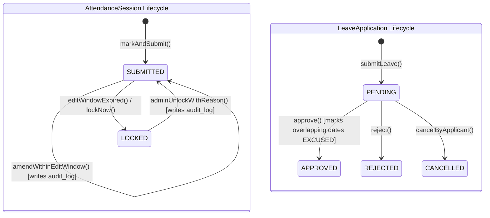

# M-04: Student and Staff Attendance with Leave and Guardian Alerts

| Field | Value |
|---|---|
| **ID** | `M-04` |
| **Title** | Student and Staff Attendance with Leave and Guardian Alerts |
| **Status** | `DONE` |
| **Priority** | `P0` |
| **Depends On** | `F-04, F-05, F-09, M-01, M-02, M-03` |
| **Blocks** | `None` |
| **Estimated Effort** | `L` |
| **Open Questions** | `Q-008, Q-022` |
| **Revision** | `1` |

---

## 1. Summary and Business Value

`M-04` delivers fast, mobile-friendly daily and period-wise student attendance, staff daily attendance, leave application management, and automated guardian absence SMS/in-app alerts. It protects academic integrity with a configurable teacher edit window (`attendance.edit_window_hours`), mandatory append-only `audit_log` entries on every attendance modification, and a delayed notification grace buffer so teachers can fix accidental marks before parents receive an SMS.

---

## 2. Scope and Explicit Non-Goals

### In Scope
- **Student Attendance Sessions & Records (`AttendanceSession`, `StudentAttendanceRecord`)**: Supports both `DAILY_SECTION` mode (one roll-call per section per day for K-12 schools) and `SUBJECT_PERIOD` mode (per-subject/period attendance for colleges and universities), recording statuses `PRESENT`, `ABSENT`, `LATE`, `EXCUSED`, and `HALF_DAY`.
- **Teacher Edit Lock Window & Admin Override**: Teachers can submit and amend attendance within `attendance.edit_window_hours` (default `48` hours). Every edit writes an `audit_log` entry with old/new status and reason. After the window expires, the session locks automatically and can only be amended by `SCHOOL_ADMIN` or `REGISTRAR` with a mandatory override reason.
- **Leave Applications (`LeaveApplication`)**: Student (submitted by guardian/student) and staff leave workflow (`PENDING -> APPROVED / REJECTED / CANCELLED`). Approved student leave automatically marks or pre-fills overlapping attendance dates as `EXCUSED`.
- **Staff Daily Attendance (`StaffAttendanceRecord`)**: Daily check-in/check-out and status (`PRESENT`, `ABSENT`, `LATE`, `ON_LEAVE`, `HALF_DAY`) for teachers and staff (`M-02`).
- **Delayed Guardian Absence Notification (`F-04`, `F-05`, `F-09`)**: Queues absence notifications with a configurable grace period (`attendance.notify_delay_minutes`, default `30` minutes) evaluated by the tenant-aware scheduler (`F-09`); if a teacher corrects `ABSENT -> PRESENT/LATE` during the grace window, the pending alert is suppressed.
- **Attendance Summary & Chronic Absentee Reports**: Monthly section attendance register grid, per-student session attendance percentage, and low-attendance warning list (`< attendance.minimum_percentage`).

### Explicit Non-Goals
- **Direct Biometric / RFID Turnstile Hardware Daemons**: `M-04` exposes a clean batch ingestion service/endpoint (`source = 'BIOMETRIC'`), but physical device agent software is out of Phase 1 scope.
- **Payroll Deduction Calculation for Staff Absences**: Payroll is Phase 2; `M-04` tracks staff attendance counts only.

---

## 3. Business Rules

- **BR-01 (Attendance Mode per School)**: Each school configures `attendance.mode` as either `DAILY_SECTION` (`subject_id IS NULL`, `period_number IS NULL`) or `SUBJECT_PERIOD` (`subject_id` and `period_number` required) `[ASSUMPTION -> Q-008]](../OPEN-QUESTIONS.md#q-008-attendance-mode--edit-lock-window-m-04)`.
- **BR-02 (Academic Calendar & Holiday Validation)**: Attendance cannot be recorded on dates marked as `HOLIDAY` or `WEEKEND` in the school's `AcademicSession` calendar (`M-01`) unless `allowHolidayOverride = true` is explicitly passed by `SCHOOL_ADMIN`.
- **BR-03 (Active Enrollment Prerequisite)**: Only students with an `ACTIVE` `Enrollment` (`M-03`) in the target `(academic_session_id, section_id)` as of `attendance_date` can be marked in an `AttendanceSession`.
- **BR-04 (Mandatory Audit Trail on Every Edit)**: Initial submission of an `AttendanceSession` logs a summary audit event; any subsequent change to an existing `StudentAttendanceRecord` or `StaffAttendanceRecord` (for example `ABSENT -> PRESENT`) requires a non-empty `editReason` and writes an immutable `audit_log` entry containing `{ enrollmentId, studentId, date, oldStatus, newStatus, reason, actorUserId }`.
- **BR-05 (48-Hour Teacher Edit Window)**: A teacher assigned to the section/subject can edit an `AttendanceSession` only while `NOW() <= submitted_at + attendance.edit_window_hours` (default `48` hours) and `is_locked = FALSE`. Once the window elapses, only `SCHOOL_ADMIN` or `REGISTRAR` with `attendance.override_lock` permission can modify records `[ASSUMPTION -> Q-008]](../OPEN-QUESTIONS.md#q-008-attendance-mode--edit-lock-window-m-04)`.
- **BR-06 (Leave Approval Auto-Excusal)**: When a `LeaveApplication` for a student is transitioned to `APPROVED`, any existing `StudentAttendanceRecord` within `[start_date, end_date]` is updated to `EXCUSED` (with an audit entry referencing `leave_application_id`), and any future `AttendanceSession` opened for dates in `[start_date, end_date]` pre-populates that student's status as `EXCUSED`.
- **BR-07 (Delayed Guardian Absence Alert Suppression)**: Marking a student `ABSENT` schedules a pending alert (`absence_alert_queue`) due at `NOW() + attendance.notify_delay_minutes` (default `30` min). When the `F-09` scheduler processes due alerts, it re-verifies the student's current attendance status: if the status was changed to `PRESENT`, `LATE`, or `EXCUSED`, the alert is marked `SUPPRESSED` and no SMS is sent `[ASSUMPTION -> Q-022]](../OPEN-QUESTIONS.md#q-011--q-025-summary-defaults)`.

---

## 4. Configurability

| Setting Key (`app_settings`) | Type | Default | Description & How Changed |
|---|---|---|---|
| `attendance.mode` | `STRING` | `DAILY_SECTION` | `DAILY_SECTION` (once per day per section) or `SUBJECT_PERIOD` (per subject & period). Changed by `SCHOOL_ADMIN`. |
| `attendance.edit_window_hours` | `INTEGER` | `48` | Hours after initial submission during which a teacher can amend attendance records without admin override. |
| `attendance.notify_absent_sms` | `BOOLEAN` | `true` | Send SMS (`F-04`) to primary guardian when a student is marked `ABSENT`. |
| `attendance.notify_late_in_app` | `BOOLEAN` | `true` | Send in-app notification (`F-05`) to guardian when a student is marked `LATE`. |
| `attendance.notify_delay_minutes` | `INTEGER` | `30` | Grace window in minutes before dispatching guardian absence SMS so teachers can fix mistaken marks. |
| `attendance.minimum_percentage` | `DECIMAL` | `75.00` | Threshold below which a student is flagged on low-attendance warning reports and dashboards. |
| `attendance.default_mark` | `STRING` | `PRESENT` | Pre-selected status in the teacher roll-call UI (`PRESENT` so teachers only tap absentees, or `UNMARKED`). |

- **Feature Flag (`tenants.features_json`)**: `"attendance": true` (enforced via `@RequiresFeature("attendance")` and frontend `modules.ts`).
- **Strategy Interfaces**:
  - `AttendancePercentageCalculatorStrategy`: Computes attendance percentage for reports (`HALF_DAY` counted as `0.5` or `1.0`, `LATE` counted as `1.0`, `EXCUSED` excluded from denominator or counted as present based on school rule).
- **Scheduled Jobs (`F-09`)**:
  - `DispatchDelayedAbsenceAlertsJob`: Runs every 5 minutes per active tenant in `school.timezone`, sending due SMS/in-app alerts for uncancelled `ABSENT` records.
  - `MissingAttendanceReminderJob`: Runs daily at a configurable school cutoff time to remind class teachers who have not yet submitted daily attendance.

---

## 5. Domain Model

### Entities & Value Objects
- **`AttendanceSession`**: `id`, `academicSessionId`, `campusId`, `classId`, `sectionId`, `subjectId` (nullable), `periodNumber` (nullable), `attendanceDate`, `mode` (`DAILY_SECTION`, `SUBJECT_PERIOD`), `status` (`DRAFT`, `SUBMITTED`, `LOCKED`), `submittedByUserId`, `submittedAt`, `lockedAt`, `totalStudents`, `presentCount`, `absentCount`, `lateCount`, `excusedCount`, `createdAt`, `updatedAt`, `deletedAt`.
- **`StudentAttendanceRecord`**: `id`, `attendanceSessionId`, `enrollmentId`, `studentId`, `status` (`PRESENT`, `ABSENT`, `LATE`, `EXCUSED`, `HALF_DAY`), `source` (`MANUAL_WEB`, `BIOMETRIC`, `LEAVE_AUTO`), `leaveApplicationId` (nullable), `remarks`, `lastModifiedByUserId`, `createdAt`, `updatedAt`.
- **`StaffAttendanceRecord`**: `id`, `staffId` (FK to `M-02` `staff`), `attendanceDate`, `status` (`PRESENT`, `ABSENT`, `LATE`, `ON_LEAVE`, `HALF_DAY`), `checkInTime`, `checkOutTime`, `source` (`MANUAL_WEB`, `BIOMETRIC`, `LEAVE_AUTO`), `leaveApplicationId` (nullable), `remarks`, `recordedByUserId`, `createdAt`, `updatedAt`.
- **`LeaveApplication`**: `id`, `applicantType` (`STUDENT`, `STAFF`), `studentEnrollmentId` (nullable FK to `enrollments`), `staffId` (nullable FK to `staff`), `leaveType` (`SICK`, `CASUAL`, `FAMILY_EMERGENCY`, `MATERNITY`, `OTHER`), `startDate`, `endDate`, `totalDays`, `reason`, `attachmentFileId` (nullable FK to `F-06`), `status` (`PENDING`, `APPROVED`, `REJECTED`, `CANCELLED`), `requestedByUserId`, `reviewedByUserId`, `reviewRemarks`, `reviewedAt`, `createdAt`, `updatedAt`, `deletedAt`.
- **`AbsenceAlertQueue`**: `id`, `studentAttendanceRecordId`, `studentId`, `guardianId`, `attendanceDate`, `scheduledSendAt`, `status` (`PENDING`, `SENT`, `SUPPRESSED`, `FAILED`), `processedAt`, `createdAt`.

### Lifecycle State Diagrams



---

## 6. Database

- **Flyway Migration**: `backend/src/main/resources/db/tenant/V15__attendance_and_leave.sql`
- **Soft-Delete Strategy**: `attendance_sessions` and `leave_applications` include `deleted_at TIMESTAMP(6) NULL`. Individual attendance records are never deleted; modifications update the row in-place and write an append-only diff into `audit_log`.

```sql
-- V15__attendance_and_leave.sql
-- Tenant schema migration for M-04: Student & Staff Attendance, Leave Applications, and Absence Alerts

CREATE TABLE leave_applications (
    id                      BIGINT        NOT NULL AUTO_INCREMENT,
    applicant_type          VARCHAR(20)   NOT NULL,
    student_enrollment_id   BIGINT        NULL,
    staff_id                BIGINT        NULL,
    leave_type              VARCHAR(30)   NOT NULL,
    start_date              DATE          NOT NULL,
    end_date                DATE          NOT NULL,
    total_days              INT           NOT NULL,
    reason                  VARCHAR(1000) NOT NULL,
    attachment_file_id      BIGINT        NULL,
    status                  VARCHAR(20)   NOT NULL DEFAULT 'PENDING',
    requested_by_user_id    BIGINT        NOT NULL,
    reviewed_by_user_id     BIGINT        NULL,
    review_remarks          VARCHAR(500)  NULL,
    reviewed_at             TIMESTAMP(6)  NULL,
    created_at              TIMESTAMP(6)  NOT NULL DEFAULT CURRENT_TIMESTAMP(6),
    updated_at              TIMESTAMP(6)  NOT NULL DEFAULT CURRENT_TIMESTAMP(6) ON UPDATE CURRENT_TIMESTAMP(6),
    deleted_at              TIMESTAMP(6)  NULL,
    PRIMARY KEY (id),
    KEY idx_leave_student_dates (student_enrollment_id, status, start_date, end_date),
    KEY idx_leave_staff_dates (staff_id, status, start_date, end_date),
    KEY idx_leave_status (status, created_at),
    CONSTRAINT fk_leave_enrollment   FOREIGN KEY (student_enrollment_id) REFERENCES enrollments (id),
    CONSTRAINT fk_leave_staff        FOREIGN KEY (staff_id)              REFERENCES staff (id),
    CONSTRAINT fk_leave_attachment   FOREIGN KEY (attachment_file_id)    REFERENCES stored_files (id),
    CONSTRAINT fk_leave_requested_by FOREIGN KEY (requested_by_user_id)  REFERENCES users (id),
    CONSTRAINT fk_leave_reviewed_by  FOREIGN KEY (reviewed_by_user_id)   REFERENCES users (id)
) ENGINE=InnoDB DEFAULT CHARSET=utf8mb4;

CREATE TABLE attendance_sessions (
    id                    BIGINT        NOT NULL AUTO_INCREMENT,
    academic_session_id   BIGINT        NOT NULL,
    campus_id             BIGINT        NOT NULL,
    class_id              BIGINT        NOT NULL,
    section_id            BIGINT        NOT NULL,
    subject_id            BIGINT        NULL,
    period_number         INT           NULL,
    attendance_date       DATE          NOT NULL,
    mode                  VARCHAR(20)   NOT NULL DEFAULT 'DAILY_SECTION',
    status                VARCHAR(20)   NOT NULL DEFAULT 'SUBMITTED',
    submitted_by_user_id  BIGINT        NOT NULL,
    submitted_at          TIMESTAMP(6)  NOT NULL DEFAULT CURRENT_TIMESTAMP(6),
    locked_at             TIMESTAMP(6)  NULL,
    total_students        INT           NOT NULL DEFAULT 0,
    present_count         INT           NOT NULL DEFAULT 0,
    absent_count          INT           NOT NULL DEFAULT 0,
    late_count            INT           NOT NULL DEFAULT 0,
    excused_count         INT           NOT NULL DEFAULT 0,
    created_at            TIMESTAMP(6)  NOT NULL DEFAULT CURRENT_TIMESTAMP(6),
    updated_at            TIMESTAMP(6)  NOT NULL DEFAULT CURRENT_TIMESTAMP(6) ON UPDATE CURRENT_TIMESTAMP(6),
    deleted_at            TIMESTAMP(6)  NULL,
    PRIMARY KEY (id),
    KEY idx_attsess_section_date (academic_session_id, section_id, attendance_date, subject_id, period_number),
    KEY idx_attsess_date_status (attendance_date, status),
    KEY idx_attsess_class_date (class_id, attendance_date),
    CONSTRAINT fk_attsess_session      FOREIGN KEY (academic_session_id)  REFERENCES academic_sessions (id),
    CONSTRAINT fk_attsess_campus       FOREIGN KEY (campus_id)            REFERENCES campuses (id),
    CONSTRAINT fk_attsess_class        FOREIGN KEY (class_id)             REFERENCES academic_classes (id),
    CONSTRAINT fk_attsess_section      FOREIGN KEY (section_id)           REFERENCES sections (id),
    CONSTRAINT fk_attsess_subject      FOREIGN KEY (subject_id)           REFERENCES subjects (id),
    CONSTRAINT fk_attsess_submitted_by FOREIGN KEY (submitted_by_user_id) REFERENCES users (id)
) ENGINE=InnoDB DEFAULT CHARSET=utf8mb4;

CREATE TABLE student_attendance_records (
    id                        BIGINT        NOT NULL AUTO_INCREMENT,
    attendance_session_id     BIGINT        NOT NULL,
    enrollment_id             BIGINT        NOT NULL,
    student_id                BIGINT        NOT NULL,
    status                    VARCHAR(20)   NOT NULL,
    source                    VARCHAR(20)   NOT NULL DEFAULT 'MANUAL_WEB',
    leave_application_id      BIGINT        NULL,
    remarks                   VARCHAR(300)  NULL,
    last_modified_by_user_id  BIGINT        NOT NULL,
    created_at                TIMESTAMP(6)  NOT NULL DEFAULT CURRENT_TIMESTAMP(6),
    updated_at                TIMESTAMP(6)  NOT NULL DEFAULT CURRENT_TIMESTAMP(6) ON UPDATE CURRENT_TIMESTAMP(6),
    PRIMARY KEY (id),
    UNIQUE KEY uk_std_att_session_enrollment (attendance_session_id, enrollment_id),
    KEY idx_std_att_student_status (student_id, status),
    KEY idx_std_att_enrollment (enrollment_id, status),
    CONSTRAINT fk_std_att_session     FOREIGN KEY (attendance_session_id)    REFERENCES attendance_sessions (id),
    CONSTRAINT fk_std_att_enrollment  FOREIGN KEY (enrollment_id)            REFERENCES enrollments (id),
    CONSTRAINT fk_std_att_student     FOREIGN KEY (student_id)               REFERENCES students (id),
    CONSTRAINT fk_std_att_leave       FOREIGN KEY (leave_application_id)     REFERENCES leave_applications (id),
    CONSTRAINT fk_std_att_modified_by FOREIGN KEY (last_modified_by_user_id) REFERENCES users (id)
) ENGINE=InnoDB DEFAULT CHARSET=utf8mb4;

CREATE TABLE staff_attendance_records (
    id                    BIGINT        NOT NULL AUTO_INCREMENT,
    staff_id              BIGINT        NOT NULL,
    attendance_date       DATE          NOT NULL,
    status                VARCHAR(20)   NOT NULL,
    check_in_time         TIME          NULL,
    check_out_time        TIME          NULL,
    source                VARCHAR(20)   NOT NULL DEFAULT 'MANUAL_WEB',
    leave_application_id  BIGINT        NULL,
    remarks               VARCHAR(300)  NULL,
    recorded_by_user_id   BIGINT        NOT NULL,
    created_at            TIMESTAMP(6)  NOT NULL DEFAULT CURRENT_TIMESTAMP(6),
    updated_at            TIMESTAMP(6)  NOT NULL DEFAULT CURRENT_TIMESTAMP(6) ON UPDATE CURRENT_TIMESTAMP(6),
    PRIMARY KEY (id),
    UNIQUE KEY uk_staff_att_date (staff_id, attendance_date),
    KEY idx_staff_att_date_status (attendance_date, status),
    CONSTRAINT fk_staff_att_staff       FOREIGN KEY (staff_id)             REFERENCES staff (id),
    CONSTRAINT fk_staff_att_leave       FOREIGN KEY (leave_application_id) REFERENCES leave_applications (id),
    CONSTRAINT fk_staff_att_recorded_by FOREIGN KEY (recorded_by_user_id)  REFERENCES users (id)
) ENGINE=InnoDB DEFAULT CHARSET=utf8mb4;

CREATE TABLE absence_alert_queue (
    id                            BIGINT       NOT NULL AUTO_INCREMENT,
    student_attendance_record_id  BIGINT       NOT NULL,
    student_id                    BIGINT       NOT NULL,
    guardian_id                   BIGINT       NOT NULL,
    attendance_date               DATE         NOT NULL,
    scheduled_send_at             TIMESTAMP(6) NOT NULL,
    status                        VARCHAR(20)  NOT NULL DEFAULT 'PENDING',
    processed_at                  TIMESTAMP(6) NULL,
    created_at                    TIMESTAMP(6) NOT NULL DEFAULT CURRENT_TIMESTAMP(6),
    PRIMARY KEY (id),
    UNIQUE KEY uk_alert_record (student_attendance_record_id),
    KEY idx_alert_due (status, scheduled_send_at),
    CONSTRAINT fk_alert_att_record FOREIGN KEY (student_attendance_record_id) REFERENCES student_attendance_records (id),
    CONSTRAINT fk_alert_student    FOREIGN KEY (student_id)                   REFERENCES students (id),
    CONSTRAINT fk_alert_guardian   FOREIGN KEY (guardian_id)                  REFERENCES guardians (id)
) ENGINE=InnoDB DEFAULT CHARSET=utf8mb4;

INSERT INTO app_settings (setting_key, setting_value) VALUES
    ('attendance.mode',                 'DAILY_SECTION'),
    ('attendance.edit_window_hours',    '48'),
    ('attendance.notify_absent_sms',    'true'),
    ('attendance.notify_late_in_app',   'true'),
    ('attendance.notify_delay_minutes', '30'),
    ('attendance.minimum_percentage',   '75.00'),
    ('attendance.default_mark',         'PRESENT')
ON DUPLICATE KEY UPDATE setting_value = VALUES(setting_value);
```

---

## 7. API

All endpoints are prefixed with `/api/v1` and gated by `@RequiresFeature("attendance")`.

| HTTP Method | Path | Request DTO | Response DTO | Permission | RBAC Scope |
|---|---|---|---|---|---|
| `GET` | `/api/v1/attendance/students/sheet` | Query: `sessionId`, `sectionId`, `subjectId`, `periodNumber`, `date` | `StudentAttendanceSheetDto` (roster + existing marks + approved leaves + lock status) | `attendance.read` | `ALL`, `DEPARTMENT`, `CLASS`, `SECTION` |
| `POST` | `/api/v1/attendance/students/sessions` | `SubmitStudentAttendanceRequest` | `AttendanceSessionDto` | `attendance.write` | `ALL`, `DEPARTMENT`, `CLASS`, `SECTION` |
| `PUT` | `/api/v1/attendance/students/sessions/{sessionId}` | `AmendStudentAttendanceRequest` (includes `editReason`) | `AttendanceSessionDto` | `attendance.write` | `ALL`, `DEPARTMENT`, `CLASS`, `SECTION` |
| `POST` | `/api/v1/attendance/students/sessions/{sessionId}/unlock` | `AdminUnlockAttendanceRequest` (mandatory `overrideReason`) | `AttendanceSessionDto` | `attendance.override_lock` | `ALL` |
| `GET` | `/api/v1/attendance/students/history/{studentId}` | Query: `sessionId`, `fromDate`, `toDate` | `StudentAttendanceSummaryDto` | `attendance.read` | `ALL`, `DEPARTMENT`, `CLASS`, `SECTION`, `OWN` |
| `GET` | `/api/v1/attendance/reports/monthly-section` | Query: `sessionId`, `sectionId`, `yearMonth` | `MonthlySectionAttendanceGridDto` | `attendance.report` | `ALL`, `DEPARTMENT`, `CLASS`, `SECTION` |
| `GET` | `/api/v1/attendance/reports/low-attendance` | Query: `sessionId`, `classId`, `sectionId`, `threshold` | `PageResponse<LowAttendanceStudentDto>` | `attendance.report` | `ALL`, `DEPARTMENT`, `CLASS`, `SECTION` |
| `GET` | `/api/v1/attendance/staff/sheet` | Query: `date`, `departmentId` | `StaffAttendanceSheetDto` | `attendance.staff.read` | `ALL`, `DEPARTMENT` |
| `POST` | `/api/v1/attendance/staff/sheet` | `SubmitStaffAttendanceRequest` | `StaffAttendanceSheetDto` | `attendance.staff.write` | `ALL` |
| `POST` | `/api/v1/attendance/leaves` | `CreateLeaveApplicationRequest` | `LeaveApplicationDto` | `leave.request` | `ALL`, `OWN` |
| `GET` | `/api/v1/attendance/leaves` | Query: `applicantType`, `status`, `sectionId`, `page`, `size` | `PageResponse<LeaveApplicationDto>` | `leave.read` | `ALL`, `DEPARTMENT`, `CLASS`, `SECTION`, `OWN` |
| `POST` | `/api/v1/attendance/leaves/{id}/review` | `ReviewLeaveApplicationRequest` (`APPROVED` / `REJECTED`) | `LeaveApplicationDto` | `leave.approve` | `ALL`, `DEPARTMENT`, `CLASS`, `SECTION` |

---

## 8. Permissions to Seed and Default Role Grants

| Permission Code | Description | `SCHOOL_ADMIN` | `REGISTRAR` | `ACCOUNTANT` | `TEACHER` | `STUDENT` | `GUARDIAN` |
|---|---|---|---|---|---|---|---|
| `attendance.read` | View student attendance sheets and individual history | Yes (`ALL`) | Yes (`ALL`) | No | Yes (`SECTION`) | Yes (`OWN`) | Yes (`OWN`) |
| `attendance.write` | Submit and amend student attendance within edit window | Yes (`ALL`) | Yes (`ALL`) | No | Yes (`SECTION`) | No | No |
| `attendance.override_lock` | Unlock or amend student attendance after edit window expires | Yes (`ALL`) | Yes (`ALL`) | No | No | No | No |
| `attendance.report` | View monthly attendance grids and chronic absentee reports | Yes (`ALL`) | Yes (`ALL`) | No | Yes (`SECTION`) | No | No |
| `attendance.staff.read` | View staff attendance records | Yes (`ALL`) | Yes (`ALL`) | Yes (`ALL`) | Yes (`OWN`) | No | No |
| `attendance.staff.write` | Record and amend daily staff attendance | Yes (`ALL`) | Yes (`ALL`) | No | No | No | No |
| `leave.request` | Submit student or staff leave applications | Yes (`ALL`) | Yes (`ALL`) | Yes (`OWN`) | Yes (`OWN`) | Yes (`OWN`) | Yes (`OWN`) |
| `leave.read` | View leave applications | Yes (`ALL`) | Yes (`ALL`) | Yes (`OWN`) | Yes (`SECTION`) | Yes (`OWN`) | Yes (`OWN`) |
| `leave.approve` | Approve or reject student/staff leave applications | Yes (`ALL`) | Yes (`ALL`) | No | Yes (`SECTION`) | No | No |

---

## 9. Events and Notifications Emitted or Consumed

| Event Class / Name | Trigger | Payload Schema | Outbox Routing Key | Notification Channels |
|---|---|---|---|---|
| `StudentAttendanceSubmittedEvent` | Teacher submits `AttendanceSession` | `{ tenantSlug, attendanceSessionId, sectionId, attendanceDate, presentCount, absentCount, lateCount }` | `attendance.session_submitted` | Internal (populates `absence_alert_queue` for `ABSENT` rows and dispatches immediate `IN_APP` for `LATE` rows) |
| `StudentAbsentConfirmedEvent` | `DispatchDelayedAbsenceAlertsJob` (`F-09`) processes due `absence_alert_queue` row where status is still `ABSENT` | `{ tenantSlug, studentId, studentName, studentCode, rollNumber, sectionName, attendanceDate, guardianId, guardianPhone, guardianUserId }` | `attendance.absent_confirmed` | `SMS` (`F-04`), `IN_APP` (`F-05`) |
| `LeaveApplicationSubmittedEvent` | Guardian, student, or staff submits leave request | `{ tenantSlug, leaveApplicationId, applicantType, applicantName, startDate, endDate, sectionId }` | `attendance.leave_submitted` | `IN_APP` (`F-05` to class teacher / admin) |
| `LeaveApplicationReviewedEvent` | Teacher or admin approves/rejects leave request | `{ tenantSlug, leaveApplicationId, status, reviewRemarks, requesterUserId }` | `attendance.leave_reviewed` | `IN_APP` (`F-05`), `SMS`/`EMAIL` (`F-04`) |

---

## 10. Tenancy and Security Considerations

- **Physical Isolation**: All attendance and leave tables live inside each school's dedicated database.
- **Tenant Context in Scheduled Jobs (`F-09`)**: `DispatchDelayedAbsenceAlertsJob` iterates active tenants with `"attendance": true`, binds `TenantContext.set(tenantSlug)` in a `try/finally` block, evaluates `scheduled_send_at <= NOW()`, and emits tenant-tagged outbox notifications.
- **Strict Section Scope Enforcement**: When a `TEACHER` calls `POST /api/v1/attendance/students/sessions` or `PUT .../sessions/{id}`, `@perm.hasScoped(authentication, 'attendance.write', 'SECTION', #request.sectionId)` verifies that the teacher is assigned to that section (or subject in `SUBJECT_PERIOD` mode) in `M-02`.
- **Append-Only Audit Trail (`audit_log`)**:
  - `ATTENDANCE_SESSION_SUBMITTED`
  - `ATTENDANCE_RECORD_AMENDED` (captures `{ studentId, date, oldStatus, newStatus, editReason }`)
  - `ATTENDANCE_SESSION_ADMIN_UNLOCKED` (captures `{ sessionId, overrideReason, unlockedBy }`)
  - `STAFF_ATTENDANCE_AMENDED`
  - `LEAVE_APPLICATION_REVIEWED`

---

## 11. Frontend

- **Feature Directory**: `frontend/src/features/attendance/` (`api/`, `hooks/`, `components/`, `pages/`)
- **Module Registration (`frontend/src/app/modules.ts`)**:
  - Feature key: `attendance`
  - Navigation items: **Student Attendance** (`/attendance/students`), **Staff Attendance** (`/attendance/staff`), **Leave Requests** (`/attendance/leaves`), **Attendance Reports** (`/attendance/reports`)
- **Routes & Pages**:
  - `/attendance/students`: `StudentAttendanceRollCallPage`
    - Date picker (defaults to today in school timezone), Class & Section selector (and Subject/Period selector when `attendance.mode === 'SUBJECT_PERIOD'`).
    - Fast keyboard/touch roll-call table: one-tap segmented pills (`P`, `A`, `L`, `E`, `H`), "Mark All Present" quick action, live summary bar (`Present: 38 | Absent: 2 | Late: 1`), lock countdown badge (`"Editable for 46h 12m"`), and mandatory reason modal when editing an already-submitted session.
  - `/attendance/staff`: `StaffAttendancePage` (daily check-in/out time and status sheet for `SCHOOL_ADMIN` / `REGISTRAR`).
  - `/attendance/leaves`: `LeaveApplicationsPage` (tabs for Student Leaves and Staff Leaves, create leave modal for Guardians/Students/Staff, approve/reject drawer).
  - `/attendance/reports`: `AttendanceReportsPage`
    - **Monthly Register Grid**: Matrix of students (rows) vs days of month `1..31` (columns) with color-coded `P`/`A`/`L`/`E` badges and attendance `%` column, printable/exportable.
    - **Chronic Absentee / Low Attendance Tab**: Students below `attendance.minimum_percentage` (`75%`).
- **Required `en` and `bn` i18n Keys**:
  - `attendance.nav.students` (`"Student Attendance"` / `"শিক্ষার্থী উপস্থিতি"`)
  - `attendance.nav.staff` (`"Staff Attendance"` / `"শিক্ষক ও কর্মচারী উপস্থিতি"`)
  - `attendance.nav.leaves` (`"Leave Applications"` / `"ছুটির আবেদন"`)
  - `attendance.nav.reports` (`"Attendance Reports"` / `"উপস্থিতি প্রতিবেদন"`)
  - `attendance.status.PRESENT` (`"Present"` / `"উপস্থিত"`)
  - `attendance.status.ABSENT` (`"Absent"` / `"অনুপস্থিত"`)
  - `attendance.status.LATE` (`"Late"` / `"বিলম্বিত"`)
  - `attendance.status.EXCUSED` (`"Excused (Leave)"` / `"ছুটি মঞ্জুরকৃত"`)
  - `attendance.status.HALF_DAY` (`"Half Day"` / `"অর্ধদিবস"`)
  - `attendance.sheet.markAllPresent` (`"Mark All Present"` / `"সবাইকে উপস্থিত চিহ্নিত করুন"`)
  - `attendance.sheet.lockedNotice` (`"Edit window expired. Contact Registrar/Admin to unlock."` / `"সম্পাদনার সময়সীমা শেষ হয়েছে। আনলক করতে রেজিস্ট্রার/অ্যাডমিনের সাথে যোগাযোগ করুন।"`)
  - `attendance.edit.reasonPrompt` (`"Reason for attendance modification"` / `"উপস্থিতি পরিবর্তনের কারণ"`)

---

## 12. Test Plan

- **Unit Tests**:
  - `AttendanceEditWindowPolicyTest`: Verifies that a teacher can edit at `submittedAt + 47h`, is rejected with `403/409` at `submittedAt + 49h`, and succeeds after an admin unlock.
  - `LeaveApprovalAttendanceSyncTest`: Verifies that approving a 3-day leave updates existing attendance rows in that range to `EXCUSED` and pre-fills new sheets as `EXCUSED`.
  - `AttendancePercentageCalculatorTest`: Tests edge cases (0 sessions, all excused, half-days, mid-session enrollment date).
- **Integration Tests (Testcontainers MySQL)**:
  - `StudentAttendanceLifecycleIntegrationTest`: Submits attendance for a section of 10 students (8 `PRESENT`, 2 `ABSENT`), verifies `absence_alert_queue` has 2 `PENDING` rows; amends 1 student from `ABSENT -> LATE` with `editReason`, runs `DispatchDelayedAbsenceAlertsJob`, and verifies 1 alert is `SENT`, 1 alert is `SUPPRESSED`, and `audit_log` contains the exact diff.
  - `MonthlyAttendanceReportIntegrationTest`: Seeds 5 days of attendance across a month and verifies the monthly grid aggregation and low-attendance filter (`< 75%`).
- **Two-School Tenant Isolation Test (`AttendanceTenantIsolationTest`)**:
  - Submits student and staff attendance in school `alpha`.
  - Calls `/api/v1/attendance/students/sheet`, `/api/v1/attendance/reports/monthly-section`, and `/api/v1/attendance/leaves` under school `beta` -> verifies zero cross-tenant leakage.
- **Permission & Scope Boundary Tests**:
  - Teacher assigned to Section A attempts to submit or read attendance for Section B -> receives `403 Forbidden`.
  - Guardian attempts to view `/api/v1/attendance/students/history/{otherStudentId}` -> receives `403 Forbidden`.

---

## 13. Acceptance Criteria

- [ ] Class teacher can open today's attendance sheet for their assigned section, see all `ACTIVE` enrolled students in roll-number order with approved leaves pre-marked as `EXCUSED`, mark absentees/latecomers, and submit in under 30 seconds.
- [ ] Amending any student's attendance status after initial submission requires a reason and records the old status, new status, actor, and reason in `audit_log`.
- [ ] After `attendance.edit_window_hours` (default 48h), the attendance sheet is locked for teachers; `SCHOOL_ADMIN` or `REGISTRAR` can unlock/amend with an audited override reason.
- [ ] If a teacher marks a student `ABSENT` by mistake and corrects it to `PRESENT` within `attendance.notify_delay_minutes` (default 30 min), no absence SMS is sent to the guardian.
- [ ] Guardians can submit a student leave application from their portal and view real-time attendance history and percentage for their children.
- [ ] Admin and teachers can view and print the Monthly Section Attendance Register Grid and filter students falling below `75%` attendance.

---

## 14. Implementation Slices

- [ ] **Slice 1**: Flyway migration `V15__attendance_and_leave.sql`, domain entities (`AttendanceSession`, `StudentAttendanceRecord`, `StaffAttendanceRecord`, `LeaveApplication`, `AbsenceAlertQueue`), and edit-window domain policy unit tests.
- [ ] **Slice 2**: Student attendance sheet query, submission, amendment (with `audit_log` diffing), and admin unlock endpoints with section-scoped RBAC and two-school isolation tests.
- [ ] **Slice 3**: Leave application workflow (`PENDING -> APPROVED/REJECTED/CANCELLED`) with automatic `EXCUSED` sync + Staff daily attendance endpoints.
- [ ] **Slice 4**: Delayed guardian absence alert queue processor (`F-09` `DispatchDelayedAbsenceAlertsJob` + `F-04`/`F-05` integration) and monthly/low-attendance reporting endpoints.
- [ ] **Slice 5**: React frontend (`StudentAttendanceRollCallPage`, `StaffAttendancePage`, `LeaveApplicationsPage`, `AttendanceReportsPage`, `en`/`bn` i18n keys) and full build verification.

---

## 15. Risks and Mitigations

| Risk | Impact | Concrete Mitigation |
|---|---|---|
| False-alarm absence SMS sent to parents when a teacher taps the wrong row | Parent panic, school embarrassment, wasted SMS credits | Queue absence alerts in `absence_alert_queue` with a 30-minute delay (`attendance.notify_delay_minutes`) and re-verify current status before sending. |
| Silent tampering with historical attendance to inflate exam eligibility | Academic fraud | Enforce `attendance.edit_window_hours` lock and write an immutable `audit_log` entry with old/new values and mandatory reason on every single record modification. |
| Duplicate `AttendanceSession` created when two teachers submit simultaneously | Inconsistent attendance counts | Validate and lock on `(academic_session_id, section_id, attendance_date, COALESCE(subject_id, 0), COALESCE(period_number, 0))` before inserting. |

---

## 16. How to Extend or Customize Later

- **Integrating Biometric / RFID Card Readers**: Create an endpoint `/api/v1/attendance/biometric-punches` that resolves `students.rfid_card_uid` (`M-03`) or `staff.employee_code` (`M-02`) and upserts `StudentAttendanceRecord` / `StaffAttendanceRecord` with `source = 'BIOMETRIC'` using the exact same `AttendanceSession` domain service.
- **Custom Attendance Eligibility Rules for Exams**: Phase 2 Exams module can call `AttendanceQueryService.getStudentAttendancePercentage(enrollmentId)` and compare against `attendance.minimum_percentage` before generating exam admit cards.

---

## 17. Revision History

| Revision | Date | Author | Changes |
|---|---|---|---|
| `1` | 2026-11-04 | Agent | Initial comprehensive plan for `M-04` Student and Staff Attendance with Leave and Guardian Alerts. |

