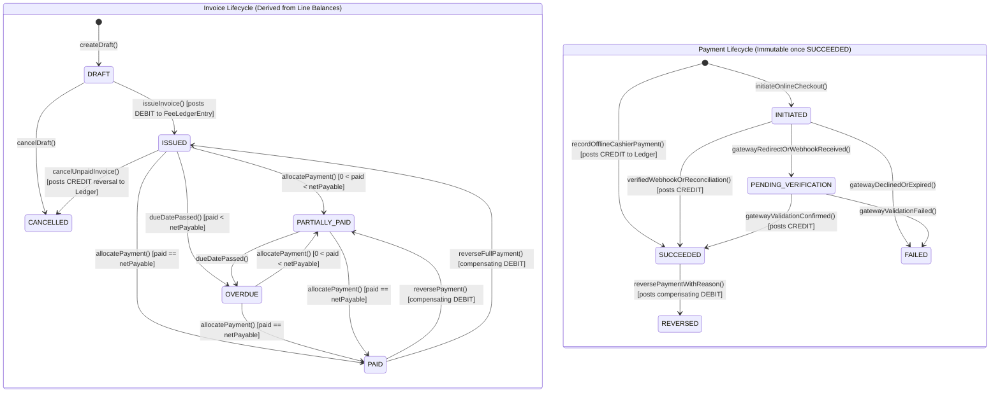

# M-05: Fees, Invoices, Immutable Ledger, Payment Gateways, and Reconciliation

| Field | Value |
|---|---|
| **ID** | `M-05` |
| **Title** | Fees, Invoices, Immutable Ledger, Payment Gateways, and Reconciliation |
| **Status** | `DONE` |
| **Priority** | `P0 (Highest Risk)` |
| **Depends On** | `F-04, F-05, F-07, F-09, F-10, M-01, M-03` |
| **Blocks** | `None` |
| **Estimated Effort** | `XL` |
| **Open Questions** | `Q-009, Q-010, Q-015, Q-023, Q-024` |
| **Revision** | `1` |

---

## 1. Summary and Business Value

`M-05` is the financial core of the ERP, managing fee structures, student scholarships/waivers, batch and individual invoicing, offline cashier collection, online payment gateways (SSLCommerz, bKash, Nagad, Sandbox), official QR-verified PDF receipts, and an append-only double-entry-style student fee ledger. Because financial errors directly damage trust between schools and parents, `M-05` enforces strict accounting invariants: **no single `paid` boolean flag**, `DECIMAL(12,2)` money precision with explicit ISO-4217 currency (`BDT`), mandatory idempotency keys on all payment and invoice-generation mutations, and immutable posted payments where corrections are only possible via formal reversal/refund ledger entries.

---

## 2. Scope and Explicit Non-Goals

### In Scope
- **Fee Configuration (`FeeHead`, `FeeStructure`, `FeeStructureLine`)**: Configurable fee heads (Tuition, Admission, Lab, Exam, Transport, Library) and session/class-scoped fee structures with billing frequency (`ONE_TIME`, `MONTHLY`, `QUARTERLY`, `SEMESTER`, `ANNUAL`) and late-fine rules.
- **Discounts, Scholarships & Waivers (`StudentDiscountWaiver`)**: Fixed-amount or percentage waivers assigned to a student enrollment (`M-03`), with configurable `SCHOOL_ADMIN` approval workflow (`Q-023`).
- **Invoices & Invoice Lines (`Invoice`, `InvoiceLine`, `Fine`)**: Batch and individual invoice generation (`DRAFT -> ISSUED -> PARTIALLY_PAID -> PAID -> OVERDUE -> CANCELLED`), deterministic line-level balance calculation, and automated late-fine assessment (`LateFineCalculatorStrategy`).
- **Payments, Allocations & Student Wallet (`Payment`, `PaymentAllocation`, `Refund`, `StudentWallet`)**: Partial or full payments allocated across invoice lines (`FINE -> ARREARS -> TUITION -> OTHER`), overpayment credit to `StudentWallet`, and formal refund/reversal workflow (`Q-010`, `Q-024`).
- **Append-Only Fee Ledger (`FeeLedgerEntry`)**: Immutable ledger recording every financial event (`INVOICE_ISSUED`, `WAIVER_APPLIED`, `FINE_ASSESSED`, `PAYMENT_RECEIVED`, `PAYMENT_REVERSED`, `WALLET_CREDITED`, `WALLET_APPLIED`, `REFUND_ISSUED`) as explicit `DEBIT` or `CREDIT` entries with running balance verification.
- **Online & Offline Payment Gateways (`PaymentGatewayStrategy`)**:
  - `OfflineCashierGateway` (Cash, Bank Deposit Slip, Cheque/PO/DD)
  - `SslCommerzGateway` (Bangladesh card/MFS aggregator)
  - `BkashGateway` (bKash Tokenized Checkout)
  - `NagadGateway` (Nagad Merchant Checkout)
  - `SandboxMockGateway` (Deterministic local/staging test gateway)
- **Webhook Verification & Reconciliation (`F-09`)**: Cryptographic HMAC/signature verification + IP/merchant validation on gateway callbacks, idempotent webhook processing, and a scheduled reconciliation job (`ReconcilePendingGatewayPaymentsJob`) that polls gateway query APIs for stuck `INITIATED`/`PENDING` transactions.
- **Official Printable Receipt PDF with QR Verification (`F-07`)**: Tamper-evident receipt PDF with public verification token (`Q-015`).
- **Automated Due & Overdue Reminders (`F-04`, `F-05`, `F-09`)**: Scheduled SMS/Email/In-App reminders before and after invoice due dates, plus collection, ledger, and defaulters/aging reports.

### Explicit Non-Goals
- **Full Corporate General Ledger (Chart of Accounts, Balance Sheet, Vendor AP, Staff Payroll)**: `M-05` is the **Student Accounts Receivable & Fee Sub-Ledger**. Full corporate double-entry accounting & payroll are Phase 2 modules.

---

## 3. Business Rules & Financial Invariants

- **BR-01 (No Single `paid` Flag Invariant)**: Neither `invoices` nor `invoice_lines` may contain a `paid BOOLEAN` column. An invoice's status and remaining balance are strictly derived from its line totals:
  $$\text{net\_payable} = \text{gross\_amount} - \text{discount\_amount} + \text{fine\_amount}$$
  $$\text{balance\_due} = \text{net\_payable} - \text{allocated\_paid\_amount}$$
  Status is `PAID` if and only if $\text{balance\_due} = 0.00$ across all lines, `PARTIALLY_PAID` if $0.00 < \text{allocated\_paid\_amount} < \text{net\_payable}$, and `ISSUED` (or `OVERDUE` past `due_date`) if $\text{allocated\_paid\_amount} = 0.00$.
- **BR-02 (Money Precision & Explicit Currency)**: Every monetary column in the database and `BigDecimal` field in Java uses `DECIMAL(12,2)` with `RoundingMode.HALF_UP` and an explicit 3-letter ISO-4217 currency code (`fees.currency`, default `BDT`). `float` and `double` are strictly forbidden `[ASSUMPTION -> Q-009]](../OPEN-QUESTIONS.md#q-009-supported-currencies--payment-gateways-at-launch-m-05)`.
- **BR-03 (Append-Only Ledger & Payment Immutability)**: Once a `Payment` transitions to `SUCCEEDED` or a `FeeLedgerEntry` is inserted, the row is **immutable** (cannot be updated or deleted). If a cashier enters a wrong amount or a cheque bounces, the accountant must execute `reversePayment(paymentId, reason)` which transitions the payment to `REVERSED`, un-allocates the invoice lines, re-opens the invoice status, and appends a compensating `DEBIT` (`PAYMENT_REVERSED`) entry to `fee_ledger_entries`.
- **BR-04 (Mandatory Idempotency Key)**: Every request to create an offline payment, initiate an online payment, process a gateway webhook, or run batch invoice generation must carry a unique `Idempotency-Key` (stored in `payment_idempotency_keys` or `payments.idempotency_key`). Replaying the same key with the same payload returns the original result without double-charging or double-posting.
- **BR-05 (Row-Level Locking on Invoice Allocation)**: Recording or allocating a payment acquires a pessimistic write lock (`SELECT ... FOR UPDATE`) on the target `Invoice` and `StudentWallet` rows inside a `@Transactional` boundary so concurrent cashier + online gateway payments for the same invoice serialize cleanly without race conditions.
- **BR-06 (Partial Payment & Deterministic Allocation Order)**: When `fees.allow_partial_payment = true`, a payment smaller than `balance_due` is allocated across unpaid `InvoiceLine` rows in deterministic priority order: `1. FINE -> 2. ARREARS -> 3. TUITION -> 4. OTHER` (ordered by `fee_heads.allocation_priority ASC, id ASC`) `[ASSUMPTION -> Q-010]](../OPEN-QUESTIONS.md#q-010-partial-payments-allocation-order--late-fines-m-05)`.
- **BR-07 (Overpayment & Refund Handling)**: If a payment exceeds the invoice's `balance_due`, the excess is credited to the student's `StudentWallet` (`WALLET_CREDITED`) and automatically applied (`WALLET_APPLIED`) to the next issued invoice, or refunded externally via `Refund` (`EXTERNAL_REFUND`) `[ASSUMPTION -> Q-024]](../OPEN-QUESTIONS.md#q-011--q-025-summary-defaults)`.
- **BR-08 (Waiver Approval Threshold)**: An `ACCOUNTANT` can create a `StudentDiscountWaiver`, but if the waiver amount or percentage exceeds `fees.waiver_auto_approve_limit` (default `0.00`), the waiver remains `PENDING_APPROVAL` until approved by `SCHOOL_ADMIN` `[ASSUMPTION -> Q-023]](../OPEN-QUESTIONS.md#q-011--q-025-summary-defaults)`.
- **BR-09 (Receipt Verification QR Code)**: Every `SUCCEEDED` payment generates a unique receipt number and an unguessable verification token verifiable at `/api/v1/public/verify/{tenantSlug}/{token}` via `F-07` `[ASSUMPTION -> Q-015]](../OPEN-QUESTIONS.md#q-011--q-025-summary-defaults)`.

---

## 4. Configurability

| Setting Key (`app_settings`) | Type | Default | Description & How Changed |
|---|---|---|---|
| `fees.currency` | `STRING` | `BDT` | Default 3-letter ISO-4217 currency code for fee structures, invoices, and receipts. |
| `fees.allow_partial_payment` | `BOOLEAN` | `true` | Allows guardians and cashiers to pay less than the full invoice balance. |
| `fees.invoice_number_prefix` | `STRING` | `INV-{YEAR}-{SEQ:6}` | Pattern for generated invoice numbers. |
| `fees.receipt_number_prefix` | `STRING` | `RCP-{YEAR}-{SEQ:6}` | Pattern for official payment receipt numbers. |
| `fees.waiver_auto_approve_limit` | `DECIMAL` | `0.00` | Maximum waiver amount an `ACCOUNTANT` can activate without `SCHOOL_ADMIN` approval. |
| `fees.due_reminder_days_before` | `INTEGER` | `3` | Days before `due_date` to send an automated due reminder notification (`F-04`/`F-09`). |
| `fees.overdue_reminder_days_after` | `STRING` | `1,7,15` | Comma-separated days after `due_date` to send overdue notifications. |
| `fees.online_gateways_enabled` | `JSON` | `["SSLCOMMERZ","BKASH","SANDBOX"]` | Active online payment gateways enabled for this school. Gateway credentials are encrypted via `F-03`. |

- **Feature Flag (`tenants.features_json`)**: `"fees": true` (enforced via `@RequiresFeature("fees")` and frontend `modules.ts`).
- **Strategy Interfaces**:
  - `PaymentGatewayStrategy`: Uniform SPI (`initiateCheckout()`, `verifyWebhookSignature()`, `parseWebhookPayload()`, `queryTransactionStatus()`) implemented by `OfflineCashierGateway`, `SslCommerzGateway`, `BkashGateway`, `NagadGateway`, and `SandboxMockGateway`.
  - `LateFineCalculatorStrategy`: Computes late fine on overdue invoices (`NONE`, `FLAT_ONCE`, `DAILY_FIXED`, `PERCENTAGE_WITH_CAP`).
  - `PaymentAllocationStrategy`: Allocates a payment amount across one or more invoices and `InvoiceLine` items according to `fee_heads.allocation_priority`.

---

## 5. Domain Model

### Entities & Value Objects
- **`FeeHead`**: `id`, `code` (`TUITION`, `ADMISSION`, `EXAM`, `TRANSPORT`, `FINE`, etc.), `name`, `category` (`FINE`, `ARREARS`, `TUITION`, `OTHER`), `allocationPriority` (`INT`, lower allocated first), `isRefundable`, `status`, `createdAt`, `updatedAt`, `deletedAt`.
- **`FeeStructure`**: `id`, `academicSessionId`, `campusId`, `classId`, `name`, `currency` (`CHAR(3)`), `lateFinePolicyType` (`NONE`, `FLAT_ONCE`, `DAILY_FIXED`, `PERCENTAGE_CAP`), `lateFineValue` (`DECIMAL(12,2)`), `lateFineCapAmount` (`DECIMAL(12,2)`), `lateFineGraceDays` (`INT`), `status`, `createdAt`, `updatedAt`, `deletedAt`.
- **`FeeStructureLine`**: `id`, `feeStructureId`, `feeHeadId`, `frequency` (`ONE_TIME`, `MONTHLY`, `QUARTERLY`, `SEMESTER`, `ANNUAL`), `amount` (`DECIMAL(12,2)`), `dueDayOfMonth` (`INT`), `isMandatory`.
- **`StudentDiscountWaiver`**: `id`, `enrollmentId`, `studentId`, `feeHeadId`, `title`, `discountType` (`FIXED_AMOUNT`, `PERCENTAGE`), `discountValue` (`DECIMAL(12,2)`), `status` (`PENDING_APPROVAL`, `ACTIVE`, `REJECTED`, `REVOKED`), `requestedByUserId`, `approvedByUserId`, `approvedAt`, `reason`, `createdAt`, `updatedAt`, `deletedAt`.
- **`Invoice`**: `id`, `invoiceNo`, `enrollmentId`, `studentId`, `academicSessionId`, `billingMonth` (`CHAR(7)`, e.g. `2026-03` or `NULL`), `issueDate`, `dueDate`, `currency`, `grossAmount` (`DECIMAL(12,2)`), `discountAmount` (`DECIMAL(12,2)`), `fineAmount` (`DECIMAL(12,2)`), `netPayableAmount` (`DECIMAL(12,2)`), `allocatedPaidAmount` (`DECIMAL(12,2)`), `balanceDueAmount` (`DECIMAL(12,2)`), `status` (`DRAFT`, `ISSUED`, `PARTIALLY_PAID`, `PAID`, `OVERDUE`, `CANCELLED`), `generationBatchKey`, `cancelledReason`, `createdByUserId`, `createdAt`, `updatedAt`, `deletedAt`.
- **`InvoiceLine`**: `id`, `invoiceId`, `feeHeadId`, `description`, `grossAmount` (`DECIMAL(12,2)`), `discountAmount` (`DECIMAL(12,2)`), `fineAmount` (`DECIMAL(12,2)`), `netPayableAmount` (`DECIMAL(12,2)`), `allocatedPaidAmount` (`DECIMAL(12,2)`), `balanceDueAmount` (`DECIMAL(12,2)`).
- **`Payment`**: `id`, `receiptNo`, `idempotencyKey`, `studentId`, `enrollmentId`, `gatewayCode` (`OFFLINE_CASH`, `OFFLINE_BANK`, `OFFLINE_CHEQUE`, `SSLCOMMERZ`, `BKASH`, `NAGAD`, `SANDBOX`), `gatewayTransactionId`, `currency`, `amount` (`DECIMAL(12,2)`), `status` (`INITIATED`, `PENDING_VERIFICATION`, `SUCCEEDED`, `FAILED`, `REVERSED`), `paidAt`, `collectedByUserId` (nullable for online), `verificationToken` (for QR receipt `F-07`), `reversalReason`, `reversedByUserId`, `reversedAt`, `rawGatewayPayloadJson`, `createdAt`, `updatedAt`.
- **`PaymentAllocation`**: `id`, `paymentId`, `invoiceId`, `invoiceLineId`, `allocatedAmount` (`DECIMAL(12,2)`), `status` (`ACTIVE`, `REVERSED`), `createdAt`.
- **`StudentWallet`**: `id`, `studentId`, `currency`, `balanceAmount` (`DECIMAL(12,2)`), `updatedAt`.
- **`Refund`**: `id`, `refundNo`, `studentId`, `paymentId` (nullable), `refundMethod` (`WALLET_CREDIT`, `EXTERNAL_CASH`, `EXTERNAL_BANK`), `currency`, `amount` (`DECIMAL(12,2)`), `reason`, `approvedByUserId`, `createdAt`.
- **`FeeLedgerEntry` (Append-Only)**: `id`, `studentId`, `enrollmentId`, `entryType` (`DEBIT`, `CREDIT`), `eventCategory` (`INVOICE_ISSUED`, `WAIVER_APPLIED`, `FINE_ASSESSED`, `PAYMENT_RECEIVED`, `PAYMENT_REVERSED`, `WALLET_CREDITED`, `WALLET_APPLIED`, `REFUND_ISSUED`, `INVOICE_CANCELLED`), `referenceType`, `referenceId`, `currency`, `amount` (`DECIMAL(12,2)`), `runningBalanceAfter` (`DECIMAL(12,2)`), `narration`, `actorUserId`, `createdAt`.

### Lifecycle State Machines



---

## 6. Database

- **Flyway Migration**: `backend/src/main/resources/db/tenant/V17__fees_invoices_payments_ledger.sql`
- **Money Precision**: All monetary columns use `DECIMAL(12,2)` with `currency CHAR(3) NOT NULL DEFAULT 'BDT'`.
- **Immutability Enforcement**: `fee_ledger_entries` has no `updated_at` and no `deleted_at`—it is strictly append-only.

```sql
-- V17__fees_invoices_payments_ledger.sql
-- Tenant schema migration for M-05: Fees, Invoices, Immutable Ledger, Payment Gateways, and Reconciliation

CREATE TABLE fee_number_sequences (
    sequence_key   VARCHAR(60)  NOT NULL,
    last_value     BIGINT       NOT NULL DEFAULT 0,
    updated_at     TIMESTAMP(6) NOT NULL DEFAULT CURRENT_TIMESTAMP(6) ON UPDATE CURRENT_TIMESTAMP(6),
    PRIMARY KEY (sequence_key)
) ENGINE=InnoDB DEFAULT CHARSET=utf8mb4;

CREATE TABLE fee_heads (
    id                   BIGINT        NOT NULL AUTO_INCREMENT,
    code                 VARCHAR(40)   NOT NULL,
    name                 VARCHAR(150)  NOT NULL,
    category             VARCHAR(30)   NOT NULL DEFAULT 'TUITION',
    allocation_priority  INT           NOT NULL DEFAULT 100,
    is_refundable        BOOLEAN       NOT NULL DEFAULT FALSE,
    status               VARCHAR(20)   NOT NULL DEFAULT 'ACTIVE',
    created_at           TIMESTAMP(6)  NOT NULL DEFAULT CURRENT_TIMESTAMP(6),
    updated_at           TIMESTAMP(6)  NOT NULL DEFAULT CURRENT_TIMESTAMP(6) ON UPDATE CURRENT_TIMESTAMP(6),
    deleted_at           TIMESTAMP(6)  NULL,
    PRIMARY KEY (id),
    UNIQUE KEY uk_fee_heads_code (code),
    KEY idx_fee_heads_priority (allocation_priority, status)
) ENGINE=InnoDB DEFAULT CHARSET=utf8mb4;

CREATE TABLE fee_structures (
    id                     BIGINT         NOT NULL AUTO_INCREMENT,
    academic_session_id    BIGINT         NOT NULL,
    campus_id              BIGINT         NOT NULL,
    class_id               BIGINT         NOT NULL,
    name                   VARCHAR(150)   NOT NULL,
    currency               CHAR(3)        NOT NULL DEFAULT 'BDT',
    late_fine_policy_type  VARCHAR(30)    NOT NULL DEFAULT 'NONE',
    late_fine_value        DECIMAL(12,2)  NOT NULL DEFAULT 0.00,
    late_fine_cap_amount   DECIMAL(12,2)  NOT NULL DEFAULT 0.00,
    late_fine_grace_days   INT            NOT NULL DEFAULT 0,
    status                 VARCHAR(20)    NOT NULL DEFAULT 'ACTIVE',
    created_at             TIMESTAMP(6)   NOT NULL DEFAULT CURRENT_TIMESTAMP(6),
    updated_at             TIMESTAMP(6)   NOT NULL DEFAULT CURRENT_TIMESTAMP(6) ON UPDATE CURRENT_TIMESTAMP(6),
    deleted_at             TIMESTAMP(6)   NULL,
    PRIMARY KEY (id),
    KEY idx_feestruct_session_class (academic_session_id, class_id, status),
    CONSTRAINT fk_feestruct_session FOREIGN KEY (academic_session_id) REFERENCES academic_sessions (id),
    CONSTRAINT fk_feestruct_campus  FOREIGN KEY (campus_id)           REFERENCES campuses (id),
    CONSTRAINT fk_feestruct_class   FOREIGN KEY (class_id)            REFERENCES academic_classes (id)
) ENGINE=InnoDB DEFAULT CHARSET=utf8mb4;

CREATE TABLE fee_structure_lines (
    id                 BIGINT         NOT NULL AUTO_INCREMENT,
    fee_structure_id   BIGINT         NOT NULL,
    fee_head_id        BIGINT         NOT NULL,
    frequency          VARCHAR(20)    NOT NULL DEFAULT 'MONTHLY',
    amount             DECIMAL(12,2)  NOT NULL,
    due_day_of_month   INT             NOT NULL DEFAULT 10,
    is_mandatory       BOOLEAN        NOT NULL DEFAULT TRUE,
    created_at         TIMESTAMP(6)   NOT NULL DEFAULT CURRENT_TIMESTAMP(6),
    PRIMARY KEY (id),
    UNIQUE KEY uk_feestruct_line_head (fee_structure_id, fee_head_id),
    CONSTRAINT fk_fsl_structure FOREIGN KEY (fee_structure_id) REFERENCES fee_structures (id),
    CONSTRAINT fk_fsl_head      FOREIGN KEY (fee_head_id)      REFERENCES fee_heads (id)
) ENGINE=InnoDB DEFAULT CHARSET=utf8mb4;

CREATE TABLE student_discount_waivers (
    id                    BIGINT         NOT NULL AUTO_INCREMENT,
    enrollment_id         BIGINT         NOT NULL,
    student_id            BIGINT         NOT NULL,
    fee_head_id           BIGINT         NOT NULL,
    title                 VARCHAR(150)   NOT NULL,
    discount_type         VARCHAR(20)    NOT NULL,
    discount_value        DECIMAL(12,2)  NOT NULL,
    currency              CHAR(3)        NOT NULL DEFAULT 'BDT',
    status                VARCHAR(25)    NOT NULL DEFAULT 'PENDING_APPROVAL',
    reason                VARCHAR(500)   NOT NULL,
    requested_by_user_id  BIGINT         NOT NULL,
    approved_by_user_id   BIGINT         NULL,
    approved_at           TIMESTAMP(6)   NULL,
    created_at            TIMESTAMP(6)   NOT NULL DEFAULT CURRENT_TIMESTAMP(6),
    updated_at            TIMESTAMP(6)   NOT NULL DEFAULT CURRENT_TIMESTAMP(6) ON UPDATE CURRENT_TIMESTAMP(6),
    deleted_at            TIMESTAMP(6)   NULL,
    PRIMARY KEY (id),
    KEY idx_waiver_enrollment (enrollment_id, status),
    KEY idx_waiver_student (student_id, status),
    CONSTRAINT fk_waiver_enrollment   FOREIGN KEY (enrollment_id)        REFERENCES enrollments (id),
    CONSTRAINT fk_waiver_student      FOREIGN KEY (student_id)           REFERENCES students (id),
    CONSTRAINT fk_waiver_head         FOREIGN KEY (fee_head_id)          REFERENCES fee_heads (id),
    CONSTRAINT fk_waiver_requested_by FOREIGN KEY (requested_by_user_id) REFERENCES users (id),
    CONSTRAINT fk_waiver_approved_by  FOREIGN KEY (approved_by_user_id)  REFERENCES users (id)
) ENGINE=InnoDB DEFAULT CHARSET=utf8mb4;

CREATE TABLE invoices (
    id                     BIGINT         NOT NULL AUTO_INCREMENT,
    invoice_no             VARCHAR(40)    NOT NULL,
    enrollment_id          BIGINT         NOT NULL,
    student_id             BIGINT         NOT NULL,
    academic_session_id    BIGINT         NOT NULL,
    billing_month          CHAR(7)        NULL,
    issue_date             DATE           NOT NULL,
    due_date               DATE           NOT NULL,
    currency               CHAR(3)        NOT NULL DEFAULT 'BDT',
    gross_amount           DECIMAL(12,2)  NOT NULL DEFAULT 0.00,
    discount_amount        DECIMAL(12,2)  NOT NULL DEFAULT 0.00,
    fine_amount            DECIMAL(12,2)  NOT NULL DEFAULT 0.00,
    net_payable_amount     DECIMAL(12,2)  NOT NULL DEFAULT 0.00,
    allocated_paid_amount  DECIMAL(12,2)  NOT NULL DEFAULT 0.00,
    balance_due_amount     DECIMAL(12,2)  NOT NULL DEFAULT 0.00,
    status                 VARCHAR(25)    NOT NULL DEFAULT 'DRAFT',
    generation_batch_key   VARCHAR(80)    NULL,
    cancelled_reason       VARCHAR(500)   NULL,
    created_by_user_id     BIGINT         NULL,
    created_at             TIMESTAMP(6)   NOT NULL DEFAULT CURRENT_TIMESTAMP(6),
    updated_at             TIMESTAMP(6)   NOT NULL DEFAULT CURRENT_TIMESTAMP(6) ON UPDATE CURRENT_TIMESTAMP(6),
    deleted_at             TIMESTAMP(6)   NULL,
    PRIMARY KEY (id),
    UNIQUE KEY uk_invoices_no (invoice_no),
    KEY idx_invoices_student_status (student_id, status),
    KEY idx_invoices_enrollment_month (enrollment_id, billing_month),
    KEY idx_invoices_session_status_due (academic_session_id, status, due_date),
    KEY idx_invoices_batch_key (generation_batch_key),
    CONSTRAINT fk_invoices_enrollment FOREIGN KEY (enrollment_id)       REFERENCES enrollments (id),
    CONSTRAINT fk_invoices_student    FOREIGN KEY (student_id)          REFERENCES students (id),
    CONSTRAINT fk_invoices_session    FOREIGN KEY (academic_session_id) REFERENCES academic_sessions (id),
    CONSTRAINT fk_invoices_created_by FOREIGN KEY (created_by_user_id)  REFERENCES users (id),
    CONSTRAINT chk_invoices_amounts   CHECK (net_payable_amount = gross_amount - discount_amount + fine_amount),
    CONSTRAINT chk_invoices_balance   CHECK (balance_due_amount = net_payable_amount - allocated_paid_amount AND balance_due_amount >= 0.00)
) ENGINE=InnoDB DEFAULT CHARSET=utf8mb4;

CREATE TABLE invoice_lines (
    id                     BIGINT         NOT NULL AUTO_INCREMENT,
    invoice_id             BIGINT         NOT NULL,
    fee_head_id            BIGINT         NOT NULL,
    description            VARCHAR(200)   NOT NULL,
    gross_amount           DECIMAL(12,2)  NOT NULL DEFAULT 0.00,
    discount_amount        DECIMAL(12,2)  NOT NULL DEFAULT 0.00,
    fine_amount            DECIMAL(12,2)  NOT NULL DEFAULT 0.00,
    net_payable_amount     DECIMAL(12,2)  NOT NULL DEFAULT 0.00,
    allocated_paid_amount  DECIMAL(12,2)  NOT NULL DEFAULT 0.00,
    balance_due_amount     DECIMAL(12,2)  NOT NULL DEFAULT 0.00,
    created_at             TIMESTAMP(6)   NOT NULL DEFAULT CURRENT_TIMESTAMP(6),
    updated_at             TIMESTAMP(6)   NOT NULL DEFAULT CURRENT_TIMESTAMP(6) ON UPDATE CURRENT_TIMESTAMP(6),
    PRIMARY KEY (id),
    KEY idx_invlines_invoice (invoice_id),
    KEY idx_invlines_head (fee_head_id),
    CONSTRAINT fk_invlines_invoice FOREIGN KEY (invoice_id)  REFERENCES invoices (id),
    CONSTRAINT fk_invlines_head    FOREIGN KEY (fee_head_id) REFERENCES fee_heads (id),
    CONSTRAINT chk_invlines_balance CHECK (balance_due_amount = net_payable_amount - allocated_paid_amount AND balance_due_amount >= 0.00)
) ENGINE=InnoDB DEFAULT CHARSET=utf8mb4;

CREATE TABLE payments (
    id                        BIGINT         NOT NULL AUTO_INCREMENT,
    receipt_no                VARCHAR(40)    NOT NULL,
    idempotency_key           VARCHAR(100)   NOT NULL,
    student_id                BIGINT         NOT NULL,
    enrollment_id             BIGINT         NOT NULL,
    gateway_code              VARCHAR(30)    NOT NULL,
    gateway_transaction_id    VARCHAR(120)   NULL,
    bank_or_cheque_ref        VARCHAR(120)   NULL,
    currency                  CHAR(3)        NOT NULL DEFAULT 'BDT',
    amount                    DECIMAL(12,2)  NOT NULL,
    status                    VARCHAR(30)    NOT NULL DEFAULT 'INITIATED',
    paid_at                   TIMESTAMP(6)   NULL,
    collected_by_user_id      BIGINT         NULL,
    verification_token        VARCHAR(80)    NOT NULL,
    reversal_reason           VARCHAR(500)   NULL,
    reversed_by_user_id       BIGINT         NULL,
    reversed_at               TIMESTAMP(6)   NULL,
    raw_gateway_payload_json  JSON           NULL,
    created_at                TIMESTAMP(6)   NOT NULL DEFAULT CURRENT_TIMESTAMP(6),
    updated_at                TIMESTAMP(6)   NOT NULL DEFAULT CURRENT_TIMESTAMP(6) ON UPDATE CURRENT_TIMESTAMP(6),
    PRIMARY KEY (id),
    UNIQUE KEY uk_payments_receipt_no (receipt_no),
    UNIQUE KEY uk_payments_idempotency (idempotency_key),
    UNIQUE KEY uk_payments_verification_token (verification_token),
    KEY idx_payments_student_status (student_id, status),
    KEY idx_payments_gateway_tx (gateway_code, gateway_transaction_id),
    KEY idx_payments_status_created (status, created_at),
    CONSTRAINT fk_payments_student      FOREIGN KEY (student_id)           REFERENCES students (id),
    CONSTRAINT fk_payments_enrollment   FOREIGN KEY (enrollment_id)        REFERENCES enrollments (id),
    CONSTRAINT fk_payments_collected_by FOREIGN KEY (collected_by_user_id) REFERENCES users (id),
    CONSTRAINT fk_payments_reversed_by  FOREIGN KEY (reversed_by_user_id)  REFERENCES users (id),
    CONSTRAINT chk_payments_positive    CHECK (amount > 0.00)
) ENGINE=InnoDB DEFAULT CHARSET=utf8mb4;

CREATE TABLE payment_allocations (
    id                BIGINT         NOT NULL AUTO_INCREMENT,
    payment_id        BIGINT         NOT NULL,
    invoice_id        BIGINT         NOT NULL,
    invoice_line_id   BIGINT         NOT NULL,
    allocated_amount  DECIMAL(12,2)  NOT NULL,
    status            VARCHAR(20)    NOT NULL DEFAULT 'ACTIVE',
    created_at        TIMESTAMP(6)   NOT NULL DEFAULT CURRENT_TIMESTAMP(6),
    updated_at        TIMESTAMP(6)   NOT NULL DEFAULT CURRENT_TIMESTAMP(6) ON UPDATE CURRENT_TIMESTAMP(6),
    PRIMARY KEY (id),
    KEY idx_payalloc_payment (payment_id),
    KEY idx_payalloc_invoice (invoice_id, status),
    KEY idx_payalloc_line (invoice_line_id, status),
    CONSTRAINT fk_payalloc_payment FOREIGN KEY (payment_id)      REFERENCES payments (id),
    CONSTRAINT fk_payalloc_invoice FOREIGN KEY (invoice_id)      REFERENCES invoices (id),
    CONSTRAINT fk_payalloc_line    FOREIGN KEY (invoice_line_id) REFERENCES invoice_lines (id),
    CONSTRAINT chk_payalloc_amount CHECK (allocated_amount > 0.00)
) ENGINE=InnoDB DEFAULT CHARSET=utf8mb4;

CREATE TABLE student_wallets (
    id              BIGINT         NOT NULL AUTO_INCREMENT,
    student_id      BIGINT         NOT NULL,
    currency        CHAR(3)        NOT NULL DEFAULT 'BDT',
    balance_amount  DECIMAL(12,2)  NOT NULL DEFAULT 0.00,
    updated_at      TIMESTAMP(6)   NOT NULL DEFAULT CURRENT_TIMESTAMP(6) ON UPDATE CURRENT_TIMESTAMP(6),
    PRIMARY KEY (id),
    UNIQUE KEY uk_student_wallet (student_id, currency),
    CONSTRAINT fk_wallet_student  FOREIGN KEY (student_id) REFERENCES students (id),
    CONSTRAINT chk_wallet_balance CHECK (balance_amount >= 0.00)
) ENGINE=InnoDB DEFAULT CHARSET=utf8mb4;

CREATE TABLE refunds (
    id                   BIGINT         NOT NULL AUTO_INCREMENT,
    refund_no            VARCHAR(40)    NOT NULL,
    idempotency_key      VARCHAR(100)   NOT NULL,
    student_id           BIGINT         NOT NULL,
    payment_id           BIGINT         NULL,
    refund_method        VARCHAR(30)    NOT NULL,
    currency             CHAR(3)        NOT NULL DEFAULT 'BDT',
    amount               DECIMAL(12,2)  NOT NULL,
    reason               VARCHAR(500)   NOT NULL,
    approved_by_user_id  BIGINT         NOT NULL,
    created_at           TIMESTAMP(6)   NOT NULL DEFAULT CURRENT_TIMESTAMP(6),
    PRIMARY KEY (id),
    UNIQUE KEY uk_refunds_no (refund_no),
    UNIQUE KEY uk_refunds_idempotency (idempotency_key),
    KEY idx_refunds_student (student_id),
    CONSTRAINT fk_refunds_student     FOREIGN KEY (student_id)          REFERENCES students (id),
    CONSTRAINT fk_refunds_payment     FOREIGN KEY (payment_id)          REFERENCES payments (id),
    CONSTRAINT fk_refunds_approved_by FOREIGN KEY (approved_by_user_id) REFERENCES users (id),
    CONSTRAINT chk_refunds_positive   CHECK (amount > 0.00)
) ENGINE=InnoDB DEFAULT CHARSET=utf8mb4;

-- Strictly append-only student fee sub-ledger (no updated_at, no deleted_at)
CREATE TABLE fee_ledger_entries (
    id                     BIGINT         NOT NULL AUTO_INCREMENT,
    student_id             BIGINT         NOT NULL,
    enrollment_id          BIGINT         NOT NULL,
    entry_type             VARCHAR(10)    NOT NULL,
    event_category         VARCHAR(40)    NOT NULL,
    reference_type         VARCHAR(40)    NOT NULL,
    reference_id           BIGINT         NOT NULL,
    currency               CHAR(3)        NOT NULL DEFAULT 'BDT',
    amount                 DECIMAL(12,2)  NOT NULL,
    running_balance_after  DECIMAL(12,2)  NOT NULL,
    narration              VARCHAR(500)   NOT NULL,
    actor_user_id          BIGINT         NULL,
    created_at             TIMESTAMP(6)   NOT NULL DEFAULT CURRENT_TIMESTAMP(6),
    PRIMARY KEY (id),
    KEY idx_ledger_student_created (student_id, id),
    KEY idx_ledger_enrollment (enrollment_id, id),
    KEY idx_ledger_ref (reference_type, reference_id),
    CONSTRAINT fk_ledger_student    FOREIGN KEY (student_id)    REFERENCES students (id),
    CONSTRAINT fk_ledger_enrollment FOREIGN KEY (enrollment_id) REFERENCES enrollments (id),
    CONSTRAINT fk_ledger_actor      FOREIGN KEY (actor_user_id) REFERENCES users (id),
    CONSTRAINT chk_ledger_type      CHECK (entry_type IN ('DEBIT', 'CREDIT')),
    CONSTRAINT chk_ledger_amount    CHECK (amount > 0.00)
) ENGINE=InnoDB DEFAULT CHARSET=utf8mb4;

INSERT INTO fee_heads (code, name, category, allocation_priority, is_refundable) VALUES
    ('FINE',      'Late Payment Fine', 'FINE',    10, FALSE),
    ('ARREARS',   'Previous Arrears',  'ARREARS', 20, FALSE),
    ('TUITION',   'Monthly Tuition',   'TUITION', 30, FALSE),
    ('ADMISSION', 'Admission Fee',     'OTHER',   40, FALSE),
    ('EXAM',      'Examination Fee',   'OTHER',   50, FALSE)
ON DUPLICATE KEY UPDATE name = VALUES(name);

INSERT INTO app_settings (setting_key, setting_value) VALUES
    ('fees.currency',                    'BDT'),
    ('fees.allow_partial_payment',       'true'),
    ('fees.invoice_number_prefix',       'INV-{YEAR}-{SEQ:6}'),
    ('fees.receipt_number_prefix',       'RCP-{YEAR}-{SEQ:6}'),
    ('fees.waiver_auto_approve_limit',   '0.00'),
    ('fees.due_reminder_days_before',    '3'),
    ('fees.overdue_reminder_days_after', '1,7,15'),
    ('fees.online_gateways_enabled',     '["SSLCOMMERZ","BKASH","SANDBOX"]')
ON DUPLICATE KEY UPDATE setting_value = VALUES(setting_value);
```

---

## 7. API

All endpoints are prefixed with `/api/v1` and gated by `@RequiresFeature("fees")`. Mutation endpoints for batch invoicing, payment creation, and refunds require the `Idempotency-Key` HTTP header.

| HTTP Method | Path | Request DTO | Response DTO | Permission | RBAC Scope |
|---|---|---|---|---|---|
| `GET` | `/api/v1/fees/heads` | — | `List<FeeHeadDto>` | `fee.read` | `ALL` |
| `POST` | `/api/v1/fees/heads` | `CreateFeeHeadRequest` | `FeeHeadDto` | `fee.config.write` | `ALL` |
| `GET` | `/api/v1/fees/structures` | Query: `sessionId`, `classId` | `List<FeeStructureDto>` | `fee.read` | `ALL` |
| `POST` | `/api/v1/fees/structures` | `CreateFeeStructureRequest` | `FeeStructureDto` | `fee.config.write` | `ALL` |
| `POST` | `/api/v1/fees/waivers` | `CreateStudentWaiverRequest` | `StudentWaiverDto` | `fee.waiver.request` | `ALL` |
| `POST` | `/api/v1/fees/waivers/{id}/approve` | `ReviewWaiverRequest` | `StudentWaiverDto` | `fee.waiver.approve` | `ALL` |
| `POST` | `/api/v1/fees/invoices/generate-batch` | `BatchGenerateInvoicesRequest` (`Idempotency-Key`) | `BatchInvoiceGenerationResultDto` | `fee.invoice.write` | `ALL` |
| `POST` | `/api/v1/fees/invoices` | `CreateSingleInvoiceRequest` (`Idempotency-Key`) | `InvoiceDetailDto` | `fee.invoice.write` | `ALL` |
| `GET` | `/api/v1/fees/invoices` | Query: `sessionId`, `classId`, `sectionId`, `studentId`, `status`, `billingMonth`, `page`, `size` | `PageResponse<InvoiceSummaryDto>` | `fee.invoice.read` | `ALL`, `OWN` |
| `GET` | `/api/v1/fees/invoices/{id}` | — | `InvoiceDetailDto` | `fee.invoice.read` | `ALL`, `OWN` |
| `POST` | `/api/v1/fees/invoices/{id}/cancel` | `CancelInvoiceRequest` (mandatory `reason`) | `InvoiceDetailDto` | `fee.invoice.cancel` | `ALL` |
| `POST` | `/api/v1/fees/payments/offline` | `RecordOfflinePaymentRequest` (`Idempotency-Key`) | `PaymentReceiptDto` | `fee.payment.collect` | `ALL` |
| `POST` | `/api/v1/fees/payments/online/initiate` | `InitiateOnlinePaymentRequest` (`Idempotency-Key`) | `OnlineCheckoutSessionDto` (redirect URL / token) | `fee.payment.online` | `ALL`, `OWN` |
| `POST` | `/api/v1/public/fees/webhooks/{tenantSlug}/{gatewayCode}` | Raw gateway payload + HMAC signature headers | `200 OK` (`WebhookAckDto`) | Public (HMAC + IP verified) | Tenant-bound |
| `POST` | `/api/v1/fees/payments/{paymentId}/reverse` | `ReversePaymentRequest` (mandatory `reversalReason`) | `PaymentReceiptDto` | `fee.payment.reverse` | `ALL` |
| `GET` | `/api/v1/fees/payments/{paymentId}/receipt.pdf` | — | `application/pdf` stream (`F-07`) | `fee.payment.read` | `ALL`, `OWN` |
| `POST` | `/api/v1/fees/refunds` | `CreateRefundRequest` (`Idempotency-Key`) | `RefundDto` | `fee.refund.approve` | `ALL` |
| `GET` | `/api/v1/fees/students/{studentId}/ledger` | Query: `sessionId`, `page`, `size` | `StudentFeeLedgerStatementDto` (entries + wallet + total due) | `fee.ledger.read` | `ALL`, `OWN` |
| `GET` | `/api/v1/fees/reports/collection-summary` | Query: `fromDate`, `toDate`, `gatewayCode`, `collectorUserId` | `FeeCollectionReportDto` | `fee.report.read` | `ALL` |
| `GET` | `/api/v1/fees/reports/defaulters` | Query: `sessionId`, `classId`, `sectionId`, `minOverdueDays`, `page`, `size` | `PageResponse<DefaulterStudentDto>` | `fee.report.read` | `ALL` |

---

## 8. Permissions to Seed and Default Role Grants

| Permission Code | Description | `SCHOOL_ADMIN` | `REGISTRAR` | `ACCOUNTANT` | `TEACHER` | `STUDENT` | `GUARDIAN` |
|---|---|---|---|---|---|---|---|
| `fee.read` | View fee heads and fee structures | Yes (`ALL`) | Yes (`ALL`) | Yes (`ALL`) | No | Yes (`OWN`) | Yes (`OWN`) |
| `fee.config.write` | Create and update fee heads and structures | Yes (`ALL`) | No | Yes (`ALL`) | No | No | No |
| `fee.waiver.request` | Propose student fee discount or scholarship | Yes (`ALL`) | No | Yes (`ALL`) | No | No | No |
| `fee.waiver.approve` | Approve student fee waivers above threshold | Yes (`ALL`) | No | No | No | No | No |
| `fee.invoice.read` | View student invoices and line breakdowns | Yes (`ALL`) | Yes (`ALL`) | Yes (`ALL`) | No | Yes (`OWN`) | Yes (`OWN`) |
| `fee.invoice.write` | Generate single or batch invoices | Yes (`ALL`) | No | Yes (`ALL`) | No | No | No |
| `fee.invoice.cancel` | Cancel an unpaid invoice with reason | Yes (`ALL`) | No | Yes (`ALL`) | No | No | No |
| `fee.payment.read` | View payments and download official receipt PDFs | Yes (`ALL`) | Yes (`ALL`) | Yes (`ALL`) | No | Yes (`OWN`) | Yes (`OWN`) |
| `fee.payment.collect` | Record offline cash/bank/cheque payments at counter | Yes (`ALL`) | No | Yes (`ALL`) | No | No | No |
| `fee.payment.online` | Initiate online payment checkout for student invoices | Yes (`ALL`) | No | Yes (`ALL`) | No | Yes (`OWN`) | Yes (`OWN`) |
| `fee.payment.reverse` | Reverse a posted payment with mandatory audit reason | Yes (`ALL`) | No | No | No | No | No |
| `fee.refund.approve` | Issue wallet or external refund | Yes (`ALL`) | No | No | No | No | No |
| `fee.ledger.read` | View immutable student fee ledger statement | Yes (`ALL`) | No | Yes (`ALL`) | No | Yes (`OWN`) | Yes (`OWN`) |
| `fee.report.read` | View daily collection, reconciliation, and defaulters reports | Yes (`ALL`) | No | Yes (`ALL`) | No | No | No |

---

## 9. Events and Notifications Emitted or Consumed

| Event Class / Name | Trigger | Payload Schema | Outbox Routing Key | Notification Channels |
|---|---|---|---|---|
| `InvoiceIssuedEvent` | Invoice transitions `DRAFT -> ISSUED` | `{ tenantSlug, invoiceId, invoiceNo, studentId, netPayableAmount, currency, dueDate, primaryGuardianId }` | `fees.invoice_issued` | `SMS`, `EMAIL`, `IN_APP` |
| `PaymentSucceededEvent` | Offline payment recorded or online webhook verified | `{ tenantSlug, paymentId, receiptNo, studentId, amount, currency, gatewayCode, verificationToken, remainingBalance }` | `fees.payment_succeeded` | `SMS`, `EMAIL`, `IN_APP` (includes receipt PDF link) |
| `PaymentReversedEvent` | Admin reverses a posted payment | `{ tenantSlug, paymentId, receiptNo, studentId, amount, currency, reversalReason, actorUserId }` | `fees.payment_reversed` | `SMS`, `EMAIL`, `IN_APP` |
| `InvoiceOverdueReminderEvent` | `AssessLateFinesAndOverdueRemindersJob` (`F-09`) detects overdue invoice | `{ tenantSlug, invoiceId, invoiceNo, studentId, balanceDueAmount, fineAmount, daysOverdue, primaryGuardianId }` | `fees.invoice_overdue` | `SMS`, `EMAIL`, `IN_APP` |
| `StudentEnrolledEvent` *(Consumed from `M-03`)* | Student enrolled in session | `{ tenantSlug, studentId, enrollmentId, academicSessionId, classId }` | Consumed | Optionally creates initial admission/first-month draft invoice if configured |

---

## 10. Tenancy and Security Considerations

- **Physical Isolation**: All financial tables (`invoices`, `payments`, `fee_ledger_entries`, etc.) reside exclusively inside each school's tenant database (`school_<slug>`).
- **Encrypted Gateway Credentials (`F-03`)**: School-specific SSLCommerz store passwords, bKash app secrets, and Nagad private keys are stored encrypted via `EncryptionService` (`F-03`) and never returned in plaintext by `/api/v1/settings`.
- **Webhook Security**:
  - Public webhook URL `/api/v1/public/fees/webhooks/{tenantSlug}/{gatewayCode}` explicitly binds `TenantContext.set(tenantSlug)` after validating the tenant is `ACTIVE`.
  - Verifies cryptographic signature / HMAC (`X-Signature` / SSLCommerz `verify_sign` + server-to-server order validation API call) before mutating any state.
  - Raw webhook JSON is persisted in `payments.raw_gateway_payload_json` for forensic auditability.
- **Mandatory Audit Log (`audit_log`)**: Every financial mutation (`FEE_STRUCTURE_CREATED`, `WAIVER_APPROVED`, `INVOICE_ISSUED`, `INVOICE_CANCELLED`, `PAYMENT_COLLECTED`, `PAYMENT_REVERSED`, `REFUND_ISSUED`) writes an immutable entry to `audit_log`.

---

## 11. Frontend

- **Feature Directory**: `frontend/src/features/fees/` (`api/`, `hooks/`, `components/`, `pages/`)
- **Module Registration (`frontend/src/app/modules.ts`)**:
  - Feature key: `fees`
  - Navigation items: **Fee Counter (POS)** (`/fees/counter`), **Invoices** (`/fees/invoices`), **Fee Structures & Waivers** (`/fees/structures`), **Collection & Defaulters Reports** (`/fees/reports`), **My Fees & Payments** (`/fees/my-statement` for Student/Guardian)
- **Routes & Pages**:
  - `/fees/counter`: `CashierCounterPage` (fast student lookup by `student_code`/phone/roll, shows unpaid invoices + line breakdown + wallet balance, collects cash/bank/cheque partial or full payment with auto-generated `Idempotency-Key`, and immediately opens printable QR Receipt PDF modal).
  - `/fees/invoices`: `InvoiceManagementPage` (Batch Invoice Generator modal by Session/Class/Month with dry-run preview, invoice list with status pills `ISSUED`, `PARTIALLY_PAID`, `PAID`, `OVERDUE`, `CANCELLED`).
  - `/fees/students/:studentId/ledger`: `StudentFeeLedgerPage` (chronological debit/credit statement table with running balance, payment history, and admin "Reverse Payment" modal).
  - `/fees/my-statement`: `GuardianFeePortalPage` (parent/student view of unpaid invoices, one-click **Pay Online** button launching SSLCommerz / bKash / Sandbox checkout, and downloadable PDF receipts).
  - `/fees/structures`: `FeeStructureAndWaiversPage` (manage Fee Heads, Class Fee Structures, Late Fine rules, and Student Scholarship/Waiver approvals).
  - `/fees/reports`: `FeeReportsPage` (Daily Cashier Collection Summary, Online Gateway Reconciliation status, and Class/Section Defaulters Aging list).
- **Required `en` and `bn` i18n Keys**:
  - `fees.nav.counter` (`"Fee Counter"` / `"ফি কাউন্টার"`)
  - `fees.nav.invoices` (`"Invoices"` / `"ইনভয়েস সমূহ"`)
  - `fees.nav.structures` (`"Fee Structures & Waivers"` / `"ফি কাঠামো ও মওকুফ"`)
  - `fees.nav.reports` (`"Collection Reports"` / `"আদায় প্রতিবেদন"`)
  - `fees.invoice.status.ISSUED` (`"Issued"` / `"ইস্যুকৃত"`)
  - `fees.invoice.status.PARTIALLY_PAID` (`"Partially Paid"` / `"আংশিক পরিশোধিত"`)
  - `fees.invoice.status.PAID` (`"Paid"` / `"পরিশোধিত"`)
  - `fees.invoice.status.OVERDUE` (`"Overdue"` / `"বকেয়া (সময় উত্তীর্ণ)"`)
  - `fees.payment.collectOffline` (`"Receive Payment"` / `"পেমেন্ট গ্রহণ করুন"`)
  - `fees.payment.payOnline` (`"Pay Online"` / `"অনলাইনে পরিশোধ করুন"`)
  - `fees.payment.downloadReceipt` (`"Download Receipt (PDF)"` / `"রসিদ ডাউনলোড করুন (পিডিএফ)"`)
  - `fees.ledger.debit` (`"Debit (Billed)"` / `"ডেবিট (ধার্য)"`)
  - `fees.ledger.credit` (`"Credit (Paid/Waived)"` / `"ক্রেডিট (জমা/মওকুফ)"`)

---

## 12. Test Plan (Including High-Risk Financial Property & Concurrency Tests)

- **Unit & Property-Based Financial Invariant Tests**:
  - `InvoiceBalanceInvariantPropertyTest`: Runs 500 randomized sequences of `issueInvoice`, `applyWaiver`, `assessLateFine`, `allocatePartialPayment`, `overpayToWallet`, and `reversePayment`, asserting after every operation that:
    1. `invoice.netPayableAmount == sum(lines.netPayableAmount)`
    2. `invoice.allocatedPaidAmount == sum(activeAllocations.allocatedAmount)`
    3. `invoice.balanceDueAmount == invoice.netPayableAmount - invoice.allocatedPaidAmount >= 0.00`
    4. Student's latest `FeeLedgerEntry.runningBalanceAfter == sum(DEBIT) - sum(CREDIT) == sum(openInvoices.balanceDue) - wallet.balanceAmount`.
  - `PaymentAllocationPriorityTest`: Verifies a partial payment of `1,500.00 BDT` against an invoice with `200.00 FINE`, `1,000.00 ARREARS`, and `2,000.00 TUITION` allocates `200.00` to `FINE`, `1,000.00` to `ARREARS`, and `300.00` to `TUITION`.
  - `LateFineCalculatorStrategyTest`: Tests `NONE`, `FLAT_ONCE`, `DAILY_FIXED`, and `PERCENTAGE_CAP` across grace-period boundaries and leap years.
- **Concurrency & Idempotency Integration Tests (Testcontainers MySQL)**:
  - `ConcurrentPaymentAllocationTest`: Spawns 10 concurrent threads attempting to pay the same `2,000.00 BDT` invoice (5 with identical `Idempotency-Key`, 5 with distinct keys for offline + online webhook). Verifies that:
    - The 5 identical idempotency requests create exactly 1 `Payment` row.
    - Across distinct payments, `SELECT ... FOR UPDATE` serializes allocation so the invoice never becomes over-allocated (`balance_due_amount` never goes negative) and any excess goes cleanly into `student_wallets`.
  - `WebhookReplayAndReconciliationIntegrationTest`: Delivers the same `SslCommerz` / `Bkash` webhook 3 times concurrently -> asserts only 1 `PaymentAllocation` and 1 `CREDIT` ledger entry are created; tests `ReconcilePendingGatewayPaymentsJob` recovering a payment whose webhook was dropped.
  - `PaymentReversalIntegrationTest`: Records a payment (`ISSUED -> PAID`), reverses it with reason, and verifies the invoice returns to `ISSUED`, allocations are marked `REVERSED`, and a compensating `DEBIT` row is appended to `fee_ledger_entries`.
- **Two-School Tenant Isolation Test (`FeesTenantIsolationTest`)**:
  - Issues invoices and collects payments in school `alpha`.
  - Queries `/api/v1/fees/invoices`, `/api/v1/fees/reports/collection-summary`, and posts a webhook to `/api/v1/public/fees/webhooks/beta/SANDBOX` referencing `alpha`'s transaction -> verifies `404` / zero cross-tenant data access.

---

## 13. Acceptance Criteria

- [ ] Accountant can define Fee Heads, Class Fee Structures, and Student Scholarships/Waivers (with `SCHOOL_ADMIN` approval when above threshold).
- [ ] Accountant can batch-generate monthly or session invoices for an entire class/section idempotently; duplicate clicks do not generate duplicate invoices.
- [ ] Cashier can collect full or partial payments (Cash/Bank/Cheque), automatically allocating across `FINE -> ARREARS -> TUITION`, crediting any overpayment to `StudentWallet`, and printing a QR-verified PDF receipt (`F-07`).
- [ ] Guardians can log in, view their child's unpaid invoice breakdown, complete an online payment via `SandboxMockGateway` / `SSLCommerz` / `bKash`, and immediately download the official PDF receipt.
- [ ] Posted payments and ledger entries cannot be edited or deleted; reversing a payment requires `SCHOOL_ADMIN` permission and a reason, creating a compensating `DEBIT` ledger entry and reopening the invoice balance.
- [ ] Student Fee Ledger displays a complete chronological `DEBIT`/`CREDIT` statement whose running balance matches the student's open invoice balance minus wallet credit to the exact paisa (`0.01 BDT`).

---

## 14. Implementation Slices

- [ ] **Slice 1**: Flyway migration `V17__fees_invoices_payments_ledger.sql`, domain entities (`FeeHead`, `FeeStructure`, `StudentDiscountWaiver`, `Invoice`, `InvoiceLine`, `Payment`, `PaymentAllocation`, `StudentWallet`, `Refund`, `FeeLedgerEntry`), and financial invariant unit + property tests.
- [ ] **Slice 2**: Fee Heads, Fee Structures, Waivers, and idempotent Single/Batch Invoice Generation APIs + append-only `FeeLedgerEntry` posting (`INVOICE_ISSUED`, `WAIVER_APPLIED`) + two-school tenant isolation test.
- [ ] **Slice 3**: Offline Cashier Payment collection (`SELECT ... FOR UPDATE` row locking, `PaymentAllocationStrategy`, `StudentWallet` overpayment handling), Payment Reversal workflow, Refunds, and QR Receipt PDF generation (`F-07`).
- [ ] **Slice 4**: `PaymentGatewayStrategy` (`SandboxMockGateway`, `SslCommerzGateway`, `BkashGateway`, `NagadGateway`), signed webhook endpoint, `ReconcilePendingGatewayPaymentsJob` (`F-09`), and `AssessLateFinesAndOverdueRemindersJob` (`F-09` + `F-04`) + concurrency tests.
- [ ] **Slice 5**: Collection/Defaulters reporting APIs + React frontend (`CashierCounterPage`, `InvoiceManagementPage`, `StudentFeeLedgerPage`, `GuardianFeePortalPage`, `FeeStructureAndWaiversPage`, `FeeReportsPage`, `en`/`bn` i18n keys).

---

## 15. Risks and Mitigations

| Risk | Impact | Concrete Mitigation |
|---|---|---|
| Double-charging or double-crediting when a parent clicks "Pay" twice or a payment gateway sends duplicate webhooks | Severe financial discrepancy and parent dispute | Enforce unique `uk_payments_idempotency` on `idempotency_key` and unique `(gateway_code, gateway_transaction_id)` check inside a pessimistic lock on the `Payment` row. |
| Race condition when cashier records offline payment at the exact moment an online webhook arrives for the same invoice | Invoice over-allocated (`allocated_paid_amount > net_payable_amount`) | Acquire `SELECT ... FOR UPDATE` on the `Invoice` and `StudentWallet` rows before computing allocations; any excess from the second payment automatically routes to `StudentWallet`. |
| Floating-point rounding drift across partial payments and percentage discounts | 0.01 BDT mismatch blocking invoice `PAID` status | Use `BigDecimal` with scale `2` (`RoundingMode.HALF_UP`) everywhere and enforce MySQL `CHECK` constraints (`chk_invoices_amounts`, `chk_invoices_balance`). |
| Unverified or spoofed webhook requests marking unpaid invoices as `PAID` | Financial fraud | Require HMAC/signature verification + server-to-server order validation query back to SSLCommerz/bKash API before transitioning payment to `SUCCEEDED`. |

---

## 16. How to Extend or Customize Later

- **Adding a New Payment Gateway (e.g., Stripe for International Schools or AamarPay)**: Implement `PaymentGatewayStrategy` (`getGatewayCode() = "STRIPE"`, `initiateCheckout()`, `verifyWebhookSignature()`, `queryTransactionStatus()`) and register it as a Spring `@Component`. Add `"STRIPE"` to the tenant's `fees.online_gateways_enabled` setting—zero changes to `Invoice`, `Payment`, or `FeeLedgerEntry` tables.
- **Adding Custom Transport / Hostel Slab Fees**: Add a `FeeCalculatorHook` that resolves a student's bus route distance or hostel room tier during `BatchGenerateInvoicesUseCase` and populates the corresponding `InvoiceLine` amount.

---

## 17. Revision History

| Revision | Date | Author | Changes |
|---|---|---|---|
| `1` | 2026-11-04 | Agent | Initial comprehensive plan for `M-05` Fees, Invoices, Immutable Ledger, Payment Gateways, and Reconciliation. |

