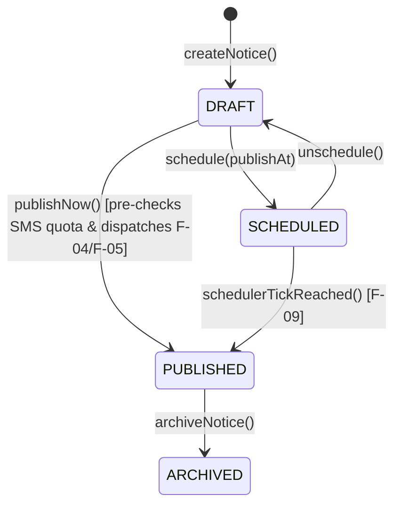

# M-06: Notice Board and Targeted School Communication

| Field | Value |
|---|---|
| **ID** | `M-06` |
| **Title** | Notice Board and Targeted School Communication |
| **Status** | `DONE` |
| **Priority** | `P1` |
| **Depends On** | `F-04, F-05, F-06, M-01, M-03` |
| **Blocks** | `None` |
| **Estimated Effort** | `M` |
| **Open Questions** | `Q-004, Q-025` |
| **Revision** | `1` |

---

## 1. Summary and Business Value

`M-06` provides a digital school notice board and targeted multi-channel broadcast system (`IN_APP`, `EMAIL`, `SMS`) for announcements, holiday circulars, exam schedules, and emergency alerts. It enables administrators and teachers to target notices precisely—to the whole school, specific campuses, departments, classes, sections, or roles (`TEACHER`, `STUDENT`, `GUARDIAN`)—while enforcing SMS plan quotas (`F-04`) and tracking read receipts per recipient.

---

## 2. Scope and Explicit Non-Goals

### In Scope
- **Notice Lifecycle (`Notice`)**: State machine (`DRAFT -> SCHEDULED -> PUBLISHED -> ARCHIVED`) with rich text/markdown content, priority level (`NORMAL`, `IMPORTANT`, `URGENT`), pin-to-top support, optional scheduled publish timestamp (`F-09`), and file/PDF attachments (`F-06`).
- **Granular Audience Targeting (`NoticeAudience`)**: A single notice can target `WHOLE_SCHOOL` or any combination of `CAMPUS`, `DEPARTMENT`, `CLASS`, `SECTION`, and `ROLE` (`TEACHER`, `STUDENT`, `GUARDIAN`, `STAFF`).
- **Role-Scoped Publishing Rules (`Q-025`)**: `SCHOOL_ADMIN` and `REGISTRAR` can publish across the whole school and trigger `SMS`/`EMAIL` broadcasts; `TEACHER` can publish `IN_APP` notices scoped only to their assigned `CLASS`/`SECTION` (`M-02`).
- **Multi-Channel Broadcast & Quota Pre-Check (`F-04`, `F-05`)**: Publishing a notice resolves the deduplicated recipient list, fans out `IN_APP` notifications (`F-05`), and—when `EMAIL` or `SMS` channels are selected—checks the school's remaining monthly SMS quota (`Q-004`) before queuing outbound messages via `F-04`.
- **Read Receipt Tracking (`NoticeReadReceipt`)**: Records when each authenticated user views/acknowledges a notice and provides delivery/read analytics (`totalTargetedUsers`, `inAppReadCount`, `smsSentCount`, `smsFailedCount`).

### Explicit Non-Goals
- **Two-Way Chat / Direct Messaging Between Parents and Teachers**: Real-time 1:1 chat is out of Phase 1 scope (`M-06` is one-way official school/class communication with read acknowledgement).
- **Public Website CMS**: `M-06` serves authenticated school users (and optionally a read-only public notice feed if `notices.public_feed_enabled=true`).

---

## 3. Business Rules

- **BR-01 (Notice Lifecycle Transitions)**: Notices start in `DRAFT`, can be scheduled (`SCHEDULED` with `publish_at > NOW()`) or immediately published (`PUBLISHED`), and later moved to `ARCHIVED`. Once `PUBLISHED`, changing audience targeting or re-triggering SMS is prohibited; content typo edits update `updated_at` and record an `audit_log` entry.
- **BR-02 (Teacher Scope Restriction & SMS Gate)**: A user with `TEACHER` role (without `notice.publish_school_wide` or `notice.broadcast_sms` permissions) may only create and publish `IN_APP` notices targeting `SECTION` or `CLASS` IDs to which they are actively assigned in `M-02`. Only users with `notice.broadcast_sms` (`SCHOOL_ADMIN` by default) can enable the `SMS` channel on a notice `[ASSUMPTION -> Q-025]](../OPEN-QUESTIONS.md#q-011--q-025-summary-defaults)`.
- **BR-03 (SMS Quota Pre-Flight Check)**: Before publishing a notice with `send_sms = TRUE`, `NoticeBroadcastService` calculates the deduplicated count of target recipient phone numbers ($N_{\text{sms}}$) and queries `SmsQuotaService` (`F-04`). If $N_{\text{sms}}$ exceeds the tenant's remaining monthly quota (`Q-004`), publishing with SMS is rejected with `422 Unprocessable Entity (SMS Quota Exceeded)` showing `{ requiredCredits, remainingCredits }` so the admin can either uncheck SMS or top up credits `[ASSUMPTION -> Q-004]](../OPEN-QUESTIONS.md#q-004-monthly-sms-quota--overage-handling-f-04-m-06)`.
- **BR-04 (Recipient Deduplication)**: If a guardian has 3 children enrolled in target sections of the same notice, the guardian receives **at most 1 SMS** and **1 In-App notification** per notice (deduplicated by `user_id` and `phone`).
- **BR-05 (Visibility Filtering)**: When a `STUDENT`, `GUARDIAN`, or `TEACHER` queries `/api/v1/notices/feed`, they only see `PUBLISHED` notices whose `notice_audiences` match at least one of:
  - `target_type = 'WHOLE_SCHOOL'`
  - Their role (`TEACHER`, `STUDENT`, `GUARDIAN`)
  - Their active `Enrollment` (`M-03`) or `TeacherSectionAssignment` (`M-02`) `campus_id`, `department_id`, `class_id`, or `section_id`.

---

## 4. Configurability

| Setting Key (`app_settings`) | Type | Default | Description & How Changed |
|---|---|---|---|
| `notices.allow_teacher_publish` | `BOOLEAN` | `true` | When `true`, teachers can publish `IN_APP` notices directly to their assigned sections; when `false`, teacher notices require `SCHOOL_ADMIN` approval. |
| `notices.sms_max_length_chars` | `INTEGER` | `320` | Maximum character length for the SMS summary text (`sms_body`) of a notice. |
| `notices.default_channels` | `JSON` | `["IN_APP"]` | Default selected delivery channels when composing a new notice. |
| `notices.public_feed_enabled` | `BOOLEAN` | `false` | Exposes notices explicitly marked `is_public = TRUE` on `/api/v1/public/notices`. |

- **Feature Flag (`tenants.features_json`)**: `"notices": true` (enforced via `@RequiresFeature("notices")` and frontend `modules.ts`).
- **Strategy Interfaces**:
  - `NoticeAudienceResolverStrategy`: Resolves target `NoticeAudience` rules into a deduplicated set of `(userId, email, phone, preferredLocale)` across `students`, `guardians`, and `staff`.

---

## 5. Domain Model

### Entities & Value Objects
- **`Notice`**: `id`, `title`, `bodyMarkdown`, `smsBody` (concise plain-text SMS version when `sendSms = true`), `category` (`GENERAL`, `ACADEMIC`, `EXAM`, `HOLIDAY`, `EVENT`, `EMERGENCY`), `priority` (`NORMAL`, `IMPORTANT`, `URGENT`), `isPinned`, `isPublic`, `sendInApp`, `sendEmail`, `sendSms`, `status` (`DRAFT`, `SCHEDULED`, `PUBLISHED`, `ARCHIVED`), `scheduledPublishAt` (nullable), `publishedAt` (nullable), `expiresAt` (nullable), `totalTargetedCount`, `authorUserId`, `publishedByUserId`, `createdAt`, `updatedAt`, `deletedAt`.
- **`NoticeAudience`**: `id`, `noticeId`, `targetType` (`WHOLE_SCHOOL`, `ROLE`, `CAMPUS`, `DEPARTMENT`, `CLASS`, `SECTION`), `targetRoleCode` (nullable: `TEACHER`, `STUDENT`, `GUARDIAN`, `STAFF`), `targetEntityId` (nullable: ID of campus, department, class, or section).
- **`NoticeAttachment`**: `id`, `noticeId`, `storedFileId` (FK to `F-06` `stored_files`), `displayName`, `createdAt`.
- **`NoticeReadReceipt`**: `id`, `noticeId`, `userId`, `readAt`.

### Lifecycle State Machine



---

## 6. Database

- **Flyway Migration**: `backend/src/main/resources/db/tenant/V16__notices_and_communication.sql`
- **Soft-Delete Strategy**: `notices` includes `deleted_at TIMESTAMP(6) NULL`.

```sql
-- V16__notices_and_communication.sql
-- Tenant schema migration for M-06: Notice Board and Targeted School Communication

CREATE TABLE notices (
    id                    BIGINT         NOT NULL AUTO_INCREMENT,
    title                 VARCHAR(250)   NOT NULL,
    body_markdown         TEXT           NOT NULL,
    sms_body              VARCHAR(500)   NULL,
    category              VARCHAR(30)    NOT NULL DEFAULT 'GENERAL',
    priority              VARCHAR(20)    NOT NULL DEFAULT 'NORMAL',
    is_pinned             BOOLEAN        NOT NULL DEFAULT FALSE,
    is_public             BOOLEAN        NOT NULL DEFAULT FALSE,
    send_in_app           BOOLEAN        NOT NULL DEFAULT TRUE,
    send_email            BOOLEAN        NOT NULL DEFAULT FALSE,
    send_sms              BOOLEAN        NOT NULL DEFAULT FALSE,
    status                VARCHAR(20)    NOT NULL DEFAULT 'DRAFT',
    scheduled_publish_at  TIMESTAMP(6)   NULL,
    published_at          TIMESTAMP(6)   NULL,
    expires_at            TIMESTAMP(6)   NULL,
    total_targeted_count  INT            NOT NULL DEFAULT 0,
    author_user_id        BIGINT         NOT NULL,
    published_by_user_id  BIGINT         NULL,
    created_at            TIMESTAMP(6)   NOT NULL DEFAULT CURRENT_TIMESTAMP(6),
    updated_at            TIMESTAMP(6)   NOT NULL DEFAULT CURRENT_TIMESTAMP(6) ON UPDATE CURRENT_TIMESTAMP(6),
    deleted_at            TIMESTAMP(6)   NULL,
    PRIMARY KEY (id),
    KEY idx_notices_status_pub (status, is_pinned, published_at),
    KEY idx_notices_scheduled (status, scheduled_publish_at),
    KEY idx_notices_category (category, status),
    CONSTRAINT fk_notices_author       FOREIGN KEY (author_user_id)       REFERENCES users (id),
    CONSTRAINT fk_notices_published_by FOREIGN KEY (published_by_user_id) REFERENCES users (id)
) ENGINE=InnoDB DEFAULT CHARSET=utf8mb4;

CREATE TABLE notice_audiences (
    id                BIGINT       NOT NULL AUTO_INCREMENT,
    notice_id         BIGINT       NOT NULL,
    target_type       VARCHAR(30)  NOT NULL,
    target_role_code  VARCHAR(60)  NULL,
    target_entity_id  BIGINT       NULL,
    created_at        TIMESTAMP(6) NOT NULL DEFAULT CURRENT_TIMESTAMP(6),
    PRIMARY KEY (id),
    KEY idx_notice_aud_notice (notice_id),
    KEY idx_notice_aud_lookup (target_type, target_entity_id, target_role_code),
    CONSTRAINT fk_notice_aud_notice FOREIGN KEY (notice_id) REFERENCES notices (id)
) ENGINE=InnoDB DEFAULT CHARSET=utf8mb4;

CREATE TABLE notice_attachments (
    id              BIGINT        NOT NULL AUTO_INCREMENT,
    notice_id       BIGINT        NOT NULL,
    stored_file_id  BIGINT        NOT NULL,
    display_name    VARCHAR(200)  NOT NULL,
    created_at      TIMESTAMP(6)  NOT NULL DEFAULT CURRENT_TIMESTAMP(6),
    PRIMARY KEY (id),
    KEY idx_notice_att_notice (notice_id),
    CONSTRAINT fk_notice_att_notice FOREIGN KEY (notice_id)      REFERENCES notices (id),
    CONSTRAINT fk_notice_att_file   FOREIGN KEY (stored_file_id) REFERENCES stored_files (id)
) ENGINE=InnoDB DEFAULT CHARSET=utf8mb4;

CREATE TABLE notice_read_receipts (
    id          BIGINT       NOT NULL AUTO_INCREMENT,
    notice_id   BIGINT       NOT NULL,
    user_id     BIGINT       NOT NULL,
    read_at     TIMESTAMP(6) NOT NULL DEFAULT CURRENT_TIMESTAMP(6),
    PRIMARY KEY (id),
    UNIQUE KEY uk_notice_read_user (notice_id, user_id),
    KEY idx_notice_read_user_time (user_id, read_at),
    CONSTRAINT fk_nrr_notice FOREIGN KEY (notice_id) REFERENCES notices (id),
    CONSTRAINT fk_nrr_user   FOREIGN KEY (user_id)   REFERENCES users (id)
) ENGINE=InnoDB DEFAULT CHARSET=utf8mb4;

INSERT INTO app_settings (setting_key, setting_value) VALUES
    ('notices.allow_teacher_publish', 'true'),
    ('notices.sms_max_length_chars',  '320'),
    ('notices.default_channels',      '["IN_APP"]'),
    ('notices.public_feed_enabled',   'false')
ON DUPLICATE KEY UPDATE setting_value = VALUES(setting_value);
```

---

## 7. API

All endpoints are prefixed with `/api/v1` and gated by `@RequiresFeature("notices")`.

| HTTP Method | Path | Request DTO | Response DTO | Permission | RBAC Scope |
|---|---|---|---|---|---|
| `POST` | `/api/v1/notices` | `CreateNoticeRequest` | `NoticeDetailDto` | `notice.write` | `ALL`, `DEPARTMENT`, `CLASS`, `SECTION` |
| `PUT` | `/api/v1/notices/{id}` | `UpdateNoticeRequest` | `NoticeDetailDto` | `notice.write` | `ALL`, `DEPARTMENT`, `CLASS`, `SECTION` |
| `POST` | `/api/v1/notices/{id}/audience-preview` | — | `AudiencePreviewDto` (`recipientCount`, `smsCount`, `remainingSmsQuota`) | `notice.write` | `ALL`, `DEPARTMENT`, `CLASS`, `SECTION` |
| `POST` | `/api/v1/notices/{id}/publish` | `PublishNoticeRequest` (now or `scheduledPublishAt`) | `NoticeDetailDto` | `notice.publish` (`+ notice.broadcast_sms` if `sendSms=true`) | `ALL`, `DEPARTMENT`, `CLASS`, `SECTION` |
| `POST` | `/api/v1/notices/{id}/archive` | — | `NoticeDetailDto` | `notice.write` | `ALL`, `SECTION` |
| `GET` | `/api/v1/notices` | Query: `status`, `category`, `q`, `page`, `size` (Admin/Teacher management list) | `PageResponse<NoticeAdminSummaryDto>` | `notice.manage.read` | `ALL`, `DEPARTMENT`, `CLASS`, `SECTION` |
| `GET` | `/api/v1/notices/feed` | Query: `category`, `unreadOnly`, `page`, `size` (Recipient-scoped feed) | `PageResponse<NoticeFeedItemDto>` | `notice.feed.read` | `ALL`, `OWN` |
| `GET` | `/api/v1/notices/{id}` | — | `NoticeDetailDto` | `notice.feed.read` | `ALL`, `OWN` |
| `POST` | `/api/v1/notices/{id}/read` | — | `204 No Content` | `notice.feed.read` | `ALL`, `OWN` |
| `GET` | `/api/v1/notices/{id}/stats` | — | `NoticeDeliveryStatsDto` (`targeted`, `readCount`, `smsSent`, `smsFailed`) | `notice.manage.read` | `ALL`, `SECTION` |

---

## 8. Permissions to Seed and Default Role Grants

| Permission Code | Description | `SCHOOL_ADMIN` | `REGISTRAR` | `ACCOUNTANT` | `TEACHER` | `STUDENT` | `GUARDIAN` |
|---|---|---|---|---|---|---|---|
| `notice.feed.read` | View published notices targeted to the user and mark as read | Yes (`ALL`) | Yes (`ALL`) | Yes (`ALL`) | Yes (`OWN`) | Yes (`OWN`) | Yes (`OWN`) |
| `notice.manage.read` | View notice management list and delivery/read statistics | Yes (`ALL`) | Yes (`ALL`) | No | Yes (`SECTION`) | No | No |
| `notice.write` | Create and edit draft notices | Yes (`ALL`) | Yes (`ALL`) | No | Yes (`SECTION`) | No | No |
| `notice.publish` | Publish or schedule notices to assigned scope | Yes (`ALL`) | Yes (`ALL`) | No | Yes (`SECTION`) | No | No |
| `notice.publish_school_wide` | Target notices to `WHOLE_SCHOOL` or arbitrary classes/roles | Yes (`ALL`) | Yes (`ALL`) | No | No | No | No |
| `notice.broadcast_sms` | Enable SMS broadcast channel when publishing a notice | Yes (`ALL`) | No | No | No | No | No |

---

## 9. Events and Notifications Emitted or Consumed

| Event Class / Name | Trigger | Payload Schema | Outbox Routing Key | Notification Channels |
|---|---|---|---|---|
| `NoticePublishedEvent` | Notice transitions to `PUBLISHED` (immediately or via `F-09` scheduled job) | `{ tenantSlug, noticeId, title, category, priority, sendInApp, sendEmail, sendSms, smsBody, authorUserId }` | `notice.published` | Consumed by `NoticeBroadcastWorker` to fan out `F-05` In-App notifications and `F-04` Email/SMS batches |

---

## 10. Tenancy and Security Considerations

- **Physical Isolation**: `notices`, `notice_audiences`, `notice_attachments`, and `notice_read_receipts` live strictly inside each school's database.
- **Audience Authorization Check**: If a user lacks `notice.publish_school_wide`, the backend verifies that every `NoticeAudience` item has `targetType = 'SECTION'` and `targetEntityId` in the teacher's assigned sections (`M-02`), and rejects `sendSms = true` unless the user holds `notice.broadcast_sms`.
- **Markdown/HTML Sanitization**: `body_markdown` is sanitized on both backend and frontend (DOMPurify / safe Markdown renderer) to prevent stored XSS.
- **Audit Log (`audit_log`)**: Logs `NOTICE_PUBLISHED`, `NOTICE_SMS_BROADCAST_QUEUED` (with recipient count), and `NOTICE_ARCHIVED`.

---

## 11. Frontend

- **Feature Directory**: `frontend/src/features/notices/` (`api/`, `hooks/`, `components/`, `pages/`)
- **Module Registration (`frontend/src/app/modules.ts`)**:
  - Feature key: `notices`
  - Navigation items: **Notice Board** (`/notices`), **Manage Notices** (`/notices/manage` for Admin/Registrar/Teacher)
- **Routes & Pages**:
  - `/notices`: `NoticeBoardFeedPage` (pinned notices banner at top, category filter chips `ALL`, `ACADEMIC`, `EXAM`, `HOLIDAY`, `EMERGENCY`, unread indicator dot, attachment download links via `F-06`, automatic read-receipt ping on open).
  - `/notices/manage`: `NoticeManagementPage` (list of `DRAFT`, `SCHEDULED`, `PUBLISHED`, `ARCHIVED` notices with read/SMS delivery progress bars).
  - `/notices/manage/new` & `/notices/manage/:id/edit`: `NoticeComposerPage`
    - Audience selector builder (`Whole School` or multi-select `Campuses`, `Classes`, `Sections`, `Roles`).
    - Channel toggles (`In-App`, `Email`, `SMS`) with live **Audience & SMS Quota Preview** card (`"Targets 412 guardians • Uses 412 / 3,200 remaining SMS credits"`).
    - Attachment uploader (`F-06`) and Publish Now / Schedule picker.
- **Required `en` and `bn` i18n Keys**:
  - `notices.nav.board` (`"Notice Board"` / `"নোটিশ বোর্ড"`)
  - `notices.nav.manage` (`"Manage Notices"` / `"নোটিশ ব্যবস্থাপনা"`)
  - `notices.category.GENERAL` (`"General"` / `"সাধারণ"`)
  - `notices.category.ACADEMIC` (`"Academic"` / `"একাডেমিক"`)
  - `notices.category.EXAM` (`"Exam"` / `"পরীক্ষা"`)
  - `notices.category.HOLIDAY` (`"Holiday"` / `"ছুটি"`)
  - `notices.category.EMERGENCY` (`"Emergency"` / `"জরুরি"`)
  - `notices.priority.URGENT` (`"Urgent"` / `"অতি জরুরি"`)
  - `notices.composer.audiencePreview` (`"Estimated Recipients & SMS Credits"` / `"আনুমানিক প্রাপক ও এসএমএস ক্রেডিট"`)
  - `notices.status.PUBLISHED` (`"Published"` / `"প্রকাশিত"`)
  - `notices.status.SCHEDULED` (`"Scheduled"` / `"নির্ধারিত"`)

---

## 12. Test Plan

- **Unit Tests**:
  - `NoticeAudienceResolverTest`: Verifies deduplication when a guardian has multiple children in targeted sections (1 SMS, 1 in-app notification).
  - `NoticePermissionValidatorTest`: Verifies that a `TEACHER` cannot target `WHOLE_SCHOOL`, cannot target another teacher's section, and cannot set `sendSms = true`.
- **Integration Tests (Testcontainers MySQL)**:
  - `NoticePublishAndFeedVisibilityIntegrationTest`: Publishes 3 notices (`WHOLE_SCHOOL`, `Class 9 Only`, `Section 9-A Guardians Only`), queries `/api/v1/notices/feed` as a Class 9-A Guardian, Class 9-B Student, and Class 8 Student, and asserts each user sees only the notices matching their scope.
  - `NoticeSmsQuotaEnforcementTest`: Sets school remaining SMS quota to `5`, attempts to publish an SMS notice targeting `20` guardians -> asserts `422 Unprocessable Entity` and verifies notice stays in `DRAFT`.
  - `ScheduledNoticePublishJobTest`: Creates a `SCHEDULED` notice with `scheduled_publish_at` in the past, runs the `F-09` scheduled job, and verifies transition to `PUBLISHED` and outbox event emission.
- **Two-School Tenant Isolation Test (`NoticeTenantIsolationTest`)**:
  - Publishes a `WHOLE_SCHOOL` notice in school `alpha`.
  - Queries `/api/v1/notices/feed` and `/api/v1/notices` under school `beta` -> verifies zero notices returned.

---

## 13. Acceptance Criteria

- [ ] `SCHOOL_ADMIN` can compose a notice with PDF/image attachments (`F-06`), target specific classes/sections/roles or the whole school, preview the exact recipient and SMS credit count, and publish immediately or schedule for a future time.
- [ ] Publishing an SMS notice when the school's monthly SMS quota (`F-04`) is insufficient returns a clear `422` quota error before sending any messages.
- [ ] `TEACHER` can publish `IN_APP` notices only to their assigned sections and cannot trigger SMS broadcasts.
- [ ] Guardians with multiple children in the same school receive only one deduplicated SMS/notification per notice.
- [ ] Opening a notice in the portal records a `NoticeReadReceipt` and updates the notice's read counter for administrators.

---

## 14. Implementation Slices

- [ ] **Slice 1**: Flyway migration `V16__notices_and_communication.sql`, JPA entities (`Notice`, `NoticeAudience`, `NoticeAttachment`, `NoticeReadReceipt`), and `NoticeAudienceResolverStrategy` unit tests.
- [ ] **Slice 2**: Notice CRUD, audience preview, and scoped feed query APIs (`/api/v1/notices/feed`) with read-receipt recording and two-school tenant isolation tests.
- [ ] **Slice 3**: Notice publishing workflow (`DRAFT -> SCHEDULED -> PUBLISHED`), teacher scope & SMS quota enforcement (`F-04`), scheduled notice publisher job (`F-09`), and outbox fan-out (`F-04`/`F-05`).
- [ ] **Slice 4**: React frontend (`NoticeBoardFeedPage`, `NoticeManagementPage`, `NoticeComposerPage` with live SMS quota preview, `en`/`bn` i18n keys) and build verification.

---

## 15. Risks and Mitigations

| Risk | Impact | Concrete Mitigation |
|---|---|---|
| Accidental whole-school SMS blast exhausting the school's monthly SMS budget in one click | High cost and blocked transactional notifications | Restrict `notice.broadcast_sms` to `SCHOOL_ADMIN`, show a mandatory confirmation modal with exact SMS credit count (`/audience-preview`), and enforce hard quota check (`Q-004`). |
| Synchronous SMS sending blocking the HTTP `/publish` request for thousands of parents | HTTP timeout and partial delivery | `/publish` only writes `NoticePublishedEvent` to `outbox_events` (`F-04`/`F-05`); background workers dispatch SMS/email asynchronously in batches. |
| Stored XSS via notice body | Session hijacking | Sanitize Markdown/HTML and enforce strict Content Security Policy (CSP). |

---

## 16. How to Extend or Customize Later

- **Adding Push Notifications (Firebase Cloud Messaging / Web Push)**: Subscribe a `PushNotificationChannelAdapter` in `F-05` to `NoticePublishedEvent`—existing `NoticeAudienceResolverStrategy` already resolves target `userId`s without changing `M-06`.
- **Adding Parent Acknowledgement / Consent Slips (e.g., Field Trip Permission)**: Add an optional `requires_acknowledgement BOOLEAN` and `response_choice VARCHAR(20)` column to `notice_read_receipts` so parents can click "I Consent / Acknowledge".

---

## 17. Revision History

| Revision | Date | Author | Changes |
|---|---|---|---|
| `1` | 2026-11-04 | Agent | Initial comprehensive plan for `M-06` Notice Board and Targeted School Communication. |

